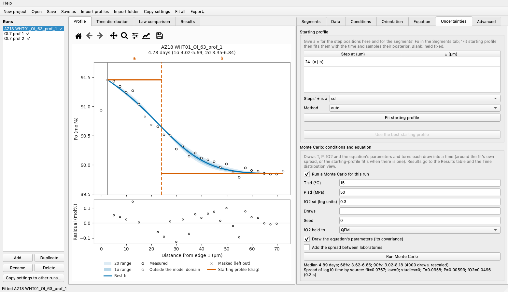
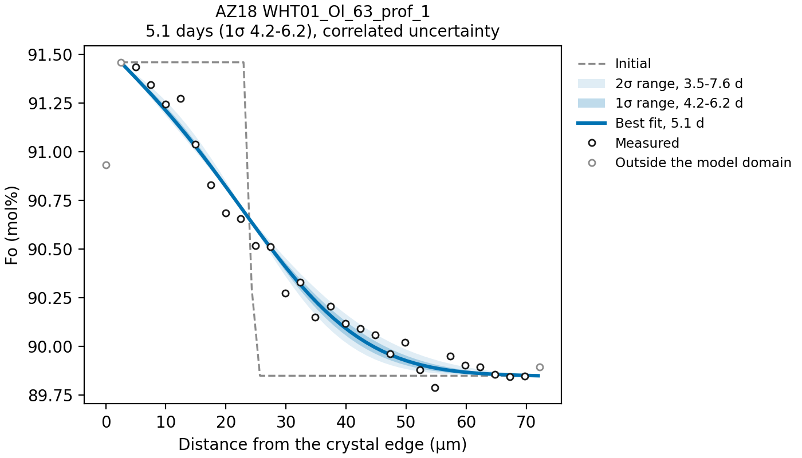

# FORSTER

**F**itting **O**livine **R**esidence & **S**torage **T**imescales from **E**lemental **R**elaxation.

[](https://github.com/whtowbin/Olivine_Diffusion_FeMg/actions/workflows/tests.yml) [](https://forster.readthedocs.io)

Olivine that grows in a changing magma records the change as zoning: a rim with a different forsterite content (Fo) from its core. While the crystal sits in hot magma, Fe and Mg exchange across that boundary and the sharp step relaxes into a smooth profile. The wider the profile, the longer the crystal stayed hot. FORSTER estimates that time by fitting a model of Fe-Mg diffusion to Fo profiles measured across zoned olivine.

You give it the measured profile, the temperature, pressure and oxygen fugacity, the profile's direction in the crystal, and a step-shaped starting profile (your estimate of the zoning before diffusion began). It reports the best-fit time with 1σ and 2σ ranges. It can also fit the starting profile itself, and carry the uncertainty in the conditions and in the diffusion equation into the time.



**Full documentation: [forster.readthedocs.io](https://forster.readthedocs.io)** (a user guide with the method, every table column and the Python API).

## Install

Python 3.11 or newer. Until the first release on PyPI, install from GitHub:

``` bash
uv tool install "forster[gui,fast] @ git+https://github.com/whtowbin/Olivine_Diffusion_FeMg"
# or
pip install "forster[gui,fast] @ git+https://github.com/whtowbin/Olivine_Diffusion_FeMg"
```

`gui` adds the desktop app (Qt), `fast` adds Numba (fits about 5x faster). After the release: `pip install "forster[gui,fast]"`.

## Use it

**Command line**, with two filled-in tables:

``` bash
forster template my_fit/          # profiles.csv, parameters.csv, diffusivities.csv and COLUMNS.md, with a worked example
forster fit my_fit/profiles.csv my_fit/parameters.csv --out my_fit/results
```

The worked example (a published melt-vein olivine profile) prints `5.14 days (4.24-6.21)` and writes a summary table and a figure for each run:



**Your own spreadsheets**: `forster import data.xlsx` proposes a column mapping (profile, distance, Fo or MgO and FeO, totals) for you to check, then writes the profiles table.

**Desktop app**: `forster gui` opens a project folder: draw the starting profile with the mouse, fit, fit the starting profile, run the Monte Carlo, and export.

**Python**:

``` python
import forster

runs = forster.read_runs("my_fit/parameters.csv")
profiles = forster.read_profiles("my_fit/profiles.csv")
result = forster.fit_run(runs[0], profiles)
print(result.time_days, result.time_range_days())
```

## What it does

-   Implicit finite-difference model of Fe-Mg interdiffusion with a diffusivity that depends on Fo, temperature, pressure, oxygen fugacity and crystal direction; four named diffusion equations (Dohmen and Chakraborty 2007 as tabulated in the program DIPRA, FORSTER's 2026 refit, and the two equations of Mutch et al. 2019, used in their program DFENS).
-   Ranges from a noise model that allows for smooth misfit between model and data, with checks that warn when the range is probably too narrow (misfit concentrated near a step, a profile that ends before its plateau).
-   Starting profiles of any number of segments, fitted with their uncertainties by optimization and importance sampling; growth stages; a Monte Carlo over the conditions and the diffusion equation; joint fits of several profiles of one crystal (Python).

## Development

``` bash
git clone https://github.com/whtowbin/Olivine_Diffusion_FeMg.git
cd Olivine_Diffusion_FeMg
uv sync
uv run pytest -n 4
uv run --group docs mkdocs serve      # the documentation site, locally
```

Some tests use other laboratories' unpublished profiles, kept in a private submodule (`Diffusion Round Robin`); without access those tests skip. Changes are listed in [CHANGELOG.md](https://github.com/whtowbin/Olivine_Diffusion_FeMg/blob/master/CHANGELOG.md); releases follow [docs/releasing.md](https://github.com/whtowbin/Olivine_Diffusion_FeMg/blob/master/docs/releasing.md).

## Development history

FORSTER grew out of code Henry Towbin wrote from about 2020, with early contributions from Jollands and Shi. That code produced the timescales in Towbin and Plank (2026) and chapter 2 of Towbin (2023). From October 2026 the code was restructured and extended with Anthropic's Claude (Claude Code; mainly Claude Opus 5.5, with Claude Sonnet and Haiku for delegated tasks). This included the package structure, the command line and desktop app, the correlated-noise uncertainty method, the starting-profile fit, the tests and most of the documentation text. Henry Towbin directed the work, made the scientific and design decisions (recorded in docs/plans/) and reviewed the results. Changes meant to leave results unchanged were checked by replaying every existing fit through the old and new code; new methods were checked against synthetic profiles of known age and against the published profiles. Commits written with Claude say so in their messages. The early version of this code used to fit the olivine profiles in Towbin and Plank (2026) is tagged `paper-jpet-2026`, and the paper's scripts are archived at https://github.com/whtowbin/Xenolith_Melt_Vein_Modeling.

## Citing

`forster cite` prints how to cite FORSTER (add `--diffusivity NAME` for the equation you used), the app's Help menu has "Cite FORSTER…", and GitHub's "Cite this repository" button uses [CITATION.cff](https://github.com/whtowbin/Olivine_Diffusion_FeMg/blob/master/CITATION.cff).

Please cite the software and the paper that describes the method:

-   FORSTER (this software): Towbin, W. H. FORSTER: Fitting Olivine Residence & Storage Timescales from Elemental Relaxation (version from `forster --version`). https://github.com/whtowbin/Olivine_Diffusion_FeMg. A DOI will be added after the first release.
-   Towbin, W. H., and Plank, T. (2026). Decompression Melting of Peridotite Xenoliths. Journal of Petrology 67(9), egag077, doi:10.1093/petrology/egag077.

Please also cite the diffusion equation you used:

-   the default (`dipra`): Dohmen, R. and Chakraborty, S. (2007), Physics and Chemistry of Minerals 34, 409-430, doi:10.1007/s00269-007-0158-6, and their erratum, 34, 597-598, doi:10.1007/s00269-007-0185-3, as tabulated in DIPRA (Girona, T. and Costa, F. (2013), Geochemistry, Geophysics, Geosystems 14, 422-431, doi:10.1029/2012GC004427);
-   the DFENS equations (`dfens_tamed`, `dfens_global`): Mutch, E. J. F. et al. (2019), Nature Geoscience 12, 569-574, doi:10.1038/s41561-019-0376-9, with their covariance from Mutch, E. J. F. et al. (2021), Geochemistry, Geophysics, Geosystems 22, e2020GC009303, doi:10.1029/2020GC009303.

For Fe-Mg diffusion above about 1150 °C, where newer experiments find faster diffusion, see Oeser, M., Dohmen, R. and Weyer, S. (2026), Geochimica et Cosmochimica Acta 413, 48-66, doi:10.1016/j.gca.2025.09.036. The references for the other equations, the numerical methods and the samplers are on the [documentation's citing page](https://forster.readthedocs.io/en/latest/changelog/#citing).

## License

MIT ([LICENSE](https://github.com/whtowbin/Olivine_Diffusion_FeMg/blob/master/LICENSE)).