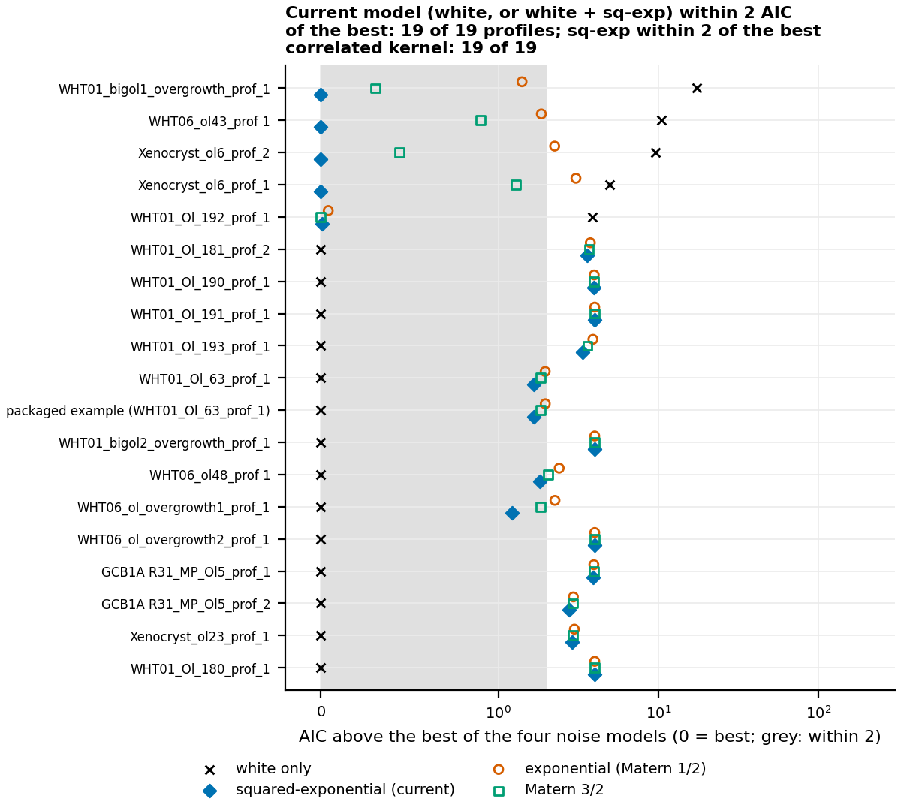
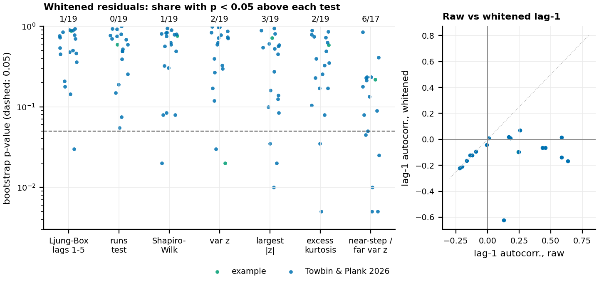
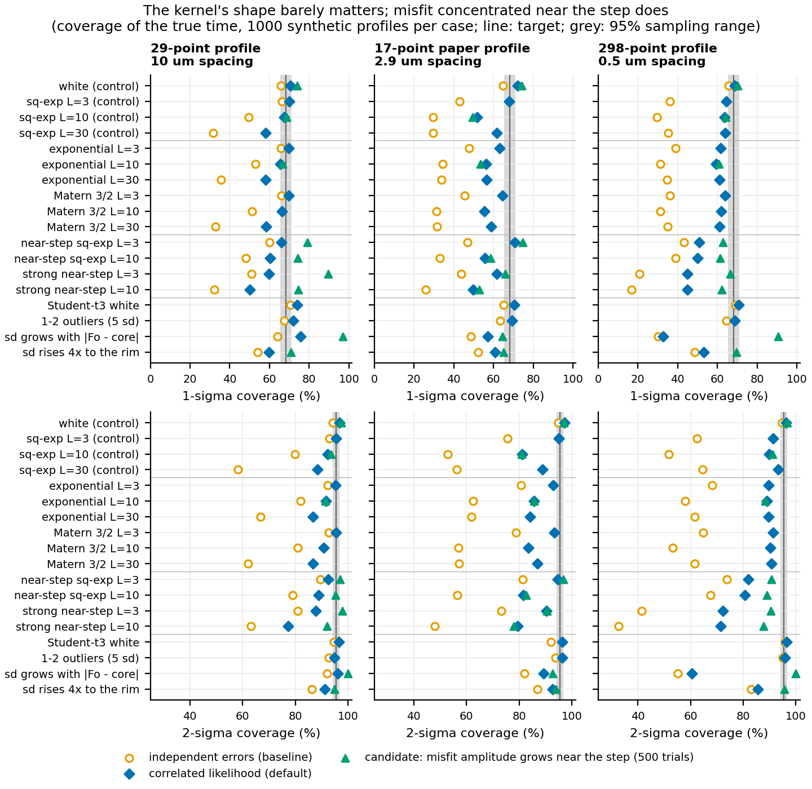

# Is the whitening in FORSTER's default fit valid for these data? (2026-10-15)

Written for Henry and for a later reader of the paper. The method is described in
[`docs/references/likelihood-method.md`](../../references/likelihood-method.md),
sections 2, 4 and 5; this note tests what that note left open (its section 10).

## Short answer

- **Whitening itself works on the real profiles.** After whitening, serial
  correlation is at chance level: on the 19 public profiles (18 from Towbin and Plank
  2026 and the packaged example) Ljung-Box flags 1 and the runs test none, against
  about 1 expected by chance for each test. The squared-exponential shape of the misfit
  was never beaten by the exponential or Matérn 3/2 shape by more than 2 AIC (19 of
  19). The 17 round robin profiles were analysed the same way and lead to the same
  conclusions; their numbers are private. On synthetic data, a misfit of the wrong
  shape (exponential or Matérn 3/2) lowers coverage by at most 5 points compared with the right shape at the
  same length. **No Matérn option is needed.**
- **Heavy tails and outliers do not break the range.** Some real profiles have
  heavier tails than a normal distribution allows (3 of the 19 public profiles fail
  Shapiro-Wilk or the largest-|z| test; the round robin profiles fail more often). On
  synthetic data, Student-t noise and 1–2 outliers of 5 sd per profile kept 1σ coverage at 69–74%. Outliers make the range wider, but it still covers.
  **A robust (Student-t) likelihood would buy precision, not calibration.** It is not
  urgent.
- **The real weakness is misfit concentrated near the step.** In 15 of the 17 public
  profiles with enough points, the whitened residuals scatter more within 2 diffusion
  lengths of the step than elsewhere (median variance ratio 1.95). In 6 of them the
  difference is significant (about 1 would be expected by chance). The round robin
  profiles show the same pattern. The model assumes the misfit is equally large
  everywhere. When it is not, synthetic 1σ coverage falls to 45–71% (69–72% with white
  noise), and 2σ coverage to 72–95% (target 95.45%). It falls furthest on the dense
  298-point geometry (45–51%). The dense round robin profiles show more near-step
  scatter than the strongest synthetic case on that geometry, so **their 1σ ranges are
  probably too narrow.**
- **A candidate fix works where it matters.** A misfit term whose amplitude may grow
  near the step lifts dense-profile coverage from 46–53% to 61–66% (2σ: 70–83% to
  88–91%), and changes the well-specified cases by at most 3 points. It is clearly
  preferred (ΔAIC < −6) on 3 of the 19 public profiles, and on the dense round robin
  profiles. It is worth adding, first as a warning and then, after more validation, as part of the
  model (section 5).

## 1. Terms

- **Residual**: measured Fo minus model Fo at a measured point, at the best-fit time.
- **Noise model**: what the method assumes about the residuals. FORSTER's default is
  *white noise* (independent from point to point, standard deviation s) plus a
  *smooth correlated misfit* (amplitude a, length L). Nearby misfit values are alike
  and values far apart are unrelated. The **kernel** is the formula for how fast that
  likeness decays with distance d:
  - **squared-exponential** (FORSTER's): exp(−d²/2L²). Very smooth misfit.
  - **exponential** (Matérn 1/2): exp(−d/L). Rough, jagged misfit.
  - **Matérn 3/2**: (1 + √3 d/L) exp(−√3 d/L). In between.
- **Whitening**: transforming the residuals with the fitted noise model (z = L⁻¹r, with
  L the Cholesky factor of the covariance) so that, if the model is right, the z are
  independent standard-normal numbers. The χ² that sets the best fit and range is Σz².
  The checks below ask whether the z really look like that.
- **AIC** (Akaike information criterion): −2 × maximised log-likelihood + 2 × number
  of noise parameters. Lower is better. A difference under 2 means the data cannot
  tell the models apart.
- **Coverage**: the share of synthetic profiles of known age whose 1σ range contains
  the true time. A correct 1σ range covers 68.27%, a 2σ range 95.45%. With 1000
  trials, a correct 1σ range lands between 65.4% and 71.1%, and a correct 2σ range
  between 94.1% and 96.7%, 95% of the time (the **sampling band**).
- **Independent-error baseline**: the rule before 2026-10-12. Each point's error is
  independent, σ is fitted to the residuals, and the range is where χ² rises by 1
  (1σ) or 4 (2σ).
- **Diffusion length** l = √(D t) at the best fit. **Near the step** means within 2 l of
  a step of the initial condition.
- **Bootstrap p-value**: the standard tests (Ljung-Box and the others) assume the z are
  exactly independent N(0, 1). Here the noise model was fitted to the same residuals,
  which makes z look slightly too white. Each p-value below therefore comes from 200
  synthetic data sets drawn from the profile's own fitted model and refitted with the
  whole default pipeline. p is the share of those that look at least as extreme as the
  real data.

## 2. What was tested

**A. Real residuals** (`real_profiles.py`, `zone_noise.py real`). The 35 profiles of
the grid-choice study (17 round robin, 18 Towbin and Plank 2026, loaded as
`analyses/ic_sampling/references.py` does) and the packaged example
(`forster.write_template`; the same crystal as WHT01_Ol_63, on the chosen grid). Each
was fitted with the default method (`forster.fit_run`). The round robin profiles
belong to other laboratories: their results are kept in the private submodule, and the
numbers in this note are for the 19 public profiles (18 paper profiles and the
example) unless a sentence says otherwise. Then:
1. At the white best fit, where FORSTER fits its noise model, four noise models were
   fitted by maximum likelihood: white only, white + squared-exponential, white +
   exponential, white + Matérn 3/2. Each used the same (ρ, L) grid as FORSTER, refined
   with the same optimiser and bounds for every kernel. The check that my
   squared-exponential grid fit reproduces FORSTER's `NoiseModel` passes for all 36
   profiles (round robin included).
   The comparison was repeated at the correlated best fit, with the same conclusions.
2. The residuals at the default best fit were whitened with FORSTER's fitted model and
   tested: Ljung-Box on lags 1–5, a runs test on the signs, Shapiro-Wilk, the variance
   of z and the largest |z|.
3. The scatter near the step(s) and away from them was compared, as raw-residual RMS
   and as variance of z. A rim zone (within 2 l of the rim but not near a step) had 3
   or more points in only 3 profiles, so it could not be tested separately.

**B. Synthetic coverage when the noise model is wrong** (`synthetic.py`). Profiles of
known age were made with the forward model (implicit scheme, grid from
`forster.grid.choose_grid` at the true time, which gives 400 time steps up to it). The
model was run on three real geometries, using only their x positions:

| Geometry | Points | Spacing | True time | Diffusion length | White noise |
|---|---|---|---|---|---|
| 29-point profile, 10 um spacing (a round robin profile) | 29 | 10 µm | private | private | 0.2 mol% Fo |
| 17-point paper profile, 2.9 um spacing (GCB1A R31_MP_Ol5_prof_2) | 17 | 2.9 µm | 12.3 d | 8.5 µm | 0.1 mol% Fo |
| 298-point profile, 0.5 um spacing (a round robin profile, two steps) | 298 | 0.5 µm | private | private | 0.6 mol% Fo |

The true time of each geometry is the default fit to that profile's data; for the
round robin geometries it is private. Coverage, bias and width below are relative to
the true time, so they do not reveal it. The white-noise levels follow the 2026-10-13
validation for the two round robin geometries. For the paper
geometry I used the median white noise fitted to the paper profiles (about 0.1 mol%).
The cases, each with 1000 trials:
- **controls**: white only, and white + squared-exponential misfit (0.4 mol% Fo) at
  L = 3, 10, 30 µm. The noise model is right in these;
- **wrong kernel shape**: exponential and Matérn 3/2 misfit, 0.4 mol% Fo, L = 3, 10,
  30 µm;
- **misfit concentrated near the step**: squared-exponential misfit (L = 3 or 10 µm)
  multiplied by a Gaussian bump of width l around each step, with peak amplitude
  0.4 mol% Fo, or 1.2 mol% ("strong", added after part A showed near-step scatter
  that strong in the real data);
- **heavy tails**: Student-t noise with 3 degrees of freedom, scaled to the same sd;
  and white noise plus 1 or 2 points shifted by 5 sd;
- **heteroscedastic white noise**: sd proportional to |Fo − core Fo| (plus 10% of its
  maximum, so the core is not noise-free), or sd rising linearly 4× from core to rim.
  Both are scaled to the same RMS sd.

Each synthetic profile was fitted with the unchanged default
(`forster.uncertainty.fit_correlated_points` on the model at the points for every time
step). That is what `fit_profile` does, minus early stopping, which does not change
the fit. The same data were also fitted with the independent-error baseline and with
two cheap candidate changes: the kernel chosen by AIC, and one refit without points
whose standardised leave-one-out residual exceeds 4. **Follow-up** (`zone_noise.py`,
500 trials, the first 500 draws of the same cases): two candidate near-step noise
models (section 5).

## 3. Results A: real residuals



**Figure 2.** AIC of each noise model above the best of the four, for every public
real profile, from the residuals at the white best fit. Grey: within 2 of the best.
Profiles are sorted by how much the white-only model loses. In the top 5
a correlated term is needed (white only worse by more than 2). In the rest, white noise alone is best, and the three
correlated models sit near +2 to +4 (the AIC cost of their two extra parameters).

**Kernel shape (A2).**
- The current noise model (white, or white + squared-exponential) is within 2 AIC of
  the best of the four for **19 of 19** public profiles. The squared-exponential is
  within 2 of the best correlated kernel for 19 of 19, and is the best one for 18.
- A correlated term is clearly needed (white only worse by > 2) for 5 profiles. In 4
  of them the squared-exponential is the best correlated kernel. The 5th,
  WHT01_Ol_192, prefers Matérn 3/2 by 0.01.
- Only the dense round robin profiles carry enough points to separate the shapes. They
  favour the squared-exponential (numbers private).
- **Caveat on power:** for 15–30 points this comparison is weak. In part B, with a
  truly exponential misfit, AIC picked a kernel other than the squared-exponential in
  only 0–32% of 29-point and paper trials and 65–69% of 298-point trials. With a truly
  squared-exponential misfit it picked another kernel in up to 37% of 298-point trials. So
  "never beaten" mostly means "the data cannot tell". Part B shows this does not
  matter much for coverage.



**Figure 3.** (left) Bootstrap p-values of the whiteness tests for the 19 public real
profiles. The numbers on top count p < 0.05; about 1 of 19 would be expected by
chance. (right) Lag-1 autocorrelation of the residuals before and after whitening.
Only fit statistics are shown, no measured data.

**Whiteness (A3).**
- **Serial correlation is removed.** 5 profiles have raw lag-1 autocorrelation above
  0.3. After whitening, 18 of 19 lie between −0.22 and +0.07. The exception is
  WHT06_ol_overgrowth1 (14 points, −0.62, Ljung-Box p = 0.03). Ljung-Box p < 0.05:
  1 of 19; runs test: 0 of 19. That is chance level, and the round robin profiles
  agree.
- **The distribution is not always normal.** Shapiro-Wilk p < 0.05: 1 of 19. Largest
  |z| too large: 3 of 19. Excess kurtosis too large: 2 of 19. Four profiles fail at
  least one of the four core tests (Ljung-Box, runs, Shapiro-Wilk, largest |z|), so 15
  of 19 pass all four. With a Bonferroni correction for four tests, 18 of 19 pass. The
  failures:
  - WHT01_Ol_190, WHT01_bigol1 and Xenocryst_ol23 (largest |z| 2.9–3.1);
  - WHT06_ol_overgrowth1 (Ljung-Box only).
  The round robin profiles fail these tests more often.
- **Where the extreme points are.** Among the public profiles the most extreme
  standardised leave-one-out residual sits near a step (0.23 l from it) only in
  WHT01_Ol_190. In the failing round robin profiles it sits at or next to the step,
  which looks like misfit at the step rather than random bad analyses.
- **The variance of z is 0.79–1.00 by construction**, because s is fitted to these
  residuals. It is not a useful test and is left out of "passes".

**Near-step scatter (A4).**
- Whitened variance near the step against far from it: larger in **15 of 17**
  public profiles (17 had 3 or more points in each zone). Median ratio 1.95; median
  raw-RMS ratio 1.57.
- Bootstrap p < 0.05 in **6 of 17**: WHT01_Ol_180, _190 and _191, both Xenocryst_ol6
  profiles, and WHT06_ol48.
- The round robin profiles show the same pattern. The dense ones have larger near/far
  raw-RMS ratios than the strongest synthetic near-step case on the 298-point geometry
  (section 5).

Per-profile values. ΔAIC columns are relative to the squared-exponential (positive:
squared-exponential better). p-values are bootstrap; "<0.01" means none of the 200
bootstrap sets was as extreme. The last column is the near-step candidate of section 5
(negative: the near-step term is preferred). Full columns are in `real_profiles.csv`,
`real_kernels.csv` and `zone_real.csv`.

| profile | set | n | L (um) | AIC white - sq-exp | AIC exp - sq-exp | AIC M3/2 - sq-exp | lag-1 raw | lag-1 whitened | Ljung-Box p | runs p | Shapiro p | max abs z (p) | near/far var z (p) | near-step term dAIC |
|---|---|---|---|---|---|---|---|---|---|---|---|---|---|---|
| GCB1A R31_MP_Ol5_prof_1 | TP26 | 17 | 20.3 | -3.9 | 0.0 | 0.0 | -0.16 | -0.16 | 0.21 | 0.77 | 0.84 | 2.1 (0.59) |  | 2.0 |
| GCB1A R31_MP_Ol5_prof_2 | TP26 | 17 | 7.5 | -2.8 | 0.2 | 0.1 | 0.17 | 0.02 | 0.45 | 0.70 | 0.63 | 2.0 (0.57) | 1.95 (0.23) | 0.4 |
| WHT06_ol_overgrowth2_prof_1 | TP26 | 27 | 0.0 | -4.0 | 0.0 | 0.0 | 0.01 | 0.01 | 0.73 | 0.39 | 0.83 | 2.2 (0.61) |  | 2.0 |
| WHT06_ol_overgrowth1_prof_1 | TP26 | 14 | 9.5 | -1.2 | 1.0 | 0.6 | 0.13 | -0.62 | 0.03 | 0.07 | 0.60 | 2.0 (0.53) | 0.99 (0.41) | 2.0 |
| WHT01_bigol1_overgrowth_prof_1 | TP26 | 31 | 10.4 | 17.4 | 1.4 | 0.3 | 0.43 | -0.07 | 0.46 | 0.80 | 0.08 | 3.1 (0.03) | 0.58 (0.85) | 2.0 |
| WHT01_bigol2_overgrowth_prof_1 | TP26 | 19 | 0.0 | -4.0 | 0.0 | 0.0 | -0.09 | -0.09 | 0.14 | 0.76 | 0.95 | 2.5 (0.16) | 3.05 (0.09) | 1.9 |
| WHT01_Ol_63_prof_1 | TP26 | 27 | 4.0 | -1.7 | 0.3 | 0.2 | 0.25 | -0.10 | 0.89 | 0.60 | 0.80 | 2.1 (0.81) | 1.59 (0.18) | -0.8 |
| WHT01_Ol_180_prof_1 | TP26 | 23 | 0.0 | -4.0 | 0.0 | 0.0 | -0.12 | -0.12 | 0.48 | 0.25 | 0.32 | 2.7 (0.10) | 2.63 (0.05) | -0.2 |
| WHT01_Ol_181_prof_2 | TP26 | 24 | 70.0 | -3.6 | 0.2 | 0.1 | -0.20 | -0.21 | 0.36 | 0.49 | 0.91 | 2.5 (0.27) | 1.98 (0.13) | 2.0 |
| WHT01_Ol_190_prof_1 | TP26 | 17 | 14.7 | -4.0 | 0.0 | 0.0 | -0.01 | -0.04 | 0.78 | 1.00 | 0.02 | 2.9 (<0.01) | 4.91 (0.02) | -3.2 |
| WHT01_Ol_191_prof_1 | TP26 | 20 | 0.0 | -4.0 | 0.0 | 0.0 | -0.22 | -0.22 | 0.77 | 0.49 | 0.08 | 2.5 (0.12) | 5.90 (<0.01) | 1.9 |
| WHT01_Ol_192_prof_1 | TP26 | 19 | 34.6 | 3.9 | 0.0 | -0.0 | 0.46 | -0.07 | 0.94 | 0.93 | 0.79 | 2.1 (0.55) | 1.50 (0.21) | 2.0 |
| WHT01_Ol_193_prof_1 | TP26 | 20 | 4.8 | -3.4 | 0.5 | 0.2 | 0.18 | 0.01 | 0.54 | 0.94 | 0.57 | 1.8 (0.95) | 1.40 (0.23) | 2.0 |
| Xenocryst_ol6_prof_1 | TP26 | 15 | 2.5 | 5.0 | 3.1 | 1.3 | 0.59 | 0.01 | 0.50 | 0.52 | 0.49 | 2.1 (0.45) | 6.60 (<0.01) | -9.4 |
| Xenocryst_ol6_prof_2 | TP26 | 23 | 2.2 | 9.6 | 2.2 | 0.4 | 0.64 | -0.17 | 0.85 | 0.05 | 0.81 | 2.6 (0.14) | 2.43 (0.04) | -1.0 |
| WHT06_ol43_prof 1 | TP26 | 28 | 4.0 | 10.5 | 1.9 | 0.9 | 0.59 | -0.14 | 0.70 | 0.15 | 0.76 | 1.9 (0.89) | 1.81 (0.08) | -7.3 |
| Xenocryst_ol23_prof_1 | TP26 | 17 | 21.8 | -2.9 | 0.1 | 0.1 | -0.14 | -0.12 | 0.90 | 0.19 | 0.08 | 2.9 (0.02) | 1.17 (0.23) | 1.0 |
| WHT06_ol48_prof 1 | TP26 | 26 | 2.6 | -1.8 | 0.6 | 0.2 | 0.26 | 0.07 | 0.18 | 0.68 | 0.30 | 2.8 (0.08) | 3.44 (<0.01) | -6.6 |
| packaged example (WHT01_Ol_63_prof_1) | ex | 27 | 4.0 | -1.7 | 0.3 | 0.2 | 0.25 | -0.10 | 0.88 | 0.59 | 0.77 | 2.1 (0.72) | 1.59 (0.22) | -0.8 |

## 4. Results B: synthetic coverage



**Figure 1.** 1σ (top) and 2σ (bottom) coverage of the true time, per case and
geometry, 1000 trials each. Diamonds: the default. Open circles: the
independent-error baseline. Triangles: the near-step candidate of section 5 (500
trials, shown only where run). Vertical line: target. Grey band: 95% sampling range
for 1000 trials.

Coverage (%) of the 1σ and 2σ ranges for the default and the independent-error
baseline, median error of the best fit (bias, % of the true time) and median 1σ width
(% of the true time). 1000 trials per case. Sampling band: 65.4–71.1 (1σ), 94.1–96.7
(2σ).

| geometry | case | 1s default | 1s indep. | 2s default | 2s indep. | bias % | width % | indep. width % |
|---|---|---|---|---|---|---|---|---|
| 29-point profile, 10 um spacing | white (control) | 70 | 66 | 96.7 | 94.2 | -0.2 | 20 | 19 |
| 29-point profile, 10 um spacing | sq-exp L=3 (control) | 70 | 66 | 95.4 | 93.0 | -0.6 | 45 | 40 |
| 29-point profile, 10 um spacing | sq-exp L=10 (control) | 67 | 50 | 92.2 | 79.8 | -2.1 | 60 | 38 |
| 29-point profile, 10 um spacing | sq-exp L=30 (control) | 58 | 32 | 88.5 | 58.3 | -1.9 | 68 | 35 |
| 29-point profile, 10 um spacing | exponential L=3 | 70 | 66 | 95.3 | 92.2 | -0.5 | 45 | 40 |
| 29-point profile, 10 um spacing | exponential L=10 | 66 | 53 | 91.6 | 82.1 | -0.9 | 53 | 39 |
| 29-point profile, 10 um spacing | exponential L=30 | 58 | 36 | 86.8 | 66.8 | -0.8 | 59 | 36 |
| 29-point profile, 10 um spacing | Matern 3/2 L=3 | 70 | 66 | 95.4 | 92.7 | -0.5 | 45 | 40 |
| 29-point profile, 10 um spacing | Matern 3/2 L=10 | 66 | 51 | 90.8 | 80.9 | -1.5 | 56 | 39 |
| 29-point profile, 10 um spacing | Matern 3/2 L=30 | 58 | 33 | 86.7 | 62.1 | -2.2 | 63 | 35 |
| 29-point profile, 10 um spacing | near-step sq-exp L=3 | 66 | 60 | 92.5 | 89.5 | -0.2 | 25 | 23 |
| 29-point profile, 10 um spacing | near-step sq-exp L=10 | 60 | 48 | 88.9 | 78.9 | -0.4 | 27 | 22 |
| 29-point profile, 10 um spacing | strong near-step L=3 | 60 | 51 | 87.8 | 81.0 | -1.5 | 47 | 41 |
| 29-point profile, 10 um spacing | strong near-step L=10 | 50 | 32 | 77.4 | 63.1 | -1.8 | 53 | 36 |
| 29-point profile, 10 um spacing | Student-t3 white | 74 | 70 | 96.5 | 94.6 | +0.2 | 18 | 16 |
| 29-point profile, 10 um spacing | 1-2 outliers (5 sd) | 72 | 67 | 94.8 | 92.7 | -0.2 | 31 | 28 |
| 29-point profile, 10 um spacing | sd grows with \|Fo − core\| | 76 | 64 | 96.2 | 92.1 | +0.0 | 22 | 17 |
| 29-point profile, 10 um spacing | sd rises 4x to the rim | 60 | 54 | 91.1 | 86.2 | +0.0 | 20 | 18 |
| 17-point paper profile, 2.9 um spacing | white (control) | 72 | 65 | 97.1 | 94.7 | +0.0 | 14 | 12 |
| 17-point paper profile, 2.9 um spacing | sq-exp L=3 (control) | 68 | 43 | 95.0 | 75.6 | +1.0 | 87 | 48 |
| 17-point paper profile, 2.9 um spacing | sq-exp L=10 (control) | 52 | 30 | 81.1 | 52.9 | -0.1 | 78 | 38 |
| 17-point paper profile, 2.9 um spacing | sq-exp L=30 (control) | 62 | 30 | 88.9 | 56.2 | +0.8 | 46 | 35 |
| 17-point paper profile, 2.9 um spacing | exponential L=3 | 63 | 48 | 92.8 | 80.7 | +2.2 | 72 | 50 |
| 17-point paper profile, 2.9 um spacing | exponential L=10 | 56 | 34 | 85.6 | 62.6 | -0.1 | 79 | 44 |
| 17-point paper profile, 2.9 um spacing | exponential L=30 | 57 | 34 | 84.1 | 61.9 | -0.6 | 68 | 39 |
| 17-point paper profile, 2.9 um spacing | Matern 3/2 L=3 | 65 | 46 | 93.2 | 78.7 | +1.8 | 78 | 49 |
| 17-point paper profile, 2.9 um spacing | Matern 3/2 L=10 | 56 | 31 | 83.4 | 57.0 | +0.8 | 82 | 41 |
| 17-point paper profile, 2.9 um spacing | Matern 3/2 L=30 | 59 | 32 | 86.8 | 57.1 | -0.5 | 59 | 36 |
| 17-point paper profile, 2.9 um spacing | near-step sq-exp L=3 | 71 | 47 | 94.5 | 81.3 | +0.2 | 51 | 30 |
| 17-point paper profile, 2.9 um spacing | near-step sq-exp L=10 | 56 | 33 | 81.6 | 56.6 | +0.0 | 50 | 26 |
| 17-point paper profile, 2.9 um spacing | strong near-step L=3 | 62 | 44 | 90.3 | 73.2 | -0.6 | 136 | 77 |
| 17-point paper profile, 2.9 um spacing | strong near-step L=10 | 50 | 26 | 79.4 | 48.0 | -2.2 | 117 | 47 |
| 17-point paper profile, 2.9 um spacing | Student-t3 white | 70 | 65 | 96.3 | 92.1 | +0.2 | 12 | 10 |
| 17-point paper profile, 2.9 um spacing | 1-2 outliers (5 sd) | 69 | 63 | 96.3 | 93.8 | +0.5 | 25 | 22 |
| 17-point paper profile, 2.9 um spacing | sd grows with \|Fo − core\| | 57 | 49 | 89.3 | 82.0 | -0.5 | 14 | 12 |
| 17-point paper profile, 2.9 um spacing | sd rises 4x to the rim | 61 | 52 | 92.7 | 86.9 | +0.0 | 14 | 12 |
| 298-point profile, 0.5 um spacing | white (control) | 69 | 66 | 96.2 | 94.8 | +0.0 | 7 | 7 |
| 298-point profile, 0.5 um spacing | sq-exp L=3 (control) | 65 | 36 | 91.4 | 62.5 | -0.2 | 19 | 8 |
| 298-point profile, 0.5 um spacing | sq-exp L=10 (control) | 64 | 30 | 89.8 | 51.8 | +0.2 | 17 | 8 |
| 298-point profile, 0.5 um spacing | sq-exp L=30 (control) | 64 | 35 | 93.3 | 64.7 | +0.0 | 10 | 8 |
| 298-point profile, 0.5 um spacing | exponential L=3 | 62 | 39 | 89.7 | 68.2 | -0.2 | 14 | 8 |
| 298-point profile, 0.5 um spacing | exponential L=10 | 59 | 31 | 88.9 | 58.0 | +0.2 | 17 | 8 |
| 298-point profile, 0.5 um spacing | exponential L=30 | 61 | 35 | 89.7 | 61.6 | +0.2 | 14 | 8 |
| 298-point profile, 0.5 um spacing | Matern 3/2 L=3 | 64 | 36 | 91.4 | 64.8 | -0.2 | 17 | 8 |
| 298-point profile, 0.5 um spacing | Matern 3/2 L=10 | 62 | 31 | 90.2 | 53.2 | +0.0 | 17 | 8 |
| 298-point profile, 0.5 um spacing | Matern 3/2 L=30 | 61 | 35 | 90.6 | 61.7 | +0.2 | 11 | 8 |
| 298-point profile, 0.5 um spacing | near-step sq-exp L=3 | 51 | 43 | 81.9 | 73.8 | +0.0 | 8 | 7 |
| 298-point profile, 0.5 um spacing | near-step sq-exp L=10 | 50 | 39 | 80.7 | 67.5 | +0.0 | 8 | 7 |
| 298-point profile, 0.5 um spacing | strong near-step L=3 | 45 | 21 | 72.4 | 41.6 | -0.5 | 17 | 8 |
| 298-point profile, 0.5 um spacing | strong near-step L=10 | 45 | 17 | 71.5 | 32.7 | +0.5 | 17 | 8 |
| 298-point profile, 0.5 um spacing | Student-t3 white | 71 | 69 | 96.5 | 95.8 | +0.0 | 7 | 7 |
| 298-point profile, 0.5 um spacing | 1-2 outliers (5 sd) | 69 | 64 | 95.9 | 95.0 | -0.2 | 8 | 7 |
| 298-point profile, 0.5 um spacing | sd grows with \|Fo − core\| | 33 | 30 | 60.6 | 55.2 | -0.2 | 7 | 7 |
| 298-point profile, 0.5 um spacing | sd rises 4x to the rim | 53 | 49 | 85.6 | 82.9 | +0.0 | 7 | 7 |

What the table shows:
- **Controls reproduce the 2026-10-13 validation.**
  - White noise: 69–72% (1σ), 96.2–97.1% (2σ). The 17-point paper geometry is
    slightly conservative: 72.3% and 97.1%, just above the band.
  - Squared-exponential misfit: 64–70% for L = 3 and 10 µm on the 29- and 298-point profiles, and 58–64%
    at L = 30 µm (the known trade-off when L approaches the diffusion length).
- **New: the paper geometry is hit hardest by misfit as long as the diffusion
  length.** With L = 10 µm against l = 8.5 µm, coverage is 52% (1σ) and 81% (2σ),
  below the 53–62% the method note quotes for the 29- and 298-point profiles. The independent-error
  baseline gives 30%.
- **The wrong kernel shape costs little.** Against the squared-exponential at the
  same L:
  - exponential: −2 to 0 points on 29 points, −5 to +4 on paper, −3 to −4 on 298 points;
  - Matérn 3/2: −1 to 0 on 29 points, −3 to +4 on paper, −1 to −3 on 298 points.
  - The lowest wrong-shape value is 56% (paper, L = 10 µm), and there the
    squared-exponential itself gives 52%.
- **Near-step misfit is the largest loss among the misfit cases.**
  - At 0.4 mol% Fo peak: 66 and 60% on 29 points, 71 and 56% on paper, 51 and 50% on 298 points.
  - At 1.2 mol%: 60 and 50% on 29 points, 62 and 50% on paper, 45 and 45% on 298 points.
  - 2σ coverage falls to 72–95%. Widths barely grow on 298 points (8%, as for white noise),
    so the range does not see the problem.
- **Heavy tails do not hurt coverage.**
  - Student-t: 70–74%. Outliers: 69–72%.
  - Outliers make the range wider: 20 to 31% of the true time on 29 points, 14 to 25%
    on the paper geometry, 7.2 to 7.7% on 298 points.
- **Heteroscedastic noise can hurt badly or help, depending on where it sits.**
  - sd rising 4× to the rim: 53–61%.
  - sd proportional to |Fo − core|: 76% on 29 points (over-covers), 57% on paper and 33%
    on 298 points. On the 298-point geometry the noisiest points (the rim and the
    plateau) are about 11× noisier than the core, an extreme case.
- **Bias is small in every case**: median within ±2.3% of the true time.
- **The independent-error baseline is worse in every correlated case**: 17–60% at 1σ
  where the point spacing resolves the misfit. It reaches 66% only when the misfit is
  shorter than the spacing (L = 3 µm on the 10 µm spacing of the 29-point profile, where it acts as white
  noise). It is close to the default only for white or heavy-tailed noise.
- **Whiteness tests do not detect near-step misfit.** In the near-step cases,
  Ljung-Box flags 2–18% of trials. Shapiro-Wilk flags 6–17%, except 46–70% for the
  strong cases on 29 points.

The two cheap candidates help nowhere (table in the appendix):
- **Kernel chosen by AIC:** coverage changes by −8 to +3 points against the default,
  and is lower in most cases.
- **Leave-one-out outlier clip (|z| > 4):** coverage changes by −2.3 to +0.1 points,
  except −3.8 and −4.7 for the Fo-proportional cases on the 29- and 298-point profiles. It narrows the range only on the dense
  profile (outliers: 7.7 to 7.3%). On sparse profiles it found outliers in only 0–11%
  of trials, because one 5-sd outlier among 17–29 points inflates the fitted s enough
  to hide itself.

## 5. A candidate fix for near-step misfit

Two noise models were tried, each with one extra parameter fitted by maximum
likelihood together with s, ρ and L at the white best fit (`zone_noise.py`). Here
e(x) is a Gaussian bump of width l (at the white best fit) around each step, with
peak 1:
- **near-step white**: C = s²(diag(1 + g·e) + ρ²K). The white noise may grow near the
  step. **It does not help:** 1σ coverage stays at 51–54% (298 points, near-step) and 43–45%
  (298 points, strong). Not recommended.
- **near-step correlated**: C = s²(I + ρ² S K S), with S = diag(√(1 + h·e)) and h on
  0, 1, 3, 10, 30, 100. The *correlated misfit's* amplitude may grow near the step
  (h = 0 is FORSTER's model). This matches the shape of the synthetic near-step cases,
  so for them it is a best case. The heteroscedastic cases have different shapes.

Coverage (%) for the default and the near-step correlated candidate, 500 trials. The
"near/far raw rms" column is the median ratio of residual RMS near the step to that
far from it at the default best fit, the same statistic as A4 on the real profiles.
"dAIC" is the AIC change from adding the near-step term (negative favours it); the
two dAIC columns give the share of trials below −2 and −6. The last column is the
near-step white candidate.

| geometry | case | near/far raw rms | 1s default | 1s candidate | 2s default | 2s candidate | width default % | width candidate % | dAIC<-2 % | dAIC<-6 % | 1s white-near-step cand. |
|---|---|---|---|---|---|---|---|---|---|---|---|
| 29-point profile, 10 um spacing | white (control) | 0.93 | 73 | 74 | 97 | 97 | 20 | 21 | 1 | 0 | 75 |
| 29-point profile, 10 um spacing | sq-exp L=10 (control) | 0.87 | 68 | 68 | 93 | 94 | 60 | 62 | 1 | 0 | 69 |
| 29-point profile, 10 um spacing | exponential L=10 | 0.91 | 67 | 67 | 92 | 91 | 53 | 54 | 1 | 0 | 68 |
| 29-point profile, 10 um spacing | near-step sq-exp L=3 | 1.55 | 66 | 79 | 94 | 97 | 25 | 31 | 22 | 8 | 76 |
| 29-point profile, 10 um spacing | near-step sq-exp L=10 | 1.45 | 60 | 74 | 90 | 95 | 27 | 32 | 31 | 13 | 63 |
| 29-point profile, 10 um spacing | strong near-step L=3 | 3.59 | 58 | 90 | 88 | 98 | 46 | 75 | 88 | 76 | 70 |
| 29-point profile, 10 um spacing | strong near-step L=10 | 3.14 | 48 | 75 | 77 | 92 | 51 | 59 | 88 | 76 | 51 |
| 29-point profile, 10 um spacing | sd grows with \|Fo − core\| | 5.40 | 77 | 97 | 97 | 100 | 23 | 33 | 98 | 96 | 78 |
| 29-point profile, 10 um spacing | sd rises 4x to the rim | 1.59 | 61 | 71 | 93 | 95 | 20 | 25 | 23 | 7 | 65 |
| 17-point paper profile, 2.9 um spacing | white (control) | 1.03 | 74 | 74 | 97 | 97 | 15 | 15 | 1 | 0 | 72 |
| 17-point paper profile, 2.9 um spacing | sq-exp L=10 (control) | 0.90 | 52 | 49 | 81 | 81 | 78 | 76 | 4 | 0 | 51 |
| 17-point paper profile, 2.9 um spacing | exponential L=10 | 0.99 | 56 | 53 | 86 | 86 | 81 | 79 | 2 | 0 | 54 |
| 17-point paper profile, 2.9 um spacing | near-step sq-exp L=3 | 2.66 | 72 | 75 | 94 | 97 | 52 | 47 | 49 | 12 | 65 |
| 17-point paper profile, 2.9 um spacing | near-step sq-exp L=10 | 2.05 | 55 | 59 | 82 | 83 | 51 | 42 | 23 | 2 | 53 |
| 17-point paper profile, 2.9 um spacing | strong near-step L=3 | 5.35 | 63 | 66 | 91 | 91 | 142 | 127 | 75 | 37 | 57 |
| 17-point paper profile, 2.9 um spacing | strong near-step L=10 | 3.28 | 48 | 53 | 79 | 78 | 121 | 91 | 41 | 14 | 48 |
| 17-point paper profile, 2.9 um spacing | sd grows with \|Fo − core\| | 4.73 | 57 | 64 | 90 | 93 | 14 | 15 | 17 | 5 | 53 |
| 17-point paper profile, 2.9 um spacing | sd rises 4x to the rim | 2.33 | 62 | 65 | 93 | 94 | 14 | 15 | 8 | 1 | 57 |
| 298-point profile, 0.5 um spacing | white (control) | 0.99 | 69 | 70 | 97 | 97 | 7 | 7 | 1 | 0 | 70 |
| 298-point profile, 0.5 um spacing | sq-exp L=10 (control) | 0.94 | 65 | 64 | 91 | 91 | 17 | 17 | 1 | 0 | 65 |
| 298-point profile, 0.5 um spacing | exponential L=10 | 0.95 | 60 | 61 | 88 | 88 | 16 | 17 | 2 | 0 | 60 |
| 298-point profile, 0.5 um spacing | near-step sq-exp L=3 | 1.08 | 53 | 63 | 83 | 91 | 8 | 10 | 37 | 15 | 54 |
| 298-point profile, 0.5 um spacing | near-step sq-exp L=10 | 1.07 | 51 | 61 | 83 | 89 | 8 | 9 | 35 | 18 | 51 |
| 298-point profile, 0.5 um spacing | strong near-step L=3 | 1.61 | 46 | 66 | 74 | 90 | 17 | 24 | 97 | 94 | 43 |
| 298-point profile, 0.5 um spacing | strong near-step L=10 | 1.46 | 46 | 62 | 70 | 88 | 16 | 21 | 86 | 77 | 45 |
| 298-point profile, 0.5 um spacing | sd grows with \|Fo − core\| | 7.23 | 34 | 91 | 63 | 100 | 7 | 23 | 100 | 100 | 36 |
| 298-point profile, 0.5 um spacing | sd rises 4x to the rim | 1.62 | 53 | 70 | 88 | 96 | 7 | 11 | 89 | 72 | 63 |

- **Well-specified cases barely change:** within ±1 point, except paper SE L = 10
  (52 to 49) and exponential L = 10 (56 to 53).
- **Near-step and rim cases recover:**
  - 29 points: 48–66% to 74–90%;
  - 298 points: 46–53% to 61–66% (2σ: 70–83% to 88–91%);
  - rim-rising sd: 53–62% to 65–71%.
  - Ranges widen where coverage was lost, e.g. strong near-step misfit on 298 points
    16–17% to 21–24%, and on 29 points at L = 3 µm 46% to 75%.
- **The 17-point paper geometry gains only 3–7 points.** Too few points sit near the
  step to estimate the extra term.
- **As a diagnostic** (ΔAIC of the near-step term at the white best fit):
  - false alarms at ΔAIC < −2 in 0.6–4% of control trials, at ΔAIC < −6 in at most
    0.2%;
  - detection at ΔAIC < −6: 76–94% of the strong cases on the 29- and 298-point profiles, but 14–37% on
    paper and 2–18% for the 0.4 mol% cases.
  - A simpler test, Brown-Forsythe on near/far z, is weaker: it fired on 3–34% of 298-point
    near-step trials.
- **On the public real profiles:** preferred by more than 2 AIC on 4 of 19 and by more
  than 6 on 3 (Xenocryst_ol6_prof_1, WHT06_ol43, WHT06_ol48). On the round robin
  profiles it is preferred more often, most strongly on the dense ones, and moves their
  times (private).
  - h reached the top of its grid (100) in 7 of the 19 profiles, so a continuous fit
    may move these further.
  - The fitted time changes by +54% for Xenocryst_ol6_prof_1, +18% for WHT06_ol43 and
    −12% for WHT06_ol48.
  - 2 of the 4 best fits fall outside the default 1σ range.

| profile | dAIC of near-step term | h | default time (d) | default 1σ low | default 1σ high | candidate time (d) | candidate 1σ low | candidate 1σ high | candidate time outside default 1σ |
|---|---|---|---|---|---|---|---|---|---|
| AZ18 WHT01_Ol_190_prof_1 | -3.17 | 30 | 11.992 | 9.81 | 14.546 | 13.296 | 9.086 | 18.097 | False |
| Xenocryst_ol6_prof_1 | -9.397 | 100 | 0.148 | 0.103 | 0.206 | 0.228 | 0.184 | 0.275 | True |
| AZ18 WHT06_ol43_prof 1 | -7.288 | 30 | 1.923 | 1.528 | 2.392 | 2.268 | 1.862 | 2.703 | False |
| AZ18 WHT06_ol48_prof 1 | -6.635 | 100 | 3.039 | 2.77 | 3.332 | 2.662 | 2.383 | 2.958 | True |

This study took D at the mean measured Fo. FORSTER's `near_step_check` (and so
`near_step_daic` in `summary.csv`) takes D at the middle of the initial condition's Fo
range, so its values differ slightly: Xenocryst_ol6_prof_1 gives −10.4 and +58%, not
−9.4 and +54%. The figures in `docs/references/noise-models-guide.md` use FORSTER's values.

## 6. Verdict

**Valid:**
- Whitening with the squared-exponential model is valid for the serial correlation in
  these profiles. After it, serial correlation is at chance level (Ljung-Box flags 1
  of the 19 public profiles, the runs test none; the round robin profiles agree).
- The kernel's shape is not a practical concern: wrong shapes cost 0–5 points of
  coverage.
- Heavy tails and isolated outliers leave coverage at 69–74%.

**Degrades:**
1. *Misfit concentrated near the step* (seen in the real data: 15 of 17 public
   profiles, 6 significant, and the round robin profiles):
   - 1σ coverage 45–71% and 2σ 72–95% in synthetic tests;
   - worst for dense profiles, 45–51%;
   - the dense round robin profiles exceed the strongest synthetic case.
2. *Misfit about as long as the diffusion length* (already known):
   - 52–64% at 1σ;
   - 52% on a paper-like 17-point profile, lower than the method note reports.
3. *Noise that grows toward the rim or with |Fo − core|*: 33–61% where the noisy part
   coincides with the time information. The real data cannot separate this from (1).

**Recommendations**, each backed by the numbers above:
1. **Do not add a Matérn kernel option.** Real profiles never preferred one. Wrong
   shapes cost at most 5 points, and choosing the kernel by AIC lowered coverage by up
   to 8 points.
2. **Do not prioritise a robust likelihood.** Coverage with outliers and Student-t
   noise is 69–74%. The cost is width (+50 to +75% on sparse profiles), which a
   Student-t likelihood might recover. That was not tested. Simple leave-one-out
   clipping did not help sparse profiles.
3. **Add a near-step warning now.** Fit the near-step correlated term at the white
   best fit, and warn when it improves AIC by more than 6.
   - False alarms ≤0.2% of control trials.
   - Detects 76–94% of strong near-step misfit on 29- and 298-point profiles.
   - Fires on 3 of the 19 public profiles, and on the dense round robin profiles.
   - Extra cost: about 6× the Cholesky factorisations of the noise-model fit, about
     0.16 s on a 298-point profile.
4. **Consider making the near-step term part of the model**, after:
   - fitting h continuously (it reached its grid maximum in 7 of the 19 public profiles);
   - testing other non-stationary shapes;
   - a differential check that h = 0 reproduces today's fits.

   On synthetic data it restored dense-profile coverage from 46–53% to 61–66%.
5. **Until then:** for dense profiles with near-step scatter (like the dense round robin
   profiles), report
   the 2σ range (88–91% with the candidate, 70–83% without), or flag the 1σ range as
   too narrow. Update the method note's section 4 with the paper-geometry number (52%
   at L ≈ l).

## 7. Reproducing

From the repository root. At most 4 worker processes, one heavy job at a time.
`WHITENING_CACHE` is where the model-at-points arrays are cached (default: the system
temp directory).

```bash
uv run python docs/plans/2026-10-15-whitening-validity/real_profiles.py      # 56 s
uv run python docs/plans/2026-10-15-whitening-validity/synthetic.py run 1000  # 13 min, 4 workers
uv run python docs/plans/2026-10-15-whitening-validity/zone_noise.py run 500  # 9.5 min, 4 workers
uv run python docs/plans/2026-10-15-whitening-validity/zone_noise.py real     # 10 s
uv run python docs/plans/2026-10-15-whitening-validity/figures.py
uv run python docs/plans/2026-10-15-whitening-validity/report.py              # the tables above
```

Files: `common.py` (kernels, noise-model fits, whiteness tests), `real_profiles.py` →
`real_profiles.csv`, `real_kernels.csv`; `synthetic.py` → `trials.csv`,
`coverage.csv`; `zone_noise.py` → `zone_trials.csv`, `zone_coverage.csv`,
`zone_real.csv`; `figures.py` → `fig1_coverage.png`, `fig2_aic.png`,
`fig3_whitened.png`; `report.py` prints every table here. The round robin profiles are
private: `real_profiles.py` and `zone_noise.py real` write their rows only to the
submodule (`Diffusion Round Robin/outputs/whitening_validity/`), and the tables and
figures here show the paper profiles, the example and synthetic profiles. The README's
earlier version with the round robin rows is in the submodule under
`outputs/public_tree_moved/`.

Limitations:
- One true time per geometry.
- Noise models are fitted on FORSTER's grid; only part A refines them continuously.
- The near-step candidate's shape matches the synthetic near-step cases.
- The bootstrap uses 200 sets, so its smallest p-value is 0.005.
- Initial-condition errors are not studied here (see `forster.scan`).

## Appendix: the two cheap candidates and the diagnostics, per case

1000 trials. "kernel by AIC": kernel chosen by AIC at the white best fit. "outlier
clip": one refit without points whose |standardised LOO residual| > 4. "AIC not
sq-exp": share of trials where AIC chose the exponential or Matérn 3/2. "clipped":
share with at least one point dropped. "LB/SW p<.05": share where Ljung-Box (lags 1–5)
or Shapiro-Wilk of the whitened residuals gives nominal p < 0.05. "warn": FORSTER's
profile-wide-misfit warning.

| geometry | case | 1s default | 1s kernel by AIC | 1s outlier clip | 2s default | 2s kernel by AIC | 2s outlier clip | AIC not sq-exp % | clipped % | LB p<.05 % | SW p<.05 % | warn % |
|---|---|---|---|---|---|---|---|---|---|---|---|---|
| 29-point profile, 10 um spacing | white (control) | 70 | 67 | 70 | 97 | 95 | 97 | 1 | 0 | 5 | 5 | 0 |
| 29-point profile, 10 um spacing | sq-exp L=3 (control) | 70 | 68 | 70 | 95 | 94 | 95 | 1 | 0 | 7 | 4 | 0 |
| 29-point profile, 10 um spacing | sq-exp L=10 (control) | 67 | 66 | 67 | 92 | 89 | 92 | 15 | 0 | 3 | 4 | 4 |
| 29-point profile, 10 um spacing | sq-exp L=30 (control) | 58 | 57 | 58 | 88 | 88 | 88 | 23 | 0 | 2 | 5 | 1 |
| 29-point profile, 10 um spacing | exponential L=3 | 70 | 67 | 70 | 95 | 94 | 95 | 0 | 0 | 6 | 4 | 0 |
| 29-point profile, 10 um spacing | exponential L=10 | 66 | 60 | 66 | 92 | 87 | 92 | 7 | 0 | 3 | 4 | 1 |
| 29-point profile, 10 um spacing | exponential L=30 | 58 | 58 | 58 | 87 | 84 | 87 | 25 | 0 | 1 | 4 | 3 |
| 29-point profile, 10 um spacing | Matern 3/2 L=3 | 70 | 68 | 70 | 95 | 94 | 95 | 1 | 0 | 7 | 4 | 0 |
| 29-point profile, 10 um spacing | Matern 3/2 L=10 | 66 | 62 | 66 | 91 | 88 | 91 | 10 | 0 | 2 | 4 | 2 |
| 29-point profile, 10 um spacing | Matern 3/2 L=30 | 58 | 59 | 58 | 87 | 87 | 87 | 31 | 0 | 2 | 4 | 2 |
| 29-point profile, 10 um spacing | near-step sq-exp L=3 | 66 | 62 | 66 | 92 | 92 | 93 | 1 | 1 | 7 | 15 | 0 |
| 29-point profile, 10 um spacing | near-step sq-exp L=10 | 60 | 55 | 60 | 89 | 85 | 89 | 3 | 0 | 3 | 9 | 1 |
| 29-point profile, 10 um spacing | strong near-step L=3 | 60 | 56 | 58 | 88 | 85 | 86 | 1 | 12 | 18 | 70 | 1 |
| 29-point profile, 10 um spacing | strong near-step L=10 | 50 | 47 | 50 | 77 | 74 | 77 | 7 | 3 | 6 | 46 | 4 |
| 29-point profile, 10 um spacing | Student-t3 white | 74 | 71 | 72 | 96 | 96 | 96 | 0 | 10 | 4 | 39 | 0 |
| 29-point profile, 10 um spacing | 1-2 outliers (5 sd) | 72 | 69 | 70 | 95 | 95 | 94 | 1 | 11 | 4 | 80 | 0 |
| 29-point profile, 10 um spacing | sd grows with \|Fo − core\| | 76 | 70 | 72 | 96 | 95 | 95 | 4 | 18 | 31 | 85 | 3 |
| 29-point profile, 10 um spacing | sd rises 4x to the rim | 60 | 57 | 60 | 91 | 89 | 91 | 1 | 0 | 11 | 14 | 0 |
| 17-point paper profile, 2.9 um spacing | white (control) | 72 | 69 | 72 | 97 | 96 | 97 | 0 | 0 | 6 | 4 | 1 |
| 17-point paper profile, 2.9 um spacing | sq-exp L=3 (control) | 68 | 65 | 68 | 95 | 92 | 95 | 7 | 0 | 2 | 5 | 22 |
| 17-point paper profile, 2.9 um spacing | sq-exp L=10 (control) | 52 | 51 | 52 | 81 | 81 | 81 | 22 | 0 | 3 | 6 | 8 |
| 17-point paper profile, 2.9 um spacing | sq-exp L=30 (control) | 62 | 61 | 62 | 89 | 87 | 89 | 23 | 0 | 8 | 6 | 33 |
| 17-point paper profile, 2.9 um spacing | exponential L=3 | 63 | 55 | 63 | 93 | 89 | 93 | 4 | 0 | 3 | 6 | 6 |
| 17-point paper profile, 2.9 um spacing | exponential L=10 | 56 | 53 | 56 | 86 | 82 | 86 | 21 | 0 | 2 | 5 | 14 |
| 17-point paper profile, 2.9 um spacing | exponential L=30 | 57 | 56 | 57 | 84 | 84 | 84 | 32 | 0 | 3 | 5 | 20 |
| 17-point paper profile, 2.9 um spacing | Matern 3/2 L=3 | 65 | 57 | 65 | 93 | 90 | 93 | 7 | 0 | 2 | 5 | 8 |
| 17-point paper profile, 2.9 um spacing | Matern 3/2 L=10 | 56 | 55 | 56 | 83 | 84 | 83 | 30 | 0 | 1 | 7 | 10 |
| 17-point paper profile, 2.9 um spacing | Matern 3/2 L=30 | 59 | 60 | 59 | 87 | 86 | 87 | 26 | 0 | 4 | 6 | 25 |
| 17-point paper profile, 2.9 um spacing | near-step sq-exp L=3 | 71 | 65 | 71 | 94 | 91 | 94 | 8 | 0 | 4 | 12 | 11 |
| 17-point paper profile, 2.9 um spacing | near-step sq-exp L=10 | 56 | 54 | 56 | 82 | 79 | 82 | 16 | 0 | 2 | 6 | 4 |
| 17-point paper profile, 2.9 um spacing | strong near-step L=3 | 62 | 60 | 62 | 90 | 88 | 90 | 8 | 0 | 3 | 17 | 27 |
| 17-point paper profile, 2.9 um spacing | strong near-step L=10 | 50 | 51 | 50 | 79 | 80 | 79 | 18 | 0 | 2 | 6 | 5 |
| 17-point paper profile, 2.9 um spacing | Student-t3 white | 70 | 67 | 70 | 96 | 96 | 96 | 0 | 0 | 6 | 24 | 1 |
| 17-point paper profile, 2.9 um spacing | 1-2 outliers (5 sd) | 69 | 67 | 69 | 96 | 96 | 96 | 0 | 0 | 4 | 59 | 1 |
| 17-point paper profile, 2.9 um spacing | sd grows with \|Fo − core\| | 57 | 52 | 57 | 89 | 88 | 89 | 0 | 0 | 13 | 20 | 2 |
| 17-point paper profile, 2.9 um spacing | sd rises 4x to the rim | 61 | 56 | 61 | 93 | 90 | 93 | 0 | 0 | 9 | 10 | 1 |
| 298-point profile, 0.5 um spacing | white (control) | 69 | 66 | 69 | 96 | 95 | 96 | 2 | 2 | 4 | 6 | 0 |
| 298-point profile, 0.5 um spacing | sq-exp L=3 (control) | 65 | 65 | 65 | 91 | 92 | 91 | 37 | 2 | 4 | 7 | 0 |
| 298-point profile, 0.5 um spacing | sq-exp L=10 (control) | 64 | 64 | 64 | 90 | 90 | 90 | 37 | 2 | 5 | 6 | 0 |
| 298-point profile, 0.5 um spacing | sq-exp L=30 (control) | 64 | 65 | 64 | 93 | 94 | 93 | 36 | 2 | 5 | 6 | 4 |
| 298-point profile, 0.5 um spacing | exponential L=3 | 62 | 63 | 62 | 90 | 92 | 90 | 65 | 2 | 2 | 6 | 0 |
| 298-point profile, 0.5 um spacing | exponential L=10 | 59 | 62 | 59 | 89 | 90 | 89 | 69 | 3 | 5 | 6 | 0 |
| 298-point profile, 0.5 um spacing | exponential L=30 | 61 | 63 | 61 | 90 | 90 | 90 | 66 | 2 | 5 | 7 | 1 |
| 298-point profile, 0.5 um spacing | Matern 3/2 L=3 | 64 | 65 | 64 | 91 | 92 | 91 | 56 | 2 | 4 | 6 | 0 |
| 298-point profile, 0.5 um spacing | Matern 3/2 L=10 | 62 | 61 | 62 | 90 | 90 | 90 | 52 | 3 | 4 | 7 | 0 |
| 298-point profile, 0.5 um spacing | Matern 3/2 L=30 | 61 | 63 | 61 | 91 | 92 | 91 | 52 | 2 | 5 | 6 | 2 |
| 298-point profile, 0.5 um spacing | near-step sq-exp L=3 | 51 | 48 | 51 | 82 | 80 | 82 | 10 | 2 | 3 | 7 | 0 |
| 298-point profile, 0.5 um spacing | near-step sq-exp L=10 | 50 | 47 | 50 | 81 | 78 | 81 | 14 | 2 | 4 | 6 | 0 |
| 298-point profile, 0.5 um spacing | strong near-step L=3 | 45 | 44 | 45 | 72 | 72 | 72 | 29 | 2 | 5 | 10 | 0 |
| 298-point profile, 0.5 um spacing | strong near-step L=10 | 45 | 44 | 45 | 72 | 72 | 71 | 28 | 2 | 6 | 7 | 0 |
| 298-point profile, 0.5 um spacing | Student-t3 white | 71 | 69 | 70 | 96 | 96 | 96 | 1 | 96 | 4 | 100 | 0 |
| 298-point profile, 0.5 um spacing | 1-2 outliers (5 sd) | 69 | 65 | 68 | 96 | 95 | 96 | 1 | 87 | 4 | 84 | 0 |
| 298-point profile, 0.5 um spacing | sd grows with \|Fo − core\| | 33 | 32 | 28 | 61 | 59 | 52 | 2 | 100 | 78 | 100 | 0 |
| 298-point profile, 0.5 um spacing | sd rises 4x to the rim | 53 | 50 | 52 | 86 | 84 | 84 | 2 | 27 | 14 | 76 | 0 |

## Follow-ups to keep evaluating (added 2026-10-15)

The near-step **warning** is now in the package (`forster.uncertainty.near_step_check`,
run by `fit_profile` on correlated fits without growth stages; summary column
`near_step_daic`; it warns below -6). It fires on the three paper profiles this study
flagged (Xenocryst_ol6_prof_1 -10.4, WHT06_ol43 -7.7, WHT06_ol48 -6.6) and not on
WHT01_Ol_63, _181 or _192. The near-step **term** is not part of the fit. Still to do:

1. **Fit h continuously.** h reaches the top of its grid (100) on all three warned
   paper profiles and on 7 of the 19 public profiles here, so the size of the
   near-step misfit, and the shift in time it implies, is not yet measured.
2. **Decide whether the term becomes part of the model.** Before switching it on:
   - a differential check that h = 0 reproduces today's fits exactly;
   - coverage on more geometries, and on the heteroscedastic cases it did not fix;
   - other non-stationary shapes (a rim zone, an asymmetric zone, two steps);
   - a review of what it does to real profiles (Xenocryst_ol6_prof_1 +54%; 2 of the 4
     public profiles where it is preferred move outside today's 1-sigma range; the
     round robin profiles move too).
3. **Power on sparse, paper-like profiles.** The term recovered only +3 to +7 points of
   coverage there; measure the warning's detection rate at 15-20 points.
4. **Does fitting the initial condition remove it?** For the dense round robin profiles
   the round robin refit's wider Fo priors lowered the correlated misfit.
   Rerun the check after `scan_method` fits to see whether the warning clears; if so,
   the warning should point users there first.
5. **Wider reach.** Run the check in the samplers' posterior (`forster.sampling`)
   and on growth-stage fits (both skipped today); show it in the GUI (shade the
   near-step zone, run the check on release or idle, not during drags).
6. **Regression harness.** Rerun this study (`real_profiles.py`, `synthetic.py`,
   `zone_noise.py`) after any change to the noise model, and compare with these CSVs.
7. **Round robin note** (private submodule, `outputs/refit_2026/NOTE.md`): the
   ranges of the dense round robin profiles are probably too narrow; add the caveat or the 2-sigma ranges
   before it goes to the organisers. **Done 2026-10-16:** caveat added (read the 2σ ranges for the original
   starting profiles; the fitted-starting-profile row is the one to quote).
8. **Done 2026-10-16 (item 4):** fitting the starting profile cleared the warning on
   one dense round robin profile, WHT06_ol43 (−7.7 → +1.2) and Xenocryst_ol6 (−10.4 →
   +2.0), and only just on WHT06_ol48 (−6.6 → −5.4, its near-step bump remains). The
   paper times moved by −40%, −52% and +6%; Xenocryst_ol6's first step ended at the edge of its
   prior, so its −52% is not reliable. The warning now says to fit the starting profile first, and the
   starting-profile fit reports `scan_near_step_daic`
   ([noise-model-findings.md](../../references/noise-model-findings.md)).
9. **Plateau length strengthens item 2:** with near-step misfit, a longer plateau makes
   the default 1σ range too narrow (73% → 46% coverage from 3 to 20 diffusion lengths),
   and only the near-step model holds (71-80%).
10. **Third noise refit** in `fit_initial_condition` (refit at the second optimum): the
    second refit moved optima by up to 0.5 µm; whether a third changes anything is
    untested. Also check that the grid method (`scan.fit_candidates`, one noise fit at the
    white best candidate, no second pass) behaves like the sampler.
11. **The model's core end:** FORSTER ends the model at the last measured point and holds
    the core Fo there; data that stop at or before the plateau (which starts about 2
    diffusion lengths past the step) moved the time by −15% to +22% at its start and far
    more on the slope. A warning covers it now (`core_end_diffusion_lengths` < 3); consider
    extending the model to the domain's end instead (a behaviour change, needs a
    differential replay).


12. **Done 2026-10-16 (items 1 and 3; `followups/README.md`).** A continuous h moves dAIC by
    at most 0.26 on the public profiles and changes no profile's warning (round robin
    included); h's interval is open-ended (the misfit sd at the step, 0.15-1.0 mol% on the
    warned paper profiles, is the well-determined number). Extending the grid to
    h = 10000 matches the continuous fit; false alarms stay at or below 0.1-0.6%.
    Detection depends on the points within 2 l of the step: weak with 7-9, 87-97% with 13
    or more (misfit 0.8 mol% or above); the default 1σ coverage stays low at every N, and
    the near-step model restores it. **To build:** extend `NEAR_STEP_H_GRID` to
    (0, 1, 3, 10, 30, 100, 300, 1000, 3000, 10000); report the misfit sd at the step and
    the number of points within 2 l next to `near_step_daic`; say in the guide that a
    silent check with fewer than about 13 such points is weak evidence.
13. **Blind spot on dense profiles:** in 5-7% of strong near-step draws at 50-100 points
    the best fit collapses to 3-5% of the true time, the near-step zone (sized by l at that
    fit) shrinks, and the check stays silent while coverage is 0-1%. Candidates: a floor on
    the zone width, or a warning when the best-fit l is shorter than the point spacing.
