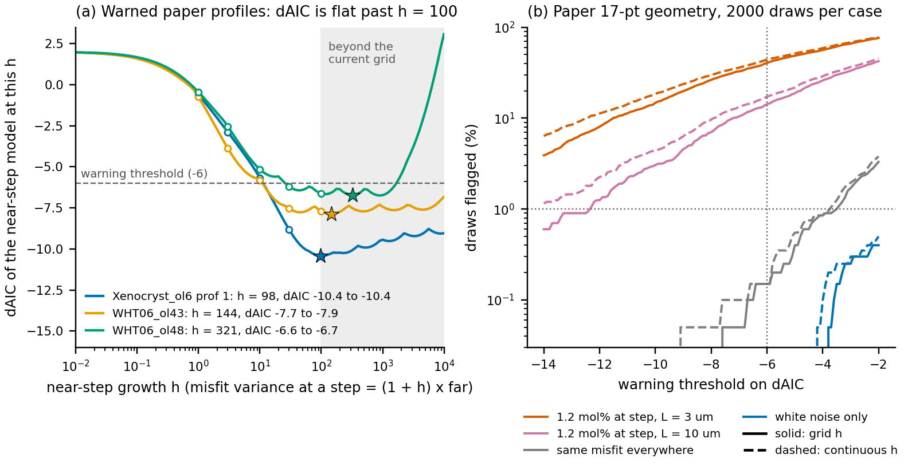
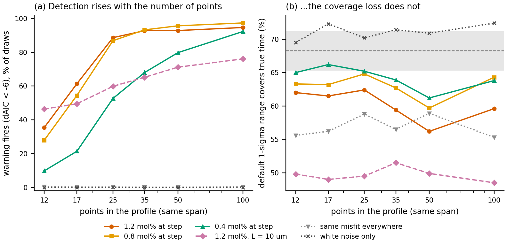

# Near-step check: fitting h continuously, and its power on sparse profiles (2026-10-16)

Two follow-ups from the end of [the whitening-validity study](../README.md) ("Follow-ups
to keep evaluating", items 1 and 3). Written for Henry and for a reader who has not seen
the study. Nothing in `src/` was changed. The prototype lives in `nearstep.py` here.

## Short answer

1. **Fitting h continuously changes almost nothing that matters.** The near-step dAIC
   gets more negative by at most 0.26 on the 19 paper and example profiles, and no
   profile's warning changes (the round robin profiles were checked as well, with the
   same outcome; their numbers are kept in the private folder). On synthetic profiles it
   lifts the warning rate on strong near-step misfit by 0 to 11 points, mostly on 12 to 17
   points, and false alarms stay at or below 0.6%. **What the continuous fit does show
   is that h itself is a poor number to report.** Its 95% interval has no upper end for
   most profiles: once the misfit far from the step is negligible, any h above about 100
   fits equally well. The misfit size at the step, in mol% Fo, is well determined and
   readable.
   **Recommendation:** keep the -6 threshold. Extend the h grid to
   (0, 1, 3, 10, 30, 100, 300, 1000, 3000, 10000) instead of adding an optimiser: that
   recovers the continuous fit's detection rate to within 2.3 points, at about 10/6 of
   today's cost. Report the misfit sd at the step (`rho s sqrt(1 + h)`, mol% Fo) in place of h, or
   next to it.
2. **On sparse profiles the warning misses most near-step misfit, but the misfit costs
   coverage just as much there.** With the plateau fixed at 5 diffusion lengths past the
   step, the warning catches 10 to 36% of near-step misfit at 12 points and 92 to 97% at
   100 points (misfit 3 µm long, peak 0.4 to 1.2 mol%). The default 1σ range covers the
   true time 56 to 66% of the time at *every* point count (target 68%), and 48 to 52%
   when the misfit is 10 µm long. So low power does matter: on a 12 to 17 point profile, a
   real loss of coverage goes unflagged in 39 to 90% of cases. **Recommendation:** keep
   the warning as it is, and say in the guide and the summary that a silent check on fewer
   than about 13 points within 2 diffusion lengths of the step is weak evidence. The fix
   that works at every point count is the near-step noise model itself (1σ coverage 70 to
   82% for 3 µm misfit, 64 to 67% for 10 µm). That makes follow-up item 2 (adding the
   term to the model) more important than any change to the warning.
3. **Surprise: on dense profiles the warning is blind exactly when the fit fails worst.**
   In 5 to 7% of draws with strong 3 µm misfit on 50 or 100 points, the best fit drops to
   a small fraction of the true time (median 3 to 5% of it). The near-step zone is sized by the
   diffusion length *at that fit*, so it shrinks to a few points and the check stays
   silent. Those draws have 0 to 1% coverage with a narrow range. See section 4.

## 1. Terms

- **Near-step check** (`forster.uncertainty.near_step_check`): at the residuals of the
  least-squares ("white") best fit, it compares FORSTER's default noise model with a
  model whose correlated misfit is allowed to be larger near the steps.
  - Default noise model: white noise of sd s, plus a smooth correlated misfit of sd
    a = rho s and correlation length L.
  - Near-step model: the misfit sd is a far from the steps and grows to a sqrt(1 + h) at
    a step. The growth follows a Gaussian bump one diffusion length wide around each
    step. h = 0 is the default model.
- **dAIC**: AIC of the near-step model minus AIC of the default model. AIC is
  −2 × log-likelihood + 2 × number of parameters, and the near-step model has one extra
  parameter (h), so dAIC = +2 means no sign of near-step misfit. FORSTER warns below −6.
- **Grid h**: today's check tries h = 0, 1, 3, 10, 30, 100 and keeps the best.
  **Continuous h**: this prototype searches h anywhere in 0.01 to 10,000 (a bounded 1-D
  optimisation in log10 h). The values of today's grid are part of the search, so the
  continuous dAIC is never higher than the grid's.
- **95% interval of h**: the h values whose likelihood is within the usual
  chi-squared(1) cut (3.84 in −2 log-likelihood) of the best, with (rho, L) refitted at
  each h. "inf" means the likelihood never drops that far up to h = 10,000.
- **Diffusion length l** = √(D t). **Near the step** = within 2 l of a step, as in the
  study.
- **Near/far RMS**: root-mean-square residual within 2 l of a step divided by that
  elsewhere. "Measured" is from the residuals at the white best fit. "Implied" is what
  the fitted near-step noise model predicts for the same points (white noise plus
  misfit, averaged over each zone).
- **Coverage**: the share of synthetic profiles of known age whose 1σ range contains the
  true time. Target 68.3%. With 1000 draws, a correct range lands within 65.4 to 71.1%
  95% of the time.
- **False alarm**: the warning fires although the noise model is right (white noise, or a
  misfit of the same size everywhere).

## 2. Follow-up 1: fitting h continuously

**What was done** (`continuous_h.py`, `nearstep.py`):
- The prototype uses FORSTER's likelihood: s in closed form, (rho, L) on FORSTER's grid,
  with one eigendecomposition per (h, L) so every rho is cheap. **Control:** its grid
  result matches the package's `near_step_check` to 1e-11 in dAIC, with the same h, on 270
  synthetic draws and on all 36 real profiles. On the real profiles it also matches the
  value `fit_run` itself reports.
- **Real profiles:** the 36 of the study (17 round robin, 18 paper, and the packaged
  example). Each was fitted with `forster.fit_run`. The residuals and the diffusion length
  at the white best fit were taken exactly as FORSTER's `_near_step` takes them. The
  1σ range was recomputed under the default, grid-h and continuous-h covariances.
- **Synthetic profiles:** 2000 draws per case on two geometries: the study's paper
  17-point geometry, with the study's seeds, and the 30-point guide geometry of
  follow-up 2. Cases: white noise, two stationary misfits (the controls) and the study's
  four near-step cases. Plus all 36 cells of follow-up 2.



**Figure 1.** (a) dAIC of the near-step model as a function of h for the three paper
profiles where FORSTER warns. Each curve refits (rho, L) at every h. Open circles: the
current grid. Stars: the continuous optimum. Grey: beyond the current grid. The small
wiggles come from the discrete rho grid that FORSTER profiles over. (b) Paper 17-point
geometry, 2000 synthetic draws per case: the share of draws whose dAIC falls below a
threshold. Solid: grid h; dashed: continuous h. Dotted lines: the −6 threshold and 1%.
The white-noise and same-misfit-everywhere curves are false alarms. The near-step curves
are detections.

**Paper and example profiles.** All profiles with dAIC < 0 or grid h at 100 are shown.
The other nine have dAIC +1.0 to +2.0 under both fits. Misfit and white sd are in mol%
Fo. Time shift is the near-step model's best fit against the default's.

| profile | points (near step) | dAIC grid | dAIC continuous | h grid | h continuous [95% interval] | white sd | misfit sd far | misfit sd at step | sqrt(1+h) | near/far rms implied | near/far rms measured | time shift grid % | time shift continuous % |
|---|---|---|---|---|---|---|---|---|---|---|---|---|---|
| Xenocryst_ol6_prof_1 | 15 (6) | -10.44 | -10.44 | 100 | 98 [14, inf] | 0.046 | 0.103 | 1.02 | 9.9 | 4.11 | 1.7 | 57.7 | 57.7 |
| AZ18 WHT06_ol43_prof 1 | 28 (9) | -7.71 | -7.88 | 100 | 144 [3.2, inf] | 0.082 | 0.039 | 0.47 | 12.1 | 3.26 | 2.44 | 17.0 | 16.1 |
| AZ18 WHT06_ol48_prof 1 | 26 (11) | -6.63 | -6.73 | 100 | 321 [3.5, 3884] | 0.051 | 0.009 | 0.15 | 18.0 | 2.31 | 2.0 | -12.2 | -12.5 |
| AZ18 WHT01_Ol_190_prof_1 | 17 (4) | -3.23 | -3.34 | 30 | 21 [1.2, 5217] | 0.057 | 0.045 | 0.21 | 4.7 | 2.33 | 2.18 | 10.4 | 8.9 |
| Xenocryst_ol6_prof_2 | 23 (8) | -1.51 | -1.51 | 10 | 9.7 [0.0, inf] | 0.004 | 0.107 | 0.35 | 3.3 | 2.43 | 1.8 | 11.7 | 11.5 |
| packaged example (AZ18 WHT01_Ol_63_prof_1) | 27 (17) | -0.76 | -1.02 | 100 | 171 [0.0, 1647] | 0.054 | 0.005 | 0.07 | 13.1 | 1.4 | 1.52 | 6.8 | 8.8 |
| AZ18 WHT01_Ol_63_prof_1 | 27 (17) | -0.75 | -1.01 | 100 | 171 [0.0, 1658] | 0.054 | 0.005 | 0.07 | 13.1 | 1.4 | 1.51 | 7.0 | 8.9 |
| AZ18 WHT01_Ol_180_prof_1 | 23 (5) | -0.06 | -0.14 | 100 | 338 [0.0, inf] | 0.078 | 0.008 | 0.14 | 18.4 | 1.77 | 1.62 | 1.1 | 1.4 |
| GCB1A R31_MP_Ol5_prof_2 | 17 (13) | 0.37 | 0.32 | 100 | 77 [0.0, inf] | 0.092 | 0.009 | 0.08 | 8.8 | 1.2 | 1.56 | -0.6 | -0.6 |
| AZ18 WHT01_bigol2_overgrowth_prof_1 | 19 (14) | 1.92 | 1.87 | 100 | 191 [0.0, inf] | 0.058 | 0.006 | 0.08 | 13.9 | 1.42 | 1.75 | -1.9 | -2.5 |

**What the fitted h says, physically:**
- **On the three warned paper profiles h is 98 to 321, and its interval runs from 3 to 14
  up to no upper limit.** The data say the misfit at the step is at least 2 to 4 times
  larger (in sd) than the misfit far from it (sqrt(1 + lower end)). They cannot say how
  much larger, because far from the step the misfit is already negligible next to the
  white noise: 0.009 to 0.10 mol%, against white noise of 0.05 to 0.08 mol%. A very
  large h with a small rho describes "misfit only near the step", and the likelihood is
  flat there.
- **h hitting 100 was mostly a symptom of that flat ridge, not a cut-off of the size of
  the misfit.** Xenocryst_ol6_prof_1's best h is 98, inside the old grid. The other two
  move to 144 and 321 and gain 0.1 to 0.2 in dAIC.
- **The misfit sd at the step is the quantity that is pinned down:** 1.02, 0.47 and
  0.15 mol% Fo for Xenocryst_ol6_prof_1, WHT06_ol43 and WHT06_ol48.
- **sqrt(1 + h), 10 to 18, is far larger than the scatter ratio anyone could see on the
  profile.** The near/far RMS ratio the fitted model implies is 2.3 to 4.1 on these
  three, because white noise dominates the scatter far from the step. The measured ratio
  is 1.7 to 2.4. The implied ratio is the higher of the two on all three, most of all
  on Xenocryst_ol6_prof_1, which has only 6 points near the step. Part of the misfit near
  the step is taken up by the fitted time itself, which lowers the measured ratio. On the
  dense round robin profiles the two ratios agree closely (private file).
- **Where the check is quiet (dAIC > −2), h is meaningless**, even when it sits at 100
  (WHT01_Ol_63, WHT01_Ol_180, GCB1A prof 2): its interval includes 0 and has no upper
  limit.
- **Time shifts barely move.** The near-step model's best fit moves by the same amount
  under both fits within 2 points on every paper profile. The round robin profiles
  differ by more (private file).

**Synthetic profiles, grid against continuous h** (dAIC < −6, 2000 draws each). "1% point":
the dAIC that 1% of draws fall below. "Largest drop": the most the continuous fit
lowered dAIC in any draw.

| geometry | case | draws | flagged grid % | flagged continuous % | 1% point of dAIC, grid | 1% point, continuous | largest drop in dAIC |
|---|---|---|---|---|---|---|---|
| paper 17 pts | white (control) | 2000 | 0.0 | 0.0 | -0.8 | -0.8 | -0.8 |
| paper 17 pts | sq-exp L=3 (control) | 2000 | 0.3 | 0.4 | -3.9 | -3.9 | -1.6 |
| paper 17 pts | sq-exp L=10 (control) | 2000 | 0.15 | 0.15 | -3.5 | -3.7 | -2.6 |
| paper 17 pts | near-step sq-exp L=3 | 2000 | 9.55 | 11.35 | -10.0 | -10.5 | -5.2 |
| paper 17 pts | near-step sq-exp L=10 | 2000 | 1.55 | 2.3 | -6.5 | -6.9 | -6.3 |
| paper 17 pts | strong near-step L=3 | 2000 | 40.5 | 44.0 | -17.1 | -18.9 | -7.1 |
| paper 17 pts | strong near-step L=10 | 2000 | 14.25 | 17.2 | -12.3 | -14.1 | -12.7 |
| synthetic 30 pts | white (control) | 2000 | 0.05 | 0.05 | -1.0 | -1.0 | -0.9 |
| synthetic 30 pts | sq-exp L=3 (control) | 2000 | 0.3 | 0.45 | -4.0 | -4.3 | -1.7 |
| synthetic 30 pts | sq-exp L=10 (control) | 2000 | 0.5 | 0.6 | -3.8 | -4.3 | -2.9 |
| synthetic 30 pts | near-step sq-exp L=3 | 2000 | 60.4 | 62.3 | -22.0 | -22.8 | -3.4 |
| synthetic 30 pts | near-step sq-exp L=10 | 2000 | 24.85 | 28.05 | -12.4 | -13.3 | -3.5 |
| synthetic 30 pts | strong near-step L=3 | 2000 | 91.25 | 91.65 | -40.6 | -44.4 | -12.9 |
| synthetic 30 pts | strong near-step L=10 | 2000 | 61.8 | 66.05 | -22.5 | -25.1 | -10.2 |

("sq-exp" is a squared-exponential misfit of 0.4 mol% of the same size everywhere;
"near-step" multiplies it by the bump at the step, peak 0.4 mol%, "strong" 1.2 mol%;
L is the misfit's correlation length in µm. The paper geometry's true diffusion length
is 8.5 µm, the 30-point geometry's 10 µm.)

- **False alarms do not rise above 1%.** On white noise: 0 to 0.05% under both fits,
  and the same on all six point counts of follow-up 2 (1000 draws each, at most 0.1%).
  With a misfit of the same size everywhere: 0.15 to 0.6% continuous, 0.15 to 0.5% grid,
  and 0.1 to 0.4% grid against 0.2 to 0.5% continuous in follow-up 2. **No threshold
  change is needed.** The 1% point of the stationary-misfit controls is −3.5 to −4.3, so −6 has room to
  spare. A threshold near −4 would keep false alarms at about 1% (0.7 to 1.3% in
  follow-up 2) and raise detection on 12 to 17 points by 8 to 16 points. That is an
  option, not tested beyond these geometries.
- **Detection rises by 0.4 to 4.3 points** with continuous h on these two geometries.
  In follow-up 2 the largest gain is 10.7 points (1.2 mol% at 12 points, 35.5% to 46.2%).
- **The study's "14–37% on 17 points" is reproduced:** 40.5% and 14.3% with today's grid
  on 2000 draws (the study had 37% and 14% on 500), 44.0% and 17.2% with continuous h.

**A longer grid does as well as the optimiser** (`extended_grid.csv`, 300 draws per row;
grid extended to h = 10,000 in half-decade steps):

| points | misfit | warns, grid % | warns, extended grid % | warns, continuous % | ms per check, package | ms, continuous prototype |
|---|---|---|---|---|---|---|
| 12 | white | 0.0 | 0.0 | 0.0 | 9.7 | 9.1 |
| 12 | 1.2 mol%, L = 3 µm | 38.0 | 46.7 | 47.0 | 9.6 | 8.5 |
| 12 | 1.2 mol%, L = 10 µm | 47.7 | 52.3 | 52.3 | 9.6 | 8.6 |
| 17 | white | 0.0 | 0.0 | 0.0 | 10.1 | 11.7 |
| 17 | 1.2 mol%, L = 3 µm | 62.3 | 69.0 | 69.0 | 10.0 | 10.9 |
| 17 | 1.2 mol%, L = 10 µm | 48.0 | 51.7 | 52.3 | 10.1 | 11.2 |
| 35 | white | 0.0 | 0.0 | 0.0 | 16.2 | 37.5 |
| 35 | 1.2 mol%, L = 3 µm | 92.7 | 92.7 | 92.7 | 16.0 | 35.8 |
| 35 | 1.2 mol%, L = 10 µm | 63.7 | 68.0 | 70.3 | 16.0 | 36.5 |

The extended grid's dAIC is within 1.9 of the continuous one in every draw. Its cost is
10/6 of today's check (10 h values instead of 6), with no optimiser and no tolerance to
choose.

**Recommendation for follow-up 1:** extend `NEAR_STEP_H_GRID` to
(0, 1, 3, 10, 30, 100, 300, 1000, 3000, 10000) and keep `NEAR_STEP_AIC = -6`. Report the
misfit sd at the step (rho s sqrt(1 + h), in Fo) as `near_step_misfit_fo`, alongside or
in place of `near_step_h`, and stop quoting h as a size: its upper end is not determined.
A continuous optimiser is not worth the extra code. If one is wanted later, `nearstep.py`
has a tested version (bounded Brent search in log10 h, grid values included, so it is
never worse than the grid).

## 3. Follow-up 2: detection power against the number of points

**What was done** (`power.py`):
- **Geometry:** the noise-models guide's synthetic profile. A 4 mol% normally zoned
  step (Fo 86 to 90) at 25 µm, the packaged example's conditions, true diffusion length
  l = 10 µm. The data run from the rim to 75 µm, 5 diffusion lengths past the step (about
  2.7 l of plateau beyond where the plateau starts). That span is fixed; only the number
  of points N changes (12, 17, 25, 35, 50, 100, evenly spaced; N = 30 is the guide's
  profile). The model runs to 300 µm, so its core end does not move the fit.
- **Noise:** 0.1 mol% white noise plus a near-step misfit: a squared-exponential misfit
  3 µm long, times the bump at the step, peak 0.4, 0.8 or 1.2 mol%. Also 1.2 mol% with a
  10 µm misfit (as long as l), and two controls: white noise alone and a 0.4 mol%,
  10 µm misfit of the same size everywhere. Every case at a given (N, draw) uses the same
  random numbers.
- **Per draw:** the default fit (best time, 1σ and 2σ ranges), the near-step check
  (grid and continuous h), and the 1σ range under the fitted near-step model.
  **1000 draws per cell**, 36 cells.
- **Check against earlier numbers:** the strong 3 µm case at 30 points is caught in 91.3%
  of 2000 draws (section 2), against 94% of 500 in the noise-models guide; 89 to 93% at
  25 and 35 points here.



**Figure 2.** (a) Share of draws where the warning fires (grid h, dAIC < −6) against
the number of points over the same 75 µm. Misfit peaks are at the step, with a
3 µm correlation length unless marked L = 10 µm. (b) Share of draws whose default
1σ range contains the true time. Dashed line: 68.3%. Grey band: where a correct range
lands 95% of the time with 1000 draws. 1000 draws per point.

| misfit | points | within 2 l of step | warns, grid % | warns, continuous % | 1s cover default % | 2s cover default % | 1s cover near-step model % | 1s width default % | 1s width near-step % |
|---|---|---|---|---|---|---|---|---|---|
| white | 12 | 7 | 0.0 | 0.0 | 70 | 96 | 70 | 22 | 23 |
| white | 17 | 9 | 0.0 | 0.0 | 72 | 96 | 72 | 18 | 19 |
| white | 25 | 13 | 0.1 | 0.1 | 70 | 96 | 70 | 15 | 15 |
| white | 35 | 18 | 0.0 | 0.0 | 71 | 96 | 71 | 13 | 13 |
| white | 50 | 26 | 0.0 | 0.0 | 71 | 96 | 72 | 11 | 11 |
| white | 100 | 53 | 0.0 | 0.0 | 72 | 97 | 73 | 8 | 8 |
| smooth 0.4 mol%, L=10, everywhere | 12 | 7 | 0.4 | 0.5 | 56 | 86 | 54 | 101 | 96 |
| smooth 0.4 mol%, L=10, everywhere | 17 | 9 | 0.2 | 0.2 | 56 | 88 | 57 | 99 | 97 |
| smooth 0.4 mol%, L=10, everywhere | 25 | 13 | 0.2 | 0.3 | 59 | 87 | 58 | 97 | 96 |
| smooth 0.4 mol%, L=10, everywhere | 35 | 19 | 0.1 | 0.2 | 56 | 85 | 55 | 99 | 94 |
| smooth 0.4 mol%, L=10, everywhere | 50 | 27 | 0.1 | 0.2 | 59 | 87 | 58 | 97 | 92 |
| smooth 0.4 mol%, L=10, everywhere | 100 | 55 | 0.3 | 0.3 | 55 | 87 | 55 | 99 | 96 |
| 0.4 mol%, L=3 | 12 | 7 | 9.8 | 11.5 | 65 | 95 | 77 | 46 | 54 |
| 0.4 mol%, L=3 | 17 | 9 | 21.4 | 23.4 | 66 | 94 | 81 | 41 | 45 |
| 0.4 mol%, L=3 | 25 | 13 | 52.7 | 54.4 | 65 | 93 | 80 | 42 | 37 |
| 0.4 mol%, L=3 | 35 | 18 | 68.0 | 69.6 | 64 | 91 | 76 | 39 | 32 |
| 0.4 mol%, L=3 | 50 | 26 | 79.8 | 81.0 | 61 | 91 | 76 | 38 | 29 |
| 0.4 mol%, L=3 | 100 | 53 | 92.3 | 93.7 | 64 | 91 | 78 | 37 | 27 |
| 0.8 mol%, L=3 | 12 | 7 | 28.0 | 35.3 | 63 | 93 | 81 | 83 | 98 |
| 0.8 mol%, L=3 | 17 | 9 | 54.5 | 58.7 | 63 | 90 | 82 | 73 | 78 |
| 0.8 mol%, L=3 | 25 | 14 | 86.9 | 88.5 | 65 | 90 | 80 | 80 | 58 |
| 0.8 mol%, L=3 | 35 | 18 | 93.3 | 94.1 | 63 | 89 | 77 | 73 | 49 |
| 0.8 mol%, L=3 | 50 | 26 | 95.7 | 96.1 | 60 | 87 | 76 | 69 | 46 |
| 0.8 mol%, L=3 | 100 | 53 | 97.4 | 98.2 | 64 | 88 | 80 | 73 | 43 |
| 1.2 mol%, L=3 | 12 | 7 | 35.5 | 46.2 | 62 | 90 | 78 | 122 | 131 |
| 1.2 mol%, L=3 | 17 | 9 | 61.4 | 69.0 | 62 | 86 | 74 | 106 | 101 |
| 1.2 mol%, L=3 | 25 | 14 | 88.7 | 90.0 | 62 | 86 | 76 | 116 | 75 |
| 1.2 mol%, L=3 | 35 | 18 | 92.8 | 92.9 | 59 | 85 | 72 | 102 | 62 |
| 1.2 mol%, L=3 | 50 | 26 | 92.9 | 93.0 | 56 | 84 | 70 | 100 | 60 |
| 1.2 mol%, L=3 | 100 | 53 | 94.7 | 95.0 | 60 | 86 | 74 | 101 | 54 |
| 1.2 mol%, L=10 | 12 | 7 | 46.4 | 49.9 | 50 | 82 | 64 | 122 | 87 |
| 1.2 mol%, L=10 | 17 | 9 | 49.5 | 53.2 | 49 | 81 | 64 | 102 | 74 |
| 1.2 mol%, L=10 | 25 | 13 | 59.9 | 63.2 | 50 | 79 | 66 | 106 | 72 |
| 1.2 mol%, L=10 | 35 | 19 | 65.2 | 70.1 | 52 | 80 | 65 | 105 | 71 |
| 1.2 mol%, L=10 | 50 | 27 | 71.2 | 74.2 | 50 | 79 | 67 | 106 | 67 |
| 1.2 mol%, L=10 | 100 | 54 | 76.1 | 80.0 | 48 | 76 | 65 | 97 | 60 |

(Widths are the median 1σ width as % of the true time. "Within 2 l of step" is the
median number of points in the near-step zone at the white best fit.)

**What the map shows:**
- **Power is set by the number of points near the step.** With 7 to 9 points within 2 l
  (12 to 17 points in all), the warning catches 10 to 61% of near-step misfit. With 13 or
  more (25 points or more) it catches 87 to 97% of misfit of 0.8 mol% or more. The weak
  0.4 mol% case needs about 50 points for 80%.
- **A misfit as long as the diffusion length (L = 10 µm) is harder to detect at every
  point count** (46 to 76%), because it looks like a change in time rather than extra
  scatter. It also does the most damage: 48 to 52% coverage.
- **Coverage does not improve with more points.** For 3 µm near-step misfit the default
  1σ range covers 56 to 66% at every N, below the 65.4 to 71.1% band in 17 of 18 cells;
  2σ covers 84 to 95% (target 95%). So the sparse profiles where the warning is weakest
  lose as much coverage as the dense ones, and that loss mostly goes unflagged.
- **The losses are moderate for 3 µm misfit and large for 10 µm misfit.** At 12 to 17
  points the 1σ coverage is 62 to 66% (2 to 7 points short of 68%), while for 10 µm misfit
  it is 49 to 50%.
- **The near-step noise model fixes coverage at every N:** 70 to 82% (3 µm) and 64 to
  67% (10 µm). It does so without changing the controls: white 70 to 73%; the misfit of
  the same size everywhere 54 to 58%, against 55 to 59% for the default. With 3 µm misfit
  it over-covers a little (up to 82%), so its range is conservative.
- **The plateau length and a second step matter as well as N.** On the study's paper
  geometry (17 points, data only 3.1 l past the step, a second step at the rim) the
  strong 3 µm case is caught 40% of the time, against 61% here at 17 points. The
  near-step model gains only 2 to 5 coverage points there, against 13 to 19 here. This
  matches the plateau finding in
  [noise-model-findings.md](../../../references/noise-model-findings.md) (the check needs
  plateau to see anything).

**Recommendation for follow-up 2:** keep the warning and its threshold. Low power on
sparse profiles is real and does matter, because their coverage loss is as large as on
dense ones. Do two cheap things now:
- report the number of points within 2 l of a step next to `near_step_daic`;
- say in the guide that a silent check with fewer than about 13 such points is weak
  evidence of no near-step misfit, and quote the 2σ range for those profiles.

The fix that works at every point count is the near-step model in the fit (study
follow-up item 2), not a more sensitive warning.

## 4. Surprise: the check is blind when the fit collapses to a young time

In the strong 3 µm cells with 50 or 100 points, the warning is silent in 5 to 7% of
draws. Those draws are not the lucky ones:

| misfit | points | warning | draws | median best fit / true time | 1σ coverage | median 1σ width % | points within 2 l |
|---|---|---|---|---|---|---|---|
| 1.2 mol%, L = 3 µm | 50 | silent | 71 | 0.03 | 1% | 3 | 5 |
| 1.2 mol%, L = 3 µm | 50 | fires | 929 | 1.02 | 60% | 107 | 27 |
| 1.2 mol%, L = 3 µm | 100 | silent | 53 | 0.05 | 0% | 6 | 11 |
| 1.2 mol%, L = 3 µm | 100 | fires | 947 | 1.01 | 63% | 105 | 54 |
| 0.8 mol%, L = 3 µm | 50 | silent | 43 | 0.18 | 5% | 13 | 12 |
| 0.8 mol%, L = 3 µm | 100 | silent | 26 | 0.22 | 4% | 19 | 28 |

In those draws the jagged misfit at the step is fitted by a nearly sharp step: the best
fit falls to a few percent of the true time. The near-step zone is sized by the
diffusion length *at that best fit*, so it shrinks to a handful of points and the check
has nothing to test. The range is narrow and misses. On sparse profiles (17 points) the
silent draws are less extreme: coverage 43 to 52%, best fit at about the right time.
This was found here and not tested further. Two candidate fixes for the next round:
- size the zone by a floor (a few point spacings, or l at the 2σ upper end);
- warn when the best-fit diffusion length is shorter than the point spacing near the
  step.

## 5. Reproducing

From the repository root, one heavy job at a time, two workers. `FOLLOWUP_CACHE` is where
model curves are cached (default: the system temp directory).

```bash
uv run python docs/plans/2026-10-15-whitening-validity/followups/continuous_h.py real      # 36 profiles, ~30 s
uv run python docs/plans/2026-10-15-whitening-validity/followups/continuous_h.py null 2000 # ~5 min, 2 workers
uv run python docs/plans/2026-10-15-whitening-validity/followups/continuous_h.py extended  # ~1 min
uv run python docs/plans/2026-10-15-whitening-validity/followups/power.py run 1000         # ~35 min, 2 workers
uv run python docs/plans/2026-10-15-whitening-validity/followups/figures.py
uv run python docs/plans/2026-10-15-whitening-validity/followups/report.py                 # the tables above
```

Files: `nearstep.py` (the prototype: continuous h, its interval, the implied near/far
ratio); `continuous_h.py` → `real_continuous_h.csv` (paper and example profiles),
`null_trials.csv`, `null_summary.csv`, `extended_grid.csv`; `power.py` →
`power_trials.csv`, `power_summary.csv`; `figures.py` → `fig1_continuous_h.png`,
`fig2_power.png`. The section 4 table comes from `power_trials.csv`.
The round robin results (all 36 profiles) are only in the private submodule:
`Diffusion Round Robin/outputs/near_step_followups/real_continuous_h_all.csv`.

**Limitations:**
- (rho, L) stay on FORSTER's grid, as in the package. The rho grid's floor (0.1)
  is one reason h runs away: with rho fixed at 0.1 or more, "no misfit far from the
  step" can only be reached by making h large. A parameterisation with separate
  near-step and far misfit amplitudes would avoid the ridge. Not tried.
- One synthetic step geometry in follow-up 2, one plateau length (5 l), one white-noise
  level (0.1 mol%). The synthetic near-step misfit has exactly the near-step model's
  shape, so the model's coverage there is a best case.
- Coverage uses the near-step covariance fitted at the white best fit, as the study did.
