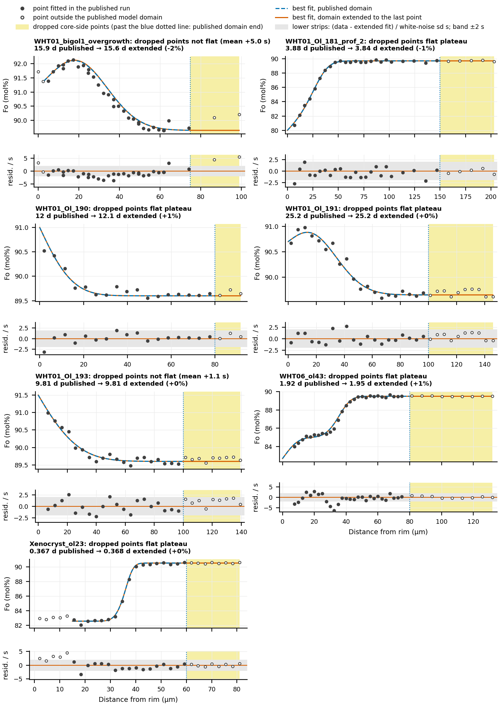

# Bringing back dropped core-side points (2026-10-16)

Written for Henry and for a reader who has not followed the FORSTER work. Public
Towbin and Plank (2026) profiles only (`analyses/xenolith_archive`).

## What the question is

FORSTER fits a measured Fo profile (forsterite content, mol%, against distance from the
crystal rim) with a diffusion model and returns the time the crystal spent diffusing.
The model is solved only over a stretch of the crystal, the **model domain**. Measured
points beyond the domain's far (core-side) end are not fitted. In several published runs
the domain stops well short of the last measured point. Henry did this either to save
model time (no longer needed: a fit now takes milliseconds) or because the points
beyond showed earlier growth or diffusion that was not being modelled. This note asks,
run by run, whether those **dropped points** can come back.

## Terms

- **Core plateau**: the flat inner part of the profile, at the core Fo. FORSTER holds the
  Fo at the core end of the model fixed at the run's core value (the last value of the
  starting profile), so past the old domain end the model is a flat line at that value.
- **Diffusion length**: sqrt(D t), how far diffusion has reached at the best-fit time.
  **Core end (diffusion lengths)**: distance from the last step of the starting profile to
  the end of the model, in diffusion lengths; below about 3 the held core Fo can move the
  fit.
- **Noise model** fitted by FORSTER: a white (independent) part with sd **s**, plus a
  correlated part with sd **a** and correlation length **L** (µm), which absorbs smooth
  misfit between model and data. s and a are in mol% Fo.
- **1σ and 2σ ranges**: the time ranges FORSTER reports (68% and 95% intervals of the fit
  alone, without the uncertainty of the diffusion equation).
- **Near-step dAIC**: FORSTER's check of whether the misfit is larger within about 2
  diffusion lengths of a step than elsewhere. Below −6 it warns; then the default ranges
  are probably too narrow. +2.0 means no sign of it (the extra parameter fitted to zero).
- **Near-step noise model**: the candidate noise model of
  `docs/references/noise-model-findings.md` that lets the misfit grow near the step. It
  kept its coverage on synthetic profiles where the default range became too narrow.

## What was done

`analyse.py` (run from the repository root: `uv run python
docs/plans/2026-10-16-dropped-plateau/analyse.py`, about 10 s):

1. Every paper run was checked (`all_runs.csv`). Seven have more than one point past
   their domain end. The other eleven have at most one point, at most 2.1 µm past the
   end (WHT01_Ol_180's domain already runs past its data).
2. Each of the seven was fitted as published and with the domain extended to the last
   point (FORSTER's default fit, everything else unchanged).
3. **Classifying the dropped points.** Residuals (data minus model) of the extended fit,
   in units of the fitted s. Past the old domain end the model is flat at the core Fo,
   so these residuals measure the dropped points against the core level. The points are
   called a **flat plateau** only if all five tests pass, else a **feature**:
   1. their mean lies within 1 s of the core level;
   2. all but at most one point lie within 2 s;
   3. a straight line through them (fitted with FORSTER's noise model, white plus
      correlated) is not significantly offset or sloped (p > 0.05; 3 or more points);
   4. a runs test finds no clustering of residual signs (p > 0.05; 4 or more points);
   5. across the whole plateau there is no significant step in level at the old domain
      end between the published and the dropped points (p > 0.05, same noise model).
   Each profile was then checked by eye (`profiles.png`).
4. For a feature, the script also looks for a clean break (flat points, then points at a
   significantly different level) and refits with the domain ended before it. No profile
   had one, so no such fit was made.
5. Sensitivity check: the extended run refitted with the core Fo set to the mean of all
   plateau points (published and dropped). The plateau starts where the extended best fit
   comes within 2 s of its core level.
6. Where the near-step check warns, the near-step noise model's range is added.

## Results

Time in days. "Published" is the run as in the paper; "extended" has the domain
extended to the last point. Ranges are FORSTER's default.

| Run | Domain end (µm), published → extended | Points dropped | Dropped points | Time, published → extended | 1σ range, published → extended | 2σ range, published → extended | Near-step dAIC |
|---|---|---|---|---|---|---|---|
| WHT01_bigol1_overgrowth | 75 → 99 | 2 | **feature** (mean +5.0 s) | 15.9 → 15.6 (−2.2%) | 13.5–18.8 → 14.2–17.2 | 11.4–22.4 → 12.9–19.1 | +2.0 → +2.0 |
| WHT01_Ol_181_prof_2 | 150 → 203 | 5 | flat | 3.88 → 3.84 (−1.1%) | 3.63–4.15 → 3.61–4.08 | 3.38–4.46 → 3.38–4.35 | +2.0 → +2.0 |
| WHT01_Ol_190 | 80 → 91.6 | 3 | flat (few points) | 12.0 → 12.1 (+0.8%) | 9.8–14.5 → 9.9–14.7 | 7.8–17.9 → 7.8–18.2 | −3.2 → −3.8 |
| WHT01_Ol_191 | 100 → 145.8 | 10 | flat | 25.2 → 25.2 (+0.0%) | 22.6–28.2 → 22.8–27.9 | 20.0–31.9 → 20.5–31.2 | +1.9 → +1.5 |
| WHT01_Ol_193 | 100 → 139.3 | 9 | **feature**, weak (mean +1.1 s) | 9.81 → 9.81 (0.0%) | 8.64–11.09 → 8.68–11.04 | 7.48–12.61 → 7.59–12.45 | +2.0 → +2.0 |
| WHT06_ol43 | 80 → 132 | 9 | flat | 1.92 → 1.95 (+1.2%) | 1.53–2.39 → 1.68–2.25 | 1.17–2.99 → 1.43–2.60 | **−7.7 → −18.3** |
| Xenocryst_ol23 | 60 → 81 | 8 | flat | 0.367 → 0.368 (+0.2%) | 0.322–0.417 → 0.329–0.411 | 0.278–0.479 → 0.291–0.462 | +1.0 → +0.2 |

WHT06_ol43 with the near-step noise model: 1σ 1.83–2.69 → 1.86–2.61 d, 2σ 1.38–3.20 →
1.49–3.03 d.

Noise model and core end, published → extended:

| Run | s (mol%) | a (mol%) | L (µm) | Core end (diffusion lengths) |
|---|---|---|---|---|
| WHT01_bigol1_overgrowth | 0.094 → 0.101 | 0.13 → 0.38 | 10 → 36 | 4.6 → 7.3 |
| WHT01_Ol_181_prof_2 | 0.154 → 0.141 | 0.03 → 0.04 | 70 → 98 | 12.8 → 18.2 |
| WHT01_Ol_190 | 0.097 → 0.092 | 0.02 → 0.03 | 15 → 16 | 9.4 → 10.7 |
| WHT01_Ol_191 | 0.091 → 0.085 | 0 → 0.01 | – → 72 | 5.7 → 9.5 |
| WHT01_Ol_193 | 0.074 → 0.072 | 0.06 → 0.06 | 5 → 5 | 6.1 → 8.6 |
| WHT06_ol43 | 0.080 → 0.087 | 0.18 → 0.12 | 4.0 → 3.4 | 9.7 → 20.8 |
| Xenocryst_ol23 | 0.176 → 0.155 | 0.08 → 0.04 | 22 → 21 | 12.5 → 23.1 |

Core level (mol% Fo) and the sensitivity check:

| Run | Core Fo held in the run | Mean of published plateau points | Mean of dropped points | Time change with core Fo = mean of all plateau points |
|---|---|---|---|---|
| WHT01_bigol1_overgrowth | 89.65 | 89.73 | 90.15 | −4.7% |
| WHT01_Ol_181_prof_2 | 89.70 | 89.62 | 89.69 | −3.5% |
| WHT01_Ol_190 | 89.60 | 89.65 | 89.66 | −15.9% |
| WHT01_Ol_191 | 89.65 | 89.68 | 89.69 | −2.7% |
| WHT01_Ol_193 | 89.60 | 89.63 | 89.68 | −10.2% |
| WHT06_ol43 | 89.49 | 89.47 | 89.50 | +0.9% |
| Xenocryst_ol23 | 90.53 | 90.44 | 90.54 | −1.7% |

Every test statistic is in `results.csv` (columns `dropped_*`; one row per run and fit).

**Figure.** Each run with more than one dropped point. Upper panel: measured Fo (filled:
fitted in the published run; open: outside the published model domain), the best fit
with the published domain (blue dashed) and with the domain extended to the last point
(vermilion). Yellow shading: the dropped core-side points, past the published domain end
(blue dotted line). Lower strip: residual of the extended fit divided by its white-noise
sd s; grey band ±2 s. Rim-side open points (bigol1 at 0 µm, Xenocryst_ol23 at 2–13 µm)
lie outside the domain at the rim end; their residuals are taken against the model's
rim-end value. Title: verdict of the flat-plateau test (for a feature, the mean residual
of the dropped points) and the best-fit times.

## Recommendations

- **WHT01_Ol_181_prof_2: extend to 203 µm.** Flat; time −1.1%.
- **WHT01_Ol_191: extend to 145.8 µm.** Flat; time unchanged. Three points at 126–136 µm
  sit about 0.1 mol% high (+1.3 s), within the noise.
- **WHT01_Ol_190: extend to 91.6 µm.** Flat by every test that three points allow, and by
  eye; time +0.8%. The tests have little power on three points.
- **Xenocryst_ol23: extend to 81 µm.** Flat; time +0.2%.
- **WHT06_ol43: extend to 132 µm, and report the near-step range.** Flat; time +1.2%. But
  the extra plateau narrows the default 1σ range by a third (0.86 → 0.57 d wide) and
  strengthens the near-step warning (−7.7 → −18.3). That is the overconfidence described
  in `noise-model-findings.md` section 3: plateau points pull the noise estimate down while
  the misfit near the step stays. The near-step noise model's range narrows less (by
  14%, 1.83–2.69 → 1.86–2.61 d), so with the extended domain quote that range, or keep
  the published one.
- **WHT01_Ol_193: keep as is (100 µm).** The dropped points sit about 0.05 mol% above the
  published plateau points (mean +1.1 s; level-step test p = 0.11). That is too small to
  call a growth stage with confidence, but enough to fail the conservative test. With
  the core Fo held, extending changes nothing (0.0%). What matters is the core Fo: set
  from all plateau points (89.65 instead of 89.60) the time falls 10%, inside the
  published 1σ range. If the inner core really is slightly higher, the run needs either
  a small extra step in the starting profile beyond 100 µm or a fitted core Fo, not a
  longer domain.
- **WHT01_bigol1_overgrowth: keep as is (75 µm); the dropped points need another zone.**
  The two dropped points (87 and 99 µm) sit 0.45–0.55 mol% above the core level (+4.5
  and +5.5 s), as does the published point at 64 µm (+3 s): Fo rises again toward the
  centre, to about 90.2. That looks like an older, higher-Fo inner core inside the zone
  being modelled. Using these points would need a fourth segment in the starting profile
  (inner core ≈ Fo 90.2, step somewhere between about 65 and 85 µm) or a growth stage.
  Two points 12 µm apart cannot place that step.

## Caveats

- **Bringing back flat points does not move the times** (−1.1% to +1.2% on the five
  flat runs), as section 3 of `noise-model-findings.md` found. It mostly narrows the
  ranges (by 8–34% at 1σ on four of the five; WHT01_Ol_190 widens 3%). Where the near-step check
  does not warn, that narrowing comes from a better noise estimate. Where it warns
  (WHT06_ol43), it is overconfidence.
- **The core Fo matters more than the domain end.** For WHT01_Ol_190 the held core Fo
  (89.60) is 0.05 mol% below both its published and its dropped plateau points, and
  setting it to their mean moves the time −16% (inside the 1σ range). That comes from
  the published points, not the dropped ones, so it is a separate question for the
  paper. The same check moves WHT01_Ol_193 by −10%. The sensitivity check uses a plain
  mean of the plateau points; it is not a fit of the core Fo.
- **The classification depends on thresholds.** The mean-within-1 s and p > 0.05 cut-offs
  are choices. WHT01_Ol_193 fails only the mean test (1.07 s against 1.0) and passes
  the level-step test at p = 0.11. For bigol1 the line test cannot run (two points) and
  the level-step test gives p = 0.15, because the extended fit's correlated noise grows
  (a 0.13 → 0.38 mol%, L 10 → 36 µm) and absorbs the offset. The mean test, and the
  eye, catch it.
- **Rim-side points.** Xenocryst_ol23's domain starts at 15 µm; the five points at 2–13 µm
  sit 0.25–0.7 mol% above the rim plateau (+1.6 to +4.5 s), a rim-side feature such as late
  overgrowth. bigol1 and WHT01_Ol_63 also leave one or two rim points out. This note does
  not address them.
- The published WHT06_ol43 near-step dAIC here (−7.7) differs from the −8.6 in
  `noise-model-findings.md`, presumably from FORSTER changes since that note; the
  extended value (−18.3) matches.
- No run was changed in the parameter database; the extended domains above are
  recommendations.

## Files

- `analyse.py`: the analysis; reuses `extended_run`, `plateau_start_um`, the near-step
  model and `load_paper` from `docs/references/figures/noise_findings/findings.py`.
- `results.csv`: one row per run and fit (published, extended to the data end, extended
  with the core Fo from the plateau mean), with the test statistics.
- `all_runs.csv`: every paper run's domain against its data at both ends.
- `profiles.png`: the figure above.
