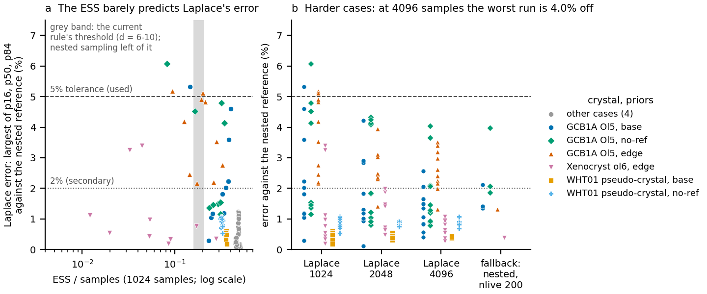

# When should a crystal's joint fit fall back to nested sampling? (2026-10-17)

Written for Henry and for a reader who has not followed the FORSTER work. Public
Towbin and Plank (2026) profiles (`analyses/xenolith_archive`). Exploratory: nothing in
`src/` or `tests/` changed.

## In short

- **Tolerance.** A sampler's result counts as accurate here when its p16, p50 and p84 of
  the time are each within **5%** of a careful reference, and the shared segment Fo within
  half a reference standard deviation. Why 5% (Henry, 2026-10-17): the diffusion
  equation alone is uncertain by about 0.1 log units in D, about 25% in time, and the
  joint fit's job is the best fit with a basic parameter uncertainty, not a precise
  posterior. A stricter 2% (and 0.2 sd) is kept as a second column.
- **At 5%, Laplace importance sampling is good enough once it has 4096 samples.** Over
  two real crystals in 8 prior and offset settings (80 seeded runs per sample count), it
  missed 5% in 4 runs, all at 1024 samples (5.1-6.1% off); with 2048 or 4096 samples
  every run was within 5% (worst 4.3% and 4.0%).
- **The effective sample size (ESS) does not tell an accurate run from a wrong one**
  between about 0.05 and 0.40 of the samples: accurate runs went as low as 0.05,
  runs more than 2% off as high as 0.40. Above 0.41 every run was within 2%.
- **The current fallback rule is accurate but slow and seed-dependent.** Every ESS rule
  tried gets all 80 results within 5%, but the current one falls back in runs where
  Laplace was fine (mostly Xenocryst with edge offsets: ESS as low as 1% of the samples,
  yet every run within 5%, and within 1.1% at 4096 samples), at 1.5-25 minutes a
  fallback instead of seconds, and in 4 of the 8 cases different seeds switch between
  Laplace and nested sampling.
- **Recommendation (at 5%): replace the ESS threshold for joint fits by a sample-count
  step.** Keep 1024 samples when ESS / samples is at least ideal(d), the fraction an
  exactly bell-shaped posterior with d parameters gives (0.39 at 6, 0.34 at 8, 0.30 at
  10); otherwise draw 4096 and keep them; fall back to nested sampling only when the ESS
  of the 4096 is tiny (below 20, a safety net). On these runs: all 80 within 5% (worst
  4.6%), no seed flips between methods, 12 s of sampling per fit on average against 116 s
  for the current rule; on the 9-10 parameter stress crystal it keeps 1024 samples, all
  within 2%. The cut was chosen after seeing these runs and the safety net never
  triggered, so both want checking on more crystals. If an ESS threshold is kept
  instead, keep the current one: the unscaled 0.25 and fixed ESS floors are no better.
- **At 2%** no ESS rule works (the current rule keeps 12 of 23 runs more than 2% off,
  and the fallback with 200 live points is itself off by more than 2% in 3 of its 8 runs
  on the harder cases); only a check of the percentiles' Monte Carlo error with a
  stronger fallback held it, at twice the current cost.
- **More parameters:** a stress test at 9-10 parameters (four profiles of different WHT01
  olivines fitted as one pseudo-crystal) was easy for Laplace: all 60 runs within 2%.
- **No round robin crystal could be used:** none was measured along more than one
  transect (below).

## The question

`forster.fit_crystal` fits one diffusion time to several profiles of one crystal. Besides
the time, it fits the uncertain parts of each profile's **starting profile** (the step
positions and segment compositions before diffusion; segment Fo is shared between the
profiles of a crystal) and, per profile, a small **Fo offset** for measurement drift
between sessions. Their uncertainty feeds into the time's uncertainty, so FORSTER
samples their **posterior** (the combined probability of the parameter values given the
priors and the data) and reports the time's posterior median (p50) and the 68% range
from its 16th to its 84th percentile (p16 to p84).

It samples in one of two ways (`forster.sampling.sample_posterior`):

- **Laplace importance sampling** (seconds): draw 1024 parameter sets from a bell-shaped
  approximation centred on the best fit and weight each by how well the approximation
  matches the true posterior there.
- **Nested sampling** (`dynesty`; minutes to hours): explores the posterior without
  assuming its shape.

The **effective sample size (ESS)** says how many equally weighted draws the weighted
draws are worth. When it is low, a few draws carry most of the weight and the
approximation may be poor, so FORSTER falls back to nested sampling. For a joint fit
the rule is (`scaled=True`): fall back when ESS / samples is below 0.25 x
ideal(d) / ideal(4), where d is the number of fitted parameters and ideal(d) the ESS
fraction the method reaches when the posterior is exactly bell-shaped (0.48 at 4, 0.39
at 6, 0.34 at 8 parameters); while the ESS is above that but below 256, the samples are
doubled, up to 4096. The 0.25 came from single profiles with 2-5 parameters; the scaling
was checked on one synthetic crystal only. This note checks it on real crystals.

## The crystals

Among the 18 paper runs, two crystals have more than one profile: **GCB1A R31_MP_Ol5**
(prof_1 and prof_2) and **Xenocryst_ol6** (prof_1 and prof_2). By name and by eye each pair
is one crystal (same zoning shape; prof_2 of GCB1A reads about 0.3 mol% higher, which the
Fo offset takes up), and their temperature, pressure and fO2 rows are identical (1250 C,
500 MPa, fO2 0.0083 Pa, as for every paper run). Their individual fits give 8.2 and 12.8
days (GCB1A) and 0.12 and 0.21 days (Xenocryst); the 2-sigma ranges overlap, so
`fit_crystal` does not warn. No other paper crystal has two profiles (the WHT01 and WHT06
runs are different olivines).

**Starting-profile priors** (the range of values the fit treats as plausible before it sees
the data; all Gaussian): every step more than 2 um inside the crystal edge has sd 3 um,
every segment Fo sd 0.005 (0.5 mol%), in the settings below except "tight" (2 um and
0.003). Steps closer to the edge (the thin segment that holds the rim Fo) stay fixed.
`fit_crystal` needs a shared segment to have one nominal value, so each segment's
nominal Fo is the mean of the two profiles' table values (GCB1A core 0.9025 and 0.9046
become 0.9036; Xenocryst's middle zone 0.847 and 0.836 become 0.8415).

**Settings** (each crystal is fitted in all four):

| setting | priors | Fo offsets | edge offsets | parameters d |
|---|---|---|---|---|
| base | steps sd 3 um, Fo sd 0.005 | one profile the reference (default) | off (default) | 6 |
| tight | steps sd 2 um, Fo sd 0.003 | default | off | 6 |
| edge | as base | default | on, sd 2 um per profile | 8 |
| no-ref | as base | both profiles free (`fo_reference=None`) | off | 7 |

The **edge offset** (where the true crystal edge lies in each profile's distances) is
barely identifiable with free steps, and the **free reference** makes the two Fo offsets
and the shared Fo trade off; both are there to make the posterior less bell-shaped, the
case the fallback exists for.

Xenocryst_ol6 diffused for only 0.1-0.2 days, but the paper table gives every run 200 days
of model time, so its time grid (sized for the short times) would hold 134,000 steps and
one best fit took 260 s. Its scan runs to 2 days instead (`scan_max_time_days`); no fit
warned that the posterior reached the end.

## What was done

For each crystal and setting (a **case**), `calibrate.py`:

1. ran `fit_crystal(..., method="auto")` with the defaults and recorded the method it
   chose, its ESS and its wall time;
2. drew Laplace importance samples alone at 1024, 2048 and 4096 samples with seeds 0-9,
   from the same likelihood and best fit (rebuilt with `forster.joint`'s own helpers;
   the best values match the auto fit's exactly). `fit_crystal(method="laplace")` could
   not be used for this: under the joint fit's rule it still doubles the samples, so it
   does not give a fixed sample count;
3. ran the fallback as `fit_crystal` runs it (nested sampling, 200 live points), seeds 0-2
   (one seed with the edge offsets on: 25 minutes a run);
4. ran a **reference**: nested sampling with 1000 live points, seeds 0 and 1 (the two seeds
   measure the reference's own noise); with the edge offsets on, one run with 500 live
   points (one 1000-point run took 2 hours).

A run is **accurate** when its p16, p50 and p84 of the joint time are each within the
tolerance (5%, or 2%) of the reference (the mean of its runs) and every shared segment
Fo's posterior mean is within 0.5 (or 0.2) reference sd. `diagnostics.py` adds two other
checks of the importance samples: the Pareto shape k of the largest weights (Vehtari et
al. 2024, JMLR 25(72); it agrees with arviz 0.19 to 1e-14), and the bootstrap standard
error of p16, p50 and p84 (100 resamples).

## Results

| case | d | fit_crystal auto (error) | ESS/n at 1024: median (range) | Laplace accurate within 5%, of 10: 1024 / 2048 / 4096 | within 2% | largest Laplace error at 1024: % (% of 68% width) | fallback, nested nlive 200: within 5% / within 2% / runs (largest error %) | reference p16 / p50 / p84 (days) | reference runs (nlive); own noise % | wall time (s): Laplace 1024 / fallback / reference |
|---|---|---|---|---|---|---|---|---|---|---|
| GCB1A R31_MP_Ol5, base | 6 | nested (2.1%) | 0.33 (0.15-0.40) | 9 / 10 / 10 | 5 / 7 / 8 | 5.3 (11) | 3 / 2 / 3 (2.1) | 5.83 / 7.34 / 9.58 | 2 (1000); 0.8 | 3 / 87 / 318 |
| GCB1A R31_MP_Ol5, tight | 6 | laplace (1.2%) | 0.49 (0.48-0.49) | 10 / 10 / 10 | 10 / 10 / 10 | 1.2 (3) | 3 / 3 / 3 (1.8) | 9.55 / 11.9 / 14.6 | 2 (1000); 1.0 | 3 / 96 / 278 |
| GCB1A R31_MP_Ol5, edge | 8 | laplace (3.0%) | 0.20 (0.09-0.33) | 8 / 10 / 10 | 0 / 1 / 2 | 5.2 (11) | 1 / 1 / 1 (1.3) | 9.44 / 12.4 / 15.7 | 1 (500); - | 3 / 1475 / 6572 |
| GCB1A R31_MP_Ol5, no-ref | 7 | laplace (1.5%) | 0.30 (0.08-0.34) | 9 / 10 / 10 | 6 / 6 / 6 | 6.1 (12) | 3 / 1 / 3 (4.0) | 5.64 / 7.09 / 9.23 | 2 (1000); 2.0 | 3 / 212 / 695 |
| Xenocryst_ol6, base | 6 | laplace (0.1%) | 0.51 (0.50-0.51) | 10 / 10 / 10 | 10 / 10 / 10 | 0.2 (1) | 3 / 3 / 3 (0.1) | 0.213 / 0.23 / 0.25 | 2 (1000); 0.3 | 5 / 93 / 404 |
| Xenocryst_ol6, tight | 6 | laplace (0.1%) | 0.47 (0.46-0.47) | 10 / 10 / 10 | 10 / 10 / 10 | 0.1 (1) | 3 / 3 / 3 (0.2) | 0.202 / 0.221 / 0.242 | 2 (1000); 0.4 | 4 / 108 / 467 |
| Xenocryst_ol6, no-ref | 7 | laplace (0.2%) | 0.46 (0.45-0.47) | 10 / 10 / 10 | 10 / 10 / 10 | 0.4 (2) | 3 / 3 / 3 (0.6) | 0.213 / 0.23 / 0.25 | 2 (1000); 0.3 | 4 / 229 / 1188 |
| Xenocryst_ol6, edge | 8 | laplace (0.4%) | 0.05 (0.01-0.28) | 10 / 10 / 10 | 6 / 7 / 10 | 3.4 (24) | 1 / 1 / 1 (0.4) | 0.229 / 0.245 / 0.263 | 1 (500); - | 5 / 283 / 733 |

"Laplace accurate" counts the 10 seeds at each sample count. The "% of 68% width" puts the
largest error in days against the width of the reference's 68% range. "-" for the
reference's own noise: one run only.

- **Four cases are easy** (GCB1A tight, all Xenocryst settings but edge): ESS / samples
  0.45-0.51, Laplace within 2% in all 120 runs, every rule keeps it.
- **GCB1A base and no-ref** (ESS / samples about 0.3): Laplace's error is Monte Carlo noise
  in the tails, mostly p84 (it misses a long upper tail and then, on one draw, overshoots).
  More samples help: within 2% in 5 of 10 runs at 1024 and 8 at 4096 (base), within 5% in
  all runs from 2048 on. Higher ESS did not mean a smaller error here: the four base runs
  with the highest ESS (0.36-0.40) were all 2-4.6% off. For no-ref the reference's own two
  runs differ by 2.0%, so its 2% labels are uncertain; its 5% labels are not.
- **GCB1A edge** (ESS / samples about 0.2): Laplace sits on average 1.5-2.7% late on all
  three percentiles at every sample count, against both nested runs (500 and 200 live
  points, 1.3% apart): a small bias that more samples barely change. It passes at 5% from
  2048 samples on; at 2% only 2 of 10 runs pass at 4096.
- **Xenocryst edge** (ESS / samples 0.01-0.28, median 0.05; Pareto k about 0.8,
  "unreliable"): yet Laplace is within 5% in every run and within 2% in all 10 at 4096
  (largest error 1.1%). The low ESS comes from the edge offsets, which hardly move the
  time: the ESS judges the weights over every parameter, not the time the fit reports.
  The current rule falls back in 9 of 10 runs, needlessly.

*(a) Every Laplace run at 1024 samples (10 seeds per case): the fraction ESS / samples
against the largest error of p16, p50 and p84 against the nested-sampling reference.
Grey band: where the current rule's fallback threshold lies for the cases' 6-10
parameters (left of it: nested sampling). Grey points: the four easy paper cases; the
WHT01 pseudo-crystal is the stress test below. (b) The harder cases: each point is one
seed, at 1024, 2048 and 4096 samples, and the fallback (nested sampling, 200 live points,
1-3 seeds; not run for the pseudo-crystal). Dashed: the 5% tolerance the recommendation uses; dotted: 2%.*

## The rules

Each rule sees what `sample_posterior` sees: the ESS at 1024 samples and, when it doubles,
at 2048 and 4096 (the same seed draws the same samples). For each case and seed it either
keeps Laplace (at the sample count it stopped at) or falls back. "Kept when accurate"
counts the runs where Laplace, at that rule's sample count, was accurate; "kept when
inaccurate" is the costly mistake (a wrong range reported without a word). "Result
accurate" is the share of results the user gets that are accurate: Laplace's, or the
fallback's accuracy rate for that case. "Cases where seeds disagree": cases in which some
seeds keep Laplace and others fall back, so a rerun can change the method and the answer.
"Mean wall time" is sampling time per fit (the GCB1A edge fallback, 25 minutes, dominates
it for rules that fall back there).

| rule | kept when accurate (5%) | kept when inaccurate (5%) | result accurate, 5% (%) | kept when inaccurate (2%) | result accurate, 2% (%) | cases where seeds disagree | mean wall time (s) | worst kept error (%) |
|---|---|---|---|---|---|---|---|---|
| current: 0.25 x ideal(d)/ideal(4), doubling | 64 of 77 | 0 of 3 | 100 | 12 of 23 | 83 | 4 | 116 | 4.8 |
| unscaled 0.25 at 1024 | 58 of 76 | 0 of 4 | 100 | 9 of 23 | 85 | 4 | 176 | 4.8 |
| ESS/n >= 0.4 at 1024 (tuned on these runs) | 41 of 76 | 0 of 4 | 100 | 1 of 23 | 87 | 1 | 260 | 4.6 |
| ESS floor 256, doubling | 71 of 80 | 0 of 0 | 100 | 16 of 16 | 80 | 1 | 39 | 4.8 |
| ESS floor 512, doubling | 69 of 80 | 0 of 0 | 100 | 13 of 14 | 83 | 1 | 51 | 4.2 |
| current threshold, doubling while ESS/n < 0.4 | 62 of 80 | 0 of 0 | 100 | 10 of 15 | 83 | 3 | 99 | 4.6 |
| never fall back: Laplace 1024 | 76 of 76 | 4 of 4 | 95 | 23 of 23 | 71 | 0 | 4 | 6.1 |
| never fall back: Laplace 4096 | 80 of 80 | 0 of 0 | 100 | 14 of 14 | 82 | 0 | 23 | 4.0 |
| Laplace 4096, fall back if ESS < 20 | 80 of 80 | 0 of 0 | 100 | 14 of 14 | 82 | 0 | 23 | 4.0 |
| 1024 if ESS/n >= 0.4, else 4096; fall back if ESS < 20 | 80 of 80 | 0 of 0 | 100 | 15 of 15 | 81 | 0 | 12 | 4.6 |
| 1024 if ESS/n >= ideal(d), else 4096; fall back if ESS < 20 | 80 of 80 | 0 of 0 | 100 | 15 of 15 | 81 | 0 | 12 | 4.6 |
| as above; also fall back if bootstrap SE at 4096 > 2.5% | 75 of 80 | 0 of 0 | 100 | 12 of 15 | 81 | 2 | 24 | 4.6 |
| Pareto k < 0.7 at 1024 | 67 of 76 | 3 of 4 | 96 | 19 of 23 | 74 | 3 | 35 | 5.3 |
| bootstrap SE <= 2%, doubling | 73 of 80 | 0 of 0 | 100 | 15 of 17 | 78 | 3 | 53 | 4.9 |
| bootstrap SE <= 0.7%, doubling | 46 of 80 | 0 of 0 | 100 | 1 of 15 | 86 | 1 | 248 | 1.0 |
| bootstrap SE <= 0.5%, doubling | 37 of 80 | 0 of 0 | 100 | 0 of 14 | 88 | 2 | 262 | 1.0 |

- **current** (`scaled=True`, as `fit_crystal` runs): the threshold is 0.21, 0.19 and 0.18
  of the samples at 6, 7 and 8 parameters.
- **unscaled 0.25**: the single-profile rule (its doubling never triggers).
- **ESS/n >= 0.4**: keep only near the ideal fraction, else fall back. Read off these runs
  (every run more than 2% off but one had less), so its score is optimistic.
- **ESS floor 256 / 512**: keep once the ESS reaches it, doubling up to 4096 meanwhile.
- **current threshold, doubling while ESS/n < 0.4**: spend the doubling on every case
  below the ideal, not only those below an ESS of 256.
- **never fall back**: Laplace at a fixed 1024 or 4096 samples.
- **Laplace 4096, fall back if ESS < 20**, and **1024 if ESS/n >= 0.4 (or ideal(d)), else
  4096; fall back if ESS < 20**: the sample-count step recommended above (the ideal(d)
  form), and variants without the 1024 shortcut for easy cases or with a fixed 0.4 cut
  (the same here; not at 9-10 parameters, below). The floor of 20 (a handful of draws
  carrying all the weight) never triggered; the lowest ESS at 4096 was 25 (Xenocryst
  edge, within 1%).
- **as above; also fall back if bootstrap SE at 4096 > 2.5%**: a Monte Carlo error check
  as the safety net instead; it fell back in 5 of 80 runs (GCB1A base and no-ref), all
  of them within 5%.
- **Pareto k < 0.7**: the PSIS diagnostic instead of the ESS. It kept most of the runs
  that were off (its k stays near 0.5 when Laplace misses a tail) and flagged the accurate
  Xenocryst edge runs.
- **bootstrap SE**: keep once the bootstrap standard error of p16, p50 and p84 is at most
  2%, 0.7% or 0.5% of each, doubling first. It targets the reported numbers directly. Its
  cost is not in the wall time column: 100 resamples took 3-18 s per run here (about
  twice the importance sampling; reweighting the per-sample time densities instead of
  re-summarising would make it about a second).

## Recommendation

**At the 5% tolerance (the one to use, for the reason in "In short"): for joint fits,
replace the ESS fallback threshold by a sample-count step** in `sample_posterior` (joint
fits only; single-profile fits keep their calibrated rule):

1. draw 1024 importance samples; keep them if ESS / samples is at least ideal(d)
   (`ideal_ess_fraction`, already in `forster.sampling`);
2. otherwise draw 4096 and keep them;
3. fall back to nested sampling only if the ESS of the 4096 is below 20.

Support: 8 cases on 2 crystals, 80 seeded decisions, plus 20 on the stress crystal. All
80 paper results within 5% (worst 4.6%) and all 20 stress results within 2%; 0 cases
where seeds flip between methods (the current rule: 4); 12 s of sampling per fit on
average (the current rule: 116 s, because it falls back needlessly on low-ESS crystals
whose time is fine). The four runs that were clearly
off (more than 5%, all at 1024 samples) are fixed by drawing 4096, not detected: no
diagnostic tried here, the ESS included, picked them out. Before building it, check the
ideal(d) cut and the floor of 20 on more crystals, ideally including one where Laplace
is clearly wrong (two modes, or a best fit at a prior's edge), which these crystals did not provide.

**If an ESS threshold stays, keep the current one** (`scaled=True`, ESS_FALLBACK 0.25,
doubling to 4x): the unscaled 0.25 and the fixed floors are no better at either tolerance,
and the scaled rule keeps more good Laplace runs than the unscaled one (64 against 58 of
the runs within 5%) at lower cost.

**At 2%** none of the ESS rules is adequate (the current rule keeps 12 of 23 runs more
than 2% off; the recommended step keeps 15 of 15, since GCB1A edge is about 2% biased).
The only rule that held 2% was a Monte Carlo error check (bootstrap SE at most 0.7%)
with a fallback stronger than 200 live points (500-1000: 5 minutes to 2 hours here).

## Stress test at 9-10 parameters (not one crystal)

To see more parameters than two profiles give, four profiles of different olivines from
xenolith AZ18 WHT01 with the same two zones (bigol2_overgrowth, Ol_63, Ol_192, Ol_193;
rim about Fo 91.5, core about Fo 89.7; their individual times, 8-15 days, overlap at
2 sigma) were fitted as one "pseudo-crystal" in the base and no-ref settings. It is a
sampler test, not a geological result. To keep it within the time budget each case has
one reference run (1000 live points: 39 and 47 minutes) and no fallback runs.

| case | d | fit_crystal auto (error) | ESS/n at 1024: median (range) | Laplace accurate within 5%, of 10: 1024 / 2048 / 4096 | within 2% | largest Laplace error at 1024: % (% of 68% width) | fallback, nested nlive 200: within 5% / within 2% / runs (largest error %) | reference p16 / p50 / p84 (days) | reference runs (nlive); own noise % | wall time (s): Laplace 1024 / fallback / reference |
|---|---|---|---|---|---|---|---|---|---|---|
| WHT01 pseudo-4, base | 9 | laplace (0.6%) | 0.36 (0.36-0.36) | 10 / 10 / 10 | 10 / 10 / 10 | 0.6 (3) | not run | 9.4 / 10.3 / 11.4 | 1 (1000); - | 6 / nan / 2311 |
| WHT01 pseudo-4, no-ref | 10 | laplace (1.0%) | 0.32 (0.31-0.33) | 10 / 10 / 10 | 10 / 10 / 10 | 1.1 (5) | not run | 9.31 / 10.2 / 11.3 | 1 (1000); - | 7 / nan / 2804 |

Both posteriors are close to bell-shaped despite the parameter count: ESS / samples
0.31-0.36, near ideal(9) = 0.32 and ideal(10) = 0.30, and Laplace within 2% in all 60
runs. Every rule keeps Laplace except "ESS/n >= 0.4", which would fall back in all 20
decisions, and "1024 if ESS/n >= 0.4, else 4096", which draws 4096 needlessly: a fixed
0.4 does not carry over to more parameters, ideal(d) does.

## Round robin crystals

None could be used. The numbered round robin runs of each sample (for example
"transect-1" to "transect-4" of one sample) all point to a single measured profile per
sample (one EPMA traverse in the data file and in the original spreadsheet
`DiffusionRR-2.xlsx`); the numbered runs are different starting profiles fitted to that
one profile. Fitting
them as one crystal would count the same measurements several times. So 0 private
multi-transect crystals exist in the data, and nothing was written to the private folder.

## Other things found

- `fit_crystal(method="laplace")` is not "Laplace at n_samples": under the joint fit's rule
  it still doubles the samples (up to 4096) while the ESS is below 256.
- The paper table's 200 days of model time gives the Xenocryst_ol6 joint fit 100 times
  more time steps than a 2-day run (above). The individual fits stop early and do not
  suffer, but the joint fit (and the single-profile starting-profile fit, `scan_run`)
  uses the scan grid over the run's full model time.
- With the edge offsets on, nested sampling is very slow: 2 hours with 1000 live points,
  1.8 hours with 500 and 25 minutes with 200 (GCB1A), with dynesty warning about a
  complex posterior shape. The auto fit takes those 25 minutes whenever it falls back on
  such a crystal.
- In the GCB1A base case `fit_crystal`'s own fit fell back and its nested result (200 live
  points) was 2.1% off; the Laplace result it rejected (ESS 0.15 of the samples) was 5.3%
  off, and at 2048 samples that seed was 0.9% off.

## Files

- `calibrate.py`: the fits (`--set paper`, `--set stress`; `--extra` adds Laplace seeds 3-9
  and the fallback runs). Caches: `cache_paper.json`, `extra_paper.json` (and `_stress`).
- `diagnostics.py`: Pareto k and bootstrap SE for every Laplace run (`diagnostics_*.json`).
- `rules.py`: scoring and rules; `--markdown` prints the tables above, `--csv` the runs.
- `figure.py`: the figure (`ess_vs_error.png`).
- `results.csv`: every sampler run of the paper crystals and the stress crystal, scored at
  5% (case, d, method, samples, seed, ESS, p16, p50, p84, shared Fo means and sd, errors
  against the reference, accuracy, Pareto k, bootstrap SE, wall time). `rules.csv`: the
  rule totals at 5% (paper crystals).

Run from the repository root (about 12 hours on this machine, one nested sampling at a time):

    uv run python -u docs/plans/2026-10-16-joint-calibration/calibrate.py --set paper
    uv run python -u docs/plans/2026-10-16-joint-calibration/calibrate.py --set paper --extra
    uv run python -u docs/plans/2026-10-16-joint-calibration/diagnostics.py --set paper
    uv run python docs/plans/2026-10-16-joint-calibration/rules.py \
        docs/plans/2026-10-16-joint-calibration/cache_paper.json --markdown
    uv run python docs/plans/2026-10-16-joint-calibration/figure.py
