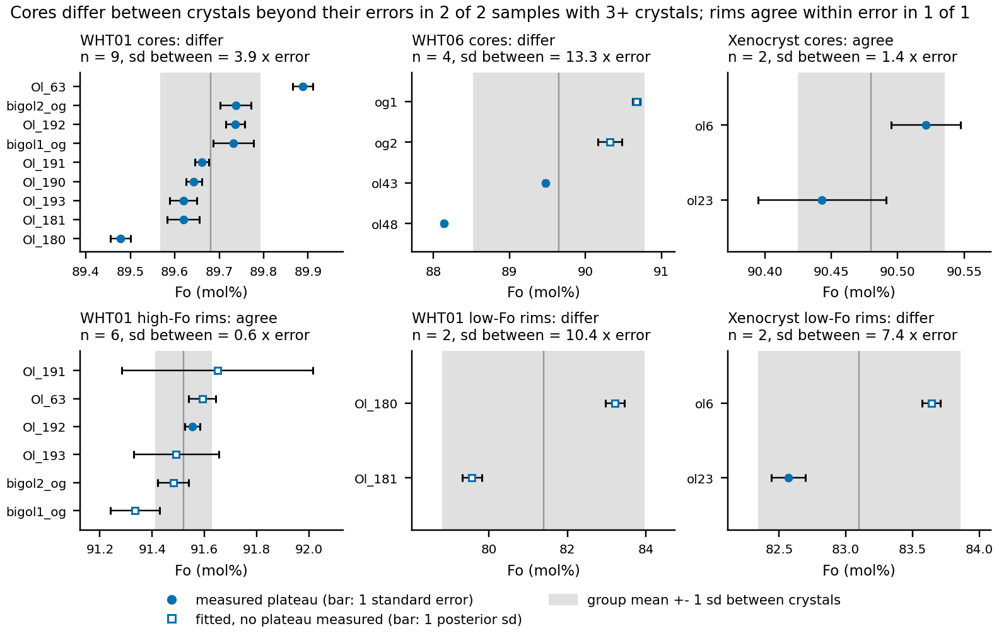
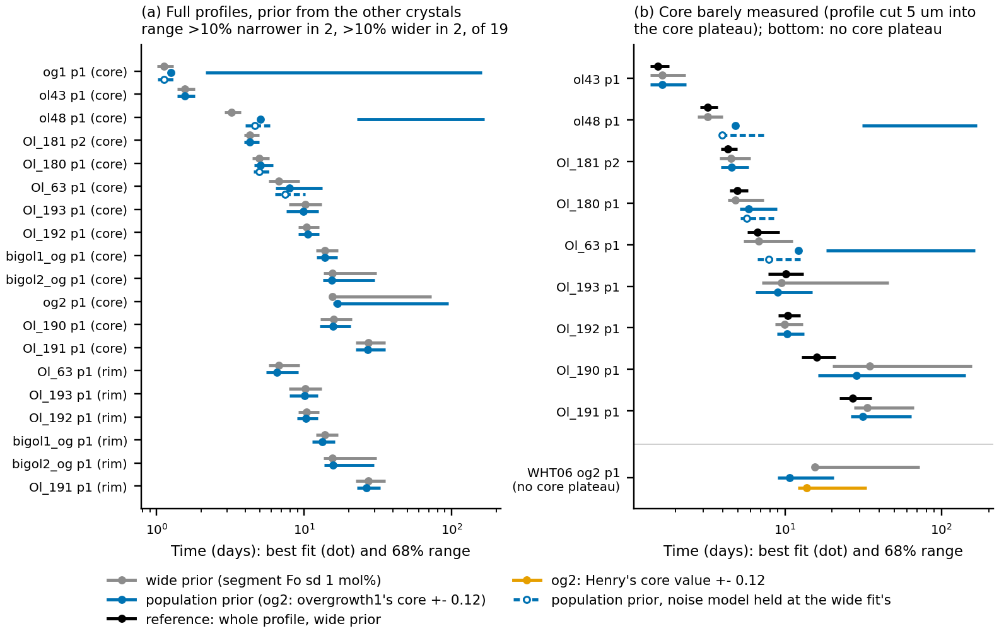

# Starting-profile priors from the crystal population (2026-10-16)

Written for Henry and for a reader who has not followed the FORSTER work. Public
Towbin and Plank (2026) profiles only (`analyses/xenolith_archive`). Exploratory: nothing
in `src/` changed.

## In short

- **Cores differ between crystals** of one sample, beyond their errors (WHT01: by 0.11
  mol%, about 4 times the errors; WHT06: two kinds of crystal, 0.9 to 2.5 mol% apart). The
  **high-Fo rims of WHT01 agree** within their errors.
- **A prior built from the other crystals** helps little for well-measured cores and
  biases outlier crystals by 10% to 20% in time. It helps for poorly pinned rims (Ol_191:
  range 25% narrower) and for cores the data barely reach, but only when its centre is
  right. For WHT06_ol_overgrowth2 (no core plateau) the time is 10.7 days with
  overgrowth1's core, 13.8 with Henry's value and 15.6 with a wide prior.
- **The dramatic blow-ups** (time ranges out to 160 days) are not a sampler failure:
  nested sampling reproduces them. They come from FORSTER fitting its noise model
  first at the prior's centre. In one case (WHT06_ol48) there is also a real conflict:
  the prior excludes the crystal's core.
- **Recommendation:** offer population priors per segment, for rims and barely measured
  cores, with a conflict check. Group by zone label and crystal kind. Fix the noise-model
  start first. Build the hierarchical fit in its cheap two-stage form, with one spread
  shared across samples.

## The question

FORSTER fits a measured Fo profile (forsterite content, mol%, against distance from the
crystal rim) with a diffusion model and returns how long the crystal diffused. The
model starts from a **starting profile**: a staircase of flat **segments**, each with its
own Fo, separated by sharp steps. How well the starting Fo values are known feeds
straight into the time.

Henry's idea (TODO_local.md, "Priors for core, rim and plateau Fo from the crystal
population"): crystals from one sample do not all have the same core or rim
composition, but together they say what values are likely. Histograms of those values
could become **priors** (the range of values the fit treats as plausible before it sees
the profile) for each crystal's starting profile. Henry already does this by hand for two
crystals whose cores were not measured (WHT06_ol_overgrowth2 and GCB1A
R31_MP_Ol5_prof_1). The long-term version is a **hierarchical fit**, which fits all
crystals of a sample together.

The questions here:
1. How different are the crystals of one sample, compared with how well each crystal's
   own values are measured?
2. If a crystal gets a prior built from the *other* crystals of its sample, how much do
   its time and its time range change?
3. Is a hierarchical fit worth building, and for which segments?

## Terms

- **Segment roles.** Segments are labelled a, b, c, ... from the rim inward
  (docs/plans/2026-10-16-geometry-naming.md). Here each one also gets a role:
  - **edge**: a first segment at most 2 µm wide, in practice the Fo held at the crystal
    surface;
  - **rim**: the outermost segment with real width (an overgrowth or rim zone);
  - **plateau**: any segment between the rim and the core;
  - **core**: the last segment.

  Labels and roles do not line up from crystal to crystal. The high-Fo overgrowth zone
  of WHT01 is segment a in most crystals but segment b in Ol_191, which has a zero-width
  edge segment in front of it.
- **Zoning direction.** **Reverse**: the rim has more Fo than the core (a high-Fo
  overgrowth). **Normal**: the rim has less. A sample can hold both kinds (WHT01, WHT06),
  and they are different growth events, so rims are grouped by sample *and* direction.
  Cores are grouped by sample.
- **Starting-profile fit** (`forster.fit_initial_condition`): fits the segment Fo values
  and step positions together with the time, and samples their posterior (what the data
  and the prior together allow).
- **Wide prior** (the baseline here): every segment Fo is a Gaussian centred on Henry's
  value with sd 1 mol% Fo, and every step more than 2 µm inside the rim is a Gaussian
  with sd 3 µm. FORSTER cuts Gaussian priors off at ±2.5 sd.
- **Posterior sd** of a segment Fo: how well the fit pins that value down.
- **68% range**: the central 68% of the posterior of time, in days. The **best** time is
  the time of the best fit.
- **ic_share**: the fraction of the variance of the time that comes from not knowing
  the starting profile. Near 1, the starting profile dominates the time uncertainty.
- **Measured plateau**: the measured points the best fit leaves within 0.1 mol% of the
  segment's starting Fo, i.e. where diffusion has not changed it. With 3 or more such
  points, the plateau's mean and its **standard error** (sd / sqrt(n)) are used as the
  crystal's value; otherwise the fitted value and its posterior sd are used.
- **Spread between crystals**: the sd of the crystal values within a group.
  **Within-crystal error**: each crystal's standard error or posterior sd. **Ratio**:
  spread / rms error. **p (same value)**: the chance of a spread this large if every
  crystal had the same true value (Cochran's Q test).
- **Leave-one-out population prior**: for crystal i, a Gaussian with the mean of the
  *other* crystals in its group and their sd × sqrt(1 + 1/m), where m is the number of
  other crystals. The sd is never set below 0.1 mol%. Leaving the crystal out avoids
  using its data twice. Built only for groups of 4 or more crystals.
- **Sensitivity**: how many days the best time moves per mol% change in a segment Fo
  (from the fit's posterior).
- **Hierarchical fit**: each crystal has its own value, drawn from a population with a
  mean **mu** and spread **tau** that are fitted too. **Shrinkage** (0 to 1): how far a
  crystal's value is pulled toward mu. A poorly measured value is pulled a lot, a well
  measured one hardly at all.

## What was done

`analyse.py` (run from the repository root:
`uv run python docs/plans/2026-10-16-population-priors/analyse.py`; fits are cached in
`fits_cache.json`, 88 KB):

1. **Wide-prior fit of all 18 paper runs**, measuring every segment's plateau
   (`segments.csv`).
2. **One value per crystal and role**, combining the two profiles where a crystal has
   two (`crystal_values.csv`). Then the spread between crystals of each group is
   compared with the within-crystal errors (`spread.csv`).
3. **Leave-one-out priors** for the three groups with 4 or more crystals: WHT01 cores
   (9), WHT01 high-Fo rims (6) and WHT06 cores (4) (`loo_priors.csv`). Each crystal is
   refitted with that prior on the one segment and wide priors on everything else
   (`refits.csv`, case `full`).
4. **Barely measured cores.** The same refits on profiles cut 5 µm past the first point
   of the measured core plateau, against each crystal's uncut fit as the reference
   (case `truncated`, 9 crystals).
5. **Henry's real case, WHT06_ol_overgrowth2**, whose core plateau is not measured at
   all. Its core prior is centred on the core of overgrowth1, the only other crystal of
   the same kind, or on Henry's own value of 90.50. Either way the sd is 0.12 mol%: the
   spread between crystals borrowed from the WHT01 cores (case `borrowed`).
6. **Sampler check.** Wherever a best time fell outside its own 68% range, both fits
   were repeated with nested sampling (`sampler_check.csv`).
7. **Noise-model check** (`check_noise.py`, its own cache `noise_cache.json`): the
   population-prior fits that came out worse were refitted with FORSTER's noise model
   held at the wide-prior fit's (`noise_check.csv`).
8. **Two-stage hierarchical fit** (`hierarchical.py`, `hierarchical.csv`): mu and tau
   per group, the shrunk value of each crystal, and the first-order time change
   (sensitivity × shift).

The samples come from the run names: AZ18 WHT01_* (9 crystals), AZ18 WHT06_* (4),
Xenocryst_* (2, ol6 with two profiles) and GCB1A_* (1 crystal, Ol5, with two profiles,
so its population is a single crystal and nothing can be built from it).

## What was found

### 1. Cores differ between crystals, high-Fo rims do not (spread.png, spread.csv)

*Each panel is one group, with its own Fo scale. Dots: one value per crystal (filled:
measured plateau mean ± 1 standard error; open squares: no plateau measured, fitted
value ± 1 posterior sd). Grey band: group mean ± 1 sd between crystals. "Differ" means
p < 0.01 that every crystal shares one value (Cochran's Q). Where a crystal has two
profiles their values are combined by inverse-variance weights.*

| group | role | crystals | mean Fo | spread between | rms error | ratio | p (same value) |
|---|---|---|---|---|---|---|---|
| WHT01 | core | 9 | 89.68 | 0.11 | 0.03 | 3.9 | 4e-36 |
| WHT06 | core | 4 | 89.65 | 1.13 | 0.08 | 13 | <1e-300 |
| Xenocryst | core | 2 | 90.48 | 0.06 | 0.04 | 1.4 | 0.15 |
| WHT01 (reverse) | rim | 6 | 91.52 | 0.11 | 0.17 | 0.6 | 0.21 |
| WHT01 (reverse) | edge | 2 | 90.72 | 0.01 | 0.10 | 0.1 | 0.93 |
| WHT01 (normal) | rim | 2 | 81.39 | 2.57 | 0.25 | 10 | 3e-25 |
| WHT06 (normal) | rim | 2 | 85.00 | 0.27 | 0.06 | 4.4 | 1e-5 |
| WHT06 (reverse) | rim | 2 | 93.03 | 0.30 | 0.07 | 4.3 | 2e-5 |
| Xenocryst (normal) | rim | 2 | 83.10 | 0.76 | 0.10 | 7.4 | 1e-13 |

All Fo values in mol%.

- **WHT01 cores** really differ, but only by 89.48 to 89.89 (sd 0.11 mol%). Caveat:
  the within-crystal error is just the standard error of the plateau mean. It leaves out
  how well EPMA reproduces between sessions, which is of the same order (about 0.1
  mol%), so part of this spread may be analytical.
- **WHT06 cores** fall into two kinds: the two overgrowth crystals (90.3 and 90.7) and
  ol43 and ol48 (89.5 and 88.1). One Gaussian across them is meaningless.
- **WHT01 high-Fo rims** are consistent with one shared value, 91.52 mol%. So are the
  two WHT01 edge values (90.72 and 90.73).
- **Rims are rarely measured.** Diffusion has usually reached the whole rim zone, so 13
  of the 17 rim segments have no measured plateau and get a fitted value, with errors
  of 0.03 to 0.37 mol%. Cores have a measured plateau in 13 of 16 crystals (counting
  GCB1A Ol5, measured in one of its two profiles, as fitted).
- **Two profiles of one crystal can disagree beyond their errors.** GCB1A Ol5: core
  90.25 ± 0.09 against 90.52 ± 0.08. Xenocryst ol6: rim 84.1 ± 0.3 against 83.6 ± 0.1.
  So "one core per crystal" is itself an approximation at the 0.1 to 0.3 mol% level.

### 2. Population priors on full profiles: a small gain for rims, a risk for cores (refits.png a)

*Best time (dot) and 68% range (line), log scale. Grey: wide prior. Blue: prior from the
other crystals of the group, on the named segment. Dashed blue with an open dot: the same
prior with FORSTER's noise model held at the wide fit's (section 4), shown only where the
fitted noise model grew by more than 25%. (b) Black: the uncut profile with the wide
prior, the reference. Bottom row, WHT06_ol_overgrowth2 (no core plateau): blue is
overgrowth1's core ± 0.12 mol%, orange is Henry's 90.50 ± 0.12. The counts in the panel
(a) title use the dashed fit where there is one.*

WHT01 (15 refits):

| role | refits | time change | range ratio (median) | segment sd ratio (median) |
|---|---|---|---|---|
| rim | 6 | -4.3% to +1.2% | 0.95 | 0.82 |
| core | 9 | -2.6% to +19.2% (+10.6% with the noise model held, section 4) | 0.98 | 0.95 |

- **Rims** gain where the crystal's own rim is poorly pinned:
  - **Ol_191**: rim sd 0.37 → 0.10 mol%, range × 0.75, ic_share 0.78 → 0.52.
  - **Ol_193**: rim sd 0.16 → 0.10 mol%, range × 0.84.
  - The others barely change.
- **Cores** that are well measured (posterior sd 0.02 to 0.06 mol%, below the 0.11
  spread between crystals) gain nothing. The exception shows the risk. **Ol_63's core**
  (89.89) lies 2.3 prior sd from the others. The prior pulls it down 0.02 to 0.07 mol%,
  and the time rises 11% (6.7 → 7.4 days) with the noise model held, or 19% (→ 8.0
  days, range twice as wide) as fitted, where the noise model was also inflated (section
  4). Times are very sensitive
  to core Fo: 20 to 95 days per mol% for several WHT01 crystals, so a 0.1 mol% error in a
  prior's centre moves the time by 5 to 20%.
- **WHT06 cores.** The prior from the other three crystals has sd 0.7 to 1.6 mol%,
  wider than the wide prior, so it cannot help. It hurts badly where it conflicts:
  ol48's own core (88.14) lies 2.8 prior sd from the others, outside the prior's ±2.5 sd
  cut-off. Its time goes 3.2 → 5.1 days and its range spreads over most of the 200-day
  run. overgrowth1's range does the same although its core is inside the prior's
  range. Section 4 shows that the spread over the run comes from FORSTER's noise model,
  not from the sampler. ol48's bias of +24% to +44% remains when the noise model is held
  fixed; overgrowth1's change disappears.

### 3. Barely measured cores: the prior helps only if its centre is right (refits.png b)

With each profile cut 5 µm into its core plateau:
- **Helped clearly**: Ol_193. Range 7.1–45.7 → 6.5–15.0 days; the uncut fit gives
  7.8–13.1.
- **Helped a little**: Ol_190 and Ol_191, both still far wider than their uncut fits.
- **No change**: Ol_181, Ol_192 and WHT06_ol43.
- **Hurt**: the two crystals whose cores sit 2.3 sd from the others. With the noise
  model held (section 4): **Ol_63** 6.8 → 7.9 days against an uncut 6.7, and
  **Ol_180** 4.8 → 5.7 against 5.0, i.e. biased by 16% to 19%. As fitted, Ol_63 went
  to 12.2 days with a range to 163. **WHT06_ol48**: biased +24%, its core pinned at the
  prior's cut-off.

**WHT06_ol_overgrowth2** (core not measured; Henry's case):

| core prior | best (days) | 68% range (days) |
|---|---|---|
| wide (90.50 ± 1.0) | 15.6 | 15.0–72.6 |
| other WHT06 crystals (89.43 ± 1.46) | 16.8 | 15.8–94.9 |
| overgrowth1's core (90.67 ± 0.12) | 10.7 | 9.0–20.6 |
| Henry's value (90.50 ± 0.12) | 13.8 | 12.1–33.3 |

A tight core prior narrows this crystal's range 2 to 5 times. But a 0.17 mol% shift of
the prior's centre moves its time by 30%, so the prior must come from the right crystals,
here the one other crystal of the same kind. A prior from the whole sample is useless.

### 4. Conflict between prior and data, or a missed mode? (sampler_check.csv)

In four population-prior refits the best time fell outside its own 68% range, and the
range spread over most of the 200-day run: WHT06_ol_overgrowth1 and WHT06_ol48 (full
profiles), and Ol_63 and WHT06_ol48 (cut profiles). Two checks were run.

**Nested sampling** (`sampler_check.csv`). Nested sampling can find several separate
fits (modes) where the default sampler, which explores around the single best fit,
cannot. It reproduced all 8 fits (the wide and the population prior for each case)
within a few percent; for overgrowth1 with the population prior, the range was 2.4–161
days against 2.1–160. So **the sampler is not missing a mode.**

**Fixed noise model** (`check_noise.py`, `noise_check.csv`). FORSTER fits a noise model
alongside the profile: a white part (scatter from point to point) and a correlated part
(smooth misfit between model and data). In the blow-ups, the correlated part grew 4 to
18 times over the wide-prior fit (overgrowth1: 0.005 → 0.19 mol%; ol48: 0.05 → 0.95). A
large correlated part treats the misfit as noise, so the data stop constraining the
time. The cause is in how `fit_initial_condition` proceeds: it fits the noise model
first at the prior's centre, then searches for the best fit under that noise model, and
refits the noise model only at the point that search reaches. A prior centred away from
the data starts it with an inflated noise model, which it keeps. Refitting with the
noise model held at the wide fit's:

| case | wide prior | population prior (as fitted) | population prior, noise held |
|---|---|---|---|
| overgrowth1, full | 1.12 (1.01–1.30) | 1.25 (2.14–160) | 1.12 (1.01–1.31) |
| ol48, full | 3.21 (2.88–3.71) | 5.05 (22.7–166) | 4.63 (3.99–5.85), core at the prior's cut-off |
| ol48, cut | 3.21 (2.75–4.01) | 4.82 (31.2–168) | 3.98 (3.91–7.33), core at the prior's cut-off |
| Ol_63, full | 6.70 (5.73–9.27) | 7.98 (6.39–13.3) | 7.40 (6.36–10.2) |
| Ol_63, cut (uncut: 6.70) | 6.80 (5.46–11.2) | 12.2 (18.4–163) | 7.89 (6.69–12.6) |
| Ol_180, full | 4.96 (4.45–5.82) | 5.04 (4.60–6.18) | 4.96 (4.53–5.99) |
| Ol_180, cut (uncut: 4.96) | 4.81 (4.31–7.35) | 5.88 (5.15–8.91) | 5.72 (5.18–8.52) |

Best time in days, 68% range in brackets.

So the answer is both:
- **overgrowth1's blow-up is entirely the noise model.** With it held, the population
  prior gives the wide prior's answer exactly. Its own core (90.67) lies inside the
  prior's range (89.31 ± 1.27), so there is no conflict between prior and data.
- **ol48 is a real conflict, which the noise model then amplifies.** Its core (88.16)
  lies outside the prior's ±2.5 sd cut-off (88.37 and up), so the fit is pinned at the
  cut-off (88.39 to 88.49) and FORSTER warns that the value is at the edge of its prior.
  With the noise model held, the time is still biased +24% to +44% against the wide
  fit; without it, the range also explodes.
- **Ol_63 and Ol_180**, whose cores sit 2.3 prior sd from the other crystals, are biased
  by the prior itself by +11% to +19% where the core is barely measured or the crystal
  is an outlier (Ol_180's full profile is unaffected). The inflated noise model made
  Ol_63's bias worse: +19% instead of +11% on the full profile, and a range out to 163
  days instead of 12.6 on the cut one.

The noise model (white and correlated parts combined) grew by more than 25% only in
these cases. In every other refit, including all the rim gains, the cut Ol_193 and the
overgrowth2 fits, it changed by less than 10%, so those results stand as fitted.

This is a FORSTER issue beyond population priors: **any informative prior whose centre
is away from the data can inflate the noise model.** A fix, for a later change in
`src/`: fit the first noise model at a data-driven starting point (the wide-prior best
fit, or the measured plateau levels), or repeat the noise refit and best-fit search
until the noise model stops changing.

### 5. What a hierarchical fit would change (hierarchical.csv)

The two-stage version (`hierarchical.random_effects`) fits mu and tau to the crystal
values and their errors, then shrinks each crystal toward mu:

- **WHT01 high-Fo rims**: tau = 0.05 mol%. Shrinkage 0.23 to 0.98, so poorly fitted
  rims are pulled almost entirely to the shared value. First-order time changes are
  -5.4% to +5.0%.
- **WHT01 cores**: tau = 0.11 mol%. Shrinkage at most 0.14, time changes at most 4.4%
  (Ol_63).
- **WHT06 cores**: tau = 1.13 mol%, no shrinkage. Even so, overgrowth2 would move 15%,
  because its time is so sensitive to its core (−176 days per mol%).

A small sample cannot estimate its own spread: WHT06 has two crystals of each kind.
The overgrowth2 case worked only because the spread was borrowed from WHT01. A useful
hierarchical model therefore has a **mean per crystal type and a spread shared across
samples**, not a free mean and spread per sample.

## Recommendation

1. **Build population priors as an option the user applies segment by segment, not as
   a default.** Worth it for poorly constrained segments: rims and outer zones (rarely
   measured, and in WHT01 shared across crystals) and cores whose plateau is short or
   missing. Not worth it for well-measured cores: they gain nothing, and an outlier
   crystal can be biased by up to 20% in time. A simple rule for the GUI: offer the
   population prior only where the crystal's own posterior sd for that segment (from a
   wide-prior fit) is larger than the spread between crystals.
2. **Always show the conflict check first.** Show the crystal's own fitted value in
   units of the prior sd, and warn above 2. With FORSTER's ±2.5 sd cut-off, a prior that
   excludes the crystal's real value pins the fit at the cut-off and biases the time
   (WHT06_ol48: +24% to +44%).
3. **Fix the noise-model start in `fit_initial_condition` before offering informative
   priors** (a FORSTER change, separate from population priors). Today the first noise
   model is fitted at the prior's centre. A centre away from the data inflates the
   correlated noise, which then stays, and the time range spreads over the whole run
   (WHT06_ol_overgrowth1: 1.0–1.3 days became 2–160 with a prior that does not
   conflict). Fit the first noise model at a data-driven start (the wide-prior best fit
   or the measured plateau levels), or alternate noise refit and best-fit search until
   the noise model is stable. Pin it with a test: an informative prior centred 1 to 2
   sd away from the data must not change the noise model.
4. **Group by zone and crystal kind, not by default label or sample alone.** Population
   priors need segment labels that mean the same zone in every crystal (rename
   segments, e.g. `og` for the overgrowth; the naming note allows this), and a way to
   say which crystals are of one kind (reverse and normal crystals of one sample are
   different populations). Matching by the default a, b, c would pair the wrong zones
   (WHT01_Ol_191).
5. **Gaussian rather than kernel density.** With at most 8 other crystals the Gaussian
   predicted each left-out crystal better than a kernel density (Scott bandwidth) in all
   three groups (total log density 46.2 vs 43.6 for WHT01 cores, 30.9 vs 28.4 for rims,
   9.2 vs 8.9 for WHT06 cores). Offer the kernel density only when a group is clearly
   bimodal and has many crystals.
6. **Hierarchical fit: worth building in its two-stage form** (each crystal's own fit
   summarised as a value ± error, then a population mean per crystal kind and one spread
   shared across samples). It is cheap: no extra model runs beyond each crystal's own
   fit and one refit with the resulting prior. The full joint fit (`joint_log_posterior`,
   all crystals sampled together) costs about N crystals × one fit per evaluation in
   N × d + 2 dimensions (38 for WHT01). Build it only if the two-stage version proves
   inaccurate, e.g. for skewed posteriors of unmeasured plateaus.

## Caveats

- The within-crystal errors are standard errors of plateau means or posterior sds. They
  leave out inter-session EPMA accuracy (~0.1 mol%), so "differ beyond error" for the
  WHT01 cores may partly be analytical.
- Groups are small (2 to 9 crystals). The leave-one-out sd of 3 to 8 crystals is itself
  uncertain by 25 to 40%.
- Only the paper runs were used: no extra crystals measured but not modelled, which
  is what Henry used for some cores.
- The prior's 0.1 mol% floor applied to Ol_63 and Ol_180 (cores) and bigol1 (rim): with
  them left out, the others' spread falls below 0.1.

## Files

- `analyse.py`: all fits and tables (cached in `fits_cache.json`). `hierarchical.py`:
  hierarchical-fit prototype (two-stage and full log posterior). `figures.py`: the two
  figures.
- `segments.csv`: every segment of every run (nominal, measured plateau, fitted).
- `crystal_values.csv`: one value per crystal and role.
- `spread.csv`: spread against errors per group.
- `loo_priors.csv`: leave-one-out priors and how far each crystal sits from its prior.
- `refits.csv`: wide prior against population prior (full, truncated, borrowed).
- `sampler_check.csv`: nested-sampling repeats.
- `check_noise.py`, `noise_check.csv`, `noise_cache.json`: refits with the noise model
  held at the wide fit's.
- `hierarchical.csv`: two-stage hierarchical fit and the predicted time changes.
