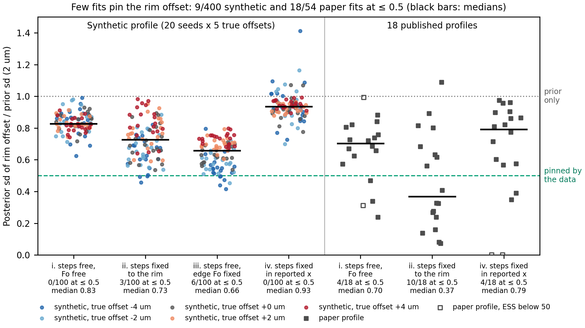
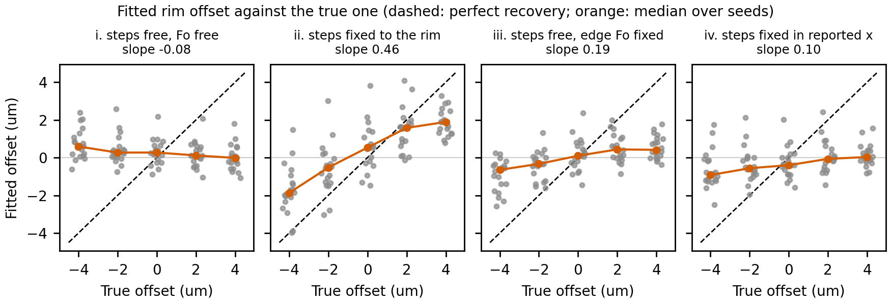

# Can one profile pin its rim position? (step 0, 2026-10-23)

Step 0 of [the single-profile edge offset plan](../2026-10-23-single-profile-edge-offset.md).
Measurement only: nothing in `src/` or `tests/` changed. Script: `spike.py`; every fit is
one row of `results.csv`; the tables below are printed by `uv run python spike.py report`,
which also draws both figures.

## In short

- **With free steps, one profile does not pin the rim offset.** The posterior sd of the
  offset stays at 0.83 of its 2 µm prior on the synthetic profile (median; 0 of 100 fits
  at or below 0.5) and at 0.70 on the 18 published profiles (4 of 18 at or below 0.5).
  The fitted offset does not follow the true one (slope -0.08 against the true offset,
  Figure 2). Turning it on moves the best time by a median 1.3-1.4% (at most 0.44 of the
  1σ half-range on the synthetic profile, 0.99 on one paper profile) and widens the 1σ
  range by a median 2-4%.
- **Edge 1's Fo fixed (case iii) helps a little but not enough:** median sd ratio 0.66,
  6 of 100 fits at or below 0.5, slope 0.19, time unchanged (median 0.0%).
- **Steps fixed: the answer depends on what "fixed" means.**
  - Fixed relative to the rim (what a fixed step means in today's code, case ii): median
    0.73 on the synthetic profile (3 of 100 at or below 0.5) but 0.37 on the paper
    profiles (10 of 18). The offset then moves the time (synthetic: median |change| 7%,
    up to 40%; paper: up to +23% and -16%). But this offset is doing the job a free step
    would do: it shifts the data against a step whose distance from the rim is held,
    so it measures where the data put the step, not where the rim is.
  - Fixed in reported distance (a step read off a P2O5 traverse measured on the same
    distance scale, case iv; spike-only patch, the code cannot do this today): median
    0.93 synthetic (0 of 100) and 0.79 paper (4 of 18, two of them with a collapsed
    sampler, see below). No information about the rim; the time does not move (median
    0.0%).
- **By the plan's decision rule** (sd at most about half the prior on typical profiles,
  and the time moving beyond its fit noise), the offset is not worth fitting on single
  profiles with free steps, nor with edge Fo fixed, nor with steps fixed in reported
  distance. With Henry's decision 1 ("if one profile cannot pin the offset, it will not
  be fitted at all"), these numbers say: do not fit it. The one setting where it is
  pinned (steps fixed relative to the rim, on sharp profiles) is the setting where it is
  not a rim parameter.
- **Cost under the joint fit's step rule is small:** 0.3-0.5 s per synthetic fit off
  and on, 1.7 s against 2.2 s (median) per paper fit, at most 10 s. **Under the
  single-profile ESS rule it would not be:** with free steps the offset would send 61% of
  the paper fits (11 of 18) to nested sampling, against 11% without it (median ESS
  fraction 0.51 off, 0.22 on).

## What was run

All fits: `forster.fit_crystal([run], profiles, fo_offset_sd=0.0, edge_offset_sd_um=0 or
2.0, method="laplace", seed=0)`, one at a time in one process. `method="laplace"` with
the joint fit's step rule: 1024 importance samples, 4096 if the ESS fraction is below
ideal(d), no nested fallback. The individual fit (`fit_run`) was done once per data set
and case and passed in, so the offset-off and offset-on fits share the grid.

- **Sign convention.** Reported distance = true distance + δ. The code reads the model at
  (reported distance - offset), so a correct fit returns offset = δ.
- **Recorded per fit:** the offset's posterior sd from the returned `sd` dict (the
  importance-weighted sd of the samples) divided by 2 µm; the best offset
  (`edge1_offset_um`); best time and 1σ range (the posterior's central 68%); the ESS of
  the first 1024-sample draw (read by wrapping `forster.sampling._importance` in the
  script), from which "would fall back" = ESS/1024 < 0.25, the single-profile rule; the
  final ESS and sample count; wall time of the `fit_crystal` call (individual fit not
  included).
- **Synthetic profile (cases i-iv).** The packaged example's conditions, orientation,
  diffusivity and starting profile (edge Fo 0.9146, core 0.8985, step 24 µm from the
  rim), run forward (implicit scheme, 0.25 µm, 400 steps) to the example's own best time
  (5.14 d; diffusion length about 11 µm, so the step sits about 2.2 diffusion lengths
  from the rim). Points every 2.5 µm from a first analysis 1-5 µm inside the true rim
  (uniform per seed) to 72 µm; noise drawn from the example's fitted noise model (white
  0.055 mol% Fo plus squared-exponential misfit 0.044 mol% Fo over 4.0 µm). The same
  seed gives the same points and noise for every δ. Points reported at a negative
  distance (δ = -2 or -4) are left out, as the fit would; 27-29 points were fitted.
  20 seeds x 5 offsets (δ = -4, -2, 0, +2, +4 µm) x 4 cases x offset off and on = 800
  fits. Priors: steps sd 2 µm, segment Fo sd 0.003, centered on the true Fo; a free
  step's nominal position is where the reported data show it (24 + δ).
  - i: step free, edge and core Fo free.
  - ii: step fixed at 24 µm from the rim (the true distance), Fo free.
  - iii: step free, edge Fo fixed at its true value, core Fo free.
  - iv: step fixed at 24 + δ in reported distance and moved with the offset (the model's
    step at 24 + δ - offset), Fo free. Done by patching `joint._Part.candidate` inside
    `spike.py`; not something the code does.
- **Paper profiles.** The 18 Towbin and Plank (2026) runs as the tests read them
  (`read_runs(PAPER_PARAMS)`, `read_profiles(PAPER_DATA, sheet="Olivine")`). Case i:
  every step sd 2 µm, every segment Fo sd 0.003. Added because it was cheap: case ii
  (the table's steps fixed, Fo sd 0.003) and case iv (the same steps fixed in reported
  distance). 108 fits.

Total: 908 fits, 681 s inside `fit_crystal`; about 12 minutes of wall clock with the
individual fits. Peak memory of the probe run was 0.27 GB. Nothing was cut: the fits
were fast enough to use 20 seeds instead of 5 and to add case iv and the paper cases ii
and iv.

## Why the free-step cases sit near 0.7-0.9

With the step free, the data fix where the step lies in reported distance (rim offset
plus step distance from the rim), not each term. With two 2 µm Gaussian priors and the
sum fixed exactly, the offset's posterior sd is 2/√2 = 1.41 µm, a ratio of 0.71. A
ratio below 0.71 needs information from the rim itself, and the rim adds little because
the model holds edge 1 at the first segment's Fo: unless that segment is thin or the
diffusion length short, nothing changes at the rim when it moves. The synthetic profile
(0.83) does not even fix the step's reported position that well (its step is broad,
diffusion length 11 µm). The four paper profiles that do pin the offset with free steps
(Xenocryst_ol6_prof_1 and _2, AZ18 WHT06_ol43_prof 1, Xenocryst_ol23_prof_1; ratios
0.24-0.47) have the four shortest diffusion lengths in the set (1.9-3.6 µm, against
4.2-15.6 µm for the other 14), and three of them have a 1-2 µm rim zone of different Fo.
Their offset sds rest on importance samples whose ESS fell to 3-10% of the first draw
(31-184 effective samples after the step), so they are less certain than the others.

## Figures

**Figure 1.** One profile seldom pins its rim position. Posterior sd of the edge offset
divided by its 2 µm prior sd, per fit. Left: the synthetic profile, 100 fits per case
(20 noise seeds x 5 true offsets, colored by the true offset). Right: the 18 published
profiles, one fit each per case; hollow squares are fits whose final ESS was below 50
(two fits in case iv collapsed onto one sample, sd 0). Black bars: medians. 0.5 is the
plan's "pinned by the data" line; 1.0 is the prior alone. Values above 1 (case iv) are
sampling scatter of the sd estimate or a flat likelihood that slightly favors the
prior's tails.

**Figure 2.** The fitted offset follows the true one only with the step fixed to the rim
(case ii), and then about halfway (slope 0.46). Synthetic profile, 20 seeds per true
offset (gray, jittered); orange: median over seeds; dashed: perfect recovery. Slopes are
least-squares fits over all 100 points of a panel.

## Answer to the decision rule

| Question | Synthetic profile | Paper profiles | Pinned? |
|---|---|---|---|
| Free steps (case i): sd ratio | median 0.83, 0/100 at ≤ 0.5 | median 0.70, 4/18 at ≤ 0.5 | No |
| Steps fixed to the rim (ii) | median 0.73, 3/100 | median 0.37, 10/18 | Paper yes, synthetic no; and it measures the step, not the rim |
| Steps fixed in reported distance (iv) | median 0.93, 0/100 | median 0.79, 4/18 (2 collapsed) | No |
| Edge 1 Fo fixed, steps free (iii) | median 0.66, 6/100 | not run | No |
| Time moved beyond fit noise? (median abs change / 1σ half-range) | i 0.05, ii 0.25, iii 0.08, iv 0.04; above 1 in 3 of 100 fits, all case ii | i 0.09, ii 0.13, iv 0.03; above 1 in 2 of 18 fits, both case ii | Only with steps fixed to the rim |

- **Free steps:** not pinned, and the time does not move beyond its noise. Fitting the
  offset would only widen the range a little (median +2-4%) and, under the single-profile
  ESS rule, push most real profiles to nested sampling.
- **Steps fixed to the rim:** pinned on most paper profiles and it moves the time where
  the fixed step disagrees with the data (paper: WHT01_bigol1 +23%, WHT06_ol43 -16%,
  WHT01_Ol_180 -14%). On the synthetic profile, where the true step is known, it halves
  the time error for true offsets of +2 and +4 µm (median 35% to 23%, 66% to 35%) and
  does nothing for negative ones. Read this as the offset freeing the step under another
  name: it is the setting where letting the step move (case i) would do the same.
- **Steps fixed in reported distance** (the P2O5 case in the plan's sense): not pinned.
  The plan's sentence "with the steps pinned, the offset moves the rim relative to the
  step" describes this case, which today's code does not model (`_Part.matrix` shifts
  the points against rim and steps together).
- **Edge Fo fixed:** a little information (median 0.66), not enough, and the time does
  not move.

## What is uncertain

- **One synthetic geometry.** The example's step lies about 2.2 diffusion lengths from
  the rim. A thin rim zone or a shorter diffusion length gives more information (as the
  four paper profiles show); a step farther in gives less. No synthetic case with a rim
  zone was run.
- **The sd ratio depends on the step prior.** With free steps the floor near 0.71 comes
  from the two equal 2 µm priors; a tighter step prior would lower it without the data
  saying anything more about the rim.
- **The offset's sd comes from importance samples.** Where the ESS fell below about 5%
  (the four short-diffusion-length paper profiles with the offset on, some case iv fits)
  the sd is less certain; two case iv paper fits collapsed onto one sample (sd 0, the
  fitted offset equal to the step position, at the edge of the valid starting
  profiles). The joint-fit calibration checked the step rule's time percentiles (within
  5%), not a nuisance parameter's sd.
- **"Would fall back" was read from the joint fit's proposal,** whose Laplace covariance
  is refined (`whiten=True`); the single-profile fit uses the unrefined one, so its ESS
  may differ.
- **The synthetic times are biased high with the Fo priors used** (median +10-15% at
  δ = 0, offset off or on; time error table below). That is the starting-profile fit's
  behavior with Fo sd 0.003 on a 1.6 mol% step, not the offset's, but it means the time
  changes are measured against a noisy, biased baseline.
- **Paper case ii and iv use the table's step positions as if they were known.** They
  are the authors' choices, not measurements; the time changes in those cases show how
  far the data disagree with them.

## Tables

Columns: **sd ratio** = posterior sd of the offset / 2 µm; **offset bias** = fitted
offset - true offset; **time change %** = best time with the offset on / off - 1;
**range widening %** = 1σ range width on / off - 1; **abs change / half-range** = |time
change| over the offset-off 1σ half-range in % of the best time (the fit's own noise);
**ESS fraction** = ESS of the first 1024-sample draw / 1024; **would fall back** =
that fraction below 0.25 (the single-profile rule; the share of fits); **s per fit** =
median wall time of `fit_crystal`. Synthetic cells: median [min, max] over the 20 seeds.
### Synthetic cases (median [min, max] over seeds)

#### i. steps free, Fo free

| delta (um) | n | sd ratio | offset bias (um) | time change % | range widening % | abs change / half-range | ESS fraction (on) | would fall back, off / on | s per fit, off / on |
|---|---|---|---|---|---|---|---|---|---|
| -4 | 20 | 0.86 [0.63, 0.99] | +4.59 [+3.38, +6.39] | -0.6 [-7.5, +3.1] | +3 [-22, +21] | 0.06 [0.00, 0.27] | 0.51 [0.12, 0.60] | 0% / 15% | 0.4 / 0.7 |
| -2 | 20 | 0.84 [0.71, 0.98] | +2.27 [+1.25, +4.58] | -1.1 [-12.3, +13.7] | +5 [-25, +15] | 0.05 [0.00, 0.44] | 0.49 [0.18, 0.65] | 0% / 15% | 0.3 / 0.9 |
| +0 | 20 | 0.83 [0.72, 0.93] | +0.27 [-0.88, +2.18] | -1.0 [-7.9, +3.8] | +3 [-8, +12] | 0.05 [0.00, 0.31] | 0.53 [0.44, 0.67] | 0% / 0% | 0.4 / 0.4 |
| +2 | 20 | 0.82 [0.74, 0.91] | -1.88 [-3.05, +0.07] | -1.1 [-9.1, +3.6] | +4 [-19, +38] | 0.06 [0.00, 0.34] | 0.55 [0.38, 0.62] | 0% / 0% | 0.3 / 0.4 |
| +4 | 20 | 0.82 [0.74, 0.91] | -4.02 [-5.08, -2.19] | +0.0 [-7.4, +3.5] | +4 [-8, +7] | 0.04 [0.00, 0.27] | 0.55 [0.25, 0.65] | 0% / 5% | 0.4 / 0.4 |
| all | 100 | 0.83 [0.63, 0.99] | +0.27 [-5.08, +6.39] | -0.4 [-12.3, +13.7] | +4 [-25, +38] | 0.05 [0.00, 0.44] | 0.53 [0.12, 0.67] | 0% / 7% | 0.4 / 0.5 |

#### ii. steps pinned (to the rim), Fo free

| delta (um) | n | sd ratio | offset bias (um) | time change % | range widening % | abs change / half-range | ESS fraction (on) | would fall back, off / on | s per fit, off / on |
|---|---|---|---|---|---|---|---|---|---|
| -4 | 20 | 0.65 [0.46, 0.82] | +2.13 [+0.04, +5.48] | +1.3 [-19.2, +8.1] | -7 [-61, +16] | 0.20 [0.00, 0.43] | 0.63 [0.46, 0.68] | 0% / 0% | 0.3 / 0.4 |
| -2 | 20 | 0.67 [0.54, 0.88] | +1.47 [-1.05, +5.02] | +2.4 [-25.6, +10.8] | +10 [-38, +22] | 0.14 [0.02, 0.89] | 0.60 [0.42, 0.72] | 0% / 0% | 0.3 / 0.4 |
| +0 | 20 | 0.69 [0.54, 0.89] | +0.53 [-1.47, +3.82] | -4.0 [-29.3, +6.5] | +11 [-55, +19] | 0.22 [0.00, 0.66] | 0.61 [0.51, 0.72] | 0% / 0% | 0.3 / 0.4 |
| +2 | 20 | 0.77 [0.59, 0.95] | -0.42 [-2.13, +2.10] | -10.6 [-35.6, +2.1] | +2 [-46, +21] | 0.40 [0.00, 1.13] | 0.60 [0.18, 0.73] | 0% / 5% | 0.3 / 0.4 |
| +4 | 20 | 0.82 [0.64, 0.98] | -2.11 [-3.22, -0.72] | -14.9 [-39.7, -6.9] | +6 [-31, +24] | 0.60 [0.17, 1.68] | 0.58 [0.45, 0.66] | 0% / 0% | 0.3 / 0.4 |
| all | 100 | 0.73 [0.46, 0.98] | +0.51 [-3.22, +5.48] | -5.5 [-39.7, +10.8] | +5 [-61, +24] | 0.25 [0.00, 1.68] | 0.60 [0.18, 0.73] | 0% / 1% | 0.3 / 0.4 |

#### iii. steps free, edge Fo fixed

| delta (um) | n | sd ratio | offset bias (um) | time change % | range widening % | abs change / half-range | ESS fraction (on) | would fall back, off / on | s per fit, off / on |
|---|---|---|---|---|---|---|---|---|---|
| -4 | 20 | 0.54 [0.42, 0.80] | +3.35 [+1.42, +4.26] | -0.5 [-5.0, +18.9] | -1 [-49, +21] | 0.07 [0.00, 0.36] | 0.57 [0.46, 0.70] | 0% / 0% | 0.3 / 0.4 |
| -2 | 20 | 0.58 [0.45, 0.72] | +1.67 [+0.38, +3.33] | -1.5 [-7.3, +7.7] | -0 [-26, +17] | 0.07 [0.00, 0.50] | 0.61 [0.44, 0.70] | 0% / 0% | 0.3 / 0.4 |
| +0 | 20 | 0.63 [0.54, 0.71] | +0.10 [-1.44, +2.38] | +0.0 [-5.7, +11.7] | +5 [-13, +25] | 0.09 [0.00, 0.66] | 0.58 [0.35, 0.76] | 0% / 0% | 0.3 / 0.4 |
| +2 | 20 | 0.69 [0.60, 0.79] | -1.56 [-2.86, +0.00] | +1.1 [-2.4, +9.1] | +10 [-1, +50] | 0.08 [0.00, 0.55] | 0.61 [0.46, 0.73] | 0% / 0% | 0.3 / 0.4 |
| +4 | 20 | 0.74 [0.67, 0.80] | -3.59 [-4.38, -2.21] | +1.1 [-1.1, +7.0] | +7 [-3, +20] | 0.07 [0.00, 0.40] | 0.60 [0.54, 0.73] | 0% / 0% | 0.3 / 0.4 |
| all | 100 | 0.66 [0.42, 0.80] | +0.10 [-4.38, +4.26] | +0.0 [-7.3, +18.9] | +5 [-49, +50] | 0.08 [0.00, 0.66] | 0.60 [0.35, 0.76] | 0% / 0% | 0.3 / 0.4 |

#### iv. steps pinned (in reported distance), Fo free

| delta (um) | n | sd ratio | offset bias (um) | time change % | range widening % | abs change / half-range | ESS fraction (on) | would fall back, off / on | s per fit, off / on |
|---|---|---|---|---|---|---|---|---|---|
| -4 | 20 | 0.93 [0.73, 1.41] | +3.08 [+1.51, +5.74] | -1.2 [-10.0, +6.2] | +1 [-20, +6] | 0.06 [0.00, 0.29] | 0.58 [0.01, 0.68] | 0% / 5% | 0.3 / 0.6 |
| -2 | 20 | 0.94 [0.70, 1.16] | +1.44 [+0.04, +4.14] | +0.0 [-9.8, +23.7] | +0 [-13, +11] | 0.04 [0.00, 0.45] | 0.62 [0.15, 0.69] | 0% / 10% | 0.3 / 0.4 |
| +0 | 20 | 0.92 [0.78, 1.07] | -0.40 [-1.59, +2.01] | +0.0 [-2.7, +3.7] | +2 [-10, +5] | 0.04 [0.00, 0.08] | 0.61 [0.50, 0.71] | 0% / 0% | 0.3 / 0.4 |
| +2 | 20 | 0.92 [0.88, 0.96] | -2.07 [-3.44, +0.42] | +0.0 [-2.0, +1.3] | +1 [-28, +4] | 0.00 [0.00, 0.07] | 0.60 [0.46, 0.70] | 0% / 0% | 0.3 / 0.6 |
| +4 | 20 | 0.95 [0.89, 0.99] | -3.97 [-4.84, -2.45] | +0.0 [-1.3, +4.0] | +2 [-12, +7] | 0.03 [0.00, 0.21] | 0.61 [0.47, 0.69] | 0% / 0% | 0.3 / 0.4 |
| all | 100 | 0.93 [0.70, 1.41] | -0.36 [-4.84, +5.74] | +0.0 [-10.0, +23.7] | +1 [-28, +11] | 0.04 [0.00, 0.45] | 0.60 [0.01, 0.71] | 0% / 3% | 0.3 / 0.4 |

### Time error against the truth

| case | delta (um) | time error off % | time error on % | abs error off % | abs error on % |
|---|---|---|---|---|---|
| i | -4 | +9 [-62, +71] | +7 [-63, +71] | 19 | 18 |
| i | -2 | +10 [-39, +61] | +9 [-40, +60] | 13 | 12 |
| i | +0 | +11 [-38, +63] | +11 [-38, +61] | 16 | 16 |
| i | +2 | +14 [-37, +65] | +14 [-39, +64] | 17 | 19 |
| i | +4 | +15 [-38, +65] | +16 [-38, +66] | 18 | 19 |
| ii | -4 | +3 [-66, +58] | +1 [-65, +45] | 12 | 14 |
| ii | -2 | +2 [-46, +50] | +5 [-43, +52] | 9 | 11 |
| ii | +0 | +15 [-34, +80] | +11 [-38, +66] | 16 | 17 |
| ii | +2 | +35 [-13, +138] | +20 [-30, +96] | 35 | 23 |
| ii | +4 | +66 [+12, +209] | +35 [-11, +164] | 66 | 35 |
| iii | -4 | +27 [-38, +90] | +23 [-38, +105] | 28 | 26 |
| iii | -2 | +19 [-37, +84] | +15 [-36, +78] | 21 | 19 |
| iii | +0 | +10 [-38, +65] | +10 [-37, +65] | 17 | 17 |
| iii | +2 | +6 [-39, +51] | +6 [-38, +56] | 13 | 14 |
| iii | +4 | +3 [-39, +42] | +5 [-39, +47] | 12 | 10 |
| iv | -4 | +18 [-45, +149] | +16 [-45, +127] | 19 | 17 |
| iv | -2 | +15 [-35, +110] | +15 [-36, +90] | 16 | 17 |
| iv | +0 | +15 [-34, +80] | +14 [-33, +75] | 16 | 16 |
| iv | +2 | +16 [-34, +75] | +16 [-34, +75] | 16 | 16 |
| iv | +4 | +16 [-35, +73] | +17 [-34, +72] | 18 | 18 |

### Paper profiles, i. steps free, Fo free

| profile | points | params (on) | best time off (d) | best time on (d) | time change % | range off (d) | range on (d) | widening % | offset (um) | sd ratio | ESS fraction off / on | ESS on | would fall back off / on | s per fit off / on |
|---|---|---|---|---|---|---|---|---|---|---|---|---|---|---|
| GCB1A R31_MP_Ol5_prof_1 | 17 | 6 | 7.83 | 7.72 | -1.4 | 6.68-9.33 | 6.54-9.47 | +11 | +0.39 | 0.73 | 0.26 / 0.24 | 973 | no / yes | 1.6 / 1.6 |
| GCB1A R31_MP_Ol5_prof_2 | 17 | 6 | 12.5 | 13.2 | +6.2 | 10.3-15 | 10.8-15.9 | +7 | -1.40 | 0.66 | 0.27 / 0.26 | 1072 | no / no | 1.9 / 2.0 |
| AZ18 WHT06_ol_overgrowth2_prof_1 | 27 | 4 | 15.7 | 15.5 | -1.1 | 13.7-45.7 | 13.7-41.6 | -13 | +0.11 | 0.81 | 0.05 / 0.12 | 346 | yes / yes | 2.5 / 2.3 |
| AZ18 WHT06_ol_overgrowth1_prof_1 | 14 | 4 | 1.13 | 1.12 | -1.1 | 1.01-1.29 | 1-1.29 | +1 | +0.00 | 0.57 | 0.75 / 0.20 | 508 | no / yes | 1.0 / 4.4 |
| AZ18 WHT01_bigol1_overgrowth_prof_1 | 31 | 6 | 13.8 | 14.1 | +2.9 | 12.1-15.5 | 12.4-16.2 | +11 | -1.00 | 0.63 | 0.45 / 0.46 | 475 | no / no | 1.0 / 1.2 |
| AZ18 WHT01_bigol2_overgrowth_prof_1 | 19 | 4 | 15.4 | 15.4 | +0.0 | 13.2-27.4 | 13.7-27.1 | -6 | -0.00 | 0.76 | 0.41 / 0.03 | 150 | no / yes | 2.8 / 3.0 |
| AZ18 WHT01_Ol_63_prof_1 | 27 | 4 | 6.29 | 6.42 | +2.0 | 5.27-8.18 | 5.41-8.44 | +4 | -1.23 | 0.82 | 0.57 / 0.54 | 556 | no / no | 0.8 / 0.9 |
| AZ18 WHT01_Ol_180_prof_1 | 23 | 4 | 5.54 | 5.46 | -1.5 | 5.07-6.41 | 5.01-6.35 | +0 | +0.71 | 0.69 | 0.61 / 0.05 | 210 | no / yes | 1.9 / 9.0 |
| AZ18 WHT01_Ol_181_prof_2 | 24 | 4 | 4.08 | 4.08 | +0.0 | 3.72-4.56 | 3.69-4.53 | +1 | +0.73 | 0.67 | 0.61 / 0.52 | 533 | no / no | 1.5 / 1.6 |
| AZ18 WHT01_Ol_190_prof_1 | 17 | 4 | 15.3 | 15.7 | +2.9 | 12.1-19.7 | 12.3-23.7 | +50 | -0.41 | 0.99 | 0.30 / 0.02 | 23 | no / yes | 2.2 / 4.2 |
| AZ18 WHT01_Ol_191_prof_1 | 20 | 6 | 27.1 | 27.1 | +0.0 | 22.8-33.8 | 22.5-34.3 | +6 | +0.12 | 0.84 | 0.24 / 0.24 | 971 | yes / yes | 1.6 / 1.7 |
| AZ18 WHT01_Ol_192_prof_1 | 19 | 4 | 10.4 | 10.5 | +1.5 | 9.1-12.6 | 9.15-12.7 | +1 | -0.59 | 0.72 | 0.68 / 0.51 | 523 | no / no | 1.2 / 1.2 |
| AZ18 WHT01_Ol_193_prof_1 | 20 | 4 | 10.2 | 10.2 | +0.0 | 8.17-12.9 | 8.06-13.2 | +10 | -0.04 | 0.88 | 0.58 / 0.51 | 522 | no / no | 0.7 / 0.7 |
| Xenocryst_ol6_prof_1 | 15 | 6 | 0.0869 | 0.0851 | -2.1 | 0.0767-0.11 | 0.0748-0.108 | +1 | +0.62 | 0.31 | 0.58 / 0.05 | 31 | no / yes | 1.9 / 7.0 |
| Xenocryst_ol6_prof_2 | 23 | 6 | 0.235 | 0.253 | +7.6 | 0.212-0.248 | 0.236-0.269 | -8 | -1.10 | 0.24 | 0.25 / 0.10 | 159 | no / yes | 5.0 / 6.2 |
| AZ18 WHT06_ol43_prof 1 | 28 | 6 | 1.18 | 1.18 | +0.0 | 1.12-1.39 | 1.09-1.37 | +3 | +1.62 | 0.34 | 0.34 / 0.03 | 115 | no / yes | 4.4 / 7.6 |
| Xenocryst_ol23_prof_1 | 17 | 4 | 0.344 | 0.349 | +1.3 | 0.306-0.41 | 0.305-0.41 | +1 | -0.12 | 0.47 | 0.70 / 0.07 | 184 | no / yes | 2.3 / 10.0 |
| AZ18 WHT06_ol48_prof 1 | 26 | 4 | 3.19 | 3.23 | +1.2 | 2.88-3.7 | 2.89-3.74 | +3 | +0.20 | 0.74 | 0.63 / 0.50 | 509 | no / no | 1.1 / 1.2 |
| **median** | | | | | +0.0 | | | +2 | | 0.70 | 0.51 / 0.22 | 491 | 11% / 61% | 1.7 / 2.2 |

### Paper profiles, ii. steps pinned (to the rim), Fo free

| profile | points | params (on) | best time off (d) | best time on (d) | time change % | range off (d) | range on (d) | widening % | offset (um) | sd ratio | ESS fraction off / on | ESS on | would fall back off / on | s per fit off / on |
|---|---|---|---|---|---|---|---|---|---|---|---|---|---|---|
| GCB1A R31_MP_Ol5_prof_1 | 17 | 4 | 7.72 | 7.72 | +0.0 | 6.75-9.38 | 6.67-9.58 | +10 | +0.13 | 0.62 | 0.65 / 0.48 | 491 | no / no | 0.8 / 0.8 |
| GCB1A R31_MP_Ol5_prof_2 | 17 | 4 | 11.7 | 13.1 | +11.8 | 9.75-14.9 | 11-16 | -2 | -1.43 | 0.56 | 0.64 / 0.66 | 674 | no / no | 0.8 / 0.9 |
| AZ18 WHT06_ol_overgrowth2_prof_1 | 27 | 3 | 20.3 | 19.4 | -4.4 | 13.4-42.6 | 13.7-44.6 | +6 | +0.19 | 0.80 | 0.50 / 0.29 | 1220 | no / no | 2.4 / 2.2 |
| AZ18 WHT06_ol_overgrowth1_prof_1 | 14 | 3 | 1.18 | 1.12 | -5.5 | 1.03-1.41 | 1-1.29 | -24 | -0.64 | 0.14 | 0.76 / 0.75 | 764 | no / no | 0.9 / 1.0 |
| AZ18 WHT01_bigol1_overgrowth_prof_1 | 31 | 4 | 11.4 | 14 | +22.8 | 10.1-13.2 | 12.2-15.9 | +19 | -2.10 | 0.41 | 0.61 / 0.63 | 643 | no / no | 0.9 / 1.0 |
| AZ18 WHT01_bigol2_overgrowth_prof_1 | 19 | 3 | 15.8 | 15.8 | +0.0 | 12.7-23.5 | 13.4-26.1 | +17 | +0.00 | 0.68 | 0.71 / 0.21 | 498 | no / yes | 0.6 / 3.0 |
| AZ18 WHT01_Ol_63_prof_1 | 27 | 3 | 5.46 | 5.71 | +4.7 | 4.35-8.24 | 4.84-7.38 | -35 | -2.45 | 0.63 | 0.70 / 0.57 | 586 | no / no | 0.7 / 0.8 |
| AZ18 WHT01_Ol_180_prof_1 | 23 | 3 | 6.52 | 5.62 | -13.8 | 6.09-7 | 5.09-6.42 | +46 | +0.94 | 0.28 | 0.70 / 0.66 | 673 | no / no | 2.0 / 2.1 |
| AZ18 WHT01_Ol_181_prof_2 | 24 | 3 | 3.74 | 3.98 | +6.5 | 3.5-4.04 | 3.6-4.34 | +38 | -0.54 | 0.33 | 0.70 / 0.61 | 628 | no / no | 1.6 / 1.7 |
| AZ18 WHT01_Ol_190_prof_1 | 17 | 3 | 15.3 | 15.7 | +2.9 | 12.4-20 | 11.3-21.1 | +28 | -0.42 | 1.09 | 0.73 / 0.52 | 2108 | no / no | 1.0 / 4.2 |
| AZ18 WHT01_Ol_191_prof_1 | 20 | 4 | 27.4 | 27.1 | -1.1 | 23.4-34 | 23-34.5 | +8 | +0.20 | 0.82 | 0.65 / 0.57 | 589 | no / no | 0.8 / 0.8 |
| AZ18 WHT01_Ol_192_prof_1 | 19 | 3 | 10.4 | 10.5 | +1.5 | 8.92-12.5 | 9.15-12.7 | -2 | -1.04 | 0.33 | 0.73 / 0.63 | 648 | no / no | 1.1 / 1.3 |
| AZ18 WHT01_Ol_193_prof_1 | 20 | 3 | 10.2 | 10.2 | +0.0 | 8.35-12.9 | 8.2-13.3 | +13 | -0.05 | 0.89 | 0.71 / 0.59 | 607 | no / no | 0.8 / 0.7 |
| Xenocryst_ol6_prof_1 | 15 | 4 | 0.129 | 0.129 | +0.0 | 0.104-0.191 | 0.104-0.201 | +12 | -0.00 | 0.24 | 0.55 / 0.46 | 1934 | no / no | 1.3 / 5.3 |
| Xenocryst_ol6_prof_2 | 23 | 4 | 0.23 | 0.235 | +2.2 | 0.21-0.25 | 0.218-0.254 | -8 | -0.20 | 0.08 | 0.56 / 0.56 | 575 | no / no | 1.5 / 1.7 |
| AZ18 WHT06_ol43_prof 1 | 28 | 4 | 1.83 | 1.54 | -15.8 | 1.51-2.44 | 1.4-1.76 | -61 | +1.37 | 0.16 | 0.57 / 0.52 | 529 | no / no | 1.5 / 1.7 |
| Xenocryst_ol23_prof_1 | 17 | 3 | 0.358 | 0.344 | -3.8 | 0.313-0.419 | 0.305-0.409 | -2 | +0.17 | 0.07 | 0.73 / 0.68 | 697 | no / no | 2.1 / 2.3 |
| AZ18 WHT06_ol48_prof 1 | 26 | 3 | 3.27 | 3.23 | -1.2 | 2.92-3.69 | 2.89-3.73 | +8 | +0.17 | 0.27 | 0.70 / 0.74 | 754 | no / no | 1.0 / 1.1 |
| **median** | | | | | +0.0 | | | +8 | | 0.37 | 0.70 / 0.58 | 646 | 0% / 6% | 1.0 / 1.5 |

### Paper profiles, iv. steps pinned (in reported distance), Fo free

| profile | points | params (on) | best time off (d) | best time on (d) | time change % | range off (d) | range on (d) | widening % | offset (um) | sd ratio | ESS fraction off / on | ESS on | would fall back off / on | s per fit off / on |
|---|---|---|---|---|---|---|---|---|---|---|---|---|---|---|
| GCB1A R31_MP_Ol5_prof_1 | 17 | 4 | 7.72 | 7.6 | -1.4 | 6.75-9.38 | 6.76-9.13 | -10 | +0.50 | 0.00 | 0.65 / 0.01 | 45 | no / yes | 0.7 / 1.8 |
| GCB1A R31_MP_Ol5_prof_2 | 17 | 4 | 11.7 | 11.9 | +1.3 | 9.75-14.9 | 10-15.1 | -1 | -0.54 | 0.60 | 0.64 / 0.26 | 1237 | no / no | 0.8 / 3.0 |
| AZ18 WHT06_ol_overgrowth2_prof_1 | 27 | 3 | 20.3 | 17.4 | -14.0 | 13.4-42.6 | 13-42.2 | -0 | -0.81 | 0.81 | 0.50 / 0.36 | 1386 | no / no | 2.4 / 2.5 |
| AZ18 WHT06_ol_overgrowth1_prof_1 | 14 | 3 | 1.18 | 1.18 | +0.0 | 1.03-1.41 | 1.02-1.39 | -1 | +0.10 | 0.86 | 0.76 / 0.71 | 729 | no / no | 0.9 / 1.0 |
| AZ18 WHT01_bigol1_overgrowth_prof_1 | 31 | 4 | 11.4 | 11.4 | +0.0 | 10.1-13.2 | 10.1-13.2 | +2 | +0.36 | 0.77 | 0.61 / 0.56 | 574 | no / no | 0.9 / 1.0 |
| AZ18 WHT01_bigol2_overgrowth_prof_1 | 19 | 3 | 15.8 | 15.8 | +0.0 | 12.7-23.5 | 12.6-23 | -3 | -0.21 | 0.71 | 0.71 / 0.53 | 2165 | no / no | 0.6 / 2.8 |
| AZ18 WHT01_Ol_63_prof_1 | 27 | 3 | 5.46 | 5.59 | +2.4 | 4.35-8.24 | 4.49-7.7 | -18 | +2.01 | 0.86 | 0.70 / 0.54 | 2208 | no / no | 0.7 / 2.9 |
| AZ18 WHT01_Ol_180_prof_1 | 23 | 3 | 6.52 | 6.52 | +0.0 | 6.09-7 | 6.09-7 | -0 | +0.71 | 0.90 | 0.70 / 0.05 | 222 | no / yes | 2.1 / 10.1 |
| AZ18 WHT01_Ol_181_prof_2 | 24 | 3 | 3.74 | 3.83 | +2.6 | 3.5-4.04 | 3.57-4.13 | +5 | +1.97 | 0.82 | 0.70 / 0.60 | 616 | no / no | 1.5 / 1.4 |
| AZ18 WHT01_Ol_190_prof_1 | 17 | 3 | 15.3 | 15.7 | +2.9 | 12.4-20 | 13.7-22.2 | +12 | -0.42 | 0.58 | 0.73 / 0.37 | 1550 | no / no | 1.0 / 2.5 |
| AZ18 WHT01_Ol_191_prof_1 | 20 | 4 | 27.4 | 27.4 | +0.0 | 23.4-34 | 23.9-34.9 | +4 | -0.03 | 0.57 | 0.65 / 0.30 | 1231 | no / no | 0.8 / 1.7 |
| AZ18 WHT01_Ol_192_prof_1 | 19 | 3 | 10.4 | 10.4 | +0.0 | 8.92-12.5 | 8.89-12.5 | -0 | +0.35 | 0.96 | 0.73 / 0.67 | 683 | no / no | 1.2 / 1.2 |
| AZ18 WHT01_Ol_193_prof_1 | 20 | 3 | 10.2 | 10.2 | +0.0 | 8.35-12.9 | 8.33-13 | +4 | -0.08 | 0.90 | 0.71 / 0.59 | 608 | no / no | 0.8 / 0.8 |
| Xenocryst_ol6_prof_1 | 15 | 4 | 0.129 | 0.122 | -5.7 | 0.104-0.191 | 0.106-0.145 | -55 | +1.00 | 0.00 | 0.55 / 0.01 | 40 | no / yes | 1.3 / 3.6 |
| Xenocryst_ol6_prof_2 | 23 | 4 | 0.23 | 0.24 | +4.4 | 0.21-0.25 | 0.225-0.262 | -6 | -1.10 | 0.35 | 0.56 / 0.36 | 934 | no / no | 1.5 / 7.9 |
| AZ18 WHT06_ol43_prof 1 | 28 | 4 | 1.83 | 1.56 | -14.5 | 1.51-2.44 | 1.43-2.12 | -26 | +1.75 | 0.39 | 0.57 / 0.06 | 223 | no / yes | 1.5 / 4.8 |
| Xenocryst_ol23_prof_1 | 17 | 3 | 0.358 | 0.358 | +0.0 | 0.313-0.419 | 0.314-0.42 | +0 | -0.12 | 0.96 | 0.73 / 0.65 | 666 | no / no | 2.1 / 2.2 |
| AZ18 WHT06_ol48_prof 1 | 26 | 3 | 3.27 | 3.27 | +0.0 | 2.92-3.69 | 2.94-3.73 | +2 | +0.22 | 0.97 | 0.70 / 0.50 | 2003 | no / no | 1.0 / 4.6 |
| **median** | | | | | +0.0 | | | -0 | | 0.79 | 0.70 / 0.43 | 706 | 0% / 22% | 1.0 / 2.5 |
