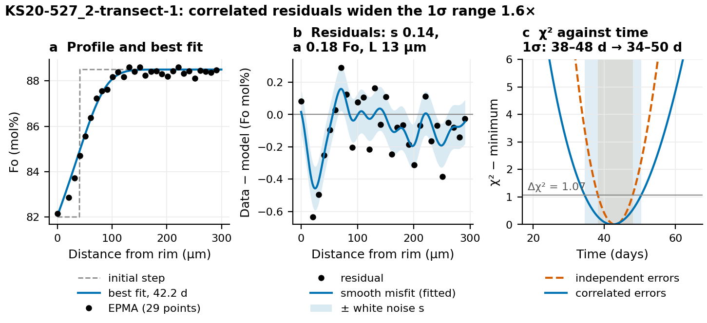
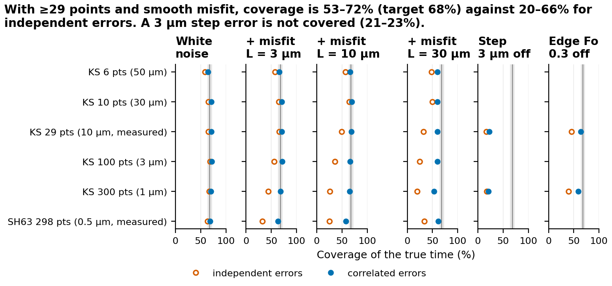
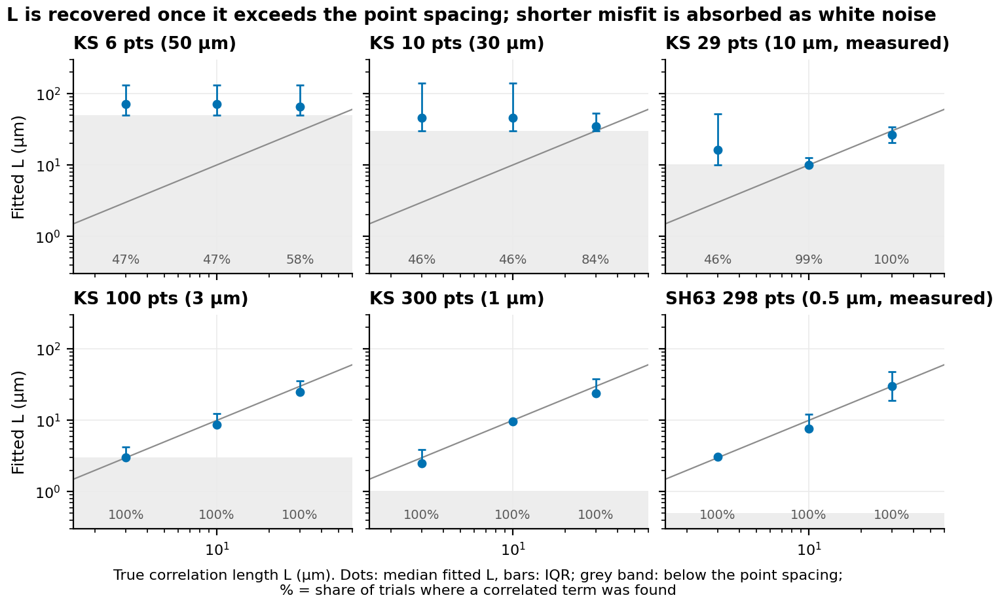
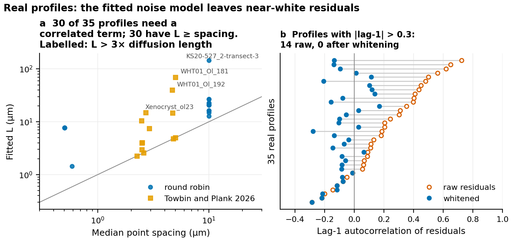
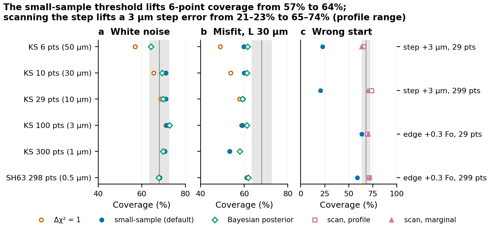
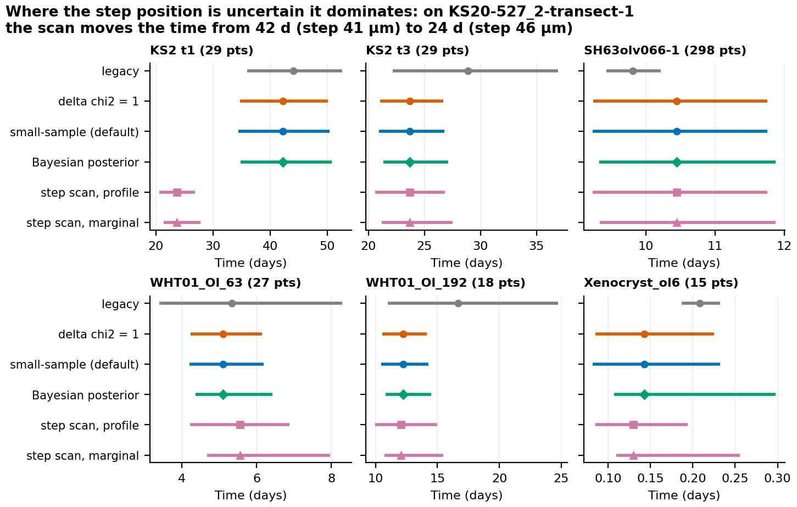

# The correlated-noise likelihood: how forster fits a time and its uncertainty

This note explains how forster finds the best-fit diffusion time and its 1σ range:
the correlated-noise likelihood (default since 2026-10-12) and the additions of
2026-10-13. Those additions are the small-sample threshold, early stopping, a
Bayesian alternative and a scan over initial conditions. The note shows worked
examples and tests the method on synthetic profiles of known age and on the 35 real
profiles in this repository. The code is `src/forster/uncertainty.py` and
`src/forster/scan.py`. How the method differs from earlier versions is in
[fit-uncertainty.md](fit-uncertainty.md).

## Summary

- Each model profile is compared with the **measured points**, not with an
  interpolated curve. The errors on those points are modelled as **white
  analytical noise plus a smooth, spatially correlated misfit**. The size and
  length scale of both are fitted to the data.
- The best fit is the time of maximum likelihood. The 1σ range is where χ²
  rises above its minimum by a **small-sample threshold**: 1.07 for 29 points,
  1.48 for 6, and tending to 1 for many. This corrects for the noise being
  estimated from the same points (section 2, step 12).
- On synthetic profiles with at least 29 points and smooth misfit, the range
  contains the true time 53–72% of the time (target 68%). Ranges that assume
  independent errors drop to 20–66%. For 6-point profiles the threshold lifts
  coverage from 49–57% to 60–66%.
- The **Bayesian alternative**, integrating the noise scale out, agrees with the
  default to within 5 points of coverage. On real profiles it gives ranges of
  about the same width, shifted slightly toward longer times (section 6).
- **Initial-condition errors are not in the single-fit range.** With the step 3 µm
  off, it covers the true time only 21–23% of the time. `forster.scan` fits a set
  of candidate initial conditions and lifts that to 65–74% (section 7). On round
  robin profile KS20-527_2-transect-1, it moves the step from 41 to 46 µm and the
  time from 42 to 24 d. Each step position and the edge, core and plateau Fo can be
  given a Gaussian (1σ) or uniform (± half-width) uncertainty, from Python or in
  `parameters.csv`.
- **Early stopping** gives the same fits as running to `max_time_days`, 6.6×
  faster over the 35 real profiles (section 8).

## 1. Why a new likelihood

A diffusion fit compares a model curve with measurements and asks which time fits
best and how well that time is known. Plain χ² = Σ rᵢ²/σ² answers both
questions correctly only if each point's error is independent and σ is known.
Real profiles break both assumptions:

- **The model never fits perfectly.** Initial-condition shape, 1-D geometry,
  beam convolution and growth leave smooth misfit. Neighbouring residuals share a
  sign (Fig. 1b). Counting such points as independent overstates the evidence.
- **σ is rarely known well.** The round robin's SH63 profiles scatter by
  0.6–0.7 Fo, not the 0.2 Fo assumed.

Rescaling the errors so that reduced χ² = 1 does not fix this. The number of
degrees of freedom is undefined for a nonlinear model (Andrae et al. 2010), and the
rescaling still assumes independent errors. The approach here keeps χ² as a log
likelihood, which is sound for a nonlinear fit (Andrae 2010, §3.1–3.2; Press et
al. 2007, §15.6), but gives it an error model that matches what the residuals
show.

## 2. The method, step by step

**Step 1. Inputs.** n measured points (xᵢ, yᵢ), distance in µm and Fo as a
fraction. One forward run of the diffusion model gives the profile cₖ on the model
grid at every time step tₖ = k·Δt.

**Step 2. Model at the data.** Interpolate each model curve to the measured
positions: mₖ = W cₖ. W is a fixed n × N matrix with two entries per row, because the
positions do not change from one time step to the next. Points outside the model
domain are left out.

**Step 3. Residuals.** rₖ = y − mₖ.

**Step 4. Error model.** The data are the model plus Gaussian errors with
covariance C:

```
y = m(t) + ε,    ε ~ Normal(0, C)
```

**Step 5. Likelihood.**

```
−2 log L(t) = rₖᵀ C⁻¹ rₖ + log|C| + n log 2π
```

With C fixed, only the first term depends on time. It is the generalised χ².
With C = σ²I it reduces to the familiar Σ rᵢ²/σ².

**Step 6. The covariance.**

```
C = s² (I + ρ² K),    K_ij = exp(−(xᵢ − xⱼ)² / 2L²)
```

| Parameter | Meaning | Reported as |
|---|---|---|
| s | white noise, independent point to point (analytical scatter) | `white_sigma` (Fo fraction) |
| a = ρ s | amplitude of the smooth misfit the model cannot follow | `correlated_sigma` |
| L | distance over which that misfit persists | `correlation_length_um` |

K is the squared-exponential kernel of Gaussian-process regression (Rasmussen and
Williams 2006, ch. 2 and 4; Press et al. 2007, §15.9). It is the same family of
function as the Gaussian variogram used by kriging. The kriging-based method in
earlier versions used it to smooth the data; here it describes the residuals.
Treating model inadequacy as a Gaussian process in this way is standard model
calibration (Kennedy and O'Hagan 2001). It is also used to fit spectra whose model
residuals are correlated (Czekala et al. 2015).

**Step 7. What correlation does.** Two analyses 1 µm apart on the same bump of
misfit carry one piece of information about that bump, not two. C⁻¹ discounts
points by how redundant they are with their neighbours. The smooth part of the
profile then carries roughly (profile length ÷ L) independent pieces of information,
not n.

**Step 8. Whitening, as a check.** Factor C = LLᵀ (Cholesky) and form z = L⁻¹r.
Then χ² = Σ zᵢ². If the error model is adequate, the zᵢ look like independent
standard-normal draws. Their lag-1 autocorrelation and a Kolmogorov-Smirnov test
are the residual checks recommended by Andrae et al. (2010) in place of reduced
χ² (Fig. 4b).

**Step 9. Fitting s, ρ and L.** These are chosen by maximum likelihood on the
residuals r₀ of a first, white-noise best fit. Here the log|C| term matters: it
penalises a large covariance, so the noise cannot be made arbitrarily large to
absorb misfit. For fixed (ρ, L) the best s has a closed form,
s² = r₀ᵀ B⁻¹ r₀ / n with B = I + ρ²K, so only (ρ, L) is searched on a grid:
- ρ: 0, then 12 values from 0.1 to 30;
- L: 12 values from the median point spacing to half the profile length.

**Step 10. Two passes.** A first pass with plain least squares gives a provisional
best time. Step 9 fits the noise model there. A second pass computes χ²(t) with
that covariance for every time step.

**Step 11. Cost.** rₖᵀC⁻¹rₖ is expanded as cₖᵀ A cₖ − 2 bᵀ cₖ + const, with
A = WᵀC⁻¹W (N × N) and b = WᵀC⁻¹y, both computed once. The cost per time step depends
on the model grid, not on the number of analyses. It takes 0.04–0.07 s for 10⁵–5×10⁵
time steps, against 2–8 s for the forward run itself (less with early stopping,
section 8).

**Step 12. Best fit and range.** The best fit is the time step with the smallest
χ². The 1σ range is where χ² ≤ χ²min + Δ, with the ends interpolated between time
steps.

With one fitted parameter and the noise known, Δ = 1. This is Wilks' (1938) limit
and the "Δχ² = 1 after minimising over everything else" rule of Press et al.
(2007, §15.6). But s is estimated from the same n residuals, and that has two
effects:
- **The estimate is biased low.** The fit absorbs part of the scatter, so the
  residual sum is about (n − p)σ², not nσ².
- **The estimate is noisy.** From 6 residuals, s² scatters by about ±60%. When it
  comes out low, χ² is too steep and the range too narrow.

Both are handled as in Student's t, the textbook case of a parameter estimated
with σ from the same data:

```
Δ = n/(n − p) · F(0.6827; 1, n − p) = n/(n − p) · t²(0.8413; n − p)
```

Here p is the number of fitted parameters: 1 (time) for a single fit, and 1 + k when
`forster.scan` also varies k initial-condition parameters. The first factor undoes
the bias, the second widens the range for the uncertainty in s.

| Points n | Δ (p = 1) | Range wider than Δ = 1 by |
|---|---|---|
| 6 | 1.48 | ×1.22 |
| 10 | 1.25 | ×1.12 |
| 15 | 1.15 | ×1.07 |
| 29 | 1.07 | ×1.04 |
| 100 | 1.02 | ×1.01 |
| 300 | 1.007 | none |

The correction is exact for a linear model with independent Gaussian errors, and
approximate here. Its effect on coverage is measured in section 4. The function is
`forster.uncertainty.interval_threshold`.

## 3. Worked example



**Figure 1.** Round robin profile KS20-527_2-transect-1 (29 EPMA points, 10 µm
apart; 1200 °C).
- (a) The measured points, the initial step and the best fit.
- (b) Residuals at the best fit, with the fitted smooth-misfit component (the
  Gaussian-process mean, a²K C⁻¹r) and ± the fitted white noise s.
- (c) χ² against time for independent errors (σ fitted, dashed) and for the
  correlated error model (solid). The horizontal line is the 29-point threshold,
  Δ = 1.07; shading marks each 1σ range.

The residuals run in same-sign stretches of about two points, so the fitted
L = 13 µm. Allowing for that widens the 1σ range from 38–48 d to 34–50 d.

From Python (this is the `forster template` example, a Towbin and Plank 2026 profile):

```python
from dataclasses import replace

import numpy as np

import forster
from forster.uncertainty import fit_correlated, interpolation_matrix

forster.write_template("my_fits")
profiles = forster.read_profiles("my_fits/profiles.csv")
run = forster.read_runs("my_fits/parameters.csv")[0]
result = forster.fit_run(run, profiles)          # correlated is the default
print(result.time_days, result.time_minus_days, result.time_plus_days)
print(result.noise)  # NoiseModel(white_sigma=..., correlated_sigma=..., correlation_length_um=...)

# Whitened residuals: should look like white noise if the error model is adequate.
fit = fit_correlated(result.curves, result.model_x_um, result.fit_x_um, result.fit_fo)
W = interpolation_matrix(result.model_x_um, fit.x_um)
r = fit.fo - W @ result.curves[fit.interval.best]
z = np.linalg.solve(np.linalg.cholesky(fit.noise.covariance(fit.x_um)), r)

legacy = forster.fit_run(replace(run, uncertainty="legacy"), profiles)  # the old rule
```

For this profile:

| Quantity | Value |
|---|---|
| Best fit, correlated | 5.10 d |
| 1σ range, correlated (Δ = 1.08 for 27 points) | 4.20–6.19 d |
| Fitted noise | s = 0.055 Fo, a = 0.044 Fo, L = 4.0 µm |
| Lag-1 autocorrelation | 0.24 raw, −0.10 whitened |
| 1σ range, legacy rule | 3.39–8.29 d |

From the command line, `forster fit` reports the three noise values in
`summary.csv` as `white_sigma_fo`, `correlated_sigma_fo` and
`correlation_length_um`.

## 4. Validation on synthetic profiles

### Design

Profiles of known age were made with the forward model. Measurements were drawn
from known noise and fitted exactly as forster fits real data, 400 times for each
case. Two real geometries were used:

- **KS20-527_2-transect-1** at five sampling densities: its 29 measured points,
  10 and 6 of them (30 and 50 µm apart), and 100 and 300 evenly spaced points
  (3 and 1 µm apart);
- **SH63olv066-1** at its 298 measured points, 0.5 µm apart.

White noise was set to 0.2 Fo for the EPMA-like spacings, rising to 0.4 and 0.6 Fo
for the dense ones, as on the SH63 data. Four noise cases were tested: white only,
and white plus a smooth misfit of 0.4 Fo with L = 3, 10 or 30 µm. Two systematic
initial-condition errors were also tested: data made with the step 3 µm further from
the rim, or with the edge 0.3 Fo higher, and fitted with the nominal model.
Section 7 tests those two with `forster.scan`.

For each trial the script records whether the 1σ range contains the true time,
the range's width and the fitted noise model. It applies three rules to the same χ²
curve: the default (small-sample threshold), Δ = 1, and the Bayesian posterior
(section 6). It also computes a baseline on the same data: independent errors with
σ fitted to the residuals, Δ = 1.

### Coverage



**Figure 2.** Share of 400 synthetic profiles per case whose 1σ range contains the
true time. Open orange: independent errors with fitted σ. Filled blue: the
correlated likelihood (default). The vertical line is the 68% target; the grey band
is the 95% sampling range for 400 trials (±4.6 points).

| Profile | White only | Misfit L = 3 µm | L = 10 µm | L = 30 µm |
|---|---|---|---|---|
| KS 6 pts (50 µm) | 64 (59) | 66 (57) | 66 (57) | 60 (48) |
| KS 10 pts (30 µm) | 71 (66) | 70 (65) | 70 (65) | 60 (50) |
| KS 29 pts (10 µm), measured | 71 (65) | 71 (66) | 68 (49) | 60 (32) |
| KS 100 pts (3 µm) | 72 (69) | 72 (56) | 66 (36) | 59 (24) |
| KS 300 pts (1 µm) | 71 (67) | 68 (44) | 65 (26) | 53 (20) |
| SH63 298 pts (0.5 µm), measured | 68 (64) | 64 (32) | 58 (26) | 62 (34) |

Values are coverage (%) for the default rule, with independent errors in brackets.
Target 68%.

What the table shows:
- **White noise:** the default is calibrated at 68–72% for 10 or more points.
- **Smooth misfit:** the independent-error range collapses as the sampling gets
  denser, to 20–44% at 0.5–1 µm spacing, because more points just repeat the same
  misfit. With 29 or more points the correlated likelihood stays at 58–72% for
  misfit up to 10 µm long.
- **Misfit about as long as the diffusion length** (L = 30 µm here, where
  √(D t) ≈ 27 µm) lowers coverage to 53–62%. The misfit term and the diffusion
  profile then trade off, a known limit of model-discrepancy terms (Brynjarsdóttir
  and O'Hagan 2014). It is still far better than the 20–34% from independent
  errors.
- **Sparse profiles:** the small-sample threshold lifts 6-point coverage from
  49–57% (Δ = 1) to 60–66%, and 10-point coverage from 54–66% to 60–71% (Fig. 5).
  Above about 30 points it changes coverage by 2 points or less.
- **Bias:** best fits are nearly unbiased, with the median error within ±4% in
  every random-noise case.
- **Widths:** median 1σ ranges are 7–42% of the true time with white noise
  (narrowest for the 298-point SH63 profile, widest at 6 points) and 10–84% with
  smooth misfit.

**Systematic errors, single fit.**

| Initial condition | 29 points | 300 points | Best fit |
|---|---|---|---|
| Step 3 µm further from the rim | 23% covered | 21% covered | +18% |
| Edge 0.3 Fo too high | 64% covered | 59% covered | −7 to −9% |

The likelihood treats misfit as random. An initial condition that is consistently
wrong biases the time, and the single-fit range does not widen to cover that bias.
Section 7 shows how the scan covers it.

### Correlation length



**Figure 3.** Fitted L (median and interquartile range of the trials where a
correlated term was found) against the true L, for each sampling geometry, with
misfit of 0.4 Fo. Grey band: below the median point spacing. Percentages: share of
trials in which the fit chose a correlated term (ρ > 0).

- **L is recovered when it exceeds the point spacing.** Fitted medians were
  2.5–3.1 µm for a true 3 µm, 7.7–9.7 µm for 10 µm, and 24–30 µm for 30 µm on the
  100-, 300- and 298-point geometries.
- **When L is below the point spacing, it cannot be resolved.** Examples are 3 µm
  misfit at 10 µm spacing, and anything at 30–50 µm spacing. The fit then mostly
  puts the misfit into s; the median fitted s rose from 0.18 to 0.41 Fo at 29
  points. Coverage is unaffected. When a correlated term is chosen in these cases
  (about 46% of trials, the same rate as with pure white noise), its L is
  meaningless and sits above the spacing.
- **A small correlated term is often fitted to pure white noise.** This happened
  in 45–64% of white-noise trials, with a median amplitude up to 0.08 Fo against
  s = 0.14–0.6 Fo. It does no harm: coverage and widths in those cases match the
  white-noise rows of the table.

### The profile-wide-misfit warning

The noise-model warning used to fire whenever ρ or L sat at either end of its
search grid. That happened in 25–35% of white-noise trials, and coverage was the
same whether or not it fired. Split by which end:

- **L at the lower end (the point spacing):** the misfit is too short to resolve,
  which is harmless. Coverage was 65–67%.
- **L at the upper end (half the profile):** the misfit spans the profile, which
  points to a wrong initial or boundary condition. Coverage was 51–59%.

Since 2026-10-13 the warning fires only for the upper end with ρ ≥ 0.5 (or ρ at its
grid maximum). Those trials covered 50–55%, against 62–67% for the rest. The rate
of false alarms:
- 0.8% of pure white-noise residual sets at 29 points (test in
  `tests/test_uncertainty.py`);
- 0–5% of the 29-to-300-point trials;
- 8–22% of the 6- and 10-point trials, where half the profile is only a few
  points.

Among the 35 real profiles it fires for one, WHT01_Ol_192 (section 5).

## 5. Diagnostics on the real profiles



**Figure 4.** The 17 round robin profiles and 18 Towbin and Plank (2026) profiles,
each fitted with the default method.
- (a) Fitted L against median point spacing for the 30 profiles where the fit chose
  a correlated term. The line is L = spacing. Labelled profiles have L more than 3×
  the diffusion length √(D t).
- (b) Lag-1 autocorrelation of the residuals at the best fit, before (open) and
  after (filled) whitening.

- **Whitening works on real data.** 14 of 35 profiles have raw residual
  autocorrelation above 0.3; none do after whitening, where all values lie between
  −0.29 and +0.17. A Kolmogorov-Smirnov test of the whitened residuals against
  N(0, 1) gave p > 0.16 for every profile.
- **L is sensible for most profiles.** For the round robin EPMA traverses 10 µm
  apart, L is 13–27 µm (1.3–2.7 spacings), except KS20-527_2-transect-3 (below).
  Five paper profiles need no correlated term. For SH63olv066 (298 points, 0.5 µm
  apart), L = 7.7 µm is about the diffusion length (7.0 µm); this is the case in
  section 4 where coverage drops a little.
- **Some profiles stand out** with L much longer than the diffusion length:
  - KS20-527_2-transect-3: L = 146 µm, half the profile;
  - WHT01_Ol_181: 70 µm;
  - WHT01_Ol_192: 40 µm, the only one that triggers the warning (ρ ≥ 0.5);
  - Xenocryst_ol23: 15 µm, against a 2 µm diffusion length.

  A long-wavelength misfit means the model misses the profile's overall shape.
  These profiles, and those whose correlated and white-noise best fits differ most,
  are the ones to recheck for initial and boundary conditions:
  - Xenocryst_ol6_prof_1: −27%;
  - WHT01_Ol_192: −19%;
  - KS20-527_2-transect-3: −14%.

  Section 7 does this for the step position. 1σ ranges span 9–38% of the best fit on
  the round robin profiles and 13–105% on the paper profiles (Xenocryst_ol6_prof_1,
  0.14 d, is the widest). Per-profile values are in
  `docs/plans/2026-10-13-likelihood-validation/real_profiles.csv`.

## 6. The Bayesian alternative

Instead of fixing s at its best value and correcting the threshold, s can be
integrated out:
- give time a flat prior and s the standard prior 1/s;
- with C = s²B (B fixed from the fitted ρ and L), the posterior of time is then
  p(t | y) ∝ χ²(t)^(−n/2);
- the 1σ range is the central 68% of that posterior.

This is the same Student-t family as the small-sample threshold, reached by
marginalising rather than profiling. The function is
`forster.uncertainty.posterior_interval`. It needs χ² over every time with
appreciable posterior weight, so use it on a fit with `stop_early=False`.



**Figure 5.** Coverage of three interval rules on the same χ² curves (a, b), and of
the initial-condition scan (c). 400 synthetic profiles per point; target 68% with
its 95% sampling band.
- (a, b) Δ = 1 (open orange), the small-sample default (blue), and the Bayesian
  posterior (green diamonds).
- (c) The single fit with the nominal initial condition (blue), and the scan's
  profile-likelihood (open squares) and marginal (triangles) ranges, for data made
  with the step 3 µm off or the edge 0.3 Fo off.

On synthetic profiles the posterior and the default agree closely: their coverage
differs by at most 4.7 points, 0.7 on average.
- For 6 points, the posterior reaches 62–68% and the default 60–66%.
- At the hardest case (300 points, L = 30 µm) the posterior reaches 58% and the
  default 53%, because it widens the long-time side.

On real profiles (Fig. 6) the two ranges have nearly the same width (ratio
0.97–1.03). The posterior sits slightly toward longer times, because χ² rises more
slowly on the long-time side. The exception is the sparse, very short Xenocryst_ol6
profile (15 points, 0.14 d), where the posterior is 1.27× wider: 0.11–0.30 d against
0.08–0.23 d.

**Recommendation:** keep the small-sample threshold as the default. It is a
profile-likelihood range consistent with the best fit, it extends naturally to the
scan in section 7, and it costs nothing. Report the posterior range alongside when
the χ² curve is visibly asymmetric.

## 7. Uncertainty from the initial condition: `forster.scan`

A single fit takes the initial condition as known. When it is wrong, the time is
biased and the range does not widen (section 4). `forster.scan` fits a set of
candidate initial conditions and combines them. The usual case is the step at a
range of positions.

```python
from forster.scan import scan_initial_conditions, step_offsets

candidates = step_offsets(run.initial, range(-6, 7))      # step moved -6..+6 um
scan = scan_initial_conditions(profile, run.conditions, run.orientation,
                               candidates, run.grid, run.diffusivity,
                               progress=lambda i, n: print(f"{i}/{n}"))
scan.best_initial, scan.time_days
scan.profile_days        # profile-likelihood 1-sigma range of time
scan.marginal_days       # central 68% of the marginal posterior of time
scan.candidate_probability  # posterior probability of each candidate
```

**How it combines them.**
1. Each candidate costs one forward run, with early stopping. Every run gives χ² at
   every time step, so time is never sampled.
2. One noise model is fitted at the overall best (candidate, time) and used for
   every candidate, so their χ² values are comparable.
3. **Profile likelihood:** at each time, take the lowest χ² over candidates, the
   lower envelope of all the curves. The range is where that envelope rises by the
   small-sample threshold with p = 1 + k (k = 1 for a 1-D scan).
4. **Marginal:** with flat priors on time and on the candidates, and s integrated
   out, weight each (candidate, time) by χ^(−n/2). Sum over candidates for the
   posterior of time, and over time for each candidate's probability.
5. A run whose χ² is still within 14 of the overall minimum at its end, where its
   posterior weight is above about 10⁻³, is extended before the ranges are drawn.
6. The scan warns if the best candidate is the first or last one: extend it past
   the best.

The candidates should be evenly spaced, since the marginal treats them as a flat
prior. They must share the model domain.

**Validation (Fig. 5c).** For the systematic cases of section 4, scanning 13
candidates gave:

| True error | Scanned | Single fit | Scan, profile | Scan, marginal | Median width |
|---|---|---|---|---|---|
| Step 3 µm off | step −6..+6 µm | 21–23% | 65–74% | 64–70% | 36–39% (single fit 21–22%) |
| Edge Fo 0.3 off | edge −0.6..+0.6 Fo | 59–64% | 69–71% | 70–72% | 22–24% (single fit 21–23%) |

The scan also removes the bias. The median time error fell from +18% to +0.5–1.3%
for the step, and the median step error was 2 µm, with a 1 µm candidate spacing.
The ranges widen honestly where step position and time trade off: moving the step
1 µm further from the rim and shortening the time gives an almost equally good fit.

**Real profiles (Fig. 6).**



**Figure 6.** Best fit and 1σ range of time for six real profiles by each method:
the legacy rule, Δ = 1, the small-sample default, the Bayesian posterior, and a
step scan of ±6 µm in 1 µm steps (profile and marginal ranges).

- **KS20-527_2-transect-1:**
  - The scan prefers the step at 46–47 µm over the nominal 41 µm. The nominal step
    is worse by Δχ² = 14, so the data reject it.
  - The time falls from 42 d (34–50 d) to 24 d (profile 20.6–26.8 d, marginal
    21.2–27.5 d).
  - 46 µm is the step the round robin itself used for transect-3, the same profile
    with a different initial step. A scan from −12 to +15 µm confirms the optimum.
  - For this profile, the choice of step dominates the uncertainty in time.
- **KS20-527_2-transect-3 and SH63olv066-1:** the nominal step is already the best,
  and the scan ranges match the single fit.
- **WHT01_Ol_63:** the best step moves 1 µm, to 23 µm. The range widens from
  4.20–6.19 d to 4.21–6.87 d (profile) or 4.67–7.96 d (marginal).
- **WHT01_Ol_192 and Xenocryst_ol6:** the steps move by 1 µm, and the times by
  −1% and −9%.

**Cost.** 13 candidates took 2.0 s on a 29-point profile with early stopping, 1.3 s
with the scan's time step below.

### Uncertainties on each step and concentration

Each step position (`step1_um`, `step2_um`), and the edge, core and plateau Fo
(`edge_fo`, `core_fo`, `step_fo`), can be given an uncertainty, Gaussian or uniform,
chosen per parameter:

```python
from forster.scan import Uncertainty, candidate_grid, scan_initial_conditions

candidates = candidate_grid(run.initial, {
    "step1_um": Uncertainty(2.0),                  # Gaussian, sigma 2 um
    "edge_fo": Uncertainty(0.003, "uniform"),      # uniform, +-0.003
})
scan = scan_initial_conditions(profile, run.conditions, run.orientation, candidates,
                               run.grid, run.diffusivity)
scan.profile_days, scan.marginal_days, scan.best_values
```

In `parameters.csv` the same is `steps_sd_um = 2` and `edge_fo_range = 0.003` (the
`_sd` columns are Gaussian, the `_range` columns uniform, at most one per parameter).
`forster fit` then also writes `<run>_scan.csv` and the `scan_*` columns of
`summary.csv` (see `COLUMNS.md`).

- **Grid.** `scan_points` nodes per uncertain parameter: by default 13 for one
  parameter, 9 for two and 5 for more. The number of model runs is their product,
  printed before the scan; grids over 2000 candidates are refused unless the limit
  is raised.
- **Gaussian (σ).** Nodes span ±2.5σ. The marginal weights each candidate by its
  prior density. The profile range adds the penalty ((v − v₀)/σ)² to χ², treating
  the prior as one more measurement.
- **Uniform (± half-width).** Nodes span the whole range, with flat weights and no
  penalty.
- **Threshold.** The small-sample threshold counts p = 1 + the number of scanned
  parameters.
- **Invalid nodes are dropped and counted** (`scan_dropped`): steps outside the
  domain or out of order, or Fo outside (0, 1].
- **Boundaries.** Edge and core Fo are the boundary values held during diffusion,
  so their uncertainty also covers the boundary conditions, not only the starting
  profile.
- **Limits.** If the best value of a parameter is at the end of its grid (±2.5σ, or
  the edge of the range), the scan warns that the data favour values beyond it.

### The scan's time step

Every candidate runs on one numerical grid, so their χ² values are comparable; dx and
dt are not tuned per candidate. To make scans cheaper, that grid's time step is
raised until D_max·dt/dx² = 0.4, where D_max is the largest diffusivity over all
candidates' compositions. The explicit scheme is stable up to 0.5. The time step is
never lowered, and the grid spacing is never changed.

Coarsening was measured on two profiles before choosing this, using a step scan of
±6 µm:

| Profile (native dx, dt) | Native | dx ×2, dt ×4 | dx ×3, dt ×9 | dt only, to D dt/dx² = 0.4 |
|---|---|---|---|---|
| KS20-527_2-transect-1 (1 µm, 600 s) | 23.67 d, 3.0 s | 23.53 d, 0.7 s | 24.44 d (step 45), 0.3 s | **23.69 d, 1.3 s** |
| WHT01_Ol_63, template (0.5 µm, 60 s) | 5.55 d, 6.5 s | 4.89 d (step 24), 1.6 s | 5.01 d (step 24), 0.7 s | **5.54 d, 1.1 s** |

- **Coarsening dx biases the result:** by up to 12% on the 0.5 µm paper profile,
  and the best step moves.
- **Raising dt alone changes the best fit by 0.2% or less,** and the ranges by under
  0.1 d, while running 2.3–5.8× faster. The same held for the DIPRA scheme (23.686
  against 23.694 d).
- **The nominal fit is unchanged.** It still runs on the user's dt and dx;
  `scan_dt_s` reports the scan's time step.

### Validation with two uncertain parameters

Data were made with the step 3 µm and the edge 0.002 Fo away from nominal, and
fitted with 9 × 9 = 81 candidates (150 noise draws, KS20-527_2-transect-1, 29
points):

| Uncertainties | Scan, profile | Scan, marginal | Marginal width |
|---|---|---|---|
| Uniform: step ±6 µm, edge ±0.004 | 69% | 67% | 41% |
| Gaussian: step σ 3 µm, edge σ 0.003 (truth within 1σ) | 67% | 58% | 36% |
| Gaussian: step σ 2 µm, edge σ 0.002 (truth at 1.5σ and 1σ) | 50% | 47% | |

Both ranges are calibrated when the uncertainty given contains the truth. A
Gaussian prior pulls the marginal toward the nominal values, so a truth out in the
prior's tail is under-covered. That is expected of a Bayesian range, which is
calibrated on average over the prior, not for one fixed truth. The profile range
is less affected. Report `scan_low_days` and `scan_high_days` (profile), and keep
the marginal for when the stated uncertainties are trusted as priors.

## 8. Early stopping

Runs used to go to `max_time_days` even when the fit was at a small fraction of it:
SH63olv066-1 fits at 10 d out of 730 d modelled. Since 2026-10-13, the correlated
method runs the model in blocks of about 1% of `max_time_days` and stops once three
things hold:
- the run is 2× past the best fit so far;
- the sum of squared residuals is 4× its minimum;
- that sum is still rising.

If the 1σ range then reaches the stopping point, the run is extended and refitted.
The legacy method always runs to `max_time_days`. `fit_profile(..., stop_early=False)`
and `fit_run(..., stop_early=False)` turn it off. `FitResult.modelled_days` reports
how far a run went.

The time steppers resume exactly where they stopped, so a run in blocks gives the
same numbers as one run. Checked on all 35 real profiles, including the two-step
initial conditions (KS20-527-8, SH63olv066), where a late second minimum would show:
- best fit, noise model and warnings were identical for all 35;
- the ends of the 1σ range differed by exactly 0 s;
- total fitting time fell from 129 s to 19 s (6.6×), up to 90× for single
  profiles (Xenocryst_ol6: 7.3 s to 0.08 s);
- the two profiles whose best fit is past a year (KS20-527_5-transect-1 and
  SH63olv084) ran the full time, as they should.

`tests/test_uncertainty.py` checks a two-step profile, including with stop settings
so tight that the run has to be extended.

## 9. What changes for users, for better and worse

**Better**
- **Calibrated ranges** for typical and dense profiles, whether or not the model
  misfits smoothly (Fig. 2), and for sparse ones (Fig. 5).
- **No arbitrary settings.** No kriging parameters, grid-spacing dependence or
  assumed analytical error enter the range.
- **Noise is estimated from the data**, and the three noise values are a
  diagnostic of fit quality (Fig. 4).
- **Initial-condition uncertainty can be included** with a scan (section 7).
- **Several times faster** than before (section 8).

**Worse, or to watch**
- **Best fits move.** Times shift relative to independent-error fits, by up to
  27% on the real profiles, most where the misfit is long-wavelength (section 5).
- **Ranges are honest, not always narrow.** They widen when residuals are
  correlated (Fig. 1), when there are few points, and when the step position is
  scanned.
- **Misfit as long as the diffusion length** can trade off with time and lower
  coverage to 53–62% (section 4).
- **The single-fit range leaves out the initial condition.** Use the scan where
  the step position or compositions are uncertain.
- **`FitResult.curves` is shorter** with early stopping: it ends a margin past the
  fit, not at `max_time_days`.
- **The warning can still fire** on 8–22% of 6- and 10-point profiles.

## 10. Status of the earlier next steps

- **Done (2026-10-13):** the small-sample correction (default), the quieter
  warning, initial-condition uncertainty (`forster.scan`), early stopping, and a
  comparison with the Bayesian route.
- **Done (later on 2026-10-13):** uncertainties on each step and concentration,
  Gaussian or uniform, from Python and `parameters.csv`; a cheaper scan time step;
  a two-parameter validation.
- **Still open:**
  - Validate on a paper profile (2–5 µm spacing, 15–30 points), and with misfit
    shapes other than the squared-exponential kernel.
  - Scans of three or more parameters are allowed but not validated. Their cost
    grows as `scan_points` to the power of the number of parameters; sampling
    (Latin hypercube or Sobol) would scale better.

## 11. Reproducing this note

From the repository root:

```bash
uv run python docs/plans/2026-10-13-likelihood-validation/validate.py 400   # ~10 min
uv run python docs/plans/2026-10-13-likelihood-validation/diagnostics.py    # ~1 min
uv run python docs/plans/2026-10-13-likelihood-validation/early_stop_check.py
uv run python docs/plans/2026-10-13-likelihood-validation/compare_real.py
uv run --with adjustText python docs/plans/2026-10-13-likelihood-validation/figures.py
```

- `validate.py` writes `coverage.csv` (one row per case) and `trials.csv` (every
  trial). `validate.py summarise` rebuilds `coverage.csv` from `trials.csv`.
- `diagnostics.py` writes `real_profiles.csv`.
- `early_stop_check.py` writes `early_stop.csv`.
- `compare_real.py` writes `real_methods.csv`.
- `figures.py` reads these files and writes `docs/references/figures/likelihood/`.

`tests/test_uncertainty.py` and `tests/test_scan.py` repeat smaller coverage tests
on every test run.

## References

- Andrae, R. (2010). Error estimation in astronomy: A guide. arXiv:1009.2755.
- Andrae, R., Schulze-Hartung, T. and Melchior, P. (2010). Dos and don'ts of
  reduced chi-squared. arXiv:1012.3754.
- Brynjarsdóttir, J. and O'Hagan, A. (2014). Learning about physical parameters:
  the importance of model discrepancy. Inverse Problems 30, 114007.
- Czekala, I., Andrews, S. M., Mandel, K. S., Hogg, D. W. and Green, G. M. (2015).
  Constructing a flexible likelihood function for spectroscopic inference.
  Astrophysical Journal 812, 128.
- Girona, T. and Costa, F. (2013). DIPRA: A user-friendly program to model
  multi-element diffusion in olivine with applications to timescales of magmatic
  processes. Geochemistry, Geophysics, Geosystems 14, 422-431.
- Kennedy, M. C. and O'Hagan, A. (2001). Bayesian calibration of computer models.
  Journal of the Royal Statistical Society B 63, 425-464.
- Mutch, E. J. F., Maclennan, J., Shorttle, O., Rudge, J. F. and Neave, D. A.
  (2021). DFENS: Diffusion chronometry using Finite Elements and Nested Sampling.
  Geochemistry, Geophysics, Geosystems 22(4), e2020GC009303.
- Numerical Recipes forum, "multi-parameter fits", thread t-1249,
  <http://www.numerical.recipes/forumarchive/index.php/t-1249.html>.
- Press, W. H., Teukolsky, S. A., Vetterling, W. T. and Flannery, B. P. (2007).
  Numerical Recipes: The Art of Scientific Computing, 3rd ed. Cambridge University
  Press. §15.1 (least squares as maximum likelihood), §15.6 (confidence limits on
  estimated model parameters), §15.8 (Markov chain Monte Carlo), §15.9 (Gaussian
  process regression).
- Rasmussen, C. E. and Williams, C. K. I. (2006). Gaussian Processes for Machine
  Learning. MIT Press.
- Sohn, R. A. and Menke, W. (2002). Application of maximum likelihood and bootstrap
  methods to nonlinear curve-fit problems in geochemistry. Geochemistry,
  Geophysics, Geosystems 3(7), doi:10.1029/2001GC000253.
- Student [Gosset, W. S.] (1908). The probable error of a mean. Biometrika 6, 1-25.
- Wilks, S. S. (1938). The large-sample distribution of the likelihood ratio for
  testing composite hypotheses. Annals of Mathematical Statistics 9, 60-62.
