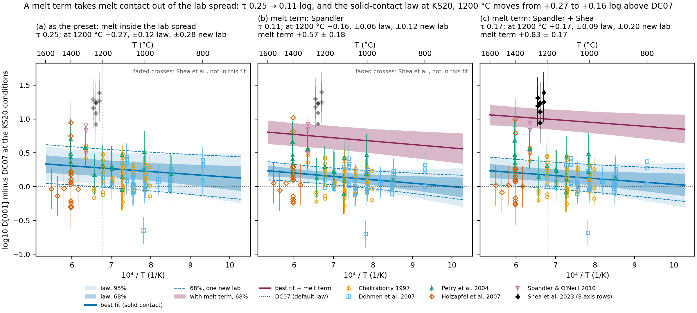
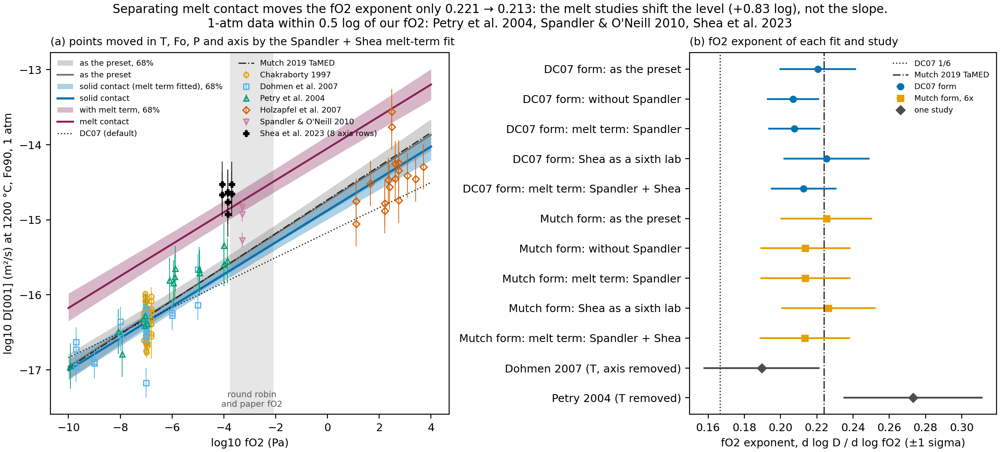
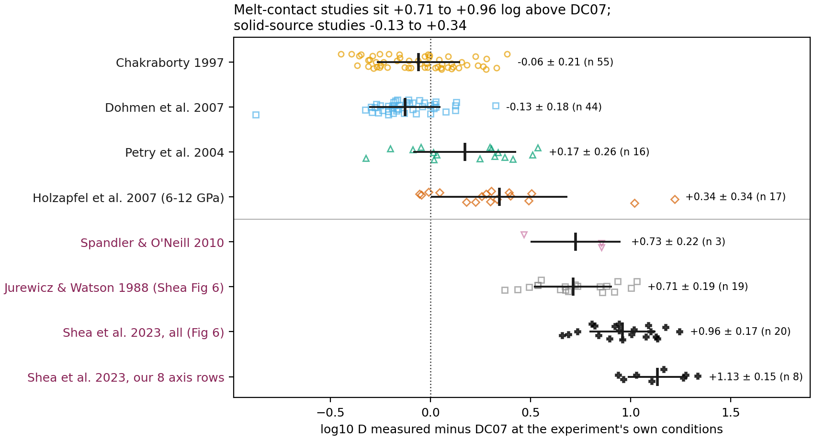

# Melt contact and the Fe-Mg calibration: Shea et al. (2023) against the refit

How the melt-olivine experiments of Shea et al. (2023) compare with the study offsets of the Fe-Mg refit (`femg_refit2026`) and with Oeser et al. (2026), and what they say about the between-study term and the fO2 exponent. This is an analysis note: forster's laws, presets and uncertainty code are unchanged. Written 2026-10-14. Data `analyses/melt_contact/data/shea2023_table1.csv`; numbers from `analyses/melt_contact/melt_sensitivity.py` (`results/variants.csv`, `shea_residuals.csv`, `element_offsets.csv`). The study itself is summarised in `diffusivity-literature.md`.

## Summary

-   **Shea et al. sit about +0.9 log above the refit** (+1.14 above DC07) on the eight profiles tied to an axis. Against the same refit, the four solid-source studies are within ±0.25, and Spandler and O'Neill (2010), the other melt-contact experiment, is +0.36 (shrunk). Shea's runs are at QFM−1, 10\^-3.7 to 10\^-4.1 Pa at 1220-1255 °C, at and just below the round robin's fO2.
-   **All three melt-contact studies sit +0.7 to +1.0 log above DC07, each at its own conditions** (Fig. 3). The solid-source studies sit −0.13 to +0.34.
    -   Jurewicz and Watson (1988): +0.71 ± 0.19 (19 points).
    -   Spandler: +0.73.
    -   Shea's full set: +0.96 ± 0.17 (20 points).

    The Jurewicz and Watson and full-Shea values are read from Shea's Fig. 6. **Our 8 axis rows run about 0.17 log above Shea's full set**, so a melt term fitted on them is biased high by about that much.
-   **The between-study term in `femg_refit2026` is mostly one melt experiment.** τ = 0.254 log with Spandler; 0.105 without it, or 0.107 with melt contact as a fixed term (+0.57 ± 0.18 log). With Shea's rows added as a second melt study, the melt term is +0.83 ± 0.17 and τ 0.174. The `mutch_x6` form gives the same numbers to within 0.02.
-   **For solid contact the level and its uncertainty both drop.** At KS20 the law is +0.16 above DC07 instead of +0.27, with 1σ 0.06 (law) and 0.12 (one new lab) instead of 0.12 and 0.28.
-   **The fO2 exponent hardly moves**: 0.221 → 0.207-0.213, about 0.05 log at our fO2. The melt studies set the level near our fO2, not the slope.
-   **Shea's offset is the same on every axis and nearly the same for Fe-Mg, Ni and Mn** (+1.12, +1.01, +1.00 log against the laws they used). Spandler's is shared by Fe-Mg and Mn (+0.7) but not by Ni (+0.15).
-   **What this changes:** τ as fitted mixes a one-sided melt effect into a symmetric lab spread. It widens the slow side, which no data support, and it understates the fast side if natural crystals in melt behave like Shea's.

## The Shea et al. data used

Table 1 gives 26 profiles (D for Fo, Ni, Ca, Mn, Cr) with temperatures and dwell times but no angles; the angles are in their supplementary table, which we do not have. Figs 2-4 tie 9 rows to a profile, an orientation and a modelled time:

-   ol25 (San Carlos seed, 1240 °C, 48 h): two profiles parallel to c, two parallel to a (Fig 4).
-   ol20 (Kilauea seed, 1220 °C, 6 h): one parallel to b, one parallel to c (Fig 3).
-   ol15 and ol18 (1255 °C): 89° and 86° from c, a or b not stated, taken as \[100\] (Fig 2).
-   ol16 (1255 °C): 58° from c, so off-axis. It is used for residuals only, not in fits.

Conditions: QFM−1 from Frost (1991) (`engine.fo2buffer`), 1 atm, and X_Fo at the middle of each profile's Fo range (0.81-0.875).

**Checking the transcription.** Shea et al.'s own residual against the law they used is log10(modelled time / true time). Ours, from the transcribed D and the assumed conditions, differs from it by −0.10 to +0.20 log for Fe-Mg. The largest gap is ol18, reversely zoned from Fo77 to Fo85, where the mid-profile Fo matters most. For Ni the gaps are within −0.19, except ol18 at −0.71, the profile Shea et al. mark as poorly resolved. The ol25 \[001\]/\[100\] ratio is 10.7 (Table 1), against 6 in DC07. Fe-Mg rows 11 and 12 come in the opposite order to Fig 4's times (4.4 and 4.3e-15 against 36.7 and 37.7 d); Ni, Ca and Mn match the figure order.

Fe-Mg residuals (log10; from Shea et al.'s times, the refit column adding DC07 − refit at each row's conditions):

| Row  | Run  | T (°C) | Axis      | vs DC07 | vs refit |
|------|------|--------|-----------|---------|----------|
| 2    | ol15 | 1255   | \[100\]\* | +0.97   | +0.75    |
| 4    | ol18 | 1255   | \[100\]\* | +1.03   | +0.80    |
| 7    | ol20 | 1220   | \[010\]   | +1.34   | +1.07    |
| 8    | ol20 | 1220   | \[001\]   | +1.17   | +0.95    |
| 11   | ol25 | 1240   | \[001\]   | +1.26   | +1.04    |
| 12   | ol25 | 1240   | \[001\]   | +1.28   | +1.05    |
| 13   | ol25 | 1240   | \[100\]   | +0.94   | +0.73    |
| 14   | ol25 | 1240   | \[100\]   | +1.11   | +0.90    |
| mean |      |        |           | +1.14   | +0.91    |

\* 86-89° from c; \[100\] or \[010\] not stated.

From our transcribed D, the mean against the refit is +0.92.

## The between-study term

`fit_random` (REML, a random offset per study) on the 135 TaMED points, then with Spandler removed, with melt contact as a fixed term, and with Shea's 8 axis rows added. These are `dc07_free` results; `mutch_x6` is in `variants.csv` and agrees to within 0.02 on τ and the KS20 level.

| Variant | n | τ (95%) | fO2 exponent | E (kJ/mol) | Melt term | KS20 vs DC07 | KS20 1σ law / new lab |
|---------|---------|---------|---------|---------|---------|---------|---------|
| baseline (the preset) | 135 | 0.254 (0.11-0.66) | 0.221 | 209.1 |  | +0.27 | 0.122 / 0.282 |
| without Spandler | 132 | 0.105 (0.02-0.40) | 0.207 | 210.6 |  | +0.16 | 0.062 / 0.121 |
| melt term (Spandler) | 135 | 0.107 (0.02-0.41) | 0.208 | 210.6 | +0.57 ± 0.18 | +0.16 | 0.063 / 0.124 |
| Shea as a sixth study | 143 | 0.449 (0.26-0.97) | 0.225 | 208.4 |  | +0.45 | 0.189 / 0.487 |
| melt term (Spandler and Shea) | 143 | 0.174 (0.06-0.49) | 0.213 | 209.3 | +0.83 ± 0.17 | +0.17 | 0.094 / 0.198 |

The SH63 and paper conditions move the same way: from +0.23 to +0.12 and from +0.32 to +0.20, with the new-lab 1σ from 0.28 to 0.12-0.13. The KS20 levels are for solid contact, with the melt term set to zero.

-   **Without the melt experiments, the four solid-source studies disagree by about 0.1 log.** That is half the within-study scatter (0.22). Their shrunken offsets are Chakraborty −0.04, Dohmen −0.03, Holzapfel −0.05 and Petry +0.12.
-   **Treated as one more lab, Shea nearly doubles τ (0.45)** and lifts the KS20 level by 0.17. A random study offset cannot tell "one lab is off" from "melt contact differs".
-   **The two melt studies differ from each other by about 0.34 log** (shrunken offsets −0.17 and +0.17 around the shared term), which keeps τ at 0.17 when both are in. They differ in melt (synthetic against natural Kilauea basalt), temperature (1300 against 1200-1255 °C) and geometry (a crucible with no growth, against seeds that dissolved and then grew a rim).
-   **The asymmetry.** A random offset is symmetric: τ = 0.254 makes "one new lab" equally likely to be 0.25 log slow or fast. The melt effect seen so far only makes diffusion faster. As a fixed term it is reported as a one-sided scenario, and the symmetric spread that remains (0.1) is what the solid-source labs support.
-   **So `femg_refit2026` carries about half a Spandler**, in its level (+0.11 at KS20) and in its `between_study_log10` (0.254 against 0.107).

## The fO2 exponent

-   **Separating melt moves the exponent by 0.008-0.014**: 0.221 → 0.207-0.213 (`mutch_x6` 0.225 → 0.213-0.214). Our runs are 3.3-4.9 log units above 10⁻⁷ Pa, so that is 0.03-0.07 log in D. The other 0.06 of the 0.11 drop at KS20 is Spandler's level, not its slope.
-   **Both melt studies are at FMQ−1** (Spandler 1300 °C, Shea 1200-1255 °C). So a melt term and the exponent do not trade off here. Equally, nothing tells us whether the melt effect changes with fO2.
-   **Without the melt studies, Petry et al. (2004) are the only 1-atm solid-source data near our fO2** (to 10\^-3.9 Pa). Their shrunken offset rises a little (+0.09 → +0.12-0.15).
-   **Oeser et al. (2026) would fill this gap**: a solid powder source at 1100-1300 °C and 10⁻⁷ to 10⁻² Pa. Transcribing their tables is the most useful next data step for the solid-source exponent at 10⁻⁴ to 10⁻² Pa.
-   Shea et al. ran at one fO2, so they give no exponent.

## Shea et al. against Oeser et al. (2026)

They are different kinds of effect.

-   **Shea's excess is on every axis.** \[001\] is about +1.27 and \[100\] about +1.03 against DC07 (ol25). The one \[010\]/\[001\] pair (ol20) gives +1.34 against +1.17. The anisotropy is 6x or more, as DC07 (10.7 in ol25). This reads as more vacancies (their Eq. 4: D = X_V · D_V), which multiplies every axis equally.
-   **Oeser's divergence is axis-specific**: above about 1150 °C, \[010\] is at least 0.5 log faster than DC07, \[001\] is about DC07, and E is 230-370 kJ/mol. This is a change of mechanism or anisotropy, not a level.

So a melt term belongs as one log offset common to the axes. The Oeser regime needs an axis-dependent activation energy, or a second mechanism, above about 1150 °C.

## Across elements

Mean residual by study against each element's law: Fe-Mg against DC07, Ni against `petry2004_ni`, and Mn against `girona_costa2013_mn` (the DC07 form). For Shea et al., their own time ratios against the laws they used.

| Study                     | Fe-Mg | Ni    | Mn    |
|---------------------------|-------|-------|-------|
| Petry et al. 2004         | +0.17 | −0.03 | +0.11 |
| Holzapfel et al. 2007     | +0.34 | −0.39 | +0.36 |
| Spandler and O'Neill 2010 | +0.73 | +0.15 | +0.69 |
| Shea et al. 2023          | +1.12 | +1.01 | +1.00 |

-   **Shea: one offset for all three elements**, as a common vacancy population would give.
-   **Spandler: Fe-Mg and Mn share it, Ni does not.** Measured from Petry, whose data the Ni law is fitted to, Spandler is +0.56 for Fe-Mg and +0.18 for Ni.
-   **Holzapfel's Ni and Fe-Mg offsets have opposite signs.** All their data are at 6-12 GPa, so that mostly tests the pressure terms of the two laws.

So a study or melt offset shared across elements is supported by Shea and half supported by Spandler. The queued Ni refit should test it: one shared term plus per-element deviations, rather than assuming it either way.

## For structuring future fits

1.  **Give melt contact its own fixed term**: one log offset, common to the axes, reported one-sided as a scenario. Do not let it into τ.

2.  **Take τ from the solid-source studies** (about 0.1 log, 95% to 0.4). Keep it for the "one new lab" range.

3.  **Fit Fe-Mg, Ni and Mn jointly**, with a study term shared across elements plus per-element deviations, and test the sharing. Petry, Holzapfel and Spandler each have all three in `analyses/femg_refit/data/`.

4.  **For the Oeser regime**, use an axis-specific activation energy or a second mechanism above about 1150 °C. It needs Oeser's tables.

5.  **An additive form to consider: D = D_TaMED(T, fO2, X) + D_ext(T; Al, H).** Chakraborty's (2010) PED law would be the extrinsic term, raised by Al or H supplied from the melt. Two predictions follow:

    -   the apparent fO2 exponent falls where D_ext matters;
    -   a melt offset shrinks at higher fO2 and temperature, where D_TaMED dominates.

    An exponent that changes with temperature is also what the fO2 × 1/T term describes (p = 0.008 under OLS, 1.7σ with random study offsets). Testing this form needs melt-contact data at a second fO2.

6.  **Data worth adding**:

    -   Oeser et al. (2026) tables;
    -   Shea et al.'s supplementary table, whose angles would let all 26 rows in;
    -   Jurewicz and Watson (1988), a third melt study, if its conditions can be recovered.

## Decisions (Henry's, not made here)

1.  **Whether to re-export `femg_refit2026` with melt as a fixed term.** τ would be about 0.11, the KS20 level +0.16 against DC07, and the law 1σ 0.06. This touches `export_preset.py` and `diffusivity.py`. The review-fixes refactor that blocked it landed in 462680b. `export_preset.py` exits 1 unless the law it builds equals the preset exactly. The current τ is also quoted in:

    -   `src/forster/diffusivity.py` (the value and its source text);
    -   `law-uncertainty-limits.md` (how the range is computed, step 4; the "Gaussian in log10 D" bullet, 0.11-0.66 and 0.164-0.671);
    -   `README.md` (0.25 log);
    -   `CHANGELOG.md` (2026-10-13 entry).

    The dated plans keep their historical values.

2.  **Whether profiles in melt contact get the melt scenario.** That covers the paper's melt veins and contact overgrowths. Against the solid-source law, the time multiplier would be:

    -   ×0.27 for +0.57 (Spandler);
    -   ×0.15 for +0.83 (both studies);
    -   ×0.12 for about +0.91 (Shea alone).

3.  **Whether natural crystals in a melt-bearing magma count as melt contact at all.** Shea et al. argue they do. None of the solid-source calibrants had melt present. **New evidence that they do:** Shea, Nizam and Helz (2026, Geology) need Fe-Mg diffusion 5-15x DC07 to match 29 years of re-equilibration of olivine populations in the Kilauea Iki lava lake, at about 1090-1150 °C, and call 5-15x a lower bound (`diffusivity-literature.md`). Against DC07, that is +0.7 to +1.18 log, the same range as the three melt-contact experiments (+0.71 to +0.96, Fig. 3).

## Figures

**Fig. 1. Arrhenius bowties of the `dc07_free` random-study fit at the KS20 conditions** (fO2 1.4e-3 Pa, Fo85, 42 MPa, \[001\]), drawn as log D minus DC07 so that 0.1 log differences show.

-   **Panels:** (a) as the `femg_refit2026` preset; (b) with a melt term for Spandler; (c) with one melt term for Spandler and Shea.
-   **Blue (solid contact):** 68% and 95% bands are quantiles over 4000 draws from the fit's covariance. The dashed lines add τ (the 68% range for one new lab).
-   **Wine (melt contact):** the solid-contact law plus the melt term, with its 68% band.
-   **Points:** each is moved to the panel's conditions by that panel's fit. A melt term does not move them, so melt points keep their offset. Bars are the measurement error (Shea ±0.3 log, their 0.6-log error bars).
-   **Shea's 8 axis rows** are faded in (a) and (b), which leave them out of the fit.
-   Numbers are in `figures/fig1_bowties.csv`.

**Fig. 2. The fO2 dependence with and without a melt term.**

-   **(a) The data at 1200 °C, Fo90, 1 atm, \[001\] against fO2**, moved in T, Fo, P and axis (not fO2) by the Spandler + Shea melt-term fit.
    -   Grey: as the preset. Blue: solid contact. Wine: melt contact. Bands are 68%.
    -   The shaded span is the round robin and paper fO2.
-   **(b) The fO2 exponent (±1σ)** of each variant in both forms, plus Dohmen's and Petry's own exponents (`fo2_figures._within_study`), against DC07's 1/6 and Mutch et al.'s 0.224.
-   Numbers are in `figures/fig2_fo2_exponents.csv`.

**Fig. 3. Each study's Fe-Mg residual against DC07 at the experiment's own conditions** (log D measured minus DC07). No point is moved, which is how Jurewicz and Watson can be shown at all: we have no fO2, Fo or orientation for them, so they cannot go on Figs. 1 and 2.

-   **Rows:** solid-source studies above the line, melt-contact studies (pink labels) below. Bars are the mean ± 1 sd.
-   **Solid-source residuals** are computed from the compiled data (Holzapfel at Ni-NiO, assumed). Their means reproduce the refit's `compare_laws` table.
-   **Jurewicz and Watson, and Shea's full set,** are Shea et al.'s own residuals, read from the vector graphics of their Fig. 6 (`extract_shea2023_figs.py`).
-   **Shea's 8 axis rows** are residuals from Shea et al.'s modelled times (Figs. 2-4).
-   All of the figure-read values are listed for checking in `figure-extracted-data.md`.
-   Numbers are in `figures/fig3_offsets.csv`.

## Caveats

-   Only 8 Shea rows are on an axis, two of them with a or b assumed. The conditions are assumed, and checked against Shea et al.'s own times to within 0.2 log.
-   **Shea's D come from one-step models.** Their two-step models, which allow diffusion during the superliquidus anneal, give D lower by 1.86x on average for Fe-Mg (Ni 1.44x, Mn 1.93x). That would lower Shea's offset by about 0.27 log, to about +0.65 against the refit, close to Spandler's.
-   τ rests on four to six studies, and its 95% ranges are wide (0.02-0.40 without Spandler).
-   The melt term rests on two studies that disagree by about 0.34 log.
    -   About half of that gap is our choice of Shea rows. Shea's full Fig. 6 set is +0.96 against DC07, and Spandler is +0.73.
    -   Jurewicz and Watson (+0.71) would be a third study, but cannot be fitted without their conditions.
    -   A melt term from the full Shea set would be roughly 0.17 lower than the +0.83 fitted here.
-   Jurewicz and Watson's values and Shea's full set are read from Shea et al.'s figures, not from tables (`figure-extracted-data.md`, entries 2 and 3). The two figures do not plot the same Jurewicz and Watson points (18 against 19, differing by up to 0.1 log).

Reproduce: `uv run python analyses/melt_contact/melt_sensitivity.py`. It first checks that the `dc07_free` baseline matches `analyses/femg_refit/results/coefficients.csv`. Figures: `uv run python analyses/melt_contact/melt_figures.py`. Figure readings from Shea et al.: `uv run --with pymupdf python analyses/melt_contact/extract_shea2023_figs.py` (needs the accepted-manuscript PDF).

## References

-   Jurewicz, A. J. G. and Watson, E. B. (1988). Cations in olivine, Part 2. Contrib Mineral Petrol 99, 186-201. doi:10.1007/BF00371460
-   Oeser, M., Dohmen, R. and Weyer, S. (2026). Geochim Cosmochim Acta 413, 48-66. doi:10.1016/j.gca.2025.09.036
-   Shea, T., Ruth, D., Jollands, M., Ohtaki, K., Ishii, H. and Bradley, J. (2023). The presence of silicate melt may enhance rates of cation diffusion in olivine. Earth Planet Sci Lett 621, 118370. doi:10.1016/j.epsl.2023.118370 (accepted manuscript: Table 1, Figs 2-4, 6, 7)
-   Spandler, C. and O'Neill, H. St. C. (2010). Contrib Mineral Petrol 159, 791-818. doi:10.1007/s00410-009-0456-8