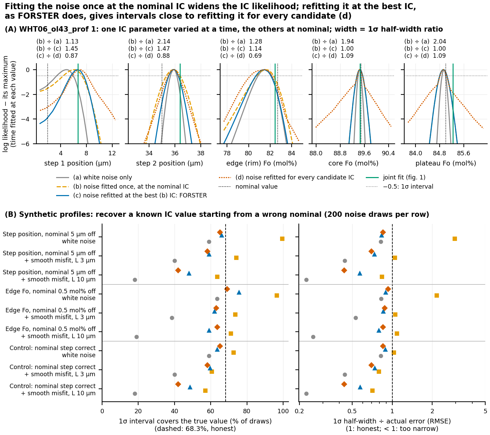
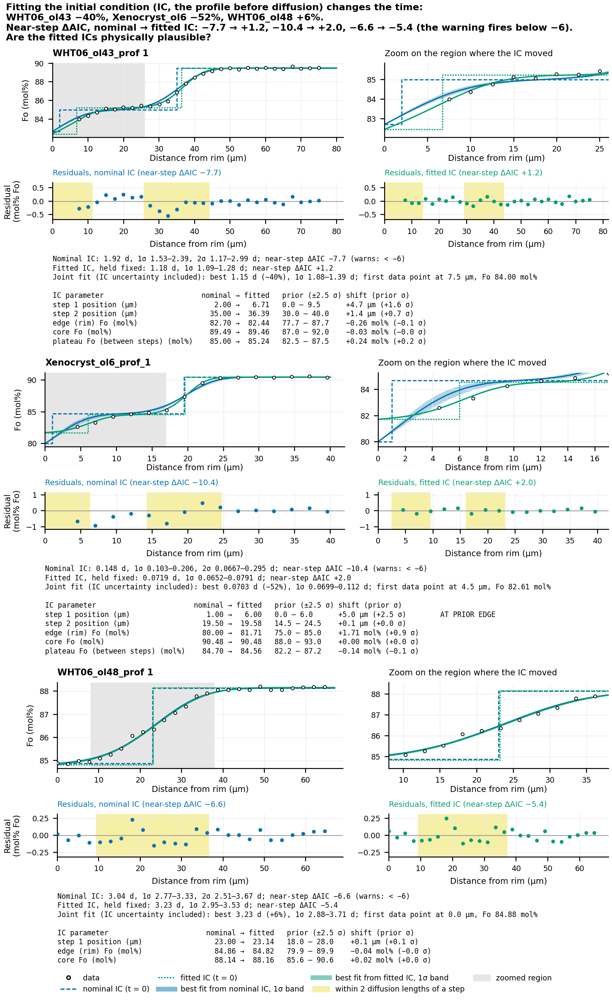
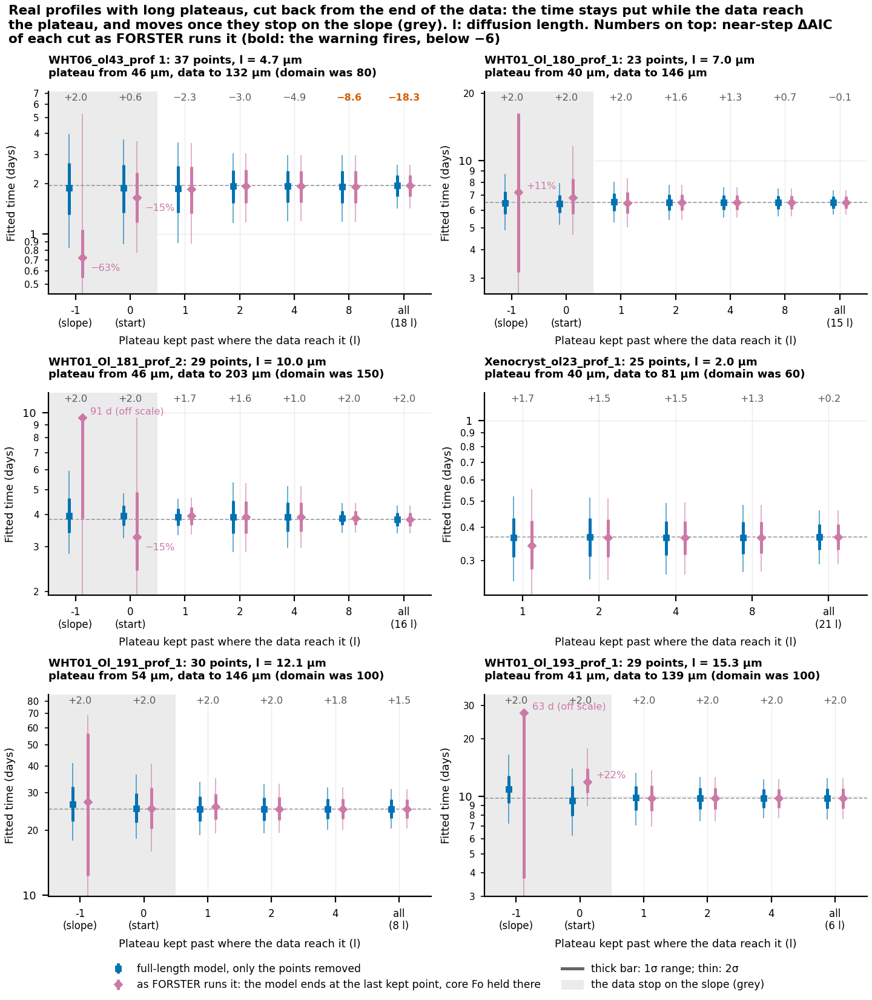
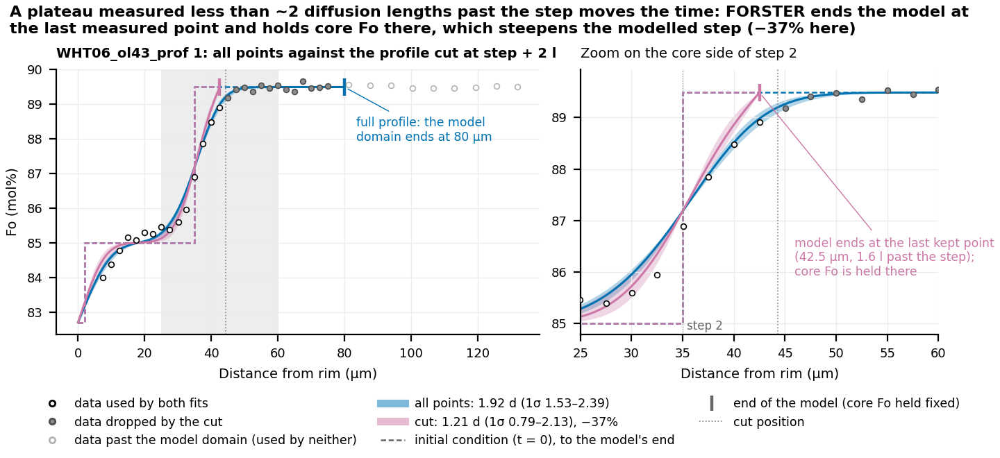
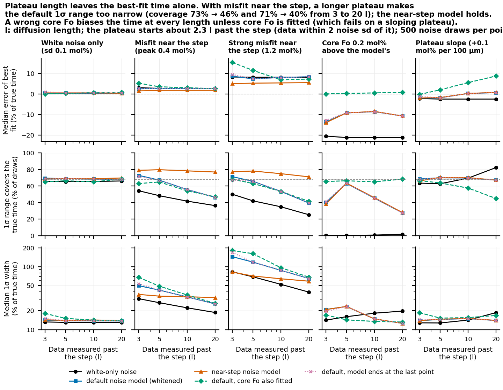

# The noise model, the starting profile and plateau length: what was tested and found

A summary for readers who use FORSTER's times and want to know how far to trust their
ranges. It covers three studies made between 2026-10-15 and 2026-10-16, and the changes
they led to. Each section says what was asked, what was done, what was found and what
it means. The running record of each step is [noise-model-log.md](../plans/noise-model-log.md);
advice for users is collected in [practical-advice.md](../guide/practical-advice.md);
how to read FORSTER's noise numbers is in [noise-models-guide.md](noise-models-guide.md).
The method, with its derivation and sources, is in
[likelihood-method.md](likelihood-method.md); a fuller mechanisms guide with citations
is planned for the release.

## In brief

1. **Whitening is valid for these profiles, with one exception.** FORSTER's noise model
   (independent scatter plus a smooth misfit of one size along the profile) describes the
   residuals of all 36 real profiles tested. The exception is misfit concentrated near
   the step, which makes the 1σ range too narrow (it covers 45-61% of true times instead
   of 68%).
2. **Misfit near the step usually means the starting profile is slightly off, and fitting
   the starting profile fixes it.** On the four real profiles where FORSTER warned,
   fitting the step positions and plateau levels cleared the warning. Whitening does not
   hide this signal from the fit: a noise model fitted at a poor starting profile does
   flatten the comparison between candidate starting profiles, but FORSTER refits the
   noise once the fit has moved, which restores it.
3. **Fitting the starting profile can move the time a lot:** −40% for WHT06_ol43. On
   Xenocryst_ol6 the time halved, but only because the fit pushed a step to the edge of
   its allowed range, a sign that a sharp step is the wrong shape for that rim.
4. **Once the data reach the plateau, how much plateau is measured does not move the
   time** (within 4% on six real profiles cut from 6-21 diffusion lengths of plateau down
   to 1). It does change the range when the misfit sits near the step: the longer the
   plateau, the more overconfident the 1σ range (73% → 46% coverage on synthetic profiles).
5. **Data that stop at or before the plateau move the time:** −15% to +22% when the data
   end where the plateau starts, and far more when they stop on the slope (−63% on
   WHT06_ol43), because the model ends at the last measured point and holds the core Fo
   there. On real profiles the plateau starts about 2 diffusion lengths past the step.

**What changed in FORSTER** (commit a0d676a; details in section 5):

| Change | When it fires | What the user should do |
|---|---|---|
| New warning: the profile ends within 3 diffusion lengths of the last step (`core_end_diffusion_lengths`) | The data probably stop at or before the plateau, where the held core Fo moves the fit | Measure until the data have been flat for at least one more diffusion length; never trim plateau points |
| The near-step warning now says to fit the starting profile first | `near_step_daic` < −6 | Give the steps and Fo levels uncertainties and use `scan_method`; then check the fitted values are plausible |
| The starting-profile fit reports `scan_near_step_daic` and warns if misfit near the step remains | `scan_near_step_daic` < −6 | Quote the 2σ range; consider a starting-profile shape the model does not have (a rim zone, growth while diffusing) |

## Terms

- **Residuals**: measured Fo minus model Fo at each measured point, at the best-fit time.
- **Misfit**: the part of the residuals the diffusion model cannot follow, for example
  because the starting profile, the geometry or the beam size is not quite right.
- **Noise model**: what FORSTER assumes about the residuals: independent scatter of size s
  (the analytical precision) plus a smooth misfit of size a, correlated over a length L.
  Points closer than about L share the same misfit, so they count as one piece of
  information rather than several.
- **Whitening**: transforming the residuals with the fitted noise model so that, if the
  model is right, they become independent and of equal size. The goodness of fit, and
  from it the range of times, is computed from the whitened residuals. Whitening is what
  stops 15 neighbouring points with the same misfit from being counted as 15 independent
  measurements.
- **Starting profile** (initial condition, IC): the profile before diffusion, set by the
  step positions and the Fo of the edge, each plateau and the core.
- **Diffusion length** l = √(D t): roughly how far a step has spread. A plateau "measured
  to 5 l" extends five diffusion lengths past the step.
- **1σ and 2σ ranges**: the ranges of time that should contain the true time 68% and 95%
  of the time. **Coverage** is how often they actually do, measured on synthetic profiles
  made with a known time.
- **Near-step check**: a comparison between the default noise model and one whose misfit
  may be larger within about one diffusion length of each step. **ΔAIC** (`near_step_daic`)
  is the change in the Akaike information criterion, a score that charges for the extra
  parameter: below −6, the near-step model is clearly better and FORSTER warns. +2 means
  no sign of near-step misfit.

## 1. Is whitening valid for these profiles?

**Asked:** can the whitened residuals be trusted for olivine profiles, which are short,
sometimes dense, and have their misfit in particular places?

**Done** ([whitening-validity study](../plans/2026-10-15-whitening-validity/README.md)):
on 36 real profiles (paper profiles and round robin profiles), tested the shape of the
correlation, whether whitening removes the correlation between neighbouring residuals,
whether the whitened residuals look normal, and whether the misfit near the step is larger
than far from it. On synthetic profiles of known age, measured coverage under seven kinds
of misfit the noise model does not assume.

**Found:**
- The smooth-misfit shape FORSTER uses (squared exponential) was adequate on 36/36
  profiles; no profile preferred another shape.
- Whitening removed the correlation between neighbouring residuals (for example lag-1
  correlation 0.43 → −0.07 on WHT01_bigol1).
- 30 of 34 profiles scatter more near the step than far from it, 12 significantly. This
  is the one place the noise model fails: it assumes one misfit size for the whole
  profile, so it averages the large misfit near the step with the quiet plateau and
  underrates it exactly where the information about time is.
- Two other kinds of misfit lower coverage without any visible sign: misfit about as long
  as the diffusion length (57%), and scatter growing toward the rim (63%). For both, the
  2σ range still covers 87-95%.

**Figure A** (from the [noise-models guide](noise-models-guide.md)). Synthetic profiles of
known age with misfit near the step (left), outliers (middle) and scatter growing toward
the rim (right). Rows: the fit with its 1σ and 2σ bands; the raw residuals; the whitened
residuals; the fitted time against the true time. Misfit near the step lowers 1σ coverage
to 61%; the near-step noise model restores 74%.

**Figure B.** The three paper profiles where the near-step check fires. Blue: the default
noise model; orange: the near-step model. The residuals are largest in the yellow zone
near the steps. In two of three the near-step best fit lies outside the default 1σ range;
in all three (and the four round robin profiles that warn) it lies inside the default 2σ
range.

**Meaning:** the near-step check was built to catch the one real failure (commit a3a8adc).
The rest of this document asks what the misfit near the step is telling us.

## 2. Does whitening dampen the signal for choosing a starting profile?

**Asked (Henry):** misfit near the step is often a signal that the starting profile (step
positions, edge Fo, plateau levels) or the assumption of pure diffusion is not right.
SH63olv066's near-edge feature needs several parameters tuned together. Does whitening
dampen the signal used to choose between starting profiles? Could the near-step ΔAIC be
used in the parameter search, or to flag a starting profile that fits badly?

**How FORSTER fits the starting profile:** an optimiser varies the uncertain parameters
and scores each candidate starting profile by the whitened goodness of fit. The noise
model is fitted at the nominal starting profile first, then **refitted once at the first
optimum**, and the optimum refined (`forster.sampling.fit_initial_condition`). The
concern: if the noise model is fitted to a poor starting profile, its misfit term absorbs
that profile's misfit, so smooth residual patterns cost little for every candidate and
the differences between candidates shrink.

**Done** (scripts in `figures/noise_findings/`):
- One-parameter scans of every starting-profile parameter on SH63olv066-1 and the three
  paper near-step profiles, each scored four ways: (a) white noise only; (b) the noise
  model fixed at the nominal starting profile; (c) refitted at the best (b) value, as
  FORSTER does; (d) refitted for every candidate.
- Joint fits of all parameters with FORSTER's method and with (d).
- A synthetic test: a profile made from a known starting profile, fitted from a wrong
  nominal one (step 5 µm off, or edge Fo 0.5 mol% off), 200 noise draws, with white noise
  or added smooth misfit. How often does each scoring's 1σ interval contain the true value?
- The cost of each scoring.

**Figure 1.** (A) WHT06_ol43: the likelihood of each starting-profile parameter under the
four scorings. The noise model fitted once at the nominal profile (b, dashed) gives wider
curves than refitting at the best value (c, blue: FORSTER), by up to 1.5×; white noise
only (a, grey) gives curves up to 2× too narrow. (B) Synthetic recovery: with a wrong
nominal starting profile, (b) covers the true value 96-99.5% of the time with intervals
2-3× wider than the real error; FORSTER's refit (c) covers 66-76%; white noise only falls
to 18-40% once there is real smooth misfit.

**Found:**
- **The first-pass flattening is real but FORSTER's refit removes it.** On the paper
  profiles the noise model fixed at the nominal profile widened the parameter intervals
  1.0-1.7× relative to the refit; on SH63olv066-1, where the nominal profile is poorest
  (misfit 0.77 mol% over 7.7 µm, against 0.25 mol% over 0.5 µm at the fitted profile),
  more. After the refit, intervals are honest on synthetic profiles (66% coverage for the
  step position, target 68%).
- **The joint fit finds the combination of parameters the near-edge feature needs.**
  FORSTER and the per-candidate refit (d) landed on the same starting profile, within
  0.1 µm and 0.1 mol%, on all three profiles fitted jointly. On SH63olv066-1 that profile
  moved step 2 from 21 to 18.2 µm and the edge Fo from 67.0 to 69.6 mol%, and the near-step
  ΔAIC went from −30.6 to −4.3.
- **Refitting the noise for every candidate is not worth adding.** It took 7× the time
  (122 s against 17 s on SH63olv066-1) for the same optimum, and it has failure modes of
  its own: the noise model absorbs misfit from a wrong core or plateau level (those come
  out 3-5× less certain), its correlation length runs to half the profile, and on a
  15-point profile it fitted the diffusion profile itself as misfit (time 3× too short).
- **The near-step ΔAIC must not go into the search.** It measures how *concentrated* the
  misfit is, not how *large*. A wrong core or plateau Fo spreads misfit along the whole
  profile, so the ΔAIC improves while the fit gets worse: in every profile it was best at
  the far end of the core-Fo and plateau-Fo scans.
- **As a check after the fit, it works.** It fired at the nominal starting profile on all
  four near-step profiles and cleared at the fitted one on all four (WHT06_ol48 only just).

**Figure 2.** Nominal (blue, dashed at time zero) and fitted (green, dotted) starting
profiles, the best fit from each, and their residuals. The tables give each parameter's
nominal and fitted value against its allowed range (the prior, ±2.5σ).
- **WHT06_ol43:** step 1 moved from 2.0 to 6.7 µm and the plateau rose 0.24 mol%; the
  residuals become white (the misfit term drops to zero) and the time falls from 1.92 to
  1.15 d (−40%). There are no data between the rim and 7.5 µm, so step 1 and the edge Fo
  are constrained only by the shape of the first few points.
- **Xenocryst_ol6:** step 1 ran from 1.0 µm to the edge of its allowed range (6.0 µm),
  past the first data point, and the time halved (−52%). The data would push it further:
  they ask for a rim zone at least 6 µm wide, which a sharp step cannot represent. This
  time is not reliable.
- **WHT06_ol48:** nothing moves much (+6%); the residual bump near 18 µm remains and the
  ΔAIC only edges past the threshold (−6.6 → −5.4). A single sharp step does not explain
  this profile's near-step misfit.

**Meaning:** misfit near the step is a signal about the starting profile, and the fit
already uses it. The useful change is to send users to the starting-profile fit when the
near-step warning fires, and to check the near-step misfit again at the fitted starting
profile (section 5). A fitted value at the edge of its prior, or misfit that remains after
the fit, points to a starting-profile shape FORSTER does not have yet (a graded rim zone,
growth while diffusing); see "Still open".

## 3. Does plateau length bias the time or its range?

**Asked (Henry):** some profiles have long plateaus and some short ones, and we rarely
choose. Does that bias the times and their uncertainty? Does whitening reduce the effect
of having more or less plateau relative to the steep part of the profile?

**Expected mechanism:** plateau points carry almost no information about time (Fo does not
change there as diffusion goes on), but they count toward the estimate of the noise. A
long plateau that fits well therefore pulls the noise estimate down, and the range narrows
while the real uncertainty does not.

**Done:**
- **Real profiles with long measured plateaus.** The six paper profiles whose data run
  furthest onto the plateau: WHT06_ol43, WHT01_Ol_180, WHT01_Ol_181_prof_2,
  Xenocryst_ol23, WHT01_Ol_191 and WHT01_Ol_193 (6-21 diffusion lengths of plateau), and
  the round robin profile SH63olv066-1 (not plotted here). Five of the six published runs
  end their model domain short of the data (WHT06_ol43 at 80 µm with data to 132 µm); the
  plateaus beyond are flat, so each domain was extended to the end of the data.
  - **Where the plateau starts** is read from the data: the first point past the step
    from which the full profile's best fit stays within 2 noise standard deviations of
    its core level. On these profiles that is 1.7-2.3 diffusion lengths past the step.
  - **Cuts** keep 8, 4, 2, 1 and 0 diffusion lengths of plateau past that point, and one
    cut stops on the slope, 1 diffusion length before it. Each cut is fitted as FORSTER
    fits a short profile (the model ends at the last kept point, with the core Fo held
    there) and with the full-length model and only the points removed, which isolates the
    effect of plateau points on the noise estimate.
- **Synthetic profiles of known age** (2.5 µm spacing, a 4 mol% step, true diffusion
  length 10 µm) with data to 3, 5, 10 and 20 diffusion lengths past the step (the plateau
  starts about 2.3 past it), the step region identical in each, 500 noise draws per case,
  under eight kinds of misfit. These measure what real profiles cannot: coverage.

**Figure 3.** Real profiles cut back from the end of the data. The x axis is the plateau
kept past where the data reach it, in diffusion lengths; grey marks cuts where the data
stop at the plateau's start or on the slope. Blue: the full-length model with only the
points removed; pink: as FORSTER runs a short profile. Numbers on top: the near-step ΔAIC
of each cut.

**Figure 4.** WHT06_ol43 with every point (model domain extended to 132 µm), cut 1
diffusion length into the plateau, and cut on the slope. The pink model ends at its last
point (40 µm) and holds the core Fo (89.5 mol%) there, where the measured profile is still
about 1 mol% lower; that steepens the modelled step and the time falls 63%. Cut 1
diffusion length into the plateau, the time moves 4%.

**Found on real profiles:**
- **Once the data reach the plateau, plateau length does not move the time.** With at
  least 1 diffusion length of plateau kept (about 3 past the step), every profile stayed
  within 4% of its full-profile time, both as FORSTER runs it and with the full-length
  model. SH63olv066-1 stays at 10.8-10.9 d from 22 down to 3 diffusion lengths past the
  step.
- **Data that stop at the plateau's start or on the slope move it.** Ending where the
  plateau starts moved the time by −15% (WHT06_ol43), +5%, −15%, −7%, +1% and +22%; ending
  1 diffusion length before it by −63% (WHT06_ol43), +11%, +8%, +16% (SH63olv066-1) and
  off the scale (91 d and 63 d) on two others. The full-length model barely moves at the
  same cuts, so it is the held core Fo at the end of the model, not the loss of points,
  that moves the time.
- **A longer plateau makes the range narrower and the near-step warning stronger when the
  misfit sits near the step.** WHT06_ol43 with every point (132 µm): 1σ 1.68-2.24 d and
  near-step ΔAIC −18.3; at the published domain end (80 µm): 1.53-2.38 d and −8.6; with
  2 diffusion lengths of plateau: −3.0, no warning. SH63olv066-1: −30.6 with the full
  plateau, −4.2 with 2 diffusion lengths. Profiles without near-step misfit show neither
  effect.

**Figure 5.** Synthetic profiles. Rows: bias of the best fit, 1σ coverage (dashed: 68%),
and the 1σ width, against how far the data extend past the step (the plateau starts about
2.3 diffusion lengths past it). Columns: white noise; misfit near the step (0.4 and 1.2
mol%); a core Fo 0.2 mol% above the model's; a sloping plateau.

**Found on synthetic profiles:**
- **The best-fit time does not depend on plateau length** (under 1% from 3 to 20
  diffusion lengths past the step in every case).
- **With misfit near the step, a longer plateau makes the 1σ range too narrow.** Default
  coverage falls from 73% to 46% (0.4 mol% misfit) and from 71% to 40% (1.2 mol%), while
  the real scatter of the fitted time stays the same. Whitening helps (10-20 points more
  coverage than white noise only) but falls just as steeply, because it too assumes one
  misfit size. **The near-step model holds at 71-80% at every length.** With misfit of
  the same size everywhere, plateau length has no effect.
- **A wrong core Fo biases the time at every length:** 0.2 mol% too high gives −9% to −14%
  (default) and −21% (white noise only), and no warning fires. Fitting the core Fo removes
  the bias, except on a sloping plateau, where the fitted core matches the average plateau
  level rather than the level next to the step (+9% at 20 diffusion lengths).
- **The near-step check needs plateau to see anything:** it caught strong near-step misfit
  in 25% of draws with data to 3 diffusion lengths past the step and 95% at 20.

**Meaning:** plateau length is not a source of bias in the time. It is a source of
overconfidence in the range when the misfit sits near the step, and only the near-step
model removes that. What does move the time is data that stop before they reach the
plateau. Trimming plateaus is never the answer: it does not move the time and it hides
the near-step warning. Two published runs never reach a plateau within their data
(WHT06_ol_overgrowth2 and GCB1A R31_MP_Ol5_prof_1, 2.8 and 2.7 diffusion lengths past
the step), so the new warning fires on them. Their profiles reach the centre of small
crystals, and their core Fo was set from other crystals of the same sample, so measuring
further is not possible: for them the issue is FORSTER's fixed core Fo at the end of the
model, where a symmetry (no-flux) boundary belongs. That boundary is not available yet
(see "Still open").

## 4. How the fixes work

**Short-plateau warning** (`forster.model._core_end_lengths`). After every fit, FORSTER
computes the diffusion length at the best-fit time, l = √(D t) with D at the middle of the
starting profile's Fo range, and the distance from the last step to the model's core end.
Their ratio is reported as `core_end_diffusion_lengths`; below 3 (`SHORT_PLATEAU_LENGTHS`)
a warning says the data probably stop at or before the plateau. The threshold comes from
the real profiles above: their plateaus start about 2 diffusion lengths past the step, and
from about 1 diffusion length into the plateau (3 past the step) every one stayed within
4%. A rule based on where the data themselves flatten would be more direct; it needs a
robust way to find the plateau in noisy data (see "Still open").

**Stronger near-step advice** (`forster.model._near_step`). The check itself is unchanged
(section 1): FORSTER fits the residuals at the white-noise best fit with a noise model
whose misfit variance may be up to about 100× larger (its size about 10×) within one
diffusion length of a step, and compares AIC. The warning now tells the user to fit the starting profile first and to check the
fitted values, and only then to quote the 2σ range.

**Near-step check after the starting-profile fit** (`forster.model.near_step_at_best_initial`).
Both ways of fitting the starting profile (the optimiser and sampler, and the grid scan)
run the same check on the residuals at their best starting profile and time, report it as
`scan_near_step_daic`, and warn if it is still below −6. It costs one model run and one
check, about 0.2 s on a 300-point profile.

**Considered and rejected:**
- Refitting the noise model for every candidate starting profile: the same optimum at 7×
  the cost, with the failure modes listed in section 2.
- Adding the near-step ΔAIC to the search objective: it rewards a wrong core or plateau Fo.
- Trimming plateaus, or a rule for how much plateau to keep: the time does not depend on
  it, and trimming hides the warning.

## 5. Still open

- **Make the near-step model part of the fit.** It is the only model whose ranges do not
  depend on how much plateau was measured (whitening study, follow-ups 1-6).
- **Starting-profile shapes FORSTER does not have:** a graded rim zone (Xenocryst_ol6),
  growth while diffusing, steps proposed automatically from the data (ideas in
  `TODO_local.md`). Misfit near the step that survives the starting-profile fit is the
  signal for these.
- **The model's core end:** a centre (no-flux) boundary for profiles that reach the
  centre of a small crystal; warning from where the data flatten rather than from the
  diffusion length. Full traverses with two rims need their own rule.
- **Priors from the crystal population:** core, rim and plateau Fo differ between crystals
  of a sample; histograms across the sample, or a joint fit of its crystals, would give
  priors for the starting-profile fit.
- **The plateau points dropped from the paper runs** (to save model time, or because they
  showed earlier stages) can now be brought back, with growth stages where needed.
- **Points beyond the domain's end** are dropped without a warning; five of the six
  long-plateau paper runs stop their domain short of flat data. Extending WHT06_ol43's
  domain from 80 to 132 µm moved its time by 2% but strengthened its near-step warning
  (−8.6 → −18.3).
- **A third noise refit** in the starting-profile fit, and a check that the grid scan
  (which fits its noise once, at the white-noise best candidate) behaves like the sampler.
- **Henry to check the fitted starting profiles** of WHT06_ol43 and Xenocryst_ol6.

## Reproducing

- Figures 1-5 and the CSVs behind them (the file names are numbered differently from the figures here): `uv run python
  docs/references/figures/noise_findings/make_figures.py` (reuses the stored Monte Carlo
  tables; `--recompute all` reruns them, about 30 minutes; `--private` writes the round
  robin versions into the private submodule).
- Figures A and B: `docs/references/figures/noise_models/make_figures.py`.
- The whitening study: `docs/plans/2026-10-15-whitening-validity/` (README, section 7).
