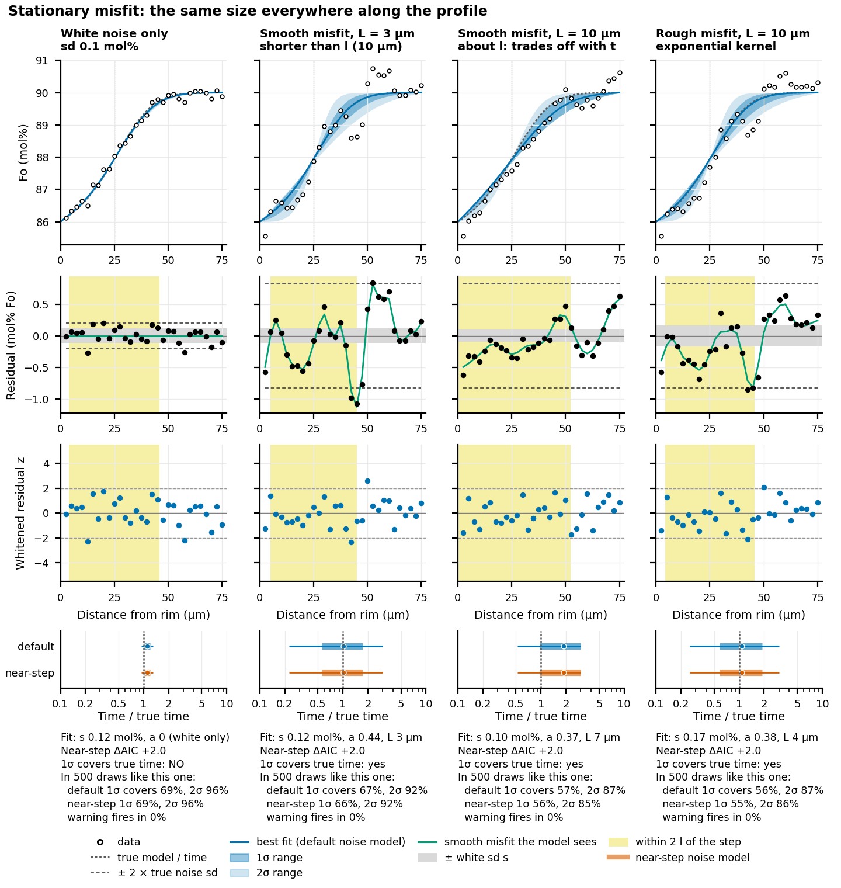
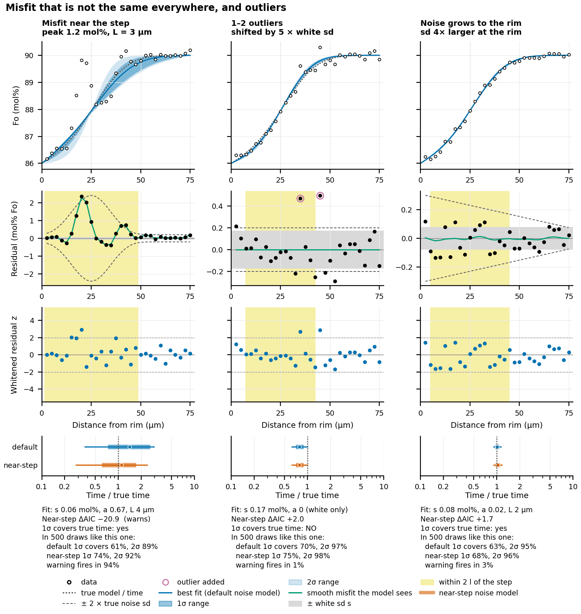
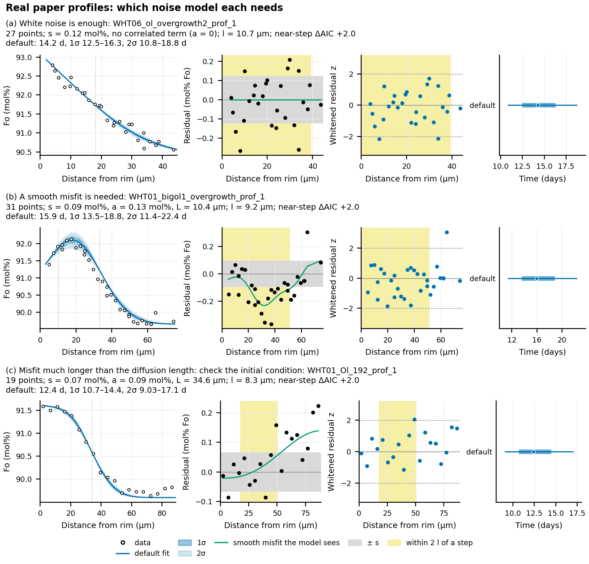
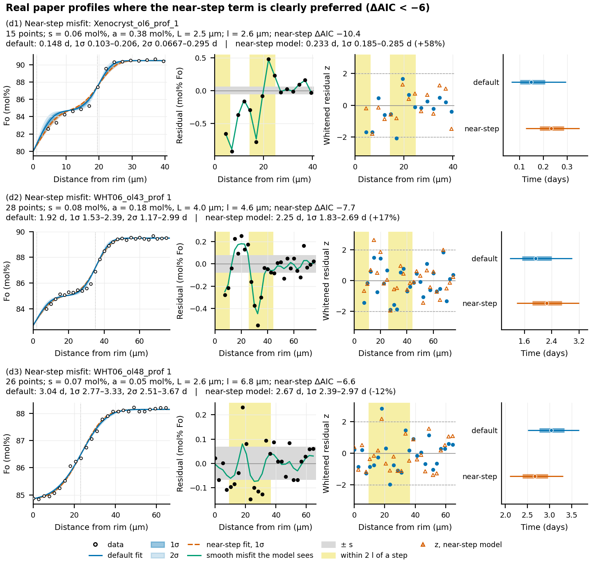

# Reading FORSTER's noise diagnostics

This guide is for people fitting their own profiles. It explains the noise numbers
FORSTER reports, what different kinds of misfit look like, and what to do about each.
The method itself is in [likelihood-method.md](likelihood-method.md). The tests behind
the numbers here are in
[the whitening-validity study](../plans/2026-10-15-whitening-validity/README.md).
The figures are made by `figures/noise_models/make_figures.py`. What was tested and
found, including fitting the starting profile and plateau length, is summarised in
[noise-model-findings.md](noise-model-findings.md); advice for collecting and fitting
profiles is collected in [practical-advice.md](../guide/practical-advice.md).

## 1. Terms

- **Residual**: measured Fo minus model Fo at a measured point, at the best-fit time.
- **Misfit**: the part of the residuals the diffusion model cannot follow, for example
  because the initial condition, the geometry or the beam size is not quite right.
- **Noise model**: what FORSTER assumes about the residuals. It sets how much each point
  counts and how wide the time range is. The default has two parts:
  - **white noise**, independent from point to point (analytical scatter), with
    standard deviation s;
  - **a smooth correlated misfit** with amplitude a and length L. Points closer than
    about L share the same misfit, so they count as one piece of information, not
    several.

  s, a and L are fitted to your residuals by maximum likelihood.
- **Diffusion length** l = √(D t) at the best fit: roughly how far the step has spread.
  **Near the step** means within 2 l of a step of the initial condition.
- **Whitened residuals** z: the residuals transformed with the fitted noise model. If
  the model is right, the z look like independent draws from a standard normal
  distribution: no runs of same-sign values, about 95% between −2 and +2.
- **AIC** (Akaike information criterion): a score for comparing noise models that
  charges for extra parameters. Lower is better. A difference under 2 means the data
  cannot tell the models apart.
- **1σ and 2σ ranges**: the range of times that should contain the true time 68% and
  95% of the time, if the noise model is right. **Coverage** is how often it actually
  does, measured on synthetic profiles of known age.

## 2. The numbers in `summary.csv`

| Column | Meaning | How to read it |
|---|---|---|
| `white_sigma_fo` | s, the white noise (Fo fraction; 0.001 = 0.1 mol% Fo) | Should be close to your analytical precision. The paper profiles give 0.05–0.18 mol%, median about 0.1. Much larger than your precision: there is unmodelled scatter, or outliers (section 3.6). |
| `correlated_sigma_fo` | a, the smooth misfit's amplitude | 0 means white noise alone was enough. If a is larger than s, the misfit dominates the residuals. |
| `correlation_length_um` | L, the misfit's length | Compare with l (√(D t), or half the width of the diffused step). L about l or longer, or L near half the profile, means the misfit is the size of the profile's shape (sections 3.3 and 3.4). |
| `near_step_daic` | AIC change when the misfit is allowed to be larger near the steps | Below −6: FORSTER warns that the misfit is concentrated near the step (section 3.5). Around +2: no sign of it (+2 is the cost of the unused parameter). |
| `time_days`, `low_days`, `high_days` | best fit and 1σ range | |
| `low2_days`, `high2_days` | 2σ range | Quote this when a warning fires. |
| `near_step_misfit_sigma_fo` | the near-step model's misfit sd at the step | How large the misfit near the step is (1.0, 0.4 and 0.16 mol% on the three warned paper profiles). |
| `near_step_points` | points within 2 diffusion lengths of a step | Below about 13 the check often misses near-step misfit (it caught 10-60% of it with 7-12 such points, 87-97% with 13 or more), so a silent check is weak evidence: quote the 2σ range. |
| `core_end_diffusion_lengths` | distance from the last step to the model's core end (the last measured point), in diffusion lengths | Below 3: FORSTER warns that the core boundary, where the core Fo is held, is close enough to move the fit. Measure further into the core. |
| `scan_near_step_daic` | `near_step_daic` at the best-fit starting profile (when the starting profile is fitted) | Fitting the starting profile usually clears a near-step warning. Still below −6: quote the 2σ range. |

FORSTER issues these warnings about the noise and the profile:
- **"the misfit is concentrated near the step"** when `near_step_daic` < −6. In the
  study it fired in at most 0.2% of synthetic fits whose noise model was right, and in
  76–94% of fits with strong misfit near the step on 29- and 298-point profiles. On a
  17-point profile it caught only 14–37%, so silence on a short profile is weak
  evidence. Among the real profiles tested it fires on three of the paper profiles and
  on some of the dense round robin profiles.
- **"the misfit spans the profile"** when L reaches half the profile and a is at least
  half of s. Check the initial and boundary conditions.
- **"even at the best-fit initial condition the misfit is concentrated near the step"**
  after a starting-profile fit, when `scan_near_step_daic` < −6. On the three paper
  profiles and the round robin profile tested, fitting the starting profile cleared the
  near-step warning; if it does not, the starting-profile model may be missing something
  (a step that is not sharp, growth while diffusing). Quote the 2σ range.
- **"the profile ends ... diffusion lengths past the last step"** when
  `core_end_diffusion_lengths` < 3.

## 3. What each kind of misfit looks like

Figures 1 and 2 use one synthetic geometry: 30 points 2.5 µm apart, a 4 mol% step at
25 µm, a true diffusion length of 10 µm (3.6 days at the conditions of the packaged
example) and 0.1 mol% white noise. Each column adds one kind of misfit and shows one
typical draw:
- Row 1: the data, the true profile (dotted), the default best fit and its 1σ and 2σ
  bands.
- Row 2: the raw residuals. Grey band: ± the fitted s. Green line: the smooth misfit
  the noise model sees. Dashed lines: ± 2 × the true noise sd. Yellow: within 2 l of
  the step.
- Row 3: the whitened residuals.
- Row 4: the fitted time and its ranges, divided by the true time, under the default
  and the near-step noise model.
- Text: the fitted noise model, the near-step ΔAIC, whether this draw's 1σ range
  covered the true time, and coverage over 500 draws of the same kind.

The draw shown is the first whose near-step ΔAIC is closest to the median of the 500,
so each column shows the diagnostic as it usually looks. A correct 1σ range misses the
true time about one time in three, and the white-noise draw shown is one of those misses.

**Figure 1.** Misfit of the same size everywhere along the profile.

**Figure 2.** Misfit concentrated near the step, outliers, and noise that grows toward
the rim.

Coverage over 500 draws (target 68% at 1σ, 95% at 2σ; the sampling band for 500 draws
is about 64–72% at 1σ):

| Kind of misfit | 1σ | 2σ | Near-step model, 1σ | Warning fires |
|---|---|---|---|---|
| White noise only | 69% | 96% | 69% | 0% |
| Smooth, L = 3 µm (shorter than l) | 67% | 92% | 66% | 0.4% |
| Smooth, L = 10 µm (about l) | 57% | 87% | 56% | 0% |
| Rough (exponential), L = 10 µm | 56% | 87% | 55% | 0.2% |
| Near the step, peak 1.2 mol% | 61% | 89% | 74% | 94% |
| 1–2 outliers of 5 × white sd | 70% | 97% | 75% | 0.6% |
| White sd 4× larger at the rim | 63% | 95% | 68% | 3% |

### 3.1 White noise only
The residuals scatter evenly around zero within about ±2 s, and the whitened residuals
look the same. FORSTER reports a ≈ 0. The ranges are right.

### 3.2 Smooth misfit shorter than the diffusion length
The residuals run in same-sign stretches a few points long. The green line follows them
and the whitened residuals look white. The default model was built for this case:
coverage 67% (1σ). Ranges are wider than with white noise (median 1σ width 85% of the
time, against 14%), and they should be. Treating these points as independent would
count each stretch several times over.

### 3.3 Smooth misfit about as long as the diffusion length
The misfit now has the same shape as a change in time: a broad bump near the step looks
like a slightly older or younger profile. The model cannot separate the two, and the
1σ range covers only 57% (52–64% in the study, 52% on a 17-point paper profile). The
diagnostics look clean (white z, no warning), so **the only warning sign is L close to
l**. Quote the 2σ range (87%).

### 3.4 Misfit much longer than the diffusion length
L several times l, or near half the profile, means the residuals drift across the
whole profile: a plateau that sits off the model, or a tilt. This points to a wrong
initial or boundary condition (core or edge Fo, plateau Fo, or step position), not to
noise. See WHT01_Ol_192 (section 4c).

### 3.5 Misfit concentrated near the step
The residuals are large near the step and small elsewhere (Figure 2, left). The default
model assumes one misfit amplitude for the whole profile, so it averages the large
near-step misfit with the quiet plateau and underrates it exactly where the time
information is. The whitened residuals often still look acceptable (z of 2–3 near the
step), which is why the separate near-step check exists. Coverage: 61% (1σ) here, 45–71%
in the study, 45–51% on dense 300-point profiles, where the range barely widens. The
near-step noise model raises coverage to 74% here and 61–66% on dense profiles.

In the real data this is the most common problem: 30 of 34 profiles scatter more near
the step than elsewhere (median ratio of whitened variances 1.75), 12 of them
significantly. It usually means the initial condition near the step is not quite
right: the step is not sharp, the plateau is not flat, or the step is in a slightly
different place.

### 3.6 Outliers
One or two points sit far from their neighbours. They are hard to spot from the
diagnostics: an outlier inflates the fitted s (0.17 against a true 0.10 mol% in the draw
shown), so its own z is only about 2.7–2.9. Coverage stays right (70%); the cost is a
wider range (median width 21% of the time against 14% for white noise). If a point is
off for a known reason (a crack, an inclusion, a bad total), remove it and refit. Do
not remove points just to narrow the range.

### 3.7 Noise that grows toward the rim
The scatter is larger near the rim. With the noise changing smoothly over the profile
it is hard to see by eye, and the warning rarely fires (3%). Coverage falls to 63% here
(53–61% in the study). Quote the 2σ range (95%) if you know the rim analyses are
noisier, for example from beam overlap with the rim or the matrix.

## 4. Real profiles: which noise model works best

Figures 3 and 4 use published profiles of Towbin and Plank (2026). Each row shows the
fit (left), the raw residuals, the whitened residuals, and the time ranges in days. The
numbers are in `figures/noise_models/real_examples.csv`.

**Figure 3.** (a) WHT06_ol_overgrowth2_prof_1: 27 points, s = 0.12 mol% and no
correlated term. White noise alone is preferred (by 4 AIC), the raw residuals already
look white (lag-1 autocorrelation 0.01), and there is no near-step signal (ΔAIC +2.0).
14.2 d, 1σ 12.5–16.3 d.
(b) WHT01_bigol1_overgrowth_prof_1: 31 points with a smooth misfit (a = 0.13 mol%,
L = 10.4 µm). White noise alone is worse by 17 AIC. The residuals run in long same-sign
stretches (lag-1 autocorrelation 0.43); after whitening they do not (−0.07). L is about
l (9.2 µm), the case of section 3.3, so the 2σ range (11.4–22.4 d) is the safer quote.
15.9 d, 1σ 13.5–18.8 d.
(c) WHT01_Ol_192_prof_1: L = 35 µm, 4.2× the diffusion length of 8.3 µm. The residuals
climb steadily toward the core: the measured core plateau sits 0.1–0.2 mol% above the
model's core Fo. That is an initial-condition problem, not noise. Refit with an
uncertain `core_fo` (section 5). Its correlated best fit already differs from the white
best fit by −19% (likelihood-method.md, section 5).

**Figure 4.** The three paper profiles where the near-step term is clearly preferred,
fitted with the default noise model (blue) and the near-step model (orange):

| Profile | Points | near_step_daic | Default: time, 1σ, 2σ (d) | Near-step model: time, 1σ (d) | Change |
|---|---|---|---|---|---|
| Xenocryst_ol6_prof_1 | 15 | −10.4 | 0.148, 0.103–0.206, 0.067–0.295 | 0.233, 0.185–0.285 | +58% |
| WHT06_ol43_prof 1 | 28 | −7.7 | 1.92, 1.53–2.39, 1.17–2.99 | 2.25, 1.83–2.69 | +17% |
| WHT06_ol48_prof 1 | 26 | −6.6 | 3.04, 2.77–3.33, 2.51–3.67 | 2.67, 2.39–2.97 | −12% |

In all three the residuals are largest in the yellow near-step zone. The near-step
best fit can move either way, and in two of the three it falls outside the default 1σ
range. In all three it lies inside the default 2σ range, and the same holds for the
dense round robin profiles that trigger the warning. **When the warning fires, the 2σ
range is the honest quote.**

## 5. What to do

| What you see | Likely cause | What to do |
|---|---|---|
| a ≈ 0, white z, `near_step_daic` ≈ +2 | white noise | Nothing. Quote the 1σ range. |
| a > 0, L well below l, white z | smooth misfit the model handles | Nothing. Quote the 1σ range. |
| L about l | misfit the size of the diffusion front, which trades off with time | Quote the 2σ range. Check the initial condition near the step. |
| L several times l, or the "misfit spans the profile" warning | wrong initial or boundary condition | Check core, edge and plateau Fo and the step position against the data. Give them uncertainties (`core_fo_sd`, `steps_sd_um`, …) so FORSTER fits them (`scan_method`, default auto), then quote `scan_low_days`–`scan_high_days`. |
| `near_step_daic` < −6 (warning) | misfit concentrated near the step: usually a starting profile not quite right | Fit the starting profile first: give the step positions and the edge, plateau and core Fo uncertainties (`steps_sd_um`, `edge_fo_sd`, …) and use `scan_method` (default auto). That cleared the warning on the four profiles tested and moved WHT06_ol43 by −40%. Check the fitted values: one at the edge of its prior means the starting-profile shape itself is wrong (Xenocryst_ol6). If `scan_near_step_daic` is still below −6, quote the 2σ range (`low2_days`–`high2_days`). |
| `core_end_diffusion_lengths` < 3 (warning) | the profile stops too close to the step | Measure further into the core. Do not trim plateau points. |
| One or two isolated large residuals, s above your analytical precision | outliers | Check those analyses. Remove only those with a known fault, and refit. |
| Scatter visibly larger near the rim | noise growing toward the rim | Quote the 2σ range. |

The near-step model is not yet part of the fit; FORSTER reports `near_step_daic` and
warns. The study recommends adding it to the model after further validation
(whitening-validity README, section 6).

Two things are not worth worrying about. The exact shape of the misfit (smooth or
jagged) costs at most 5 points of coverage, and no real profile preferred another
kernel shape. Heavy-tailed noise and isolated outliers leave coverage at 69–74%.
