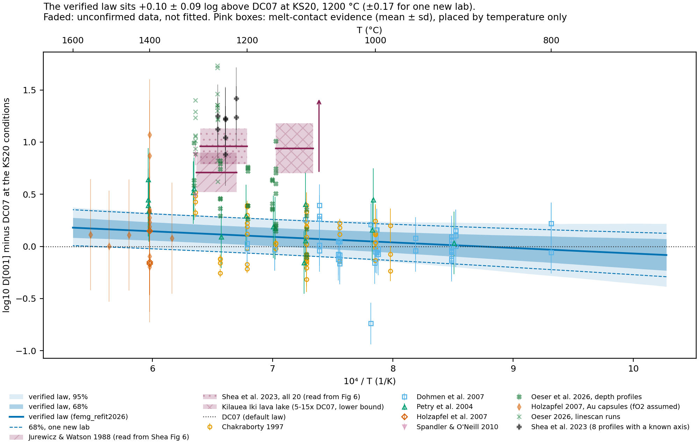
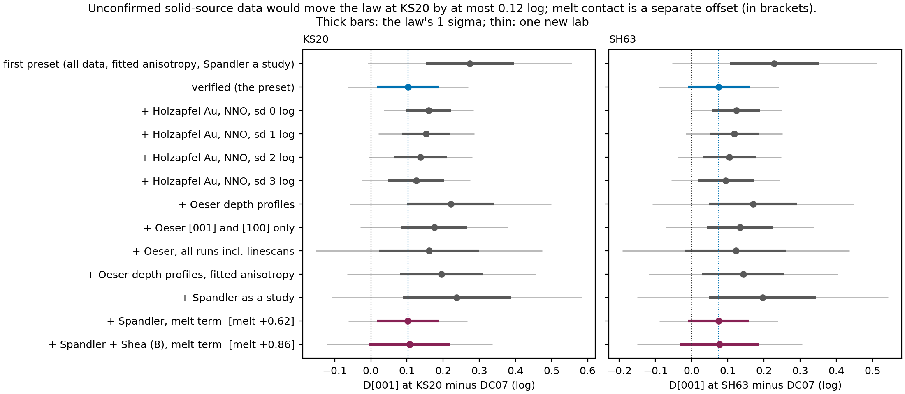
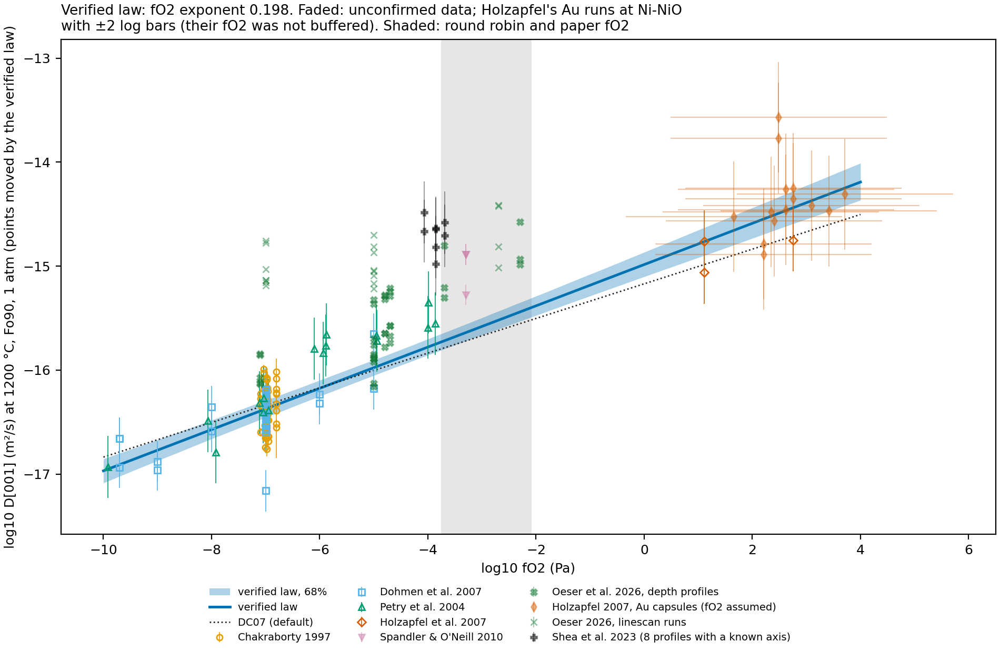
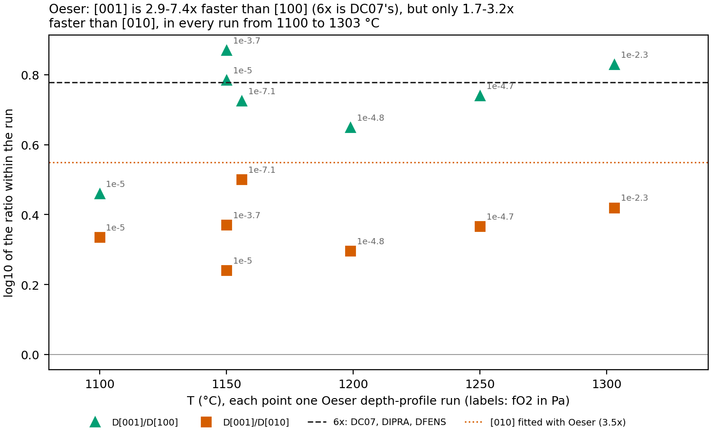
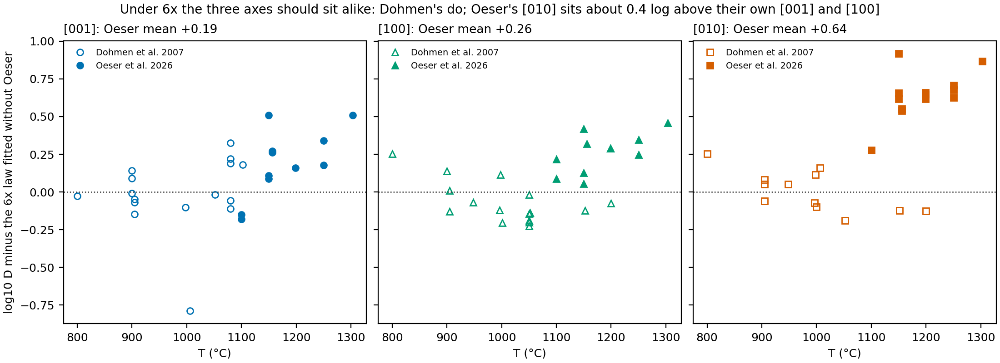
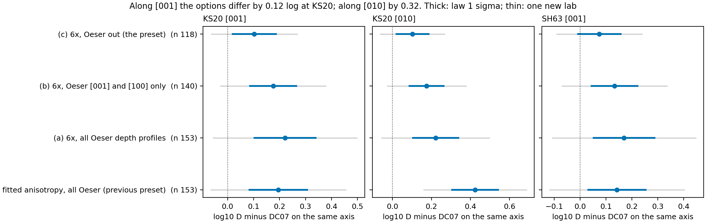
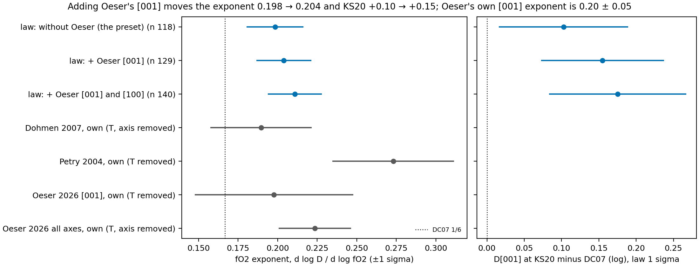

# What the unconfirmed data suggest, and where the analysis goes next

Written 2026-10-14; updated 2026-10-15 for the final form of the `femg_refit2026` preset. The preset is the Dohmen and Chakraborty (2007) form with [100] and [010] six times slower than [001], as in DC07, DIPRA and DFENS. It is fitted to the verified data only: every value stated in the sources' tables or text (`data-to-source.md`).

This note covers everything else:
- what each unconfirmed set would do if it were confirmed;
- the two scenarios kept outside the law: melt contact, and Oeser et al.'s anisotropy and high-temperature level;
- what each missing source would let us do.

Numbers: `analyses/femg_refit/results/verified/{variants,scenarios,oeser_options,oeser_fo2_options}.csv`. Figures: `unconfirmed_figures.py`, `anisotropy_figures.py` and `oeser_fo2_figures.py` in `analyses/femg_refit`. Log units throughout. "KS20" is D[001] at the round-robin conditions (1200 C, fO2 1.4e-3 Pa, Fo85, 42 MPa), relative to the default law (DC07).

## The preset

| | Points | Studies | KS20 vs DC07 | 1 sigma, law / one new lab | tau | fO2 exponent | E (kJ/mol) |
|---|---|---|---|---|---|---|---|
| **`femg_refit2026`, 2026-10-15**: verified data, 6x | 118 | 4 | **+0.10** | 0.087 / 0.167 | 0.143 | 0.198 | 211 |
| 2026-10-14: verified data with Oeser, anisotropy fitted | 153 | 5 | +0.20 | 0.114 / 0.261 | 0.235 | 0.221 | 213 |
| 2026-10-13: all data, anisotropy fitted, Spandler as a study | 135 | 5 | +0.27 | 0.122 / 0.282 | 0.254 | 0.221 | 209 |

- **Data:** Chakraborty (1997), Dohmen et al. (2007), Petry et al. (2004), and Holzapfel et al. (2007) with Ni-NiO capsules only.
- **Fitted:** log D0, E, the fO2 exponent and the composition coefficient; V = 7 cm3/mol and the 6x anisotropy are fixed.
- **Method:** least squares with a random offset per study (REML).
- **Why not other forms or methods** (checked on these data; `docs/plans/2026-10-14-oeser-additive.md` covers the earlier comparisons):
  - The Mutch form needs high-pressure data at more than one temperature, so it is singular here.
  - OLS gives too narrow a range (+0.08 ± 0.05).
  - ODR steepens the fO2 exponent to 0.29 (+0.48), above every direct measurement.
- **SH63 (1102 C)** is +0.07 and the paper conditions (1250 C) +0.13. Fe-Mg times with this preset are about 1.25x longer than with the 2026-10-14 version, and 1.5x longer than with the first.

**Fig. U1.** The preset at the KS20 conditions, drawn as log D minus DC07. Bands are 68% and 95% of the law; dashed lines add tau for one new laboratory.
- **Points:** solid points are fitted. Faded points are unconfirmed (Oeser, Holzapfel's Au runs, Spandler, Shea), each moved to the KS20 conditions by the preset.
- **Holzapfel's Au runs** carry a bar that includes a 2-log fO2 prior.
- **Pink boxes:** melt-contact evidence that cannot be placed point by point (mean ± sd against DC07 at each study's own conditions, spanning its temperatures). For the lava lake, the arrow marks a lower bound.

**Fig. U2.** The KS20 and SH63 levels of the preset and of each addition. Thick bars are the law's 1 sigma; thin bars are one new laboratory. Melt-term rows predict for solid contact; their offset is in brackets.

**Fig. U3.** The preset against fO2 at 1200 C. Points are moved in T, composition, P and axis (not fO2). Holzapfel's Au runs are at their assumed fO2 (Ni-NiO), with ±2 log bars.

## Unconfirmed solid-source data

- **Holzapfel et al. (2007), Au capsules (14 runs).** Their fO2 is assumed to be Ni-NiO.
  - At KS20 the level goes to +0.16, +0.15, +0.14 and +0.13 for an fO2 prior sd of 0, 1, 2 and 3 log, against the preset's +0.10.
  - **tau falls** to 0.11-0.13. The 3 buffered runs sit low (Holzapfel's study offset is -0.12), and the Au runs pull it up.
  - The Au runs lie on the law's extrapolation at 10^1 to 10^4 Pa within their bars (Fig. U3).
- **Oeser et al. (2026):** the next section.

## Scenario 1: Oeser et al. (2026), anisotropy and the high-temperature level

Decided 2026-10-15: the preset keeps 6x, and Oeser et al. enter only as a scenario. Their tables are verified, but three things set them apart.

**Fig. A1.** Within each Oeser depth-profile run, log D[001]/D[010] and log D[001]/D[100] against temperature. Labels give each run's fO2.

**Fig. A2.** Dohmen et al. and Oeser et al. rows against the 6x law fitted without Oeser, by axis. Under 6x the three axes should sit alike.

**Fig. A3.** What each way of including Oeser does to D along [001] and along [010] at KS20, and along [001] at SH63, relative to DC07 on the same axis.

- **Their [010] departs from 6x in every run, at every temperature and fO2.**
  - D[001]/D[010] is 1.7-3.2x, while D[001]/D[100] is 2.9-7.4x, mostly near 6x (Fig. A1).
  - Dohmen et al.'s data fit 6x within 0.04 log on all three axes, including single [010] and [100] points at 1150 and 1200 C that sit where 6x puts them (Fig. A2).
  - The disagreement is between laboratories, not a temperature trend: neither study shows a significant axis-specific activation energy.
- **Their level rises with temperature on every axis.** Against the law without them, their [001] and [100] go from about 0 at 1100 C to +0.3-0.5 at 1250-1300 C (Fig. A2). That fits their reading: a change of mechanism above about 1150 C, with E of 230-370 kJ/mol. Their linescan runs 7, 14 and 15 sit highest.
- **They change the level, not the slope.**
  - Their own [001] fO2 exponent is 0.20 ± 0.05, the same as the preset's 0.198 ± 0.018.
  - Adding their [001] rows moves the exponent by 0.006 and KS20 by +0.05; adding [001] and [100] gives +0.18, and all depth profiles +0.22 (Figs. F1 and F2; Fig. A3).
  - Their steep 1150 C step (0.52 from 1e-5 to 1e-3.7 Pa) rests on one run.

![Oeser's [001] against fO2](../../analyses/femg_refit/figures/oeser_fo2/f1_fo2_series.png)

**Fig. F1.** Oeser's [001] runs against fO2 at 1150 and 1250 C. Points within 30 C are moved to each panel's temperature by the law without Oeser. Lines are that law and the law with Oeser's [001] rows.

**Fig. F2.** The fO2 exponent and the KS20 level of the preset, with Oeser's [001] rows, and with [001] and [100]; beside each study's own exponent.

**As a scenario, for a fitted time:**
- **The [010] effect.** A traverse along [010] would have D higher by about log(6/2.1) = 0.46, so its time would be x0.35. A traverse along [001] or [100] is barely affected; a traverse's share of D along [010] says how much it is exposed.
- **The level effect.** Above about 1150 C, Oeser's level would raise D by 0.1-0.4 on every axis.

## Scenario 2: melt contact, about +0.6 to +0.9 log above the preset

Spandler and O'Neill (2010) are excluded from the preset, and Shea et al. (2023) cannot yet be fitted beyond 8 profiles. At the melt studies' conditions the preset sits +0.04 to +0.10 above DC07. Against the preset:

| Source | Against DC07, own conditions | Against the preset | How it was obtained |
|---|---|---|---|
| Spandler and O'Neill (2010), 1300 C | +0.73 | +0.63; fitted melt term **+0.62 ± 0.20** | Table 2 (two of three values are ends of a fitted line) |
| Jurewicz and Watson (1988), 1219-1298 C | +0.71 ± 0.19 | about +0.63 | read from Shea et al.'s Fig 6 |
| Shea et al. (2023), all 20, 1200-1290 C | +0.96 ± 0.17 | about +0.88 | read from Fig 6 |
| Shea et al. (2023), 8 profiles with a known axis | +1.13 | melt term with Spandler: **+0.86 ± 0.19** | Table 1 D; axes from Figs 2-4 |
| Kilauea Iki lava lake, about 1090-1150 C | +0.70 to +1.18 (5-15x), lower bound | at least +0.66 to +1.14 (assuming fO2 near QFM) | Shea, Nizam and Helz (2026), text |

**Notes on possible melt effects, from Shea et al. (2023) and what followed:**

- **It is a level, not a slope.**
  - The offset is about the same on every axis, with the anisotropy DC07-like.
  - It is about the same for Fe-Mg, Ni and Mn (x10, x7.5 and x9 in Shea et al.).
  - Separating it from the solid data leaves the fitted fO2 exponent unchanged (0.198 with or without the melt term).
  - So it belongs as one log offset, common to axes and elements, applied only to crystals in melt contact (`melt-contact-diffusion.md`).
- **The proposed cause is extra M-site vacancies made at the melt interface** by Al or H (Shea et al.'s Eq. 4: D = X_V D_V). Higher aSiO2 and extended defects were tested and rejected. It predicts that the offset shrinks where the fO2-dependent vacancies dominate, which is untested.
- **It is not a laboratory artefact.** The Kilauea Iki olivine needs 5-15x DC07 over 29 years of natural re-equilibration, with no experimental interface, at temperatures below Oeser's ~1150 C regime change.
- **Size for a fitted time** (crystal in melt contact, against the preset):
  - +0.62 (Spandler) → time x0.24;
  - +0.63 (Jurewicz and Watson) → x0.23;
  - +0.86 to +0.88 (Shea) → x0.14 to x0.13.

  The spread between sources (about 0.25 log) is larger than any one of their errors.
- **How forster should carry it, for now:** a named, one-sided scenario reported beside the solid-contact time. It should not be in the preset or in tau.

## Where the analysis goes when each source is in hand

1. **Shea et al. (2023) supplementary table** (orientation and Fo of all 26 profiles).
   - Fit all 26 instead of 8. The 8 run about 0.17 above the full set, so expect the melt term to fall toward Spandler's +0.6-0.7.
   - Ni and Mn are in the same table, so this enables the joint Fe-Mg/Ni/Mn fit with a shared melt term.
2. **Jurewicz and Watson (1988).** A third melt study with its own conditions, so the melt term gets a spread from three studies.
3. **Shea, Nizam and Helz (2026) supplement** (fO2, temperature-time paths, crystal data). Run forster's forward model on the lava-lake paths with the preset plus a melt term, to turn "5-15x, lower bound" into a likelihood.
4. **A second solid-source study with all three axes at 1150-1300 C,** to settle [010] (Dohmen's 6x or Oeser's 2x) and whether the high-temperature level is real. For Oeser's runs 7, 14 and 15, the raw linescans would check the deconvolution.
5. **Holzapfel et al. (2007) Au-capsule fO2.** A better estimate would let the 14 runs in (KS20 +0.03 to +0.06; Fig. U2). They would also make the Mutch form, with its pressure terms, fittable to verified data.
6. **Mutch et al.'s compiled experiments** (from the authors). They would show why our OLS on the same six studies gives an fO2 exponent of 0.258 where theirs is 0.224 (`data-to-source.md`, item 8). Their coefficients and covariances are already in the Mutch presets.
7. **Per-run orientations** (Chakraborty 1997; Petry 2004) and **Meissner (2000)**: confirmation of what is already in. Each moves KS20 by less than 0.01, unless a run turns out to be off [001].

## Other data that would change the result most

- **Solid-source diffusion at 1e-4 to 1e-2 Pa and 1150-1250 C, by depth profiling and with all three axes.** Our runs sit there, and the fO2 exponent there is an extrapolation: Dohmen's series give 0.19, Petry's 0.27.
- **A melt-contact experiment at a second fO2,** to separate a constant offset from extra vacancies that matter less where Fe3+ vacancies dominate.
- **The Ni and Mn compilations,** to test whether a study's or the melt's offset is shared across elements.
- **Rawlings and Mutch (2026)** (in Zotero), not yet read for further datasets.
