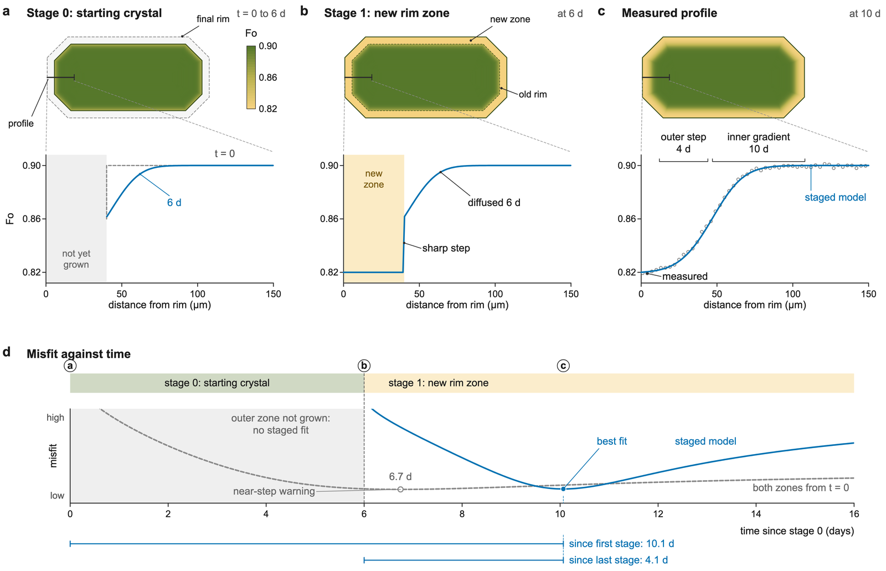
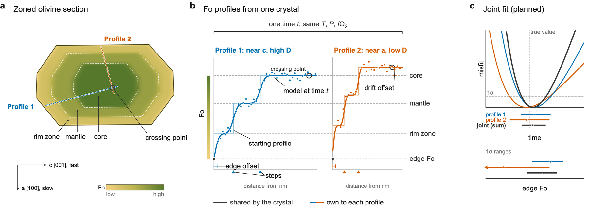

# Advanced

Features beyond fitting one profile with one starting profile. Some of them are
available from Python only for now; the page says which.

## Growth stages

A zoned crystal can record more than one growth event: a rim zone that grew partway
through, around a core that had already been diffusing. Fitting such a profile as if
every zone had been there from the start gives a time that matches neither event.
**Growth stages** model it: at the start of each stage the rim moves outward and a new
zone with its own Fo appears, which from then on diffuses together with the older
crystal. Inner zones have therefore diffused for longer than outer ones.



*A crystal growing in two stages, computed with FORSTER's own model on a synthetic
profile. **a** Stage 0: the starting crystal diffuses for 6 days with its rim held.
**b** Stage 1 at 6 days: the rim moves out and a new zone of Fo 0.82 appears, with a
sharp step on top of the gradient that has already diffused. **c** The measured
profile at 10 days and the staged fit. **d** The misfit against time: the staged model
fits at 10.1 days since the first stage (4.1 days since the last); fitting the same
profile with both zones present from the start gives 6.7 days, neither of the two, with
a misfit almost as low. FORSTER's near-step check flags the single-stage fit; the
growth history itself has to come from other evidence.*

**From the tables** (one entry per stage, in quotes for several stages):

| Column | Meaning |
|---|---|
| `stage_days` | When each stage starts, in days after the start of the run. |
| `stage_rim_um` | The rim position from that stage on: at or below the previous rim (`domain_start_um` before the first stage). |
| `stage_zone_fo` | Fo of the zone the stage adds between the old and the new rim. |
| `stage_rim_fo` | Optional: Fo held at the rim from that stage on (default: the new zone's Fo). |

The domain, step and Fo columns describe the crystal **before** the first stage. Only
times after the last stage are fitted; `time_days` counts from the start of the run
and `time_since_last_stage_days` from the last stage. Growth stages need `dx_um` and
`dt_s` given, the correlated uncertainty method, and no starting-profile fit (no `_sd`
or `_range` columns). In the app, they are a table in the Advanced tab.

**From Python:**

```python
from forster import Stage, fit_profile

overgrowth = Stage(start_s=6 * 86400, rim_um=0.0, zone_value=0.82)
result = fit_profile(profile, conditions, orientation, initial, grid, stages=[overgrowth])
print(result.time_days, result.time_since_last_stage_days)
```

With the implicit scheme, stages start at their exact times, and the rim value can
change in time: `fit_profile(..., rim_fo=forster.boundary.RimPath(times_days, values))`
holds the rim at a value interpolated linearly between the given times.

!!! warning "The history must come from elsewhere"
    A staged and a single-stage history can fit a profile almost equally well with
    different times. The stage start times are inputs, not fitted; choose them from
    petrography, other elements or zoning that only growth explains.

## Joint fits of one crystal

*Python only for now.*

Profiles measured along different directions of one crystal share one history.
`forster.fit_crystal` fits them together: they share **the time**, **the conditions**
(which must be identical) and **the Fo of each segment**, matched by segment label
(name the segments the same way on each profile, with `segment_names`). Each profile
keeps its **own step positions** (zones grow at different rates on different faces),
its **own orientation** (so its own D) and its **own noise model**.



*What is shared and what is per profile. **a** A zoned crystal with two traverses, one
near the fast c axis and one near the slow a axis. **b** Shared by the crystal: one
time, the same T, P and fO2, the Fo of each segment (dashed levels) and the edge Fo;
own to each profile: its steps, its orientation and D, an Fo offset for microprobe
drift between sessions, and optionally an edge position offset. **c** The joint misfit
is the sum of the two profiles'; its range is narrower than either profile's alone.
Illustrative, synthetic crystal (drawn while the joint fit was being built, hence
"planned" in panel c).*

```python
import forster
from forster import fit_crystal

profiles = forster.read_profiles("crystal/profiles.csv")
run_a, run_b = forster.read_runs("crystal/parameters.csv")   # with starting-profile priors
crystal = fit_crystal([run_a, run_b], profiles)
print(crystal.best_days, crystal.range_days, crystal.range2_days)
print(crystal.segment_fo, crystal.fo_offset, crystal.agree)
```

What it does:

- **Individual fits first.** Each profile is fitted alone (`crystal.individual`), and
  profiles whose 2σ ranges do not overlap give a warning (`crystal.agree` is False):
  check the orientations, whether a profile is off the crystal's centre, or a 3D
  effect near a corner, before trusting the joint time.
- **An Fo offset per profile** (`<run>:fo_offset`) absorbs microprobe drift between
  sessions, with a Gaussian prior of 0.1 mol% (`fo_offset_sd`). The profile with the
  most points is the reference, with no offset.
- **An edge position offset** (`<run>:edge1_offset_um`, where the true edge lies in
  the profile's measured distances) can be switched on with `edge_offset_sd_um=2.0`
  when the steps are well constrained.
- **Segments of one profile only**: `own_segments={"run_b": ["c"]}` lets that profile
  fit its own core, for example.
- The sampler is the same as for a single starting-profile fit, with settings
  calibrated on two real crystals to about 5% on the 16th, 50th and 84th percentiles
  of time.

The result's ranges (`low_days`-`high_days`, `low2_days`-`high2_days`) are the
central 68% and 95% of the joint posterior of time, including every free parameter.
Not yet supported: growth stages and a held `edge1_fo`; tables, the command line and
the app (the `crystal` column is carried through for now). The design is in
[2026-10-16-joint-fits.md](https://github.com/whtowbin/Olivine_Diffusion_FeMg/blob/master/docs/plans/2026-10-16-joint-fits.md)
on GitHub.

## Ni, Mn and Ca

*Python only for now.*

Ni, Mn and Ca profiles in the same olivine are a check on the Fo time: they diffuse at
different rates, so a single history should explain all of them.

- `forster.fit_element` fits a Ni, Mn or Ca profile for its own time.
- `forster.fit_joint` fits one time to Fo and the elements together, and says whether
  they agree (`consistency_p`, the probability of a disagreement at least this large
  if they share one time).

Ni and Mn diffuse with the Fo profile alongside them, since their diffusivity depends
on Fo; Ca does not need it. The element's edge, core and plateau concentrations are
fitted unless given. Concentrations can be in any unit.

```python
from forster import ElementProfile, fit_element, fit_joint

ni = ElementProfile(distance_um, nio_wt_pct, "Ni", name="my profile")
result = fit_element(ni, conditions, orientation, fo_initial, None, grid)
joint = fit_joint(fo_profile, [ni], conditions, orientation, fo_initial, None, grid)
print(result.time_days, joint.time_days, joint.consistency_p, joint.species_days)
```

Diffusion laws for the elements: DIPRA's Ni (the default for Ni), Mn and Ca equations
(Girona and Costa 2013, Table 1); Petry et al. (2004)'s own Ni law (`petry2004_ni`;
DIPRA's Ni equation pairs Petry's pre-factor with the activation energy of a different
fit, which makes Ni 0.14 log units slower at 1200 °C); and the Ni and Mn regressions of
Mutch et al. (2019) (`mutch2019_ni`, `mutch2019_mn`). Choose one with
`fit_element(..., diffusivity="petry2004_ni")`. These element fits use the explicit
schemes.

## Project folders

The desktop app works on a **project folder**, which is also just a folder of
FORSTER tables:

| File | Holds |
|---|---|
| `profiles.csv` | Every profile, with `Marked_bad` = `bad` on masked points (the table reader drops them, so `forster fit` leaves them out too). |
| `parameters.csv` | One row per run. |
| `diffusivities.csv` | The project's own diffusion equations, if any. |
| `project.json` | What only the app needs: the format version, the selected run, each run's view settings, and which cached result belongs to which run. |
| `.forster/cache/` | Cached fits, starting-profile fits and Monte Carlos (NumPy and JSON files, never pickles), each under a key computed from everything that determines it: the run's row, the profile's numbers, the equations and the FORSTER version. A run whose settings changed has no result rather than a stale one. |
| `.forster/autosave/` | The autosave, written every minute without touching the saved tables. |

Because the tables are the command line's own, `forster fit profiles.csv
parameters.csv` reruns a saved project, and a project can be shared as a zip (the
app's Export) or under version control (leave out `.forster/`). From Python,
`forster.project.Project` opens, edits and saves a project with the same checks as the
app ([Python API](api.md#project-folders-forsterprojectproject)).
