# The desktop app

The app does everything `forster fit` does, with the profile on screen. You draw the
starting profile with the mouse and the fit updates as you go. The uncertainty from the
starting profile, the conditions and the diffusion law are shown in the same window.
It needs the `gui` extra ([Installation](installation.md)).

```bash
forster gui my_project/
```

`my_project/` is a **project folder**. An empty or new folder starts from the worked
example. If the folder already holds FORSTER tables (`profiles.csv`,
`parameters.csv`), the app opens them. The app saves to the same tables the command
line reads, so `forster fit my_project/profiles.csv my_project/parameters.csv` reruns
a saved project unchanged.

!!! note "About the screenshots"
    The screenshots come from the app's test runs. "OL7 prof 1" and "OL7 prof 2" are
    synthetic test profiles, not real crystals. Three screenshots (the Segments tab,
    a refused edit and the starting-profile fit) date from the first build, which had
    fewer tabs. The tabs they show still work the same way.

## The window


The window has three parts:

- **Left: the runs.** A run is one fit of one profile with one set of inputs (one row
  of `parameters.csv`). A tick marks a fitted run. **Add** makes a new
  run on a profile, starting from the selected run's settings. **Duplicate**,
  **Rename** and **Delete** do what they say. **Copy settings to other runs...** is
  described [below](#copying-settings-between-runs).
- **Center: the views** of the selected run: **Profile**, **Time distribution**,
  **Law comparison** and **Results**.
- **Right: the run's settings**, in tabs: **Segments**, **Data**, **Conditions**,
  **Orientation**, **Equation**, **Uncertainties** and **Advanced**.

Across the top are **New from example**, **Open**, **Save**, **Save as**, **Import
profiles**, **Copy settings**, **Fit all** (fit every run) and **Export**. Hover over
any field to see its unit and the table column it is saved in.

## The Profile view and the Segments tab

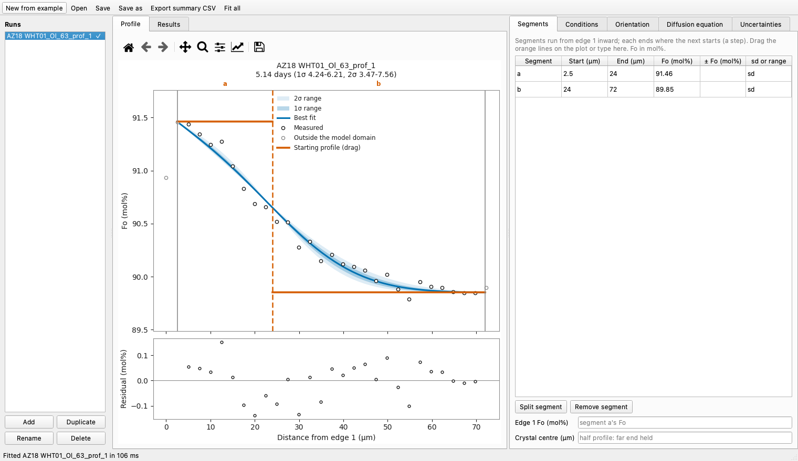

The Profile view shows the measured points and the best fit. The 1σ and 2σ bands are
the model profiles at the two ends of each range. The residuals (measured minus model)
are plotted underneath, and the title gives the time and both ranges.

The **starting profile** is drawn as orange lines. It is built from **segments**,
stretches of constant Fo labeled a, b, c, ... inward from **edge 1**, the crystal edge
where the profile starts. Segments meet at **steps** (dashed lines). You
can:

- drag a step sideways, or a segment's Fo line up and down;
- drag the gray lines at the two ends of the **model domain**, the part of the profile
  that is modeled (points outside it are drawn in gray and are not fitted);
- type the same values into the **Segments** tab: each segment's start, end and Fo in
  mol%, and an uncertainty on its Fo (a standard deviation, *sd*, or a ± *range*; see
  [Uncertainty beyond the fit](uncertainty.md)).

The run is refitted when you let go (the example refits in about 35 ms).
**Split segment** and **Remove segment** add or remove a step. Below the table, **Edge 1 Fo** holds edge 1 at a different Fo from segment a during
diffusion, for example a rim in contact with a melt of different
composition. **Crystal center** models a whole crystal, mirrored at its center, instead
of a half profile. [Setting up a run](setup.md#the-starting-profile) explains both.

Warnings appear under the plot, for example when the profile ends too close to the step
or the misfit is concentrated near the step. [Reading the results](results.md#warnings)
explains each warning and what to do about it.

### Values are checked as you type

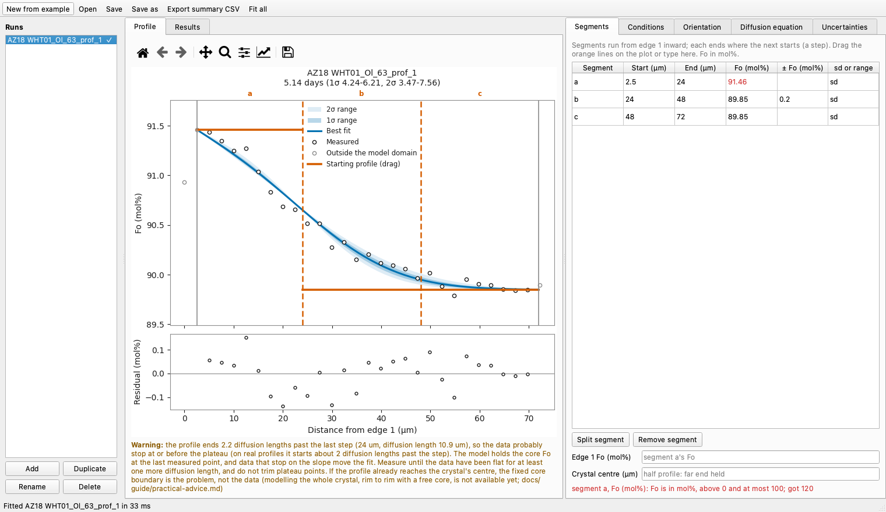

The app checks every edit by writing the run as a table row and reading it back, so it
accepts exactly what `forster fit` accepts. A refused value turns red and the reason appears under the table (here, an Fo of 120 mol%).

## The Data tab: masking points and moving the rim

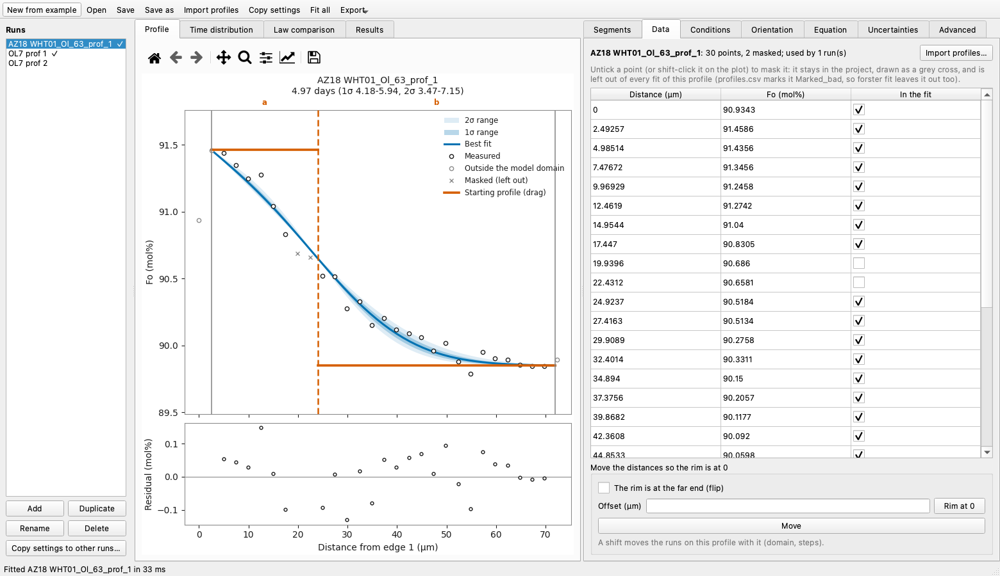

The **Data** tab lists the profile's points. To **mask** a point, untick it or
shift-click it on the plot. A masked point stays in the project as a gray cross but is
left out of every fit of this profile. It is saved in `profiles.csv` with
`Marked_bad` = `bad`, and `forster fit` skips it too. Mask a point only for a known
fault (a crack, an inclusion, a poor total, beam overlap with the rim), never to
narrow the range ([Preparing data](data.md#collecting-profiles)).

**Move the distances so the rim is at 0** shifts the distances, or flips them if the
rim is at the far end of the traverse. The domain and steps of every run on that
profile move with them. **Import profiles...** opens the import dialog.

## Importing profiles

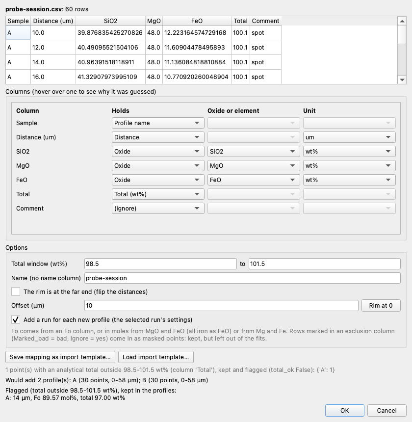

Choose a CSV or Excel file, then say what each column holds. A column can be the
profile name (or none, if the whole file is one profile), the distance (µm or mm), Fo
(a fraction or percent), an oxide or element (wt% or ppm), the analytical total, a
stage coordinate, an exclusion column, or nothing. The dialog proposes a mapping from
the headers and values (hover over a column to see why) and keeps **OK** disabled until
the mapping is complete. If there is no Fo column, Fo is computed from MgO and FeO in
moles. Points whose total falls outside the window (98.5-101.5 wt% by default) are
kept and listed as flagged. The dialog can flip and shift the distances so the rim
is at 0, add a run on each new profile, and save or load the mapping as an **import
template**. `forster import` uses the same mapping, and
[Preparing data](data.md#importing-other-spreadsheet-layouts) explains it in full.

## Conditions, Orientation and Equation

- **Conditions**: temperature (°C), pressure, and oxygen fugacity, either relative to
  a buffer (QFM or NNO, in log units) or in Pa.
- **Orientation**: the angles between the profile and the crystal axes [100], [010]
  and [001], or EBSD Euler angles together with the profile's direction on the map.
- **Equation**: the Fe-Mg diffusion law. Choose one of the four built-in laws or one of
  the project's own equations from `diffusivities.csv`. The tooltip gives the source of
  each.

[Setting up a run](setup.md) explains what each choice changes.

## The Uncertainties tab

### Fitting the starting profile

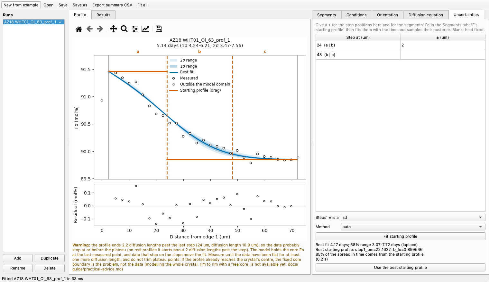

Give the step positions a ± here and the segments' Fo a ± in the Segments tab, then
press **Fit starting profile**. FORSTER fits the step positions and segment Fo together
with the time. It reports the best fit, the 68% range including the starting profile's
uncertainty, the best starting profile, and how much of the spread in time comes from
the starting profile. **Use the best starting profile** copies the fitted values into
the run. *Method* chooses the sampler (`auto` is right almost always). The fit shows
its progress and can be canceled. In the screenshot, a run with two steps, the first
known to ±2 µm, gives 4.17 days (68% range 3.07-7.72 days). The starting profile
accounts for 85% of the spread. The warning below the plot says the profile ends only
2.2 diffusion lengths past the second step.

### Monte Carlo over the conditions and the equation


Below it, the **Monte Carlo** panel draws temperature, pressure, fO2 and the
diffusion law's parameters, and turns each draw into a time. Enter the 1σ of T (°C),
P (MPa) and fO2 (log units). Choose whether fO2 stays relative to a buffer as T
changes, whether to draw the law's parameters from its published covariance, and
whether to add the spread between laboratories. The result line gives the median time,
the 68% and 90% ranges, and how much each source contributes. [Uncertainty beyond the
fit](uncertainty.md#the-monte-carlo-over-t-p-fo2-and-the-law) explains the numbers.

## Time distribution

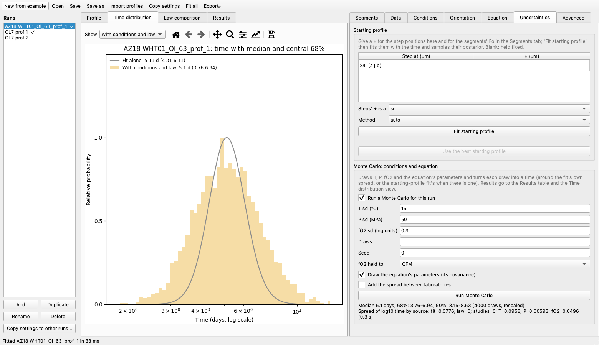

This view shows the distribution of time on a log axis: from the fit alone, with the
starting profile's uncertainty (after **Fit starting profile**), and with the
conditions and the law (after a Monte Carlo). It is the figure `forster fit` writes as
`_time.png`. *Show* picks which distributions to draw.

## Law comparison

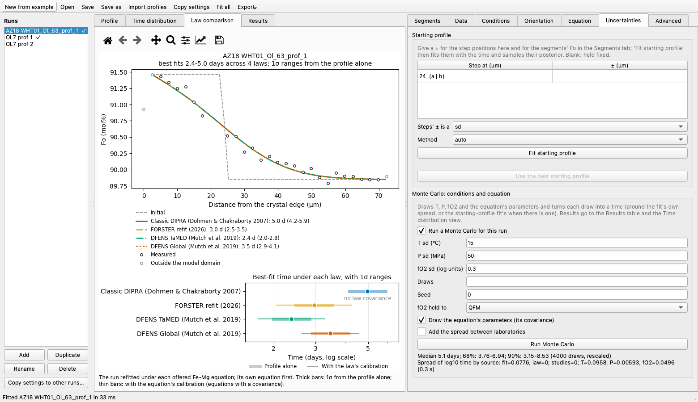

This view refits the run with each of the four built-in Fe-Mg diffusion laws, as
`forster fit --compare-laws` draws it. The profiles look identical because the fit
fixes D × t. The times differ because each law gives a different D. Thick bars show
the 1σ range from the profile alone, and thin bars add the law's own calibration
uncertainty.

## Advanced

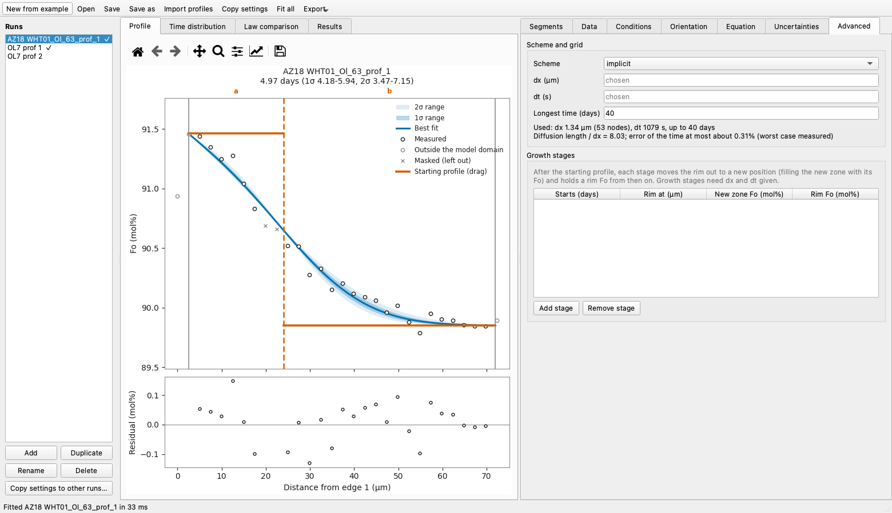

- **Scheme and grid**: the numerical scheme (implicit by default) and the grid's
  spacing (dx), time step (dt) and longest modeled time. Leave dx and dt blank and
  FORSTER chooses them. The line underneath says what the last fit used and how well
  the grid resolved the profile. Here the diffusion length is 8 grid
  spacings, so the time is within about 0.3% of a converged value.
- **Growth stages**: a table of stages, each with its start time, the new rim
  position, the new zone's Fo and the rim's Fo from then on ([Advanced](advanced.md#growth-stages)).

## Results

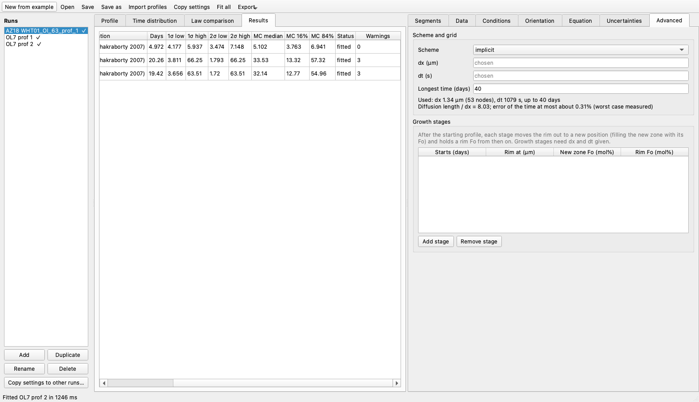

The Results view lists every run's time, 1σ and 2σ ranges, Monte Carlo median and 68%
range, status and number of warnings. **Export** writes the same `summary.csv` as
`forster fit` for the fitted runs.

## Copying settings between runs

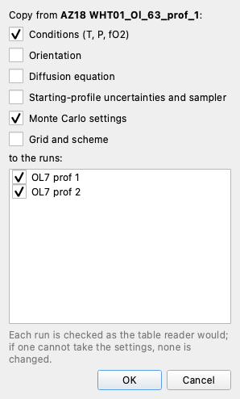

Choose which groups of settings to copy from the selected run (conditions,
orientation, diffusion equation, starting-profile uncertainties and sampler, Monte
Carlo settings, grid and scheme) and which runs to copy them to. Each target is checked as the table reader would check it. If one cannot take the settings, none is changed.

## Dark mode

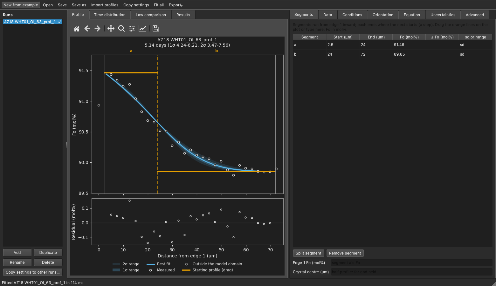

The app and its plots follow the system's light or dark setting.

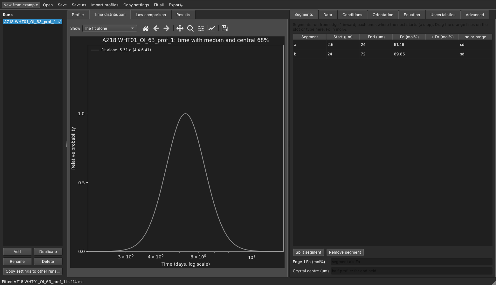

## Saving, caching and exporting

- **Save** writes the tables (`profiles.csv`, `parameters.csv`, `diffusivities.csv`)
  and `project.json`, which holds what only the app needs (each run's view: tabs and
  zoom).
- Fits, starting-profile fits and Monte Carlos are cached in the project folder
  (`.forster/cache`), so a reopened project shows its results straight away.
- The project is autosaved every minute (`.forster/autosave`). If you open a project with unsaved changes from an earlier session, the app offers to restore them.
- **Export** writes the plot or view on screen as PNG or PDF, the fit figure as
  `forster fit` draws it, `summary.csv`, or the whole project as a zip to share.
