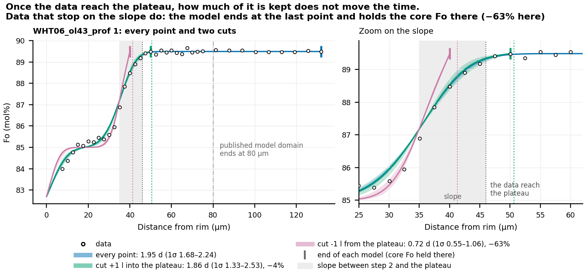

# Preparing data

This page covers how to get measured profiles into FORSTER and, before you go to the
microprobe, how to collect profiles that FORSTER can fit well.

## The profiles table

FORSTER reads measured profiles from a table (`profiles.csv`, or an Excel sheet) with
one row per analysis point.

| Column | Unit | Meaning |
|---|---|---|
| `profile` | | Profile name. The `profile` column of `parameters.csv` refers to it. Many profiles can share one table. |
| `distance_um` | µm | Distance of the analysis from the crystal edge. |
| `fo` | fraction | Forsterite content, Mg/(Mg + Fe) in moles, as a fraction: 0.895, not 89.5. |
| `Marked_bad` | | Optional. A point marked `bad` is left out of the fits (these are the points masked in the desktop app). |

```text
profile,distance_um,fo
ol12 prof 1,0.0,0.8512
ol12 prof 1,2.5,0.8547
ol12 prof 1,5.0,0.8601
...
```

FORSTER sorts the points by distance as it reads them, so the row order does not
matter. A profile needs at least 3 points, and a name with fewer is skipped with a
warning. Extra columns are ignored, so oxide data, totals and notes can stay in the
same table.

**Distance from which edge?** Distances are measured from **edge 1**, the end of the
profile where the model holds Fo. This is usually the crystal rim. If your traverse ran
from the core outward, flip it (the app's Data tab and the import step can both do
this). The first point does not have to sit at zero. The model domain
(`domain_start_um`, `domain_end_um`) sets which part of the profile is modeled.

## Importing other spreadsheet layouts

A spreadsheet straight off the microprobe has its own column names and units.
`forster import` converts it in two steps, and you check the mapping before anything
is converted.

**Step 1: propose a mapping.**

```bash
forster import probe_session.xlsx
```

FORSTER reads each column's header and values and guesses what it holds: the profile
name, the distance (µm or mm), Fo (fraction or percent), each oxide or element (wt% or
ppm), the analytical total, stage coordinates, or exclusion columns (`Marked_bad`,
`Ignore`, ...). It writes the guess to `probe_session.import.json` and stops. Open
that file, check every column and correct anything it got wrong.

**Step 2: apply the confirmed mapping.**

```bash
forster import probe_session.xlsx --template probe_session.import.json
```

This writes `probe_session_profiles.csv` in the layout above. Along the way:

- **Fo from oxides.** If there is no Fo column, Fo is computed in moles from MgO and
  FeO in wt%: Fo = (MgO/40.3044) / (MgO/40.3044 + FeO/71.8444), taking all iron as
  Fe²⁺ (FeO is total iron). Mg and Fe given as elements (wt% or ppm) work the same way.
- **Flagged totals.** Points with an analytical total outside 98.5-101.5 wt% are
  flagged in a `total_ok` column and listed, but **not** dropped. A low total is a
  reason to look at a point again. It does not prove the point is bad. Change the
  window with `--total-window 98 102`.
- **Excluded rows.** Rows marked in an exclusion column (`bad`, `yes`, `x`, `1`, ...)
  are left out.

Once confirmed, the `.import.json` file is an **import template**, and later files with
the same columns import with it directly. If a file has columns the template does not
know, or lacks ones it needs, the import stops with a message so that nothing is
imported wrongly. (An import template is only a column mapping. It has nothing to do
with the `forster template` command, which writes the parameter tables.)

| Option | Does |
|---|---|
| `--sheet NAME` | Excel sheet to read (default: the first). |
| `--save-template FILE` | Where to write the proposed mapping (default `FILE.import.json`). |
| `--out FILE` | Profiles table to write (default `FILE_profiles.csv`). |
| `--total-window LOW HIGH` | Window for flagging totals (default 98.5 101.5). |
| `--force` | Overwrite an existing proposed mapping. |

The desktop app's **Import profiles...** dialog uses the same mapping and reads and
writes the same import templates ([The desktop app](app.md#importing-profiles)). From
Python, use `forster.imports.guess`, `ImportTemplate` and `apply` ([Python
API](api.md#importing-spreadsheets-forsterimports)).

FORSTER also reads parameter and profile tables in two older layouts: the tables of
Towbin and Plank (2026), and the lab layout with `Profile_Name`, `Distance µm` and
`Fo#` in percent.

## Collecting profiles

The advice below comes from tests on synthetic profiles of known age and on the
published profiles of Towbin and Plank (2026). It uses two terms.

- The **diffusion length**, l = √(D t), is roughly how far a step has spread. On a
  fitted profile it is about half the width of the smoothed step. D is the diffusivity
  (how fast Fe and Mg exchange, in m²/s) and t is the time. FORSTER reports the fitted
  time, so l at your conditions follows from it. `core_end_diffusion_lengths` in
  `summary.csv` gives distances in units of l.
- The **plateau** (or core) is the flat part of the profile beyond the smoothed step,
  which diffusion has not yet reached.

| Advice | Why |
|---|---|
| **Keep measuring for at least one diffusion length after the profile goes flat.** More is better. | FORSTER ends the model at the last measured point and holds the core Fo there. On real profiles the plateau starts about 2 diffusion lengths past the step. Data that stopped right where the plateau starts moved the time by -15% to +22%, and data that stopped on the slope moved it by -63% or more. With 1 diffusion length of plateau or more, every profile tested stayed within 4%. FORSTER warns when the data end within 3 diffusion lengths of the step. |
| Take care with that warning when the profile ends at the center of a small crystal. | Here the data cannot go any further. Diffusion from both rims meets at the center, and once it arrives the center's Fo falls. A fixed core Fo cannot follow that change. Model the whole crystal instead (`centre_um`, [Setting up a run](setup.md#whole-crystals-center_um)). |
| **Plateaus of different lengths on different profiles are fine.** | Once the data reach the plateau, its length does not move the time (within 4% on six real profiles with 1 to 21 diffusion lengths of plateau). |
| **Never trim plateau points** to tighten a range or remove a warning. | Trimming does not move the time. It only hides misfit near the step. On one published profile the near-step check gave a clear warning with the full plateau and none with the plateau cut to 2 diffusion lengths, although the range was still too narrow. |
| **Set the model domain to include the whole measured plateau.** | Points past the end of the domain are not fitted (`points_outside_domain` counts them). A longer plateau makes the near-step check more reliable. |
| **Place about 13 or more analyses within two diffusion lengths of each step.** | The near-step check asks whether the misfit piles up near the step, so it depends on the points there. With 7-12 points it catches only 10-60% of such misfit, and with 13 or more it catches 87-97% (`near_step_points` in `summary.csv`). |
| **Aim for 25 or more points across the smoothed zone and its plateaus.** | On profiles of 15-17 points the near-step check catches only 14-37% of strong near-step misfit (94% on 30 points), and a smooth misfit can look like the profile itself. |
| **Record your analytical precision.** | Compare it with the fitted scatter (`white_sigma_fo`). A fitted scatter much larger than your precision means scatter the model does not describe, or outliers. |
| **Note analyses that may be bad** (cracks, inclusions, poor totals, beam overlap with the rim or the matrix). | Remove a point only for a known fault, then refit. Outliers inflate the fitted scatter, which makes them hard to spot in the diagnostics. If the rim analyses are noisier than the rest, the 1σ range is too narrow (it covers about 63% instead of 68%). |
| **Measure the orientation** (EBSD, or optically). | Fe-Mg diffusion is about six times faster along [001] than along [100] or [010], so the same profile can give times up to six times apart depending on its direction in the crystal ([Setting up a run](setup.md#orientation)). |



*Why the data must reach the plateau. A published profile (WHT06_ol43, Towbin and
Plank 2026) is fitted with every point (blue), cut one diffusion length into the
plateau (green, the time moves 4%), and cut on the slope (pink). The model cut on the
slope ends at its last point and holds the core Fo there, although the measured
profile is still about 1 mol% lower at that point. This steepens the modeled step,
and the time falls 63%.*

The evidence behind each item is in
[practical-advice.md](https://github.com/whtowbin/Olivine_Diffusion_FeMg/blob/master/docs/guide/practical-advice.md)
and
[noise-model-findings.md](https://github.com/whtowbin/Olivine_Diffusion_FeMg/blob/master/docs/references/noise-model-findings.md)
on GitHub.
