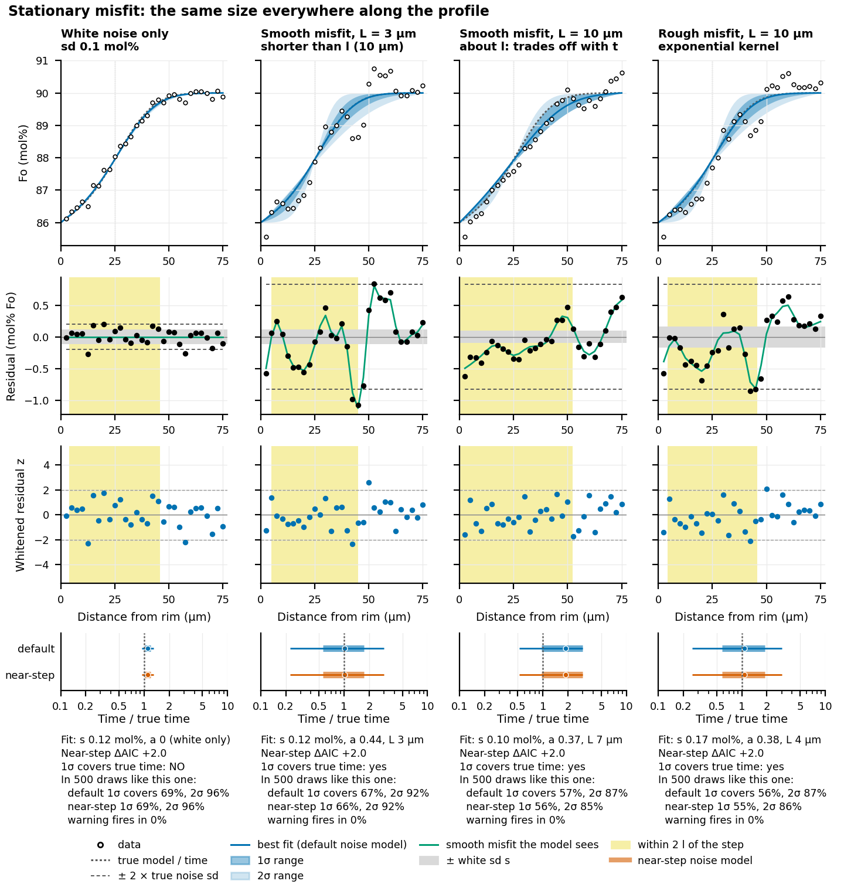
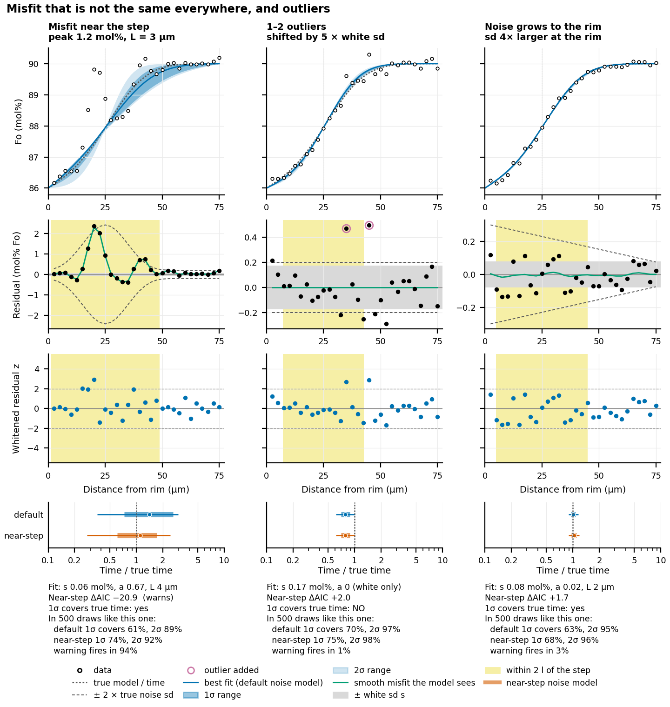
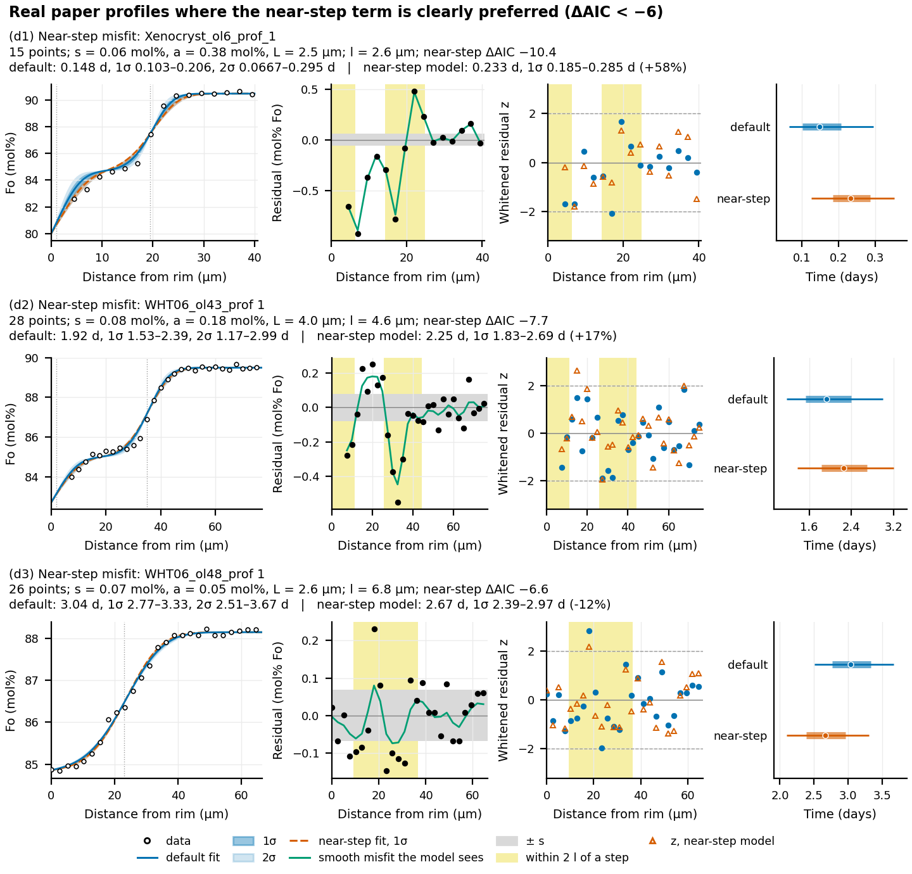

# How the fit works

This page explains how FORSTER finds the best-fit time and its 1σ and 2σ ranges, what
those ranges assume, and what each of its checks and warnings looks for. The full
method, with its derivation, sources and validation, is in
[likelihood-method.md](https://github.com/whtowbin/Olivine_Diffusion_FeMg/blob/master/docs/references/likelihood-method.md)
on GitHub.

## 1. The model

FORSTER starts from your step-shaped starting profile and solves the diffusion
equation for Fe-Mg exchange along it. The diffusivity D depends on Fo, temperature,
pressure, oxygen fugacity and the direction of the profile in the crystal ([Setting up
a run](setup.md)). Because D depends on Fo, it changes along the profile, so the
steps do not relax symmetrically. Edge 1 is held at its Fo. The far end is held at the
core's Fo, or mirrored at the crystal's center with `centre_um`.

The model runs **once**, forward in time, and the modeled profile at every time step
is compared with the measured points. FORSTER therefore never has to guess the time:
it tries every time step. The run stops once it is well past the best fit, at twice
the best time so far with the misfit four times its minimum and still rising. This
gives the same answer as running to `max_time_days`, several times faster.

## 2. Comparing the model with the data

At each time step, the **residuals** are the measured Fo minus the model Fo at each
measured point. FORSTER measures the misfit with **chi-squared** (χ²): it divides
each residual by the expected size of the error on that point, squares the result and
sums over the points. The best fit is the time with the smallest χ².

What should the expected size of the error be? Plain χ² assumes that each point's
error is independent of its neighbors' and that its size is known. Real profiles
break both assumptions:

- **The model never fits perfectly.** The starting profile may not be quite the right
  shape, the beam may average over a few microns, and the profile may not be quite
  perpendicular to the zoning. Each of these leaves a smooth misfit, so neighboring
  residuals share a sign. Counting such points as independent overstates the
  evidence. Ten analyses on the same bump of misfit carry one piece of information
  about it, not ten.
- **The analytical error is rarely known well** and is often underestimated.

## 3. The noise model

The **noise model** is FORSTER's description of the residuals. It has two parts, and
both are fitted to your residuals:

- Scatter that is independent from point to point, like analytical precision. This is
  **white noise**, with standard deviation *s* (`white_sigma_fo`).
- A smooth misfit shared by points closer together than about a length *L*
  (`correlation_length_um`). This is the **correlated misfit**, with amplitude *a*
  (`correlated_sigma_fo`). *a* = 0 means white noise alone was enough.

FORSTER chooses *s*, *a* and *L* as the values under which the observed residuals are
most probable (**maximum likelihood**). A penalty stops the noise from being made
arbitrarily large to absorb a bad fit. The three numbers are fitted at a first best
fit made with white noise only. χ² is then recomputed for every time with the fitted
noise model.

In effect, points on the same stretch of smooth misfit count together as one piece of
information. The smooth part of the profile then carries roughly (profile length ÷ L)
independent pieces of information, rather than one per point. FORSTER does this by
**whitening** the residuals: the noise model transforms them so that, if the noise
model is right, they become independent and all of the same size, like draws from a
standard normal distribution. χ² is computed from the whitened residuals. If the
whitened residuals still show runs of the same sign, or values well beyond ±2, the
noise model has missed something. FORSTER's checks (section 5) look for the common
cases.

The figures below show synthetic profiles of known age, each with one kind of misfit
added. Each profile has 30 points 2.5 µm apart, a 4 mol% step, a true diffusion length
of 10 µm and 0.1 mol% white noise. The rows show the data and the fit with its 1σ and
2σ bands; the raw residuals (green: the smooth misfit the noise model sees; yellow:
within two diffusion lengths of the step); the whitened residuals; and the fitted time
divided by the true time.

*Misfit of the same size along the whole profile. With white noise only, the residuals
look the same before and after whitening, and the 1σ range covers the true time 69% of
the time (target 68%). With a smooth misfit shorter than the diffusion length, the raw
residuals run in stretches of the same sign, the whitened ones do not, and coverage
stays right (67%). A smooth misfit about as long as the diffusion length looks like a
slightly older or younger profile. The model cannot tell the two apart, and coverage
falls to 57%.*

*Misfit concentrated near the step (left) lowers 1σ coverage to 61%. One or two
outliers (middle) widen the range but leave coverage right. Scatter that grows toward
the rim (right) lowers coverage to 63%.*

## 4. The ranges

The **1σ range** is the range of times over which χ² stays within a threshold of its
minimum. It should contain the true time 68% of the time. With many points the
threshold is 1, the textbook rule. With few points it is a little larger, because the
noise was estimated from the same few residuals and could have come out too small:

| Points | Threshold | Range wider than with 1 by |
|---|---|---|
| 6 | 1.48 | ×1.22 |
| 10 | 1.25 | ×1.12 |
| 15 | 1.15 | ×1.07 |
| 29 | 1.07 | ×1.04 |
| 100 | 1.02 | ×1.01 |

The **2σ range** (`low2_days`-`high2_days`) uses the threshold for 95.45% in the same
way. It should contain the true time 95% of the time. We tested these ranges by
fitting thousands of synthetic profiles of known age exactly as FORSTER fits real
data, and counting how often each range actually contained the true time. That
fraction is the **coverage**:

| Kind of misfit | 1σ covers | 2σ covers |
|---|---|---|
| White noise only | 69% | 96% |
| Smooth, shorter than the diffusion length | 67% | 92% |
| Smooth, about as long as the diffusion length | 57% | 87% |
| Concentrated near the step | 61% (45-61% in other tests) | 89% |
| One or two outliers | 70% | 97% |
| Scatter 4× larger at the rim | 63% | 95% |

The 1σ range is therefore right in the common cases. It is too narrow in three cases
that the diagnostics can flag, and then you should quote the 2σ range ([Reading the
results](results.md#warnings)). A range that assumed independent errors, as the
`legacy` method and most earlier software do, covered only 18-40% when real smooth
misfit was present.

!!! note "Best fit and median"
    The distribution of time is usually skewed toward longer times, so its median
    (shown in the time distribution figure) sits slightly later than the best fit:
    5.31 against 5.14 days for the worked example. Both are correct. Quote the best fit
    with its range, or the median with its central range, consistently.

### What the range does not include

The fit's range comes from the scatter and misfit of the data around the model. It
assumes the inputs are right:

- **The starting profile.** A step 3 µm out of place biased the time by 18%, and the
  single-fit range covered the true time only about 22% of the time. Fit the starting
  profile to include this uncertainty.
- **Temperature, pressure, oxygen fugacity and the diffusion law** (the equation that
  gives D). These scale D, and so the time, for every point at once, so the fit cannot
  see them.

[Uncertainty beyond the fit](uncertainty.md) adds both.

## 5. Checks and warnings

After each fit FORSTER runs a few checks. Each one is reported as a number in
`summary.csv` and, when it fires, as a warning (in the `warnings` column, printed by
`forster fit`, and shown under the plot in the app).

**Misfit concentrated near the step** (`near_step_daic`). The noise model assumes the
misfit is the same size along the whole profile. In real profiles the misfit is often
larger near the steps. That is where the information about time is, so the default
range is then too narrow. FORSTER compares the default noise model with a second one
whose misfit may be larger within about one diffusion length of each step. The
comparison uses the **AIC** (Akaike information criterion), a score that charges for
the extra parameter; lower is better. The change, ΔAIC, is reported as
`near_step_daic`. About +2 means no sign of near-step misfit; below -6 FORSTER
warns. In tests the check fired in at most 0.2% of fits whose noise model was
right, and in 76-94% of fits with strong near-step misfit on profiles of about 30
points or more. The check needs points near the step: `near_step_points` counts those
within two diffusion lengths, and with fewer than about 13 a silent check is weak
evidence. Near-step misfit usually means the starting profile is
slightly off near the step. Fitting the starting profile cleared the warning on every
profile tested.

*The three published profiles (Towbin and Plank 2026) where the near-step check
fires, fitted with the default noise model (blue) and with the near-step model
(orange). The residuals are largest in the yellow near-step zones. The near-step model
moves the best fit by -12% to +58%. In two of the three cases the new best fit lies
outside the default 1σ range, but in all three it lies inside the default 2σ range.*

**The profile ends too close to the step** (`core_end_diffusion_lengths`). The model
holds the core's Fo at the last measured point. If the data stop before the profile
has flattened, the held value steepens the modeled step and moves the time. FORSTER
reports the distance from the last step to the end of the model, in diffusion lengths,
and warns when it is below 3. Real plateaus start about 2 diffusion lengths past the
step. Measure further into the core, or, if the profile reaches the crystal's center,
model the whole crystal with `centre_um`.

**An unresolved diffusion front.** When the diffusion length at the best fit is
shorter than the spacing between points, only one or two points sit on the smoothed
step, and the near-step check sees almost none. FORSTER warns. Check that the fit has
not collapsed onto the step, and treat the range with care.

**The misfit spans the profile.** When the fitted misfit length L reaches half the
profile and the smooth misfit is at least half the white noise, the residuals drift
across the whole profile. The cause is usually a plateau or core level that sits off
the model's, or a step in the wrong place, rather than noise. Check the starting
profile and its held values.

**The range reaches the end of the model** (or time zero). Increase `max_time_days`,
or `scan_max_time_days` for the starting-profile fit.

**After fitting the starting profile** ([Uncertainty beyond the
fit](uncertainty.md#fitting-the-starting-profile)):

- **Still concentrated near the step** (`scan_near_step_daic` below -6): even the
  best-fit starting profile leaves misfit at the step. The starting profile may need a
  shape FORSTER does not have, such as a graded rim or growth during diffusion. Quote
  the 2σ range.
- **At the edge of the prior**: a fitted value reached the limit you allowed (2.5
  standard deviations for an `_sd` uncertainty, the end of a `_range`). The data want
  something outside it. Rethink the starting profile rather than widening the limit.
- **Prior conflict**: a fitted value lies 2 or more standard deviations from your
  nominal value (`scan_prior_offsets`). The prior and the data disagree, and the prior
  is pulling the fit. Check where the prior came from.

[Reading the results](results.md#warnings) has a table of what to do about each
warning.
