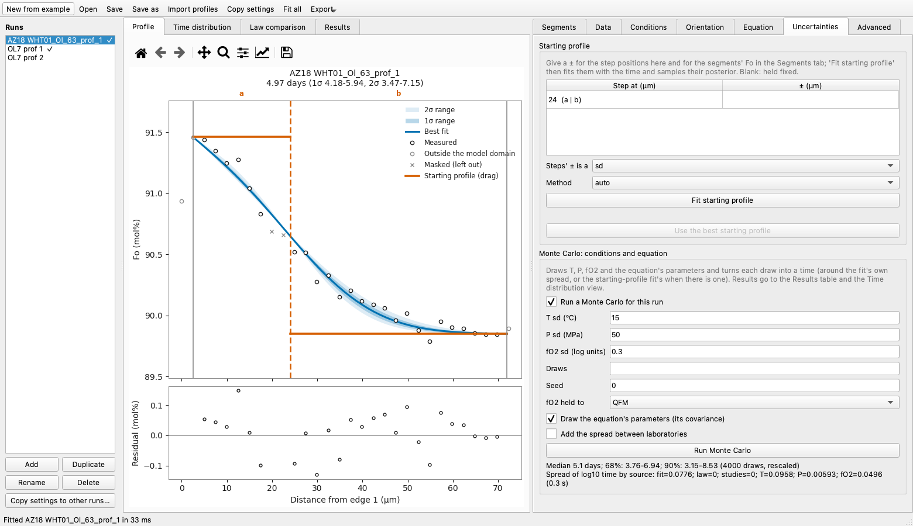
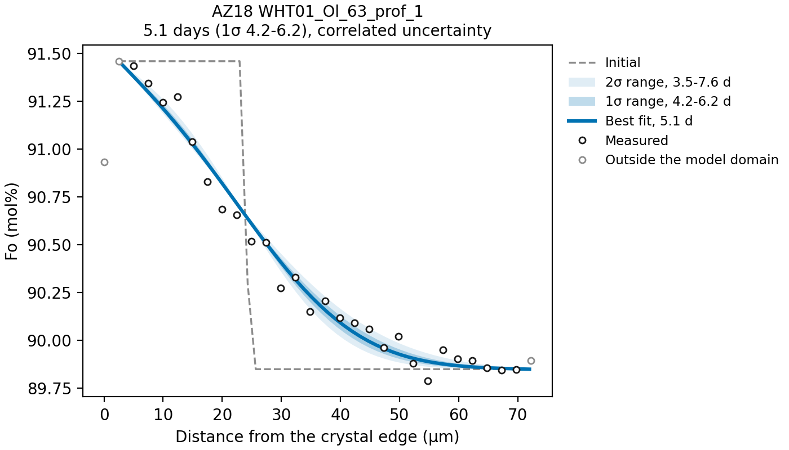
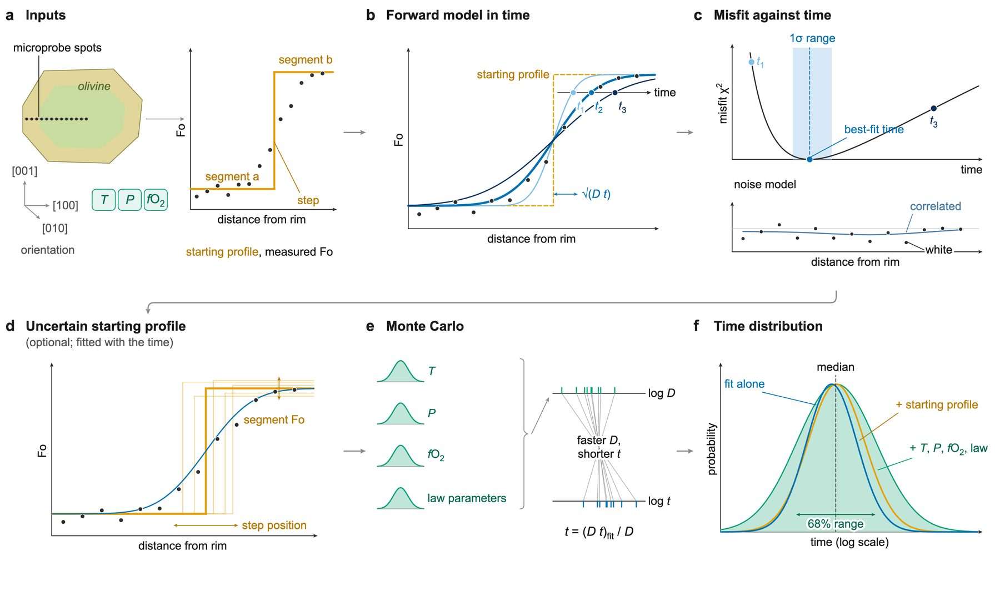

# FORSTER

**F**itting **O**livine **R**esidence & **S**torage **T**imescales from **E**lemental
**R**elaxation.

FORSTER fits Fe-Mg diffusion times to forsterite (Fo) profiles measured across zoned
olivine crystals. Zoning that growth left as sharp steps in Fo is smoothed by Fe-Mg
exchange while the crystal sits in hot magma; the wider the smoothed step, the longer
it sat. You give FORSTER the measured profile, the temperature, pressure and oxygen
fugacity during diffusion, the direction of the profile in the crystal, and a
step-shaped *starting profile* (your best guess at the zoning before diffusion). It
runs a diffusion model forward in time and reports the time whose model profile best
matches the data, with 1σ and 2σ ranges (the ranges that should contain the true time
68% and 95% of the time). It can also fit the starting profile itself, and propagate
the uncertainty of the temperature, pressure, oxygen fugacity and the diffusion law
into the time.

<figure markdown="span">
  
  <figcaption>The desktop app: the measured points (circles), the starting profile
  (orange, draggable), the best fit with its 1σ and 2σ bands and the residuals; on
  the right, the Uncertainties tab with a Monte Carlo over the conditions.</figcaption>
</figure>

<figure markdown="span">
  { width="640" }
  <figcaption>The figure <code>forster fit</code> writes for the worked example that
  comes with FORSTER (a published melt-vein olivine profile from Towbin and Plank
  2026): 5.1 days, 1σ range 4.2-6.2 days.</figcaption>
</figure>

## Three ways to use it

- **The desktop app** (`forster gui`): load profiles, draw the starting profile with
  the mouse, fit, and look at the results. No programming. [The desktop app](app.md).
- **The command line** (`forster fit`): two spreadsheets in, a folder of figures and
  a summary table out. Good for many profiles at once. [Quick start](quickstart.md).
- **Python** (`import forster`): everything above as functions, plus features not yet
  in the tables or the app (joint fits of several profiles of one crystal, Ni, Mn and
  Ca). [Python API](api.md).

All three read and write the same tables, so you can start in the app and rerun the
same fits from the command line, or the other way round.

## Where to go next

| If you want to... | Read |
|---|---|
| install FORSTER | [Installation](installation.md) |
| fit the worked example in five minutes | [Quick start](quickstart.md) |
| get your microprobe spreadsheet into FORSTER, and plan your analyses | [Preparing data](data.md) |
| choose the starting profile, conditions, orientation and diffusion law | [Setting up a run](setup.md) |
| understand what the time and its range mean | [How the fit works](how-it-works.md) |
| include the starting profile, T, P, fO2 and the law in the uncertainty | [Uncertainty beyond the fit](uncertainty.md) |
| read `summary.csv` and act on FORSTER's warnings | [Reading the results](results.md) |
| look up a column | [Column reference](columns.md) |
| look up a term (diffusion length, prior, ESS, ...) | [Glossary](glossary.md) |

*From inputs to a time distribution. **a** the inputs: a measured Fo profile, the
conditions, the orientation and a step-shaped starting profile. **b** the model is
run forward in time; the step widens as the diffusion length √(D t). **c** each time
step is compared with the data; the best fit is the minimum of the misfit, and the
range is where the misfit rises by about 1. **d** optionally, uncertain step
positions and segment Fo are fitted with the time. **e** a Monte Carlo draws T, P,
fO2 and the diffusion law's parameters. **f** the resulting time distributions.
Curves are illustrative.*

## Status

FORSTER is in development (version 0.1.0.dev0) and not yet on PyPI. Results from this
version differ from earlier versions of this code; the
[changelog](changelog.md) says what changed and by how much.

## How to cite

> Towbin, W. H., and Plank, T. (2026). *Journal of Petrology* 67(9), egag077.

Please also cite the diffusion law you used (see
[Setting up a run](setup.md#the-diffusion-law)). Some of the references FORSTER
cites are still being confirmed before the first release; the list is in
[citations-to-confirm.md](https://github.com/whtowbin/Olivine_Diffusion_FeMg/blob/master/docs/references/citations-to-confirm.md)
on GitHub.
