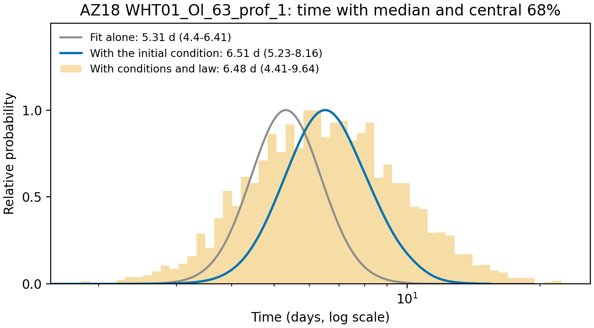
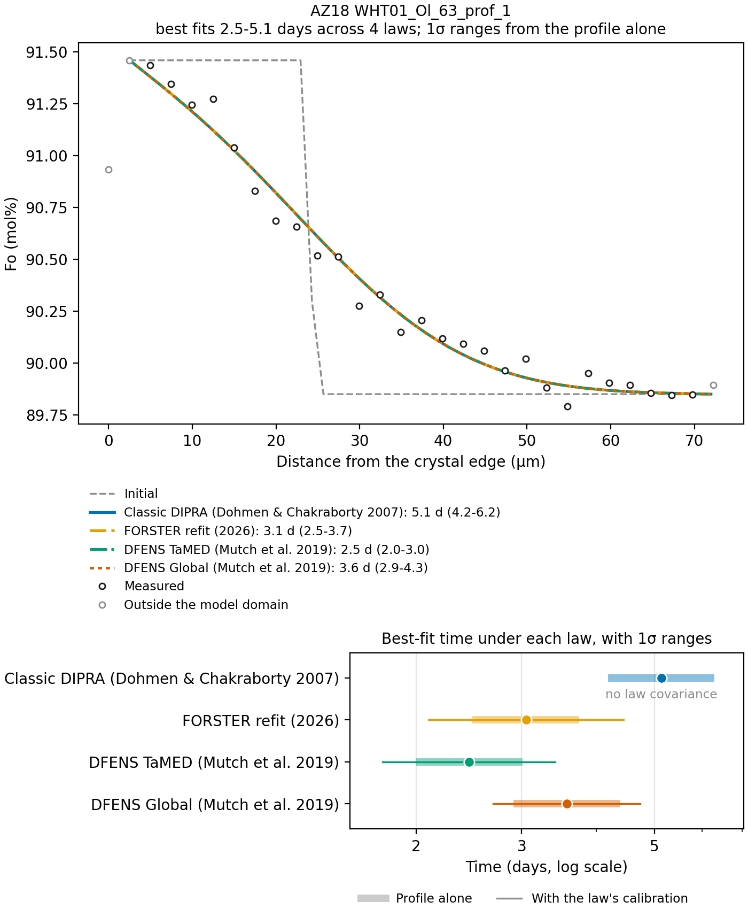

# Quick start

This page fits the worked example that comes with FORSTER, using the command line.
It explains the outputs and then shows how to replace the example with your own data.
It takes about five minutes. The [desktop app](app.md) does the same through buttons,
and `forster gui my_fits/` opens the same example.

## 1. Write the template

```bash
forster template my_fits/
```

This writes four files into `my_fits/`:

| File | What it is |
|---|---|
| `profiles.csv` | The measured points: one row per analysis, with the profile name, the distance from the crystal edge (µm) and Fo as a fraction. |
| `parameters.csv` | The model runs: one row per fit, saying which profile to fit and with what conditions, orientation and starting profile. |
| `diffusivities.csv` | The built-in diffusion equations, as a table you can copy to add your own (optional). |
| `COLUMNS.md` | A description of every column (the same as the [Column reference](columns.md)). |

The template already holds a worked example: the published profile AZ18
WHT01_Ol_63_prof_1 from Towbin and Plank (2026), measured on an olivine from a melt
vein in a mantle xenolith. Its row in `parameters.csv` holds these values:

| Column | Value | Meaning |
|---|---|---|
| `T_C`, `P_Pa` | 1250, 5e8 | 1250 °C and 0.5 GPa during diffusion. |
| `fO2_buffer`, `fO2_delta_log` | QFM, 0.3 | Oxygen fugacity 0.3 log units above the quartz-fayalite-magnetite buffer. |
| `phi1_deg`, `Phi_deg`, `phi2_deg`, `profile_angle_deg` | 77, 61.2, 334.2, -80 | The crystal's orientation from EBSD and the profile's direction on the EBSD map. |
| `domain_start_um`, `domain_end_um` | 2.5, 72 | The part of the profile that is modeled. |
| `steps_um`, `segment_fo` | 24, "0.9146, 0.8985" | The starting profile: Fo 0.9146 from the edge to a step at 24 µm, then 0.8985. |
| `max_time_days` | 40 | The longest time the model runs. |

[Setting up a run](setup.md) explains each of these.

## 2. Fit it

```bash
forster fit my_fits/profiles.csv my_fits/parameters.csv --out my_fits/results
```

```text
[1/1] AZ18 WHT01_Ol_63_prof_1
  5.14 days (4.24-6.21)
1 of 1 runs fitted; results in my_fits/results, summary in my_fits/results/summary.csv
```

The best-fit time is 5.14 days, and the **1σ range** is 4.24-6.21 days. Given the
data and the inputs, this range should contain the true time about 68% of the time.
The fit takes about two seconds.

## 3. Look at the outputs

`my_fits/results/` now holds:

| File | What it holds |
|---|---|
| `<run>_fit.png` | The figure below. |
| `<run>_curves.csv` | The model profile at time zero, at the best fit and at the ends of the 1σ and 2σ ranges, on the model's grid. Plot these in your own software. |
| `<run>_points.csv` | The fitted measured points, the best fit at each one and the residual (measured minus model). |
| `summary.csv` | One row per run: the time, its ranges, the fit statistics and every input. |
| `diffusivities.csv` | The diffusion equations the runs used, so the summary can be refitted exactly. |

(`<run>` is the run name with its spaces replaced, here `AZ18_WHT01_Ol_63_prof_1`.)


*The fit figure. Circles are the measured points. Gray circles lie outside the
modeled part of the profile and are not fitted. The dashed line is the starting
profile and the blue line is the best fit. The 1σ and 2σ bands are bounded by the
model profiles at the ends of each range.*

The first columns of `summary.csv` for this run:

| Column | Value | Meaning |
|---|---|---|
| `time_days` | 5.14 | Best-fit time. |
| `low_days`, `high_days` | 4.24, 6.21 | 1σ range. |
| `low2_days`, `high2_days` | 3.47, 7.56 | 2σ range (95%). |
| `white_sigma_fo` | 0.00055 | Point-to-point scatter fitted to the residuals: 0.055 mol% Fo. Compare with your analytical precision. |
| `correlated_sigma_fo`, `correlation_length_um` | 0.00044, 4.0 | A smooth misfit of 0.044 mol% over about 4 µm that the model does not follow ([How the fit works](how-it-works.md)). |
| `near_step_daic` | -0.76 | No sign that the misfit is concentrated near the step (a warning appears below -6). |
| `core_end_diffusion_lengths` | 4.4 | The data run 4.4 diffusion lengths past the step, enough to reach the flat core (a warning appears below 3). |
| `points_outside_domain` | 3 | Points before 2.5 µm or past 72 µm, not fitted. |
| `grid_error_pct` | 0.31 | Worst-case error of the time from the model's grid spacing. |
| `warnings` | (empty) | No warnings for this run. |

[Reading the results](results.md) goes through every column and every warning.

## 4. Add uncertainties (optional)

The 1σ range above assumes that the starting profile, temperature, pressure, oxygen
fugacity and diffusion law are exactly right. To include their uncertainties, add
columns to `parameters.csv`. This example has a step position known to ±2 µm, the Fo
of the two segments known to ±0.002, and temperature, pressure and fO2 known to
±20 °C, ±0.1 GPa and ±0.3 log units (all 1σ):

```text
steps_sd_um,segment_fo_sd,mc_T_sd_C,mc_P_sd_Pa,mc_fO2_sd_log
2,"0.002, 0.002",20,1e8,0.3
```

```text
[1/1] AZ18 WHT01_Ol_63_prof_1
  fitting the initial condition (auto)
  5.14 days (4.24-6.21)
  with the conditions and the law: 6.48 days (4.41-9.64; 90%: 3.49-12.38)
  with initial-condition uncertainty: 6.23 days (5.25-8.20); best step1_um=21.329; a_fo=0.915639; b_fo=0.898575
  79% of the variance of time from the initial condition (laplace, 1145 model runs)
```

FORSTER now fits the step position and the two Fo values along with the time. It
prefers a step at 21.3 µm over 24 µm, and the range of time that includes this
uncertainty is 5.25-8.20 days. It then draws temperature, pressure and fO2 at random
to give the final distribution: median 6.48 days, 68% range 4.41-9.64 days. Two more
files appear, `<run>_scan.csv` (the distribution of time over the starting profile)
and `<run>_mc.csv` (the Monte Carlo draws), along with a third figure:



*`<run>_time.png`. The distribution of time from the fit alone (gray), with the
starting profile's uncertainty added (blue), and with the conditions and the
diffusion law added as well (histogram). Each legend entry gives the median and the
central 68%. The median from the fit alone (5.31 days) differs slightly from the best
fit (5.14 days) because the distribution of time is skewed toward long times.*

[Uncertainty beyond the fit](uncertainty.md) explains both steps.

## 5. Compare diffusion laws (optional)

The `--compare-laws` option fits the run once with each of the four built-in Fe-Mg
diffusion laws:

```bash
forster fit my_fits/profiles.csv my_fits/parameters.csv --out my_fits/laws --compare-laws
```



*`<run>_laws.png`. The four fits look the same because a profile fixes the product
D × t, not t itself. The times differ (2.45-5.14 days) because the laws give
different D at these conditions. Thick bars show the 1σ range from the profile alone.
Thin bars add the law's own calibration uncertainty, for the laws that publish one.*

The spread between laws is often larger than the fit's own range. [Setting up a
run](setup.md#the-diffusion-law) explains the four laws.

## 6. Use your own data

1. Replace the rows of `profiles.csv` with your measured points, one row per
   analysis (or convert your microprobe spreadsheet with `forster import`; see
   [Preparing data](data.md)).
2. Replace the row of `parameters.csv` with one row per profile you want to fit.
   Fill in at least `run`, `profile`, `T_C`, `P_Pa`, one form of fO2, one form of
   orientation, `domain_start_um`, `domain_end_um`, `steps_um` and `segment_fo`.
3. Run `forster fit` again. If a run fails (because its profile is missing, for
   example), FORSTER reports it, skips it and fits the others.

Useful options:

| Option | Does |
|---|---|
| `--run NAME ...` | Fits only the named runs. |
| `--profiles-sheet`, `--parameters-sheet` | Picks the sheet when the tables are Excel files (.xlsx). |
| `--diffusivity NAME` | Fits every run with one diffusion law, whatever the `diffusivity` column says. |
| `--compare-laws` | Fits every run with each of the four built-in laws. |
| `--diffusivities FILE` | Reads your own diffusion equations from a table like `diffusivities.csv`. |

`summary.csv` uses the same column names as the parameter table, so you can give it
back to `forster fit` as a parameter table to repeat the same fits. If a run used your
own diffusion equation, add `--diffusivities results/diffusivities.csv`.

## The same from Python

```python
import forster

profiles = forster.read_profiles("my_fits/profiles.csv")
runs = forster.read_runs("my_fits/parameters.csv")
result = forster.fit_run(runs[0], profiles)
print(result.time_days, result.time_minus_days, result.time_plus_days)
forster.plot_fit(result)
```

Without tables, you can fit arrays directly:

```python
from forster import Conditions, InitialCondition, Orientation, Profile, choose_grid, fit_profile

profile = Profile(distance_um, fo, name="my profile")          # Fo as a fraction
conditions = Conditions.from_buffer(T_C=1250, P_Pa=5e8, delta_log=0.3, buffer="QFM")
orientation = Orientation.from_euler(77.0, 61.2, 334.2, profile_angle_deg=-80)
initial = InitialCondition(domain_um=(2.5, 72), steps_um=(24,), segment_fo=(0.9146, 0.8985))
grid = choose_grid(profile, conditions, orientation, initial).grid
result = fit_profile(profile, conditions, orientation, initial, grid)
```

See the [Python API](api.md).
