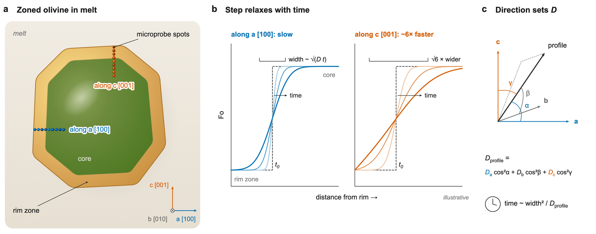

# Setting up a run

A **run** is one fit of one measured profile. It is one row of `parameters.csv`, or one
entry in the app's run list. The run names the profile to fit and gives the model
everything else it needs: the starting profile, the conditions during diffusion, the
profile's direction in the crystal, and the diffusion law. This page goes through each
in turn and says how it changes D (the diffusivity) and the fitted time.

Diffusion smooths a step over a width that grows with the **diffusion length**,
l = √(D t). A measured profile therefore fixes the product D × t, and not t alone.
Anything that doubles D halves the fitted time. This is why the conditions, the
orientation and the diffusion law matter as much as the fit itself.



*Why the profile's direction matters. **a** A zoned olivine with microprobe traverses
along [100] and [001]. **b** The same step smooths about √6 ≈ 2.4 times wider along
[001], where Fe-Mg diffusion is about six times faster. **c** For any other direction,
D along the profile combines the values along the three axes, weighted by the angles
between the profile and each axis. The time scales as width² / D. Illustrative curves.*

## The starting profile

The **starting profile** (also called the initial condition) is the Fo profile before
diffusion began. It is your interpretation of the zoning the crystal had when it grew.
FORSTER models it as **segments** of constant Fo separated by sharp **steps**.

| Column | Example | Meaning |
|---|---|---|
| `domain_start_um` | 2.5 | Start of the model, **edge 1**: the end of the profile where Fo is held (usually the crystal rim). |
| `domain_end_um` | 72 | End of the model, the **far end**. Fo is held there at the last segment's Fo (the core), unless `centre_um` is given. |
| `steps_um` | 24 | Step positions, from edge 1 inward: one number, or several in quotes (`"10, 33"`). |
| `segment_fo` | "0.9146, 0.8985" | Fo of each segment, from edge 1 inward: one more value than steps. |
| `segment_names` | "rim, core" | Optional labels. Empty: a, b, c, ... |

For a profile with one step (a rim zone around a core):

```text
domain_start_um,domain_end_um,steps_um,segment_fo
2.5,72,24,"0.9146, 0.8985"
```

For a profile with two steps (a rim zone, a plateau and the core), `steps_um` =
`"6, 35"` and `segment_fo` = `"0.827, 0.850, 0.895"`.

What to keep in mind:

- **The model domain.** Only points between `domain_start_um` and `domain_end_um` are
  fitted (`points_outside_domain` in `summary.csv` counts the others). Leave points
  outside the domain only when they belong to something the model does not describe,
  such as an earlier growth stage or a crack. Extend the domain to include the whole
  measured plateau ([Preparing data](data.md#collecting-profiles)).
- **Edge 1 is held during diffusion** at the first segment's Fo. If the rim was held at
  a different value, for instance by a melt of different composition, give that value
  as `edge1_fo`. The first segment's Fo is then used only as the starting value.
- **The far end is held at the core's Fo.** This is a *half profile*. The model assumes
  the core is large enough that diffusion never reaches the far end, which is why the
  data should reach the flat core. For a profile that reaches the center of a small
  crystal, see the next section.
- **The time is very sensitive to the core's Fo.** On profiles with short plateaus, a
  core Fo off by 0.1-0.2 mol% moved the time by 5-21%, and nothing warns. If you are
  not sure of the core Fo, give it an uncertainty and let FORSTER fit it ([Uncertainty
  beyond the fit](uncertainty.md#fitting-the-starting-profile)).
- **Steps should sit where the zoning was sharp.** A zone that grew while diffusion was
  going on, or a graded rim, is not a sharp step. FORSTER's warnings about misfit near
  the step often point to this ([Reading the results](results.md#warnings)).

### Whole crystals: `centre_um`

In a small crystal a profile may reach, or nearly reach, the center. Diffusion from the
rims has then reached the core, and the core's Fo is no longer fixed. Give the distance
to the crystal's center as `centre_um`. The model then runs from edge 1 to the center,
past the measured points if needed, and **mirrors** the profile there. Diffusion from
the opposite rim meets it at the center, so by symmetry no Fe or Mg crosses the center,
and the core is free to change. This option needs the implicit scheme and no growth
stages.

## Conditions

| Column | Unit | Meaning |
|---|---|---|
| `T_C` | °C | Temperature during diffusion. |
| `P_Pa` | Pa | Pressure (5e8 is 0.5 GPa; 1e8 is 100 MPa). |
| `fO2_Pa` | Pa | Oxygen fugacity, **or**: |
| `fO2_buffer`, `fO2_delta_log` | | A buffer (QFM, also written FMQ, or NNO, after Frost 1991) and the offset from it in log units. |

The table below gives the effect of each change on D and on the time, for the default
diffusion law near 1200 °C.

| Change | Effect on D | Effect on the time |
|---|---|---|
| +10 °C | about ×1.12 | about ×0.89 |
| +100 MPa | about ×0.94 | about ×1.06 |
| +1 log unit fO2 | ×1.47 (D ∝ fO2^1/6) | ×0.68 |
| 1 mol% lower Fo | ×1.07 | (built into the model: D changes along the profile) |

Temperature matters most. A ±30 °C uncertainty alone moves the time by about -30% to
+40%. An fO2 given relative to a buffer is recalculated for the run's temperature and
pressure, and in the Monte Carlo it follows each drawn temperature
([Uncertainty beyond the fit](uncertainty.md#the-monte-carlo-over-t-p-fo2-and-the-law)).

## Orientation

Fe-Mg diffusion in olivine is **anisotropic**. In all four built-in laws it is six
times faster along [001] (the c axis) than along [100] or [010]. For a profile at
angles α, β and γ to [100], [010] and [001], D along the profile is

D_profile = D[100] cos²α + D[010] cos²β + D[001] cos²γ

If a profile parallel to [001] is modeled with D for [100], the fitted time comes out
six times too long. Give the orientation in one of two forms:

| Columns | Meaning |
|---|---|
| `alpha_deg`, `beta_deg`, `gamma_deg` | Angles between the profile and [100], [010] and [001], in degrees (cos²α + cos²β + cos²γ = 1). |
| `phi1_deg`, `Phi_deg`, `phi2_deg`, `profile_angle_deg` | EBSD Euler angles (Bunge convention) and the direction of the profile on the EBSD map, measured from the map's positive x axis (east). FORSTER converts them to the three angles (`summary.csv` reports both). |

Leave the other form empty. For the worked example the Euler angles give α = 57°,
β = 77° and γ = 36°, so D along the profile is 0.71 × D[001].

## The diffusion law

The **diffusion law** is the diffusivity equation that gives D from temperature,
pressure, oxygen fugacity, Fo and direction. FORSTER offers four Fe-Mg laws, chosen in
the `diffusivity` column or in the app's Equation tab.

| Choice | Law | What it is |
|---|---|---|
| `dipra` (default) | Dohmen and Chakraborty (2007) | The law most olivine timescale studies use, as tabulated in the DIPRA program (Girona and Costa 2013). fO2 exponent 1/6, activation energy 201 kJ/mol, activation volume 7 cm³/mol, [100] and [010] six times slower than [001]. Published without a parameter covariance, so FORSTER cannot give its calibration uncertainty. |
| `refit` | FORSTER's 2026 refit | The same form refitted to 132 diffusion coefficients from four experimental studies, with each laboratory allowed its own offset. Fitted values: activation energy 209 kJ/mol, fO2 exponent 0.216, activation volume 7.5 cm³/mol. Carries a covariance and the spread between laboratories. |
| `dfens_tamed` | Mutch et al. (2019), "TaMED" regression | A regression of a larger compilation of experiments for the transition-metal-extrinsic diffusion mechanism, which applies at natural fO2. Used by the DFENS program (Mutch et al. 2021). Activation energy 222 kJ/mol, fO2 exponent 0.22. Carries a covariance. |
| `dfens_global` | Mutch et al. (2019), "Global" regression | The same paper's regression of all the compiled data. Activation energy 221 kJ/mol, fO2 exponent 0.19. Carries a covariance. |

**What the choice changes.** All four laws have the same form. They differ in the
overall level of D and in how D depends on fO2 and temperature, so the gap between
them changes with conditions. For the worked example (1250 °C, QFM+0.3) the times are
5.14 days (`dipra`), 3.05 (`refit`), 2.45 (`dfens_tamed`) and 3.57 (`dfens_global`).
That is a factor of two between laws, larger than the fit's own range. Compare laws on
your own runs with `forster fit --compare-laws` or the app's Law comparison view, and
**report which law you used with every time**.

**The law ranges.** Laws that carry a covariance (all but `dipra`) add more ranges to
`summary.csv`. `law_low_days`-`law_high_days` includes the uncertainty of the fitted
law (about ±0.13 log units in D near 1200 °C for `refit`). For `refit`,
`all_low_days`-`all_high_days` also includes the spread between laboratories. To
compare crystals fitted with the same law, use the fit-only range
(`low_days`-`high_days`), because the law's error is common to all of them. For a time
on its own, use the law ranges ([Uncertainty beyond the fit](uncertainty.md#law-ranges)).

**What newer experiments say.** Later work supports the Dohmen and Chakraborty law up
to about 1150 °C. Above that, newer experiments find faster diffusion along [010] and
higher activation energies, and experiments with melt present found Fe-Mg diffusion
about ten times faster than the solid-source calibrations. Every difference found
above 1150 °C points to faster diffusion, so at those temperatures times from the
default law are more likely too long than too short. The sources and the size of each
effect are in
[diffusivity-literature.md](https://github.com/whtowbin/Olivine_Diffusion_FeMg/blob/master/docs/references/diffusivity-literature.md)
and the refit in
[femg-refit2026.md](https://github.com/whtowbin/Olivine_Diffusion_FeMg/blob/master/docs/references/femg-refit2026.md)
on GitHub.

**Your own law.** `forster template` writes a `diffusivities.csv`. Copy one of its
rows, give it a new name and change the values. Put that name in the `diffusivity`
column and run `forster fit ... --diffusivities diffusivities.csv`. The equation and
its columns are in the [Column reference](columns.md#diffusivitiescsv).

## Grid and scheme

The model solves the diffusion equation by finite differences on a grid of points dx
apart, in time steps of dt. You can leave all of this to FORSTER.

| Column | Default | Meaning |
|---|---|---|
| `dx_um` | chosen | Grid spacing. Empty: a quick coarse fit gives the diffusion length l, and the final fit uses dx = l / 8 (about 0.3% accuracy in the time). |
| `dt_s` | chosen | Time step. Empty: 1/400 of the fitted time. |
| `max_time_days` | 200 | Longest time modeled. Set it a few times longer than the time you expect. A warning says if the range reaches the end. |
| `scheme` | implicit | `implicit` (TR-BDF2 time steps, stable at any step size; second-order accurate in dx). `central` and `dipra` are explicit schemes kept to reproduce earlier results (`dipra` is DIPRA's numerical scheme, not the diffusion law). |

FORSTER keeps any values you give and checks them, with a warning if dx is coarse or
wastefully fine. `summary.csv` reports `grid_resolution` (diffusion length over dx) and
`grid_error_pct` (the estimated worst-case error of the time from the grid). It also
records the grid actually used, so a refit reproduces it. A memory guard
(`FORSTER_MAX_CURVES_GB`, default 4 GB) stops a fit whose grid would need more memory
than that. If it stops a fit, fix the grid instead of raising the limit.

## Other columns

| Column | Meaning |
|---|---|
| `uncertainty` | `correlated` (default; [How the fit works](how-it-works.md)) or `legacy` (the rule of earlier versions, which compared the model with a kriged interpolation of the data; kept only to reproduce old results). |
| `stage_days`, `stage_rim_um`, `stage_zone_fo`, `stage_rim_fo` | Growth stages: zones that grew partway through ([Advanced](advanced.md#growth-stages)). |
| `steps_sd_um`, `segment_fo_sd`, ... `scan_*` | Uncertainty on the starting profile ([Uncertainty beyond the fit](uncertainty.md#fitting-the-starting-profile)). |
| `mc_*` | The Monte Carlo over T, P, fO2 and the law ([Uncertainty beyond the fit](uncertainty.md#the-monte-carlo-over-t-p-fo2-and-the-law)). |
| `crystal`, `sample` | Which crystal and rock the profile comes from. Carried through for now. Joint fits of a crystal's profiles are available from Python ([Advanced](advanced.md#joint-fits-of-one-crystal)). |
| `notes` | Free text for your records. |

Every column, with its unit and default, is in the [Column reference](columns.md).
