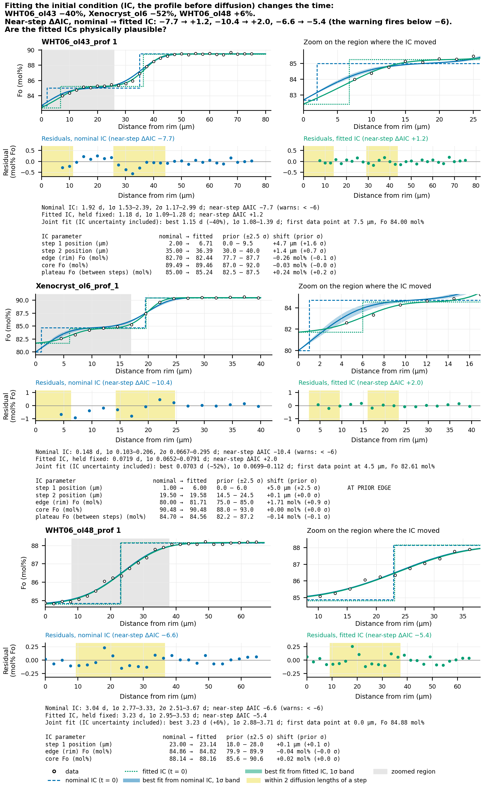

# Uncertainty beyond the fit

The fit's own range ([How the fit works](how-it-works.md)) takes the starting profile,
the conditions and the diffusion law as exact. This page adds them, in three steps
that build on each other:

1. **Fitting the starting profile**: uncertain step positions and segment Fo are
   fitted together with the time.
2. **The Monte Carlo over T, P, fO2 and the law**: the conditions and the law's
   parameters are drawn, and each draw is turned into a time.
3. **Law ranges**: a quick version of the law part, reported for every fit with a
   law that carries a covariance.

A few terms used below:

- A **prior** is what you know about a parameter before looking at this profile,
  written as a nominal value and an uncertainty: a Gaussian 1σ (`_sd` columns) or a
  uniform ± half-width (`_range` columns; every value in the range equally likely).
- The **posterior** is what you know after fitting: the prior combined with what the
  profile says. FORSTER reports the posterior of time *marginalised* over the starting
  profile, meaning averaged over every starting profile the posterior allows, each
  weighted by how probable it is.

## Fitting the starting profile

### Giving the uncertainties

| Column | Meaning |
|---|---|
| `steps_sd_um` | 1σ (Gaussian) on the step positions: one value for all, or one per step (`"2, 5"`); 0 keeps a step fixed. |
| `steps_range_um` | ± half-width (uniform) on the step positions, instead of `steps_sd_um`. |
| `segment_fo_sd` | 1σ on each segment's Fo: one value for all, or one per segment (`"0.002, , 0.003"`; an empty entry keeps that segment fixed). |
| `segment_fo_range` | ± half-width on each segment's Fo, instead; a segment takes one of the two. |

For example, a step known to ±2 µm (1σ) and an edge Fo anywhere between 0.817 and
0.823 (a uniform ±0.003 around 0.82), with the core fixed:

```text
steps_um,segment_fo,steps_sd_um,segment_fo_range
41,"0.82, 0.90",2,"0.003, "
```

Gaussian priors are cut at ±2.5σ: the fit never goes beyond. In the app, give the
steps' ± in the Uncertainties tab and each segment's ± in the Segments tab, then press
**Fit starting profile**.

The first and last segments' Fo are also the values held at edge 1 and at the far end
during diffusion, so their uncertainty covers those boundary conditions too.

**What to give an uncertainty.** Anything you are unsure of, and especially:

- **the core Fo**, unless the plateau is visibly sloped: a core Fo 0.1-0.2 mol% off
  biased times by 5-21%, with no warning, and fitting it removed the bias;
- **the steps and plateau levels when the near-step warning fires**: on every
  profile with near-step misfit tested, fitting the starting profile cleared the
  warning (one only just), and on the published profiles below it moved the time by
  -40%, +6% and -52% (the last not reliable, see below). The starting profile matters
  more than the noise model.

### What the fit does, in plain words

1. **Best fit.** An optimiser moves the uncertain parameters (step positions, segment
   Fo) to find the starting profile that, together with the best time, fits the data
   best, penalised by the prior. Each try costs one model run, which gives the misfit
   at every time at once, so time is handled exactly rather than sampled. The noise
   model is fitted at the data's best fit (not at your nominal values) and refitted
   until it is stable.
2. **Sampling the posterior.** Around the best fit FORSTER builds a bell-shaped
   approximation of the posterior (a *Laplace approximation*: a multivariate Gaussian
   from the curvature of the misfit at its minimum, made a little wider and with
   heavier tails to be safe). It draws 1024 starting profiles from it and weights each
   by how much more or less probable it really is than the approximation says
   (*importance sampling*). The weighted draws give the exact posterior, up to sampling
   error.
3. **Checking the sample.** When a few draws carry most of the weight, the
   approximation was poor (a parameter the data hardly constrain across a wide prior,
   or two separate good fits). The **effective sample size** (ESS, `scan_ess`) measures
   this: the number of equally weighted draws the weighted sample is worth. Below 256
   (a quarter of the draws), the `auto` method switches to **nested sampling** (with
   the dynesty package), which explores the whole prior and is slower but robust.

Most profiles need about 1,000 model runs and under a second; wide uniform priors up
to about 15,000 runs. `scan_seed` fixes the random draws, so a summary refits to the
same numbers.

| `scan_method` | Does |
|---|---|
| `auto` (default) | Laplace importance sampling, with nested sampling when the ESS is too low. |
| `laplace` | Importance sampling only. |
| `nested` | Nested sampling only. |
| `grid` | Fits every node of a regular grid over the parameters (the method before 2026-10-15, kept for old results). It needs about 15 points per parameter to converge (`scan_points`), so it is slow for more than two parameters. |

`scan_dx_um`, `scan_dt_s` and `scan_max_time_days` set the grid of these model runs
(empty: chosen, coarser than the final fit, for about 5% accuracy).

### What it reports

| Column | Meaning |
|---|---|
| `scan_best_days` | The time at the best-fit starting profile. |
| `scan_median_days`, `scan_low_days`, `scan_high_days` | Median and central 68% of the posterior of time, including the starting profile's uncertainty. **This is the range to quote** once the starting profile is fitted. |
| `scan_best` | The best-fit values (`step1_um`, `a_fo`, `b_fo`, ...; segments are named by their labels). |
| `scan_ic_share` | The fraction of the variance of time that comes from the starting profile (the rest is the fit at a fixed starting profile). |
| `scan_sensitivity` | How much the expected time changes per µm of each step and per unit Fo of each segment. |
| `scan_prior_offsets` | Each fitted value's distance from its nominal value in prior units (`a_fo=+2.30` is 2.3σ above). |
| `scan_near_step_daic` | The near-step check, redone at the best-fit starting profile. |
| `scan_ess`, `scan_sampler`, `scan_candidates` | How the sample was made, and how many model runs it took. |
| `scan_log_evidence` | How probable the data are under this starting-profile model as a whole; compare one-step and two-step starting profiles fitted to the same profile (higher is better). |

`<run>_scan.csv` holds the posterior of time (days, probability density, cumulative).

For the worked example with a step known to ±2 µm and both segments' Fo to ±0.002
([Quick start](quickstart.md#4-add-uncertainties-optional)): the best step moves from
24 to 21.3 µm, the range including the starting profile is 5.25-8.20 days (against
4.24-6.21 days for the fit alone), and 79% of the variance of time comes from the
starting profile.

### Look at the fitted starting profile before quoting the time



*Nominal (blue, dashed) and fitted (green, dotted) starting profiles of three published
profiles (Towbin and Plank 2026), the best fit from each and their residuals.
**WHT06_ol43**: the first step moves from 2 to 6.7 µm and the plateau rises 0.24 mol%;
the residuals become white and the time falls 40%. **Xenocryst_ol6**: the first step
runs to the edge of its allowed range, past the first data point, and the time halves;
the data ask for a rim zone at least 6 µm wide, which a sharp step cannot represent, so
this time is not reliable. **WHT06_ol48**: little moves (+6%) and the near-step misfit
remains, a sign that a single sharp step does not explain it.*

- A value **at the edge of its prior** (FORSTER warns) means the data want something
  outside what you allowed. Rethink the starting profile rather than widen the prior.
- A value **2σ or more from nominal** (FORSTER warns of a prior conflict) means the
  prior is pulling against the data; check where the prior came from.
- Steps placed where there are no data (between the rim and the first point) are
  constrained only by the shape of the nearby points.
- If the near-step warning survives (`scan_near_step_daic` below -6), quote the 2σ
  range of the fit and consider a starting profile with another shape.

## The Monte Carlo over T, P, fO2 and the law

A **Monte Carlo** draws the uncertain inputs many times at random and looks at the
spread of the answers. Give any of these columns and `forster fit` runs one:

| Column | Default | Meaning |
|---|---|---|
| `mc_T_sd_C` | | 1σ of temperature (°C). |
| `mc_P_sd_Pa` | | 1σ of pressure (Pa). |
| `mc_fO2_sd_log` | | 1σ of log10 fO2. |
| `mc_fO2_buffer` | the run's buffer | QFM or NNO: draw fO2 relative to that buffer, so it rises and falls with each drawn temperature (as it does in nature for a buffered magma). Empty, with fO2 given in Pa: fO2 is drawn on its own. |
| `mc_law` | yes | Draw the diffusion law's parameters from its published covariance (the correlations between its fitted values). Laws without one, such as `dipra`, are taken as exact. |
| `mc_between_study` | no | Add the spread between laboratories (`refit` only): for an absolute time, if the crystal may sit off the laboratories' average as one more experiment would. |
| `mc_samples` | 4000 | Number of draws. |
| `mc_seed` | 0 | Fixes the draws. |

**How it works.** The fit fixes D × t. For each draw FORSTER computes D at the drawn
conditions with the drawn law and rescales the time: t = t_fit × D_fit / D_draw. The
fitted time itself is also drawn, from the fit's own distribution (or from the
starting-profile posterior when the starting profile was fitted), so the result
contains everything together. Rescaling is exact for a held rim and needs no new model
runs (milliseconds). Runs with growth stages are refitted for each draw instead (200
draws by default).

**What it reports.** `mc_median_days`, the 68% range `mc_low_days`-`mc_high_days`
(16th-84th percentiles) and the 90% range `mc_p05_days`-`mc_p95_days`; the draws in
`<run>_mc.csv`; and `mc_sd_log10`, the spread of log10 time from each source drawn on
its own, which tells you which input matters most. For the worked example with ±20
°C, ±0.1 GPa and ±0.3 log units:

```text
mc_median_days 6.48   mc_low_days 4.41   mc_high_days 9.64   (90%: 3.49-12.38)
mc_sd_log10    fit=0.0978; law=0; studies=0; T=0.128; P=0.0119; fO2=0.0496
```

Temperature (0.128 log units) contributes more than the fit and the starting profile
together (0.098); pressure hardly matters; the law contributes 0 because the default
law has no covariance (use `refit` or a DFENS law to include it).

`<run>_time.png` and the app's Time distribution view show all three distributions on
one axis ([Quick start](quickstart.md#4-add-uncertainties-optional)).

## Law ranges

Every fit with a law that carries a covariance (all built-in laws but `dipra`) also
reports, with no extra runs:

| Column | Meaning |
|---|---|
| `law_sigma_log10` | 1σ of log10 D from the law's covariance at the run's conditions (and so of log10 time). |
| `law_low_days`, `law_high_days` | The 1σ range of time with the law's uncertainty added to the fit's. |
| `between_study_log10` | The spread between laboratories in the law's calibration data (`refit`: 0.07 log units). |
| `all_low_days`, `all_high_days` | With that spread added as well. |

**Which range to quote.**

| You want to... | Quote |
|---|---|
| compare crystals fitted with the same law and conditions (relative times) | `low_days`-`high_days`: the law's error is common to all of them and cancels. |
| give a time on its own | `law_low_days`-`law_high_days`, or better the Monte Carlo range with your T, P and fO2 uncertainties. |
| give an absolute time that allows for the crystal sitting off the laboratories' average | `all_low_days`-`all_high_days`, or the Monte Carlo with `mc_between_study`. |

The law ranges are not available for runs with growth stages or a rim value that
changes in time, where the time no longer scales as 1/D (the Monte Carlo refits those
instead). The range assumes the law's form is right; the larger differences between
laws ([Setting up a run](setup.md#the-diffusion-law)) are a separate, systematic
question. What the law range assumes and where it was tested:
[law-uncertainty-limits.md](https://github.com/whtowbin/Olivine_Diffusion_FeMg/blob/master/docs/references/law-uncertainty-limits.md)
on GitHub.
